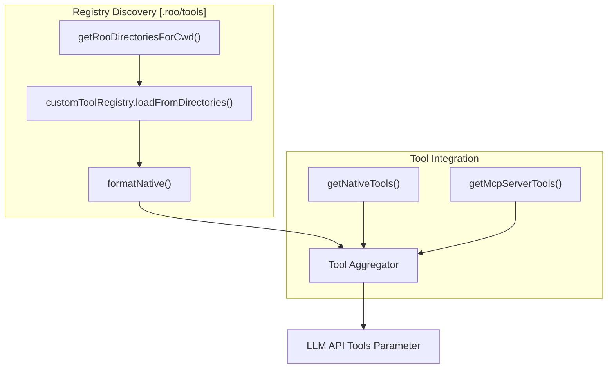
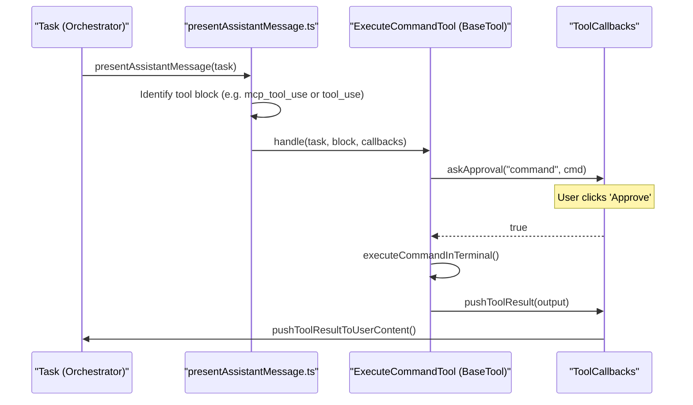

# Tool Architecture and Registry

<details>
<summary>Relevant source files</summary>

The following files were used as context for generating this wiki page:

- [packages/core/src/custom-tools/__tests__/custom-tool-registry.spec.ts](packages/core/src/custom-tools/__tests__/custom-tool-registry.spec.ts)
- [packages/types/src/tool.ts](packages/types/src/tool.ts)
- [src/core/assistant-message/NativeToolCallParser.ts](src/core/assistant-message/NativeToolCallParser.ts)
- [src/core/assistant-message/__tests__/presentAssistantMessage-custom-tool.spec.ts](src/core/assistant-message/__tests__/presentAssistantMessage-custom-tool.spec.ts)
- [src/core/assistant-message/__tests__/presentAssistantMessage-images.spec.ts](src/core/assistant-message/__tests__/presentAssistantMessage-images.spec.ts)
- [src/core/assistant-message/__tests__/presentAssistantMessage-unknown-tool.spec.ts](src/core/assistant-message/__tests__/presentAssistantMessage-unknown-tool.spec.ts)
- [src/core/assistant-message/presentAssistantMessage.ts](src/core/assistant-message/presentAssistantMessage.ts)
- [src/core/prompts/tools/native-tools/edit.ts](src/core/prompts/tools/native-tools/edit.ts)
- [src/core/prompts/tools/native-tools/edit_file.ts](src/core/prompts/tools/native-tools/edit_file.ts)
- [src/core/prompts/tools/native-tools/index.ts](src/core/prompts/tools/native-tools/index.ts)
- [src/core/tools/BaseTool.ts](src/core/tools/BaseTool.ts)
- [src/core/tools/EditFileTool.ts](src/core/tools/EditFileTool.ts)
- [src/core/tools/ExecuteCommandTool.ts](src/core/tools/ExecuteCommandTool.ts)
- [src/core/tools/SearchAndReplaceTool.ts](src/core/tools/SearchAndReplaceTool.ts)
- [src/core/tools/SearchReplaceTool.ts](src/core/tools/SearchReplaceTool.ts)
- [src/core/tools/WriteToFileTool.ts](src/core/tools/WriteToFileTool.ts)
- [src/core/tools/__tests__/editFileTool.spec.ts](src/core/tools/__tests__/editFileTool.spec.ts)
- [src/core/tools/__tests__/executeCommandTool.spec.ts](src/core/tools/__tests__/executeCommandTool.spec.ts)
- [src/core/tools/__tests__/searchAndReplaceTool.spec.ts](src/core/tools/__tests__/searchAndReplaceTool.spec.ts)
- [src/core/tools/__tests__/searchReplaceTool.spec.ts](src/core/tools/__tests__/searchReplaceTool.spec.ts)
- [src/core/tools/__tests__/writeToFileTool.spec.ts](src/core/tools/__tests__/writeToFileTool.spec.ts)
- [src/shared/tools.ts](src/shared/tools.ts)

</details>


## Purpose and Scope

This document describes the architecture of Roo Code's tool system, explaining how tools are defined, registered, discovered, and executed. It covers the `BaseTool` abstract class, the `ToolCallbacks` interface, the `customToolRegistry`, and the discovery of tools from `.roo/tools` and other workspace-specific directories.

Roo Code uses a multi-layered tool architecture that bridges natural language requests to code execution. It supports built-in native tools, Model Context Protocol (MCP) tools, and user-defined custom tools.

---

## BaseTool Abstract Class

The `BaseTool<TName>` abstract class provides the foundation for all tool implementations in Roo Code. Tools extend this class to implement their specific functionality while inheriting common lifecycle management and error handling.

### Class Structure

```typescript
export abstract class BaseTool<TName extends ToolName> {
    abstract readonly name: TName
    abstract execute(params: any, task: Task, callbacks: ToolCallbacks): Promise<void>
    
    async handle(task: Task, block: ToolUse<TName>, callbacks: ToolCallbacks): Promise<void>
    async handlePartial(task: Task, block: ToolUse<TName>): Promise<void>
}
```
[src/core/tools/BaseTool.ts:22]()

**Key responsibilities:**
- **`name`**: Unique identifier for the tool (e.g., `"read_file"`, `"execute_command"`, `"write_to_file"`). [packages/types/src/tool.ts:24-49]()
- **`execute()`**: Core implementation logic. It validates parameters, performs the operation (e.g., disk I/O or terminal execution), and returns results via callbacks. [src/core/tools/ExecuteCommandTool.ts:44-147](), [src/core/tools/WriteToFileTool.ts:29-194](), [src/core/tools/EditFileTool.ts:139-300]()
- **`handle()`**: The entry point called by the `Task` orchestrator. It extracts parameters from `toolUse.nativeArgs` (for the native protocol) or `toolUse.params` (legacy) and invokes `execute()`. [src/core/tools/BaseTool.ts:22]()
- **`handlePartial()`**: Manages streaming tool calls. This allows the UI to show what the AI is doing (e.g., which file it's about to read) before the full tool call is received. [src/core/tools/WriteToFileTool.ts:196-218](), [src/core/tools/ExecuteCommandTool.ts:149-152]()

**Sources:** [src/core/tools/BaseTool.ts:22](), [src/core/tools/ExecuteCommandTool.ts:41-153](), [src/core/tools/WriteToFileTool.ts:26-219](), [packages/types/src/tool.ts:24-49]()

---

## Tool Registry and Discovery

Roo Code supports a dynamic registry where tools are gathered from multiple sources before being presented to the LLM.

### Native and MCP Tool Discovery
The `getNativeTools` function provides the core set of tools available to the system. [src/core/prompts/tools/native-tools/index.ts:42-72]()

1.  **Native Tools**: Core tools like `read_file`, `write_to_file`, and `execute_command` are defined in the `native-tools` index. [src/core/prompts/tools/native-tools/index.ts:49-71]()
2.  **MCP Tools**: Tools provided by connected Model Context Protocol servers are gathered via `getMcpServerTools`. [src/core/prompts/tools/native-tools/index.ts:24]()
3.  **Custom Tools**: The system includes a `custom_tool` definition in the `toolNames` registry to support user-defined extensions. [packages/types/src/tool.ts:48]()

### customToolRegistry
The `customToolRegistry` manages tools discovered in the workspace. It is used during message presentation to handle execution of workspace-specific tools. [src/core/assistant-message/presentAssistantMessage.ts:7](), [packages/core/src/custom-tools/__tests__/custom-tool-registry.spec.ts:1-20]()


**Sources:** [src/core/prompts/tools/native-tools/index.ts:42-72](), [src/core/assistant-message/presentAssistantMessage.ts:7](), [packages/types/src/tool.ts:24-49]()

---

## Native Tool Calling Protocol

Roo Code uses a "Native Protocol" (OpenAI-style function calling) to communicate with models, while translating these calls into internal `ToolUse` objects.

### NativeToolCallParser
The `NativeToolCallParser` is responsible for assembling tool calls from streaming API chunks. [src/core/assistant-message/NativeToolCallParser.ts:53]()

- **`processRawChunk`**: Buffers `tool_call_partial` chunks and emits `tool_call_start`, `delta`, and `end` events. [src/core/assistant-message/NativeToolCallParser.ts:99-164]()
- **`startStreamingToolCall`**: Initializes state for a new tool call, supporting both standard and MCP tools (using `mcp--server--tool` naming). [src/core/assistant-message/NativeToolCallParser.ts:220-226]()
- **`parseStreamingArguments`**: Uses `partial-json` to parse arguments incrementally so the UI can update while the AI is still "typing" the JSON. [src/core/assistant-message/NativeToolCallParser.ts:246-290]()

### Tool Parameter Mapping
Tools define their arguments in `NativeToolArgs`. [src/shared/tools.ts:92-120]()

| Tool Name | Key Parameters | Source |
| :--- | :--- | :--- |
| `read_file` | `path`, `start_line`, `end_line`, `indentation` | [src/shared/tools.ts:94](), [src/shared/tools.ts:175-194]() |
| `write_to_file` | `path`, `content` | [src/shared/tools.ts:118](), [src/shared/tools.ts:196-199]() |
| `execute_command`| `command`, `cwd`, `timeout` | [src/shared/tools.ts:97](), [src/shared/tools.ts:169-173]() |
| `edit_file` | `file_path`, `old_string`, `new_string`, `expected_replacements` | [src/shared/tools.ts:102](), [src/core/tools/EditFileTool.ts:18-23]() |

**Sources:** [src/core/assistant-message/NativeToolCallParser.ts:53-290](), [src/shared/tools.ts:92-120](), [src/core/tools/EditFileTool.ts:18-23]()

---

## Tool Execution Flow

When an assistant message is received, `presentAssistantMessage` orchestrates the execution. [src/core/assistant-message/presentAssistantMessage.ts:61]()



### ToolCallbacks Interface
The `ToolCallbacks` provide a secure bridge for tools to interact with the task state:
- **`askApproval`**: Triggers a UI prompt for the user to approve sensitive actions. [src/shared/tools.ts:7-12]()
- **`pushToolResult`**: Sends the output of the tool back to the LLM context. [src/shared/tools.ts:16]()
- **`handleError`**: Standardizes how tool failures are reported. [src/shared/tools.ts:14]()

**Sources:** [src/core/assistant-message/presentAssistantMessage.ts:61-104](), [src/core/tools/ExecuteCommandTool.ts:44-147](), [src/shared/tools.ts:5-18]()

---

## Error Handling and Validation

The tool system includes robust validation to prevent "hallucinated" parameters or invalid operations.

- **`validateToolUse`**: Checks if the tool call contains all required parameters before execution. [src/core/assistant-message/presentAssistantMessage.ts:38]()
- **Mistake Tracking**: The `Task` object tracks `consecutiveMistakeCount`. If a tool fails (e.g., missing params), this count increments. [src/core/tools/WriteToFileTool.ts:35-37](), [src/core/tools/EditFileTool.ts:185-189]()
- **`rooIgnore` Integration**: Tools like `write_to_file` and `execute_command` check against the `rooIgnoreController` to ensure they aren't accessing forbidden paths. [src/core/tools/WriteToFileTool.ts:50-56](), [src/core/tools/ExecuteCommandTool.ts:58-64]()

**Sources:** [src/core/tools/WriteToFileTool.ts:35-56](), [src/core/tools/ExecuteCommandTool.ts:58-64](), [src/core/tools/EditFileTool.ts:185-189]()