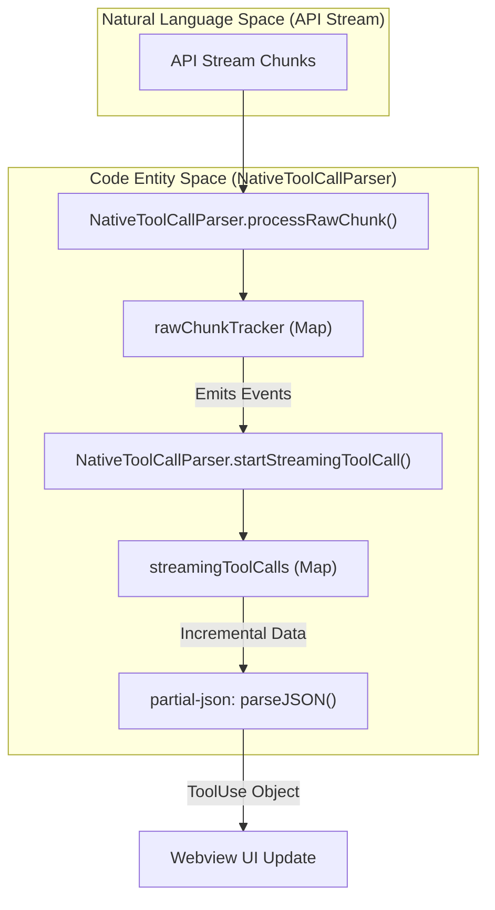
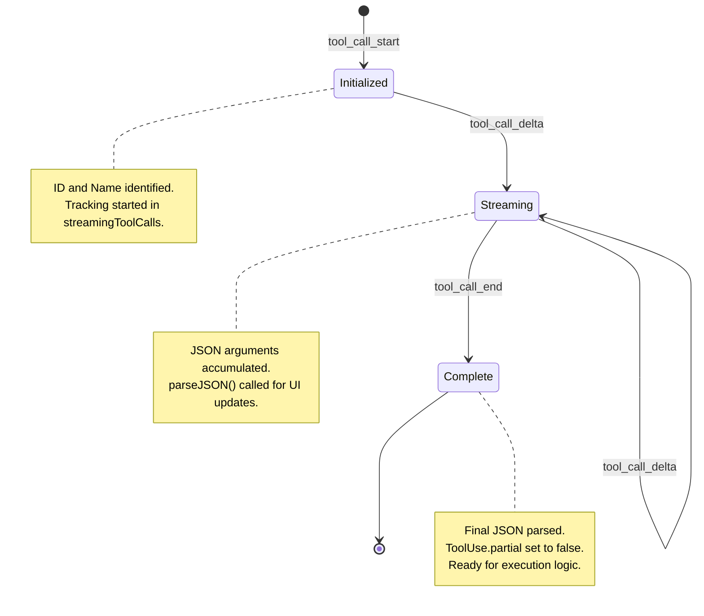
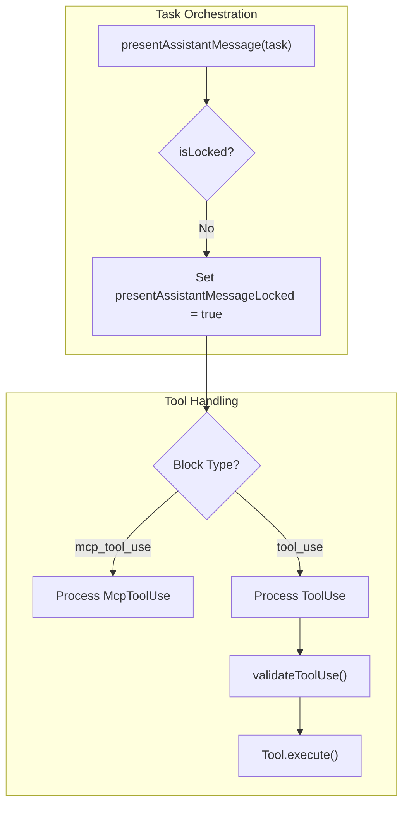

# Native Tool Calling Protocol

<details>
<summary>Relevant source files</summary>

The following files were used as context for generating this wiki page:

- [packages/cloud/src/__tests__/CloudSettingsService.parsing.test.ts](packages/cloud/src/__tests__/CloudSettingsService.parsing.test.ts)
- [packages/core/src/custom-tools/__tests__/custom-tool-registry.spec.ts](packages/core/src/custom-tools/__tests__/custom-tool-registry.spec.ts)
- [packages/types/src/tool-params.ts](packages/types/src/tool-params.ts)
- [packages/types/src/tool.ts](packages/types/src/tool.ts)
- [src/core/assistant-message/NativeToolCallParser.ts](src/core/assistant-message/NativeToolCallParser.ts)
- [src/core/assistant-message/__tests__/NativeToolCallParser.spec.ts](src/core/assistant-message/__tests__/NativeToolCallParser.spec.ts)
- [src/core/assistant-message/__tests__/presentAssistantMessage-custom-tool.spec.ts](src/core/assistant-message/__tests__/presentAssistantMessage-custom-tool.spec.ts)
- [src/core/assistant-message/__tests__/presentAssistantMessage-images.spec.ts](src/core/assistant-message/__tests__/presentAssistantMessage-images.spec.ts)
- [src/core/assistant-message/__tests__/presentAssistantMessage-unknown-tool.spec.ts](src/core/assistant-message/__tests__/presentAssistantMessage-unknown-tool.spec.ts)
- [src/core/assistant-message/presentAssistantMessage.ts](src/core/assistant-message/presentAssistantMessage.ts)
- [src/core/prompts/tools/__tests__/filter-tools-for-mode.spec.ts](src/core/prompts/tools/__tests__/filter-tools-for-mode.spec.ts)
- [src/core/prompts/tools/filter-tools-for-mode.ts](src/core/prompts/tools/filter-tools-for-mode.ts)
- [src/core/prompts/tools/native-tools/__tests__/read_file.spec.ts](src/core/prompts/tools/native-tools/__tests__/read_file.spec.ts)
- [src/core/prompts/tools/native-tools/edit.ts](src/core/prompts/tools/native-tools/edit.ts)
- [src/core/prompts/tools/native-tools/index.ts](src/core/prompts/tools/native-tools/index.ts)
- [src/core/prompts/tools/native-tools/read_file.ts](src/core/prompts/tools/native-tools/read_file.ts)
- [src/core/task/build-tools.ts](src/core/task/build-tools.ts)
- [src/core/tools/ExecuteCommandTool.ts](src/core/tools/ExecuteCommandTool.ts)
- [src/core/tools/__tests__/executeCommandTool.spec.ts](src/core/tools/__tests__/executeCommandTool.spec.ts)
- [src/core/tools/__tests__/validateToolUse.spec.ts](src/core/tools/__tests__/validateToolUse.spec.ts)
- [src/core/tools/validateToolUse.ts](src/core/tools/validateToolUse.ts)
- [src/shared/__tests__/modes.spec.ts](src/shared/__tests__/modes.spec.ts)
- [src/shared/modes.ts](src/shared/modes.ts)
- [src/shared/tools.ts](src/shared/tools.ts)

</details>


## Purpose and Scope

This document describes the native tool calling protocol used by Roo Code to enable AI models to execute tools using provider-native function calling mechanisms (OpenAI-style tool calling). This protocol has replaced the legacy XML-based tool calling system.

For information about specific tool implementations and their execution logic, see [File Operation Tools](6.4), [Command Execution and Terminal Tools](6.5), and [Browser Automation and Other Tools](6.6). For tool approval and safety mechanisms, see [Tool Approval and Safety](6.3). For the overall tool system architecture, see [Tool Architecture and Registry](6.1).

## Overview

The native tool calling protocol enables AI models to invoke tools using structured function call syntax rather than XML markup. This protocol is now the **only** supported mechanism for tool invocation in Roo Code.

### Key Characteristics

| Aspect | Native Protocol | Legacy XML Protocol (Removed) |
|--------|----------------|-------------------------------|
| **Tool Invocation** | Provider-native function calling with `tool_use` blocks | XML tags like `<read_file>...</read_file>` |
| **Tool Identification** | Required `id` field on every `tool_use` block | No ID field |
| **Tool Results** | Mandatory `tool_result` for every `tool_use_id` | Optional, error-prone |
| **Streaming** | Full support with partial JSON parsing | Not supported |
| **Multiple Tools** | Encouraged in single response | Discouraged |
| **Argument Type Safety** | Typed `nativeArgs` with schema validation | String-based parsing with XML |

**Sources:** [src/core/assistant-message/presentAssistantMessage.ts:311-334](), [src/core/assistant-message/presentAssistantMessage.ts:405-420]()

## Tool Call Format

### Tool Use Block Structure

A native tool call is represented by a `tool_use` block with the following structure:

```typescript
export interface ToolUse<TName extends ToolName = ToolName> {
    type: "tool_use"
    id?: string // Required for native protocol
    name: TName
    originalName?: string
    params: Partial<Record<ToolParamName, string>>
    partial: boolean
    nativeArgs?: TName extends keyof NativeToolArgs ? NativeToolArgs[TName] : never
    usedLegacyFormat?: boolean
}
```

The `id` field is **mandatory** for the native protocol and distinguishes native tool calls from legacy XML-based calls. Tools without an `id` are rejected with an error message indicating that XML tool calls are no longer supported.

**Sources:** [src/shared/tools.ts:127-147](), [src/core/assistant-message/presentAssistantMessage.ts:311-334]()

### Native Arguments (nativeArgs)

Each tool defines a typed interface in `NativeToolArgs` that specifies the expected argument structure. This ensures type safety and eliminates the need for manual string parsing from the `params` object.

```typescript
export type NativeToolArgs = {
    access_mcp_resource: { server_name: string; uri: string }
    read_file: import("@roo-code/types").ReadFileToolParams
    execute_command: { command: string; cwd?: string; timeout?: number | null }
    write_to_file: { path: string; content: string }
    apply_diff: { path: string; diff: string }
    // ... other tools
}
```

**Sources:** [src/shared/tools.ts:92-120](), [src/core/assistant-message/NativeToolCallParser.ts:25-35]()

## NativeToolCallParser

The `NativeToolCallParser` class is responsible for converting provider-native tool call chunks into `ToolUse` objects. It handles the complexities of streaming JSON and cross-provider format differences.



**Diagram: NativeToolCallParser Pipeline**

### Streaming State Management

The parser maintains two static maps to track state across multiple stream chunks:
1. `rawChunkTracker`: Tracks provider-level chunks (keyed by index) to handle out-of-order or fragmented tool call metadata (id, name). [src/core/assistant-message/NativeToolCallParser.ts:66-74]()
2. `streamingToolCalls`: Accumulates the JSON argument string (keyed by tool call ID) as it arrives. [src/core/assistant-message/NativeToolCallParser.ts:56-63]()

### Partial JSON Parsing

To provide real-time feedback in the UI, the parser uses `partial-json` to extract values from incomplete JSON strings. This allows the extension to show the user what file is being read or what command is being typed before the LLM finishes the response. [src/core/assistant-message/NativeToolCallParser.ts:246-289]()

**Sources:** [src/core/assistant-message/NativeToolCallParser.ts:53-74](), [src/core/assistant-message/NativeToolCallParser.ts:99-214]()

## Streaming Protocol

### Tool Call Lifecycle



**Diagram: Tool Call Lifecycle**

**Sources:** [src/core/assistant-message/NativeToolCallParser.ts:99-163](), [src/core/assistant-message/NativeToolCallParser.ts:220-226]()

## Tool Execution Flow

The `presentAssistantMessage` function in `Task` orchestrates tool execution using a lock-based sequential processing model.



**Diagram: presentAssistantMessage Flow**

### Lock-Based Sequential Processing

The function uses a lock (`presentAssistantMessageLocked`) to prevent concurrent execution of multiple tools or redundant processing during high-frequency streaming updates. If a call is made while locked, it sets `presentAssistantMessageHasPendingUpdates` to true to ensure the function is re-run once the current lock is released. [src/core/assistant-message/presentAssistantMessage.ts:66-85]()

### Tool Result Requirements

**Every `tool_use` with an `id` MUST have a corresponding `tool_result`**. This is a strict requirement of the native protocol to prevent API errors. Even if a tool is skipped (e.g., due to a previous rejection), a result must be pushed back to the conversation history. [src/core/assistant-message/presentAssistantMessage.ts:111-127](), [src/core/assistant-message/presentAssistantMessage.ts:405-420]()

**Sources:** [src/core/assistant-message/presentAssistantMessage.ts:61-85](), [src/core/assistant-message/presentAssistantMessage.ts:104-127](), [src/core/assistant-message/presentAssistantMessage.ts:405-420]()

## Native Arguments Processing

### Type-Safe Argument Extraction

The parser constructs typed `nativeArgs` based on the tool's schema. For example, the `read_file` tool supports complex parameters like `indentation` and `mode` (slice vs indentation) which are coerced into their proper types via the `NativeToolCallParser`. [src/core/assistant-message/NativeToolCallParser.ts:728-790](), [src/core/prompts/tools/native-tools/read_file.ts:41-154]()

### Type Coercion and Validation

The parser includes helper methods to ensure data integrity:
- `coerceOptionalNumber()`: Safely converts stringified numbers from LLM output. [src/core/assistant-message/NativeToolCallParser.ts:316-327]()
- `coerceOptionalBoolean()`: Handles string "true"/"false" conversions. [src/core/assistant-message/NativeToolCallParser.ts:76-90]()
- `validateToolUse()`: Checks if the tool is allowed in the current mode and respects file restrictions. [src/core/tools/validateToolUse.ts:32-63]()

## MCP Tool Integration

### Dynamic MCP Tools

MCP tools are exposed to the model as native tools using a prefixed naming convention: `mcp_serverName_toolName`. [src/core/assistant-message/NativeToolCallParser.ts:19]()

The `NativeToolCallParser` detects these prefixed names and parses them into `McpToolUse` blocks. [src/core/assistant-message/NativeToolCallParser.ts:685-703]()

### McpToolUse Processing

When `presentAssistantMessage` encounters an `mcp_tool_use` block, it extracts the `serverName` and `toolName`, then routes the execution. [src/core/assistant-message/presentAssistantMessage.ts:105-127]()

**Sources:** [src/core/assistant-message/NativeToolCallParser.ts:685-703](), [src/core/assistant-message/presentAssistantMessage.ts:105-127](), [src/shared/tools.ts:155-167]()

## System Prompt Integration

### Tool Discovery and Filtering

Tools are dynamically built and filtered based on the current `mode` (e.g., Architect, Code, Ask) and model capabilities (e.g., `supportsImages`). [src/core/task/build-tools.ts:65-169]()

- `buildNativeToolsArray()`: Combines native tools, MCP tools, and custom tools. [src/core/task/build-tools.ts:65-68]()
- `filterNativeToolsForMode()`: Restricts tool access based on the mode's configuration. [src/core/prompts/tools/filter-tools-for-mode.ts:217-258]()

### Restricted Tool Definitions (Gemini Support)

For providers like Gemini that support function call restrictions, `buildNativeToolsArrayWithRestrictions` can return all tool definitions while providing a list of `allowedFunctionNames`. This allows the model to reference historical tool calls for context while only being permitted to call tools valid for the current mode. [src/core/task/build-tools.ts:149-163]()

**Sources:** [src/core/task/build-tools.ts:65-169](), [src/core/prompts/tools/filter-tools-for-mode.ts:217-258](), [src/core/task/build-tools.ts:149-163]()