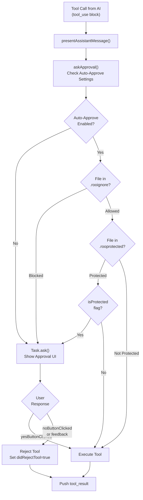
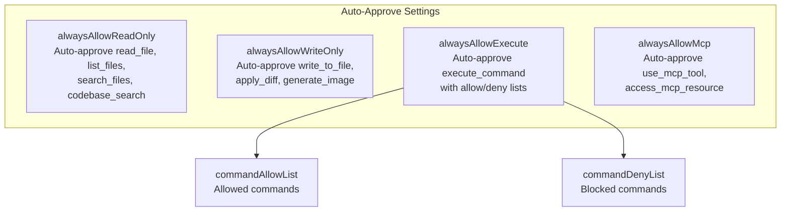
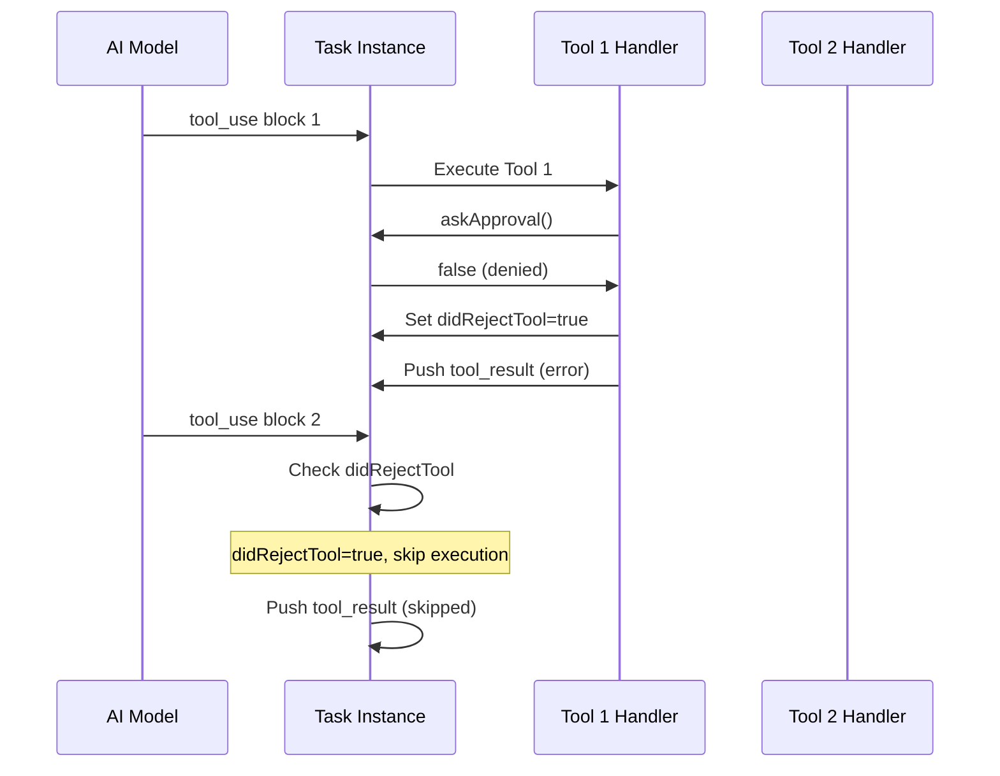

# Tool Approval and Safety

<details>
<summary>Relevant source files</summary>

The following files were used as context for generating this wiki page:

- [packages/cloud/src/__tests__/CloudSettingsService.parsing.test.ts](packages/cloud/src/__tests__/CloudSettingsService.parsing.test.ts)
- [packages/core/src/custom-tools/__tests__/custom-tool-registry.spec.ts](packages/core/src/custom-tools/__tests__/custom-tool-registry.spec.ts)
- [packages/types/src/tool-params.ts](packages/types/src/tool-params.ts)
- [packages/types/src/tool.ts](packages/types/src/tool.ts)
- [src/core/assistant-message/NativeToolCallParser.ts](src/core/assistant-message/NativeToolCallParser.ts)
- [src/core/assistant-message/__tests__/NativeToolCallParser.spec.ts](src/core/assistant-message/__tests__/NativeToolCallParser.spec.ts)
- [src/core/assistant-message/__tests__/presentAssistantMessage-custom-tool.spec.ts](src/core/assistant-message/__tests__/presentAssistantMessage-custom-tool.spec.ts)
- [src/core/assistant-message/__tests__/presentAssistantMessage-images.spec.ts](src/core/assistant-message/__tests__/presentAssistantMessage-images.spec.ts)
- [src/core/assistant-message/__tests__/presentAssistantMessage-unknown-tool.spec.ts](src/core/assistant-message/__tests__/presentAssistantMessage-unknown-tool.spec.ts)
- [src/core/assistant-message/presentAssistantMessage.ts](src/core/assistant-message/presentAssistantMessage.ts)
- [src/core/prompts/tools/__tests__/filter-tools-for-mode.spec.ts](src/core/prompts/tools/__tests__/filter-tools-for-mode.spec.ts)
- [src/core/prompts/tools/filter-tools-for-mode.ts](src/core/prompts/tools/filter-tools-for-mode.ts)
- [src/core/prompts/tools/native-tools/__tests__/read_file.spec.ts](src/core/prompts/tools/native-tools/__tests__/read_file.spec.ts)
- [src/core/prompts/tools/native-tools/edit.ts](src/core/prompts/tools/native-tools/edit.ts)
- [src/core/prompts/tools/native-tools/index.ts](src/core/prompts/tools/native-tools/index.ts)
- [src/core/prompts/tools/native-tools/read_file.ts](src/core/prompts/tools/native-tools/read_file.ts)
- [src/core/task/build-tools.ts](src/core/task/build-tools.ts)
- [src/core/tools/ExecuteCommandTool.ts](src/core/tools/ExecuteCommandTool.ts)
- [src/core/tools/__tests__/executeCommandTool.spec.ts](src/core/tools/__tests__/executeCommandTool.spec.ts)
- [src/core/tools/__tests__/validateToolUse.spec.ts](src/core/tools/__tests__/validateToolUse.spec.ts)
- [src/core/tools/validateToolUse.ts](src/core/tools/validateToolUse.ts)
- [src/shared/__tests__/modes.spec.ts](src/shared/__tests__/modes.spec.ts)
- [src/shared/modes.ts](src/shared/modes.ts)
- [src/shared/tools.ts](src/shared/tools.ts)

</details>


## Purpose and Scope

This document describes the approval and safety mechanisms that control tool execution in Roo Code. It covers the user confirmation flow, auto-approval configuration, file access controls (`.rooignore` and `.rooprotected`), and safety validations that prevent dangerous or unintended operations.

For information about tool definitions and registry, see [6.1 Tool Architecture and Registry](). For details on how tool calls are parsed from API responses, see [6.2 Native Tool Calling Protocol]().

## Tool Approval Flow

Every tool execution in Roo Code goes through an approval gate before execution. The approval system uses the `askApproval` callback function provided to tool handlers via the `ToolCallbacks` interface [src/core/tools/BaseTool.ts:22-22]().

### Core Approval Pattern



Sources: [src/core/assistant-message/presentAssistantMessage.ts:508-543](), [src/core/task/Task.ts:131-131]()

### askApproval Function Signature

The `askApproval` function is defined in the shared tool types and provides a consistent interface for requesting user approval:

```typescript
export type AskApproval = (
	type: ClineAsk,
	partialMessage?: string,
	progressStatus?: ToolProgressStatus,
	forceApproval?: boolean,
) => Promise<boolean>
```

**Parameters:**
- `type`: The type of approval request (e.g., `"tool"`, `"command"`, `"completion_result"`) [src/shared/tools.ts:8-8]().
- `partialMessage`: Optional JSON-serialized tool information for UI display.
- `progressStatus`: Optional progress indicators for long-running operations.
- `forceApproval`: Force user approval regardless of auto-approve settings (used for protected files).

Sources: [src/shared/tools.ts:7-12](), [src/core/tools/BaseTool.ts:22-22]()

### Approval Outcomes

When `askApproval` completes, it returns the user's decision along with optional feedback:

| Outcome | response Value | Behavior |
|---------|---------------|----------|
| Approved | `"yesButtonClicked"` | Tool executes normally |
| Denied | `"noButtonClicked"` | Tool rejected, `didRejectTool=true` set |
| Feedback | `"messageResponse"` | Tool rejected with user feedback text/images |

When approval is denied, the system:
1. Calls `Task.say("user_feedback", text, images)` if feedback provided [src/core/assistant-message/presentAssistantMessage.ts:157-167]().
2. Pushes a `tool_result` with an error indicating denial via `Task.pushToolResultToUserContent` [src/core/assistant-message/presentAssistantMessage.ts:119-124]().
3. Sets `Task.didRejectTool = true` to skip remaining tools in the current turn [src/core/assistant-message/presentAssistantMessage.ts:405-405]().

Sources: [src/core/assistant-message/presentAssistantMessage.ts:111-127](), [src/core/task/Task.ts:162-250]()

## Auto-Approval Configuration

Auto-approval settings allow users to skip manual confirmation for trusted operations. Settings are granular and organized by tool group.

### Auto-Approve Settings Structure



Sources: [src/core/task/Task.ts:131-132]()

### Command Allow/Deny Lists

For the `execute_command` tool, auto-approval uses pattern matching against allow and deny lists configured in VS Code settings.

**Logic Implementation:**
- Commands are matched using substring matching.
- If a command matches the deny list, it **always** requires approval.
- In the `ExecuteCommandTool`, an additional `commandTimeoutAllowlist` is checked to determine if the execution timeout should be skipped for specific trusted commands [src/core/tools/ExecuteCommandTool.ts:85-96]().
- The `resolveAgentTimeoutMs` function determines the timeout based on whether the environment is CLI or VS Code [src/core/tools/ExecuteCommandTool.ts:32-39]().

Sources: [src/core/tools/ExecuteCommandTool.ts:81-96](), [src/core/assistant-message/presentAssistantMessage.ts:104-200]()

## RooIgnore and RooProtected Safety Controls

Roo Code provides two file-based safety mechanisms to control which files can be read or modified.

### RooIgnoreController (.rooignore)

The `RooIgnoreController` defines patterns for files that should not be accessible to the AI. It follows `.gitignore` syntax and prevents both read and write operations.

**Enforcement Points:**
- **Command Execution**: `rooIgnoreController.validateCommand(command)` checks if a shell command attempts to access ignored files [src/core/tools/ExecuteCommandTool.ts:58-64]().
- **Tool Execution**: Tool handlers (like `write_to_file` or `execute_command`) use the controller to block access [src/core/tools/ExecuteCommandTool.ts:60-64]().

Sources: [src/core/task/Task.ts:103-103](), [src/core/tools/ExecuteCommandTool.ts:58-64]()

### RooProtectedController (.rooprotected)

The `RooProtectedController` defines patterns for files that require explicit user approval before modification, even with auto-approve enabled.

**Behavior:**
- Allows reads without approval (unlike `.rooignore`).
- Forces approval for writes, even if `alwaysAllowWriteOnly` is enabled.
- Sets the `isProtected` flag in `askApproval` to override auto-approval settings.

Sources: [src/core/task/Task.ts:104-104](), [src/core/assistant-message/presentAssistantMessage.ts:508-543]()

## Tool Rejection and Error Handling

When a tool is rejected (either by user denial or validation failure), the system follows a consistent error handling pattern.

### didRejectTool Flag

The `didRejectTool` flag on the `Task` instance controls whether subsequent tools in the same message are executed. This is critical for preventing API errors where a model expects results for all tools it requested [src/core/assistant-message/presentAssistantMessage.ts:111-127]().



Sources: [src/core/assistant-message/presentAssistantMessage.ts:111-127](), [src/core/assistant-message/presentAssistantMessage.ts:405-420]()

### Feedback Integration

When users provide feedback along with approval, the system merges the feedback into the tool result using `formatResponse.toolApprovedWithFeedback` [src/core/assistant-message/presentAssistantMessage.ts:159-160]().

```typescript
// Merge approval feedback into tool result
if (approvalFeedback) {
    const feedbackText = formatResponse.toolApprovedWithFeedback(approvalFeedback.text)
    resultContent = `${feedbackText}\n\n${resultContent}`

    // Add feedback images to the image blocks
    if (approvalFeedback.images) {
        const feedbackImageBlocks = formatResponse.imageBlocks(approvalFeedback.images)
        imageBlocks = [...feedbackImageBlocks, ...imageBlocks]
    }
}
```

Sources: [src/core/assistant-message/presentAssistantMessage.ts:157-167](), [src/core/prompts/responses.ts:95-95]()

## Safety Limits and Validations

### Mode and Model Restrictions

Before execution, tool calls are validated against the current mode's allowed tools and the model's specific capabilities.

- **Mode Filtering**: `filterNativeToolsForMode` removes tools not allowed by the current mode's `ToolGroup` configuration [src/core/prompts/tools/filter-tools-for-mode.ts:32-39]().
- **Model Customization**: `applyModelToolCustomization` applies `excludedTools` and `includedTools` from `ModelInfo` [src/core/prompts/tools/filter-tools-for-mode.ts:165-171]().
- **File Restrictions**: `isToolAllowedForMode` throws a `FileRestrictionError` if a tool (like `write_to_file`) attempts to edit a file outside of the mode's allowed regex pattern [src/shared/modes.ts:135-143]().

Sources: [src/core/prompts/tools/filter-tools-for-mode.ts:152-171](), [src/shared/modes.ts:135-143](), [src/core/tools/validateToolUse.ts:38-38]()

### Tool Repetition and Mistakes

The system tracks consecutive mistakes and tool repetitions to prevent loops:
- **Mistake Tracking**: `Task.consecutiveMistakeCount` is incremented when tools are called with missing parameters [src/core/tools/ExecuteCommandTool.ts:50-51]().
- **Repetition Detection**: `ToolRepetitionDetector` (via `Task.recordToolError`) monitors for repeating identical failures [src/core/tools/ExecuteCommandTool.ts:51-51]().

Sources: [src/core/tools/ExecuteCommandTool.ts:41-66](), [src/core/task/Task.ts:49-53]()

### Shell Command Safety

The `ExecuteCommandTool` includes several safety layers:
1. **Shell Integration Check**: Detects if VS Code shell integration is disabled and falls back to `execa` [src/core/tools/ExecuteCommandTool.ts:78-80]().
2. **Timeout Management**: Applies both user-configured timeouts (`commandExecutionTimeout`) and agent-specified timeouts [src/core/tools/ExecuteCommandTool.ts:81-99]().
3. **Output Interception**: Uses `OutputInterceptor` to capture terminal output for the AI without flooding the UI [src/core/tools/ExecuteCommandTool.ts:207-210]().

Sources: [src/core/tools/ExecuteCommandTool.ts:1-150]()