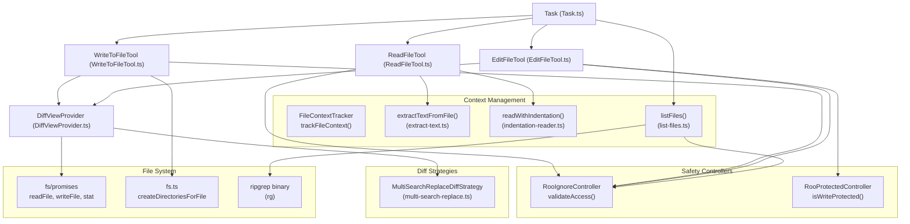
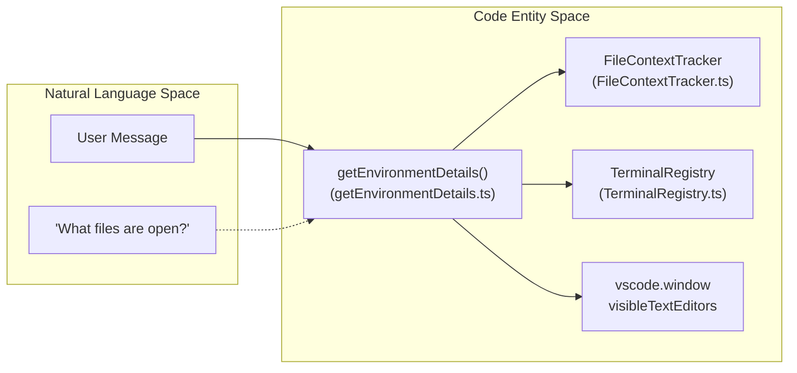

# File Operation Tools

Relevant source files

The following files were used as context for generating this wiki page:

- [packages/types/src/history.ts](packages/types/src/history.ts)
- [src/core/diff/strategies/__tests__/multi-search-replace.spec.ts](src/core/diff/strategies/__tests__/multi-search-replace.spec.ts)
- [src/core/diff/strategies/multi-search-replace.ts](src/core/diff/strategies/multi-search-replace.ts)
- [src/core/environment/__tests__/getEnvironmentDetails.spec.ts](src/core/environment/__tests__/getEnvironmentDetails.spec.ts)
- [src/core/environment/getEnvironmentDetails.ts](src/core/environment/getEnvironmentDetails.ts)
- [src/core/prompts/tools/native-tools/edit_file.ts](src/core/prompts/tools/native-tools/edit_file.ts)
- [src/core/task-persistence/taskMetadata.ts](src/core/task-persistence/taskMetadata.ts)
- [src/core/task/__tests__/native-tools-filtering.spec.ts](src/core/task/__tests__/native-tools-filtering.spec.ts)
- [src/core/task/__tests__/task-tool-history.spec.ts](src/core/task/__tests__/task-tool-history.spec.ts)
- [src/core/tools/BaseTool.ts](src/core/tools/BaseTool.ts)
- [src/core/tools/EditFileTool.ts](src/core/tools/EditFileTool.ts)
- [src/core/tools/ReadFileTool.ts](src/core/tools/ReadFileTool.ts)
- [src/core/tools/SearchAndReplaceTool.ts](src/core/tools/SearchAndReplaceTool.ts)
- [src/core/tools/SearchReplaceTool.ts](src/core/tools/SearchReplaceTool.ts)
- [src/core/tools/WriteToFileTool.ts](src/core/tools/WriteToFileTool.ts)
- [src/core/tools/__tests__/editFileTool.spec.ts](src/core/tools/__tests__/editFileTool.spec.ts)
- [src/core/tools/__tests__/newTaskTool.spec.ts](src/core/tools/__tests__/newTaskTool.spec.ts)
- [src/core/tools/__tests__/readFileTool.spec.ts](src/core/tools/__tests__/readFileTool.spec.ts)
- [src/core/tools/__tests__/searchAndReplaceTool.spec.ts](src/core/tools/__tests__/searchAndReplaceTool.spec.ts)
- [src/core/tools/__tests__/searchReplaceTool.spec.ts](src/core/tools/__tests__/searchReplaceTool.spec.ts)
- [src/core/tools/__tests__/writeToFileTool.spec.ts](src/core/tools/__tests__/writeToFileTool.spec.ts)
- [src/core/tools/helpers/__tests__/toolResultFormatting.spec.ts](src/core/tools/helpers/__tests__/toolResultFormatting.spec.ts)
- [src/core/tools/helpers/toolResultFormatting.ts](src/core/tools/helpers/toolResultFormatting.ts)
- [src/services/glob/__mocks__/list-files.ts](src/services/glob/__mocks__/list-files.ts)
- [src/services/glob/__tests__/gitignore-integration.spec.ts](src/services/glob/__tests__/gitignore-integration.spec.ts)
- [src/services/glob/__tests__/gitignore-test.spec.ts](src/services/glob/__tests__/gitignore-test.spec.ts)
- [src/services/glob/__tests__/list-files-limit.spec.ts](src/services/glob/__tests__/list-files-limit.spec.ts)
- [src/services/glob/__tests__/list-files.spec.ts](src/services/glob/__tests__/list-files.spec.ts)
- [src/services/glob/constants.ts](src/services/glob/constants.ts)
- [src/services/glob/list-files.ts](src/services/glob/list-files.ts)

## Purpose and Scope

This document covers the file operation tools that enable the AI to read, create, and modify files in the workspace. These tools include `read_file`, `write_to_file`, `edit_file`, and `list_files`. These tools form the core of Roo Code's file system interaction capabilities, providing safety-first operations with integrated diff previews, user approval workflows, and support for large codebases through specialized reading modes and efficient listing strategies.

For information about the tool architecture and registry system, see [6.1 Tool Architecture and Registry](). For approval workflows and safety mechanisms, see [6.3 Tool Approval and Safety]().

---

## Architecture Overview

File operation tools inherit from `BaseTool` and implement the tool execution lifecycle. They integrate with multiple systems to provide safe, context-aware file manipulation, utilizing a `DiffViewProvider` to manage the visual representation of changes before they are committed to disk.

### File Tool Integration

Title: File Operation Tool Data Flow

**Sources:** [src/core/tools/ReadFileTool.ts:71-81](), [src/core/tools/WriteToFileTool.ts:26-29](), [src/core/tools/BaseTool.ts:36-36](), [src/services/glob/list-files.ts:33-76]()

---

## Read File Tool

The `ReadFileTool` implements the `read_file` tool, supporting both standard sequential reading and semantic "indentation mode" for extracting code blocks.

### Execution Modes
1.  **Slice Mode (Default)**: Reads contiguous lines using `offset` and `limit`. It is implemented via `readWithSlice` [src/core/tools/ReadFileTool.ts:24-24](), [src/core/tools/ReadFileTool.ts:118-119]().
2.  **Indentation Mode**: Extracts semantic blocks based on indentation hierarchy using `anchor_line` and `max_levels`. This is powered by `readWithIndentation` [src/core/tools/ReadFileTool.ts:24-24](), [src/core/tools/ReadFileTool.ts:120-124]().
3.  **Legacy Format**: Maintains backward compatibility for parameters using `isLegacyReadFileParams` [src/core/tools/ReadFileTool.ts:8-10](), [src/core/tools/ReadFileTool.ts:76-78]().

### Specialized Content Handling
- **Binary & Images**: Uses `isBinaryFile` to detect non-text content [src/core/tools/ReadFileTool.ts:198-200](). Supported images are processed via `processImageFile` and tracked by `ImageMemoryTracker` to prevent OOM errors [src/core/tools/ReadFileTool.ts:34-35](), [src/core/tools/ReadFileTool.ts:169-174]().
- **Document Formats**: Extracts text from `.pdf`, `.docx`, and `.ipynb` via `extractTextFromFile` [src/core/tools/ReadFileTool.ts:23-23]().
- **Validation**: Rejects directory paths, suggesting `list_files` instead [src/core/tools/ReadFileTool.ts:185-194]().

**Sources:** [src/core/tools/ReadFileTool.ts:1-215](), [src/core/tools/__tests__/readFileTool.spec.ts:1-12]()

---

## Write File Tool

The `WriteToFileTool` implements the `write_to_file` tool, used for creating new files or completely overwriting existing ones.

### Execution Workflow
1.  **Validation**: Checks for missing parameters (`path`, `content`) and validates access via `RooIgnoreController` [src/core/tools/WriteToFileTool.ts:34-56]().
2.  **Directory Creation**: Automatically creates parent directories early using `createDirectoriesForFile` to prevent `ENOENT` errors during diff operations [src/core/tools/WriteToFileTool.ts:70-74]().
3.  **Content Normalization**: Strips markdown code blocks if the AI wrapped the content in them and unescapes HTML entities for non-Claude models [src/core/tools/WriteToFileTool.ts:76-86]().
4.  **Diff Generation**: Uses `formatResponse.createPrettyPatch` for existing files or `convertNewFileToUnifiedDiff` for new ones [src/core/tools/WriteToFileTool.ts:120-123]().
5.  **Focus Disruption Prevention**: If the `PREVENT_FOCUS_DISRUPTION` experiment is enabled, it saves content directly via `diffViewProvider.saveDirectly` instead of opening a visible editor tab [src/core/tools/WriteToFileTool.ts:106-136]().

**Sources:** [src/core/tools/WriteToFileTool.ts:26-194](), [src/core/tools/__tests__/writeToFileTool.spec.ts:88-188]()

---

## Edit File Tool

The `EditFileTool` implements the `edit_file` tool. It performs modifications by finding an `old_string` and replacing it with a `new_string`.

### Matching Logic
The tool employs multiple matching strategies, often utilizing the `MultiSearchReplaceDiffStrategy` for `SEARCH/REPLACE` block patterns [src/core/diff/strategies/multi-search-replace.ts:75-81]().

### Safety Constraints
- **Expected Replacements**: The AI can specify `expected_replacements`. If the number of matches found in the file does not match this count, the tool returns an error to prevent accidental global replaces [src/core/tools/__tests__/editFileTool.spec.ts:189-192]().
- **Marker Validation**: The `MultiSearchReplaceDiffStrategy` strictly validates markers like `<<<<<<< SEARCH`, `=======`, and `>>>>>>> REPLACE` to prevent malformed edits [src/core/diff/strategies/multi-search-replace.ts:101-155]().
- **Fuzzy Matching**: Supports a `fuzzyThreshold` to match content even if there are minor discrepancies (e.g., whitespace or smart quotes) [src/core/diff/strategies/multi-search-replace.ts:11-31](), [src/core/diff/strategies/multi-search-replace.ts:83-89]().

**Sources:** [src/core/tools/EditFileTool.ts:10-10](), [src/core/diff/strategies/multi-search-replace.ts:11-186](), [src/core/tools/__tests__/editFileTool.spec.ts:72-157]()

---

## List Files Tool

The `listFiles` function (utilized by the `list_files` tool) provides an efficient way to explore the workspace directory structure.

### Implementation Details
- **Ripgrep Integration**: Uses the `ripgrep` (`rg`) binary for high-performance file discovery, including hidden files and respecting `.gitignore` [src/services/glob/list-files.ts:47-51](), [src/services/glob/list-files.ts:200-208]().
- **Recursive Discovery**: Supports recursive traversal with a configurable `limit`. If the limit is reached, the system ensures that at least the first-level directories are included so the AI can continue exploring [src/services/glob/list-files.ts:59-73](), [src/services/glob/list-files.ts:113-158]().
- **Special Directory Protection**: Prevents listing the root directory or the user's home directory to maintain performance and privacy [src/services/glob/list-files.ts:163-181]().
- **Symlink Support**: Explicitly includes the `--follow` flag in ripgrep arguments to ensure symlinked directories are traversed [src/services/glob/__tests__/list-files.spec.ts:70-108]().

**Sources:** [src/services/glob/list-files.ts:33-213](), [src/services/glob/__tests__/list-files.spec.ts:165-232]()

---

## Environment and Diagnostic Collection

File operations are supported by background context collection that informs the AI about the current state of the workspace.

### Environment Details
The `getEnvironmentDetails` function aggregates workspace state:
- **Visible Files & Tabs**: Lists files currently open in the VS Code editor [src/core/environment/getEnvironmentDetails.ts:32-66]().
- **Recently Modified Files**: Tracks files modified since the last AI interaction via `FileContextTracker` [src/core/environment/getEnvironmentDetails.ts:161-169]().
- **Terminal Output**: Captures new output from active and inactive terminals to provide context for file edits (e.g., build errors) [src/core/environment/getEnvironmentDetails.ts:68-156]().

Title: Environment Context Association

**Sources:** [src/core/environment/getEnvironmentDetails.ts:23-188](), [src/core/environment/__tests__/getEnvironmentDetails.spec.ts:143-180]()

---

## Multi-Search-Replace Strategy

The `MultiSearchReplaceDiffStrategy` is the primary logic for applying `SEARCH/REPLACE` blocks.

### Implementation Details
- **Marker Validation**: Strictly validates the sequencing of `<<<<<<< SEARCH`, `=======`, and `>>>>>>> REPLACE` markers [src/core/diff/strategies/multi-search-replace.ts:101-186]().
- **Fuzzy Search**: Uses a "middle-out" fuzzy search algorithm to find the best match for a search block in the target file, even if line numbers are slightly off [src/core/diff/strategies/multi-search-replace.ts:37-73]().
- **Similarity Calculation**: Uses Levenshtein distance (via `fastest-levenshtein`) to determine how closely a file chunk matches the search block [src/core/diff/strategies/multi-search-replace.ts:11-31]().

**Sources:** [src/core/diff/strategies/multi-search-replace.ts:11-186](), [src/core/tools/EditFileTool.ts:10-10]()