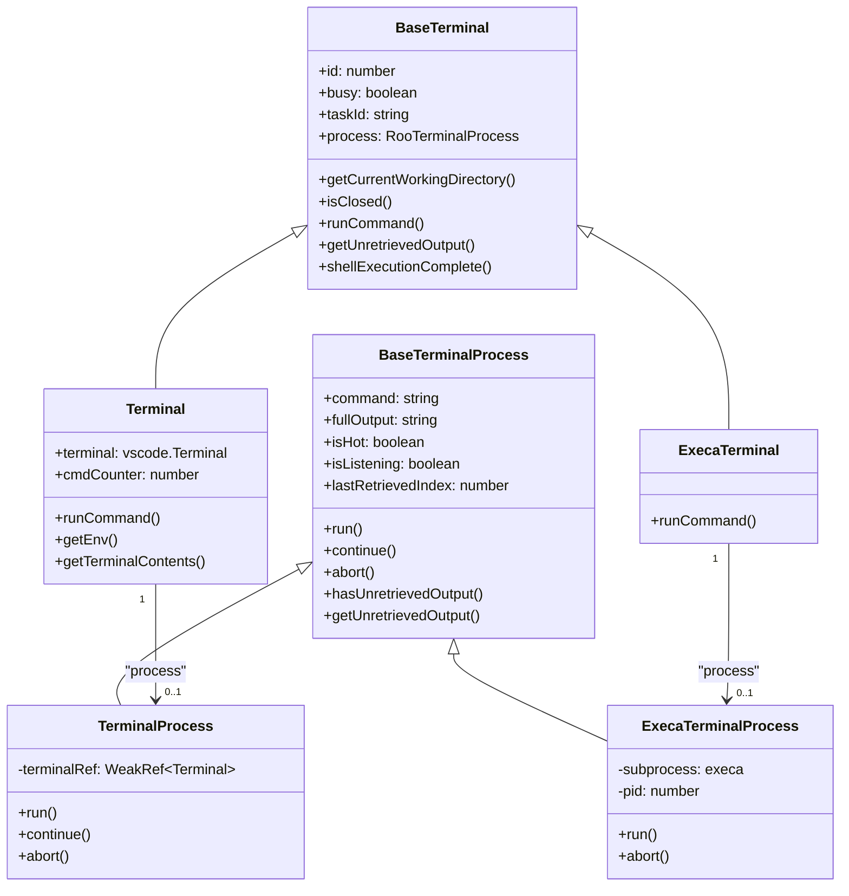
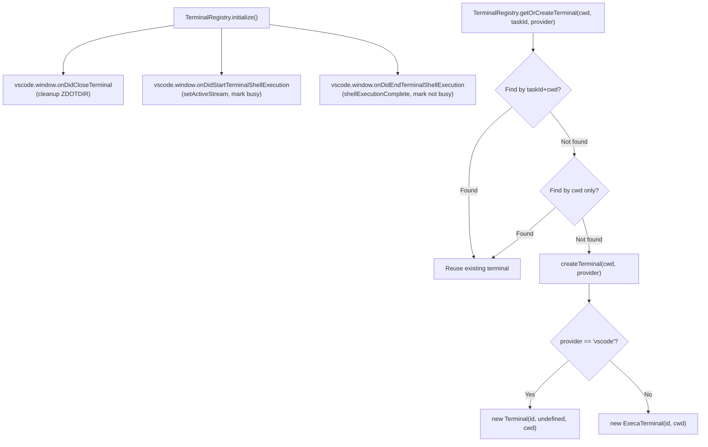
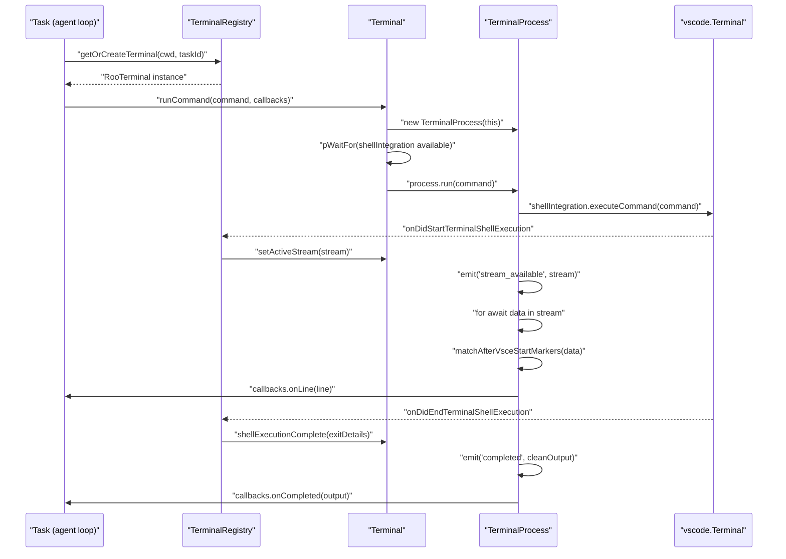
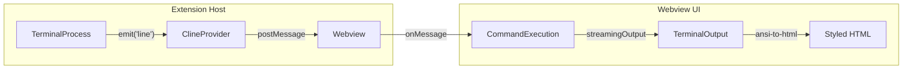

# Command Execution and Terminal Tools

<details>
<summary>Relevant source files</summary>

The following files were used as context for generating this wiki page:

- [src/integrations/terminal/BaseTerminal.ts](src/integrations/terminal/BaseTerminal.ts)
- [src/integrations/terminal/ExecaTerminalProcess.ts](src/integrations/terminal/ExecaTerminalProcess.ts)
- [src/integrations/terminal/Terminal.ts](src/integrations/terminal/Terminal.ts)
- [src/integrations/terminal/TerminalProcess.ts](src/integrations/terminal/TerminalProcess.ts)
- [src/integrations/terminal/TerminalRegistry.ts](src/integrations/terminal/TerminalRegistry.ts)
- [src/integrations/terminal/__tests__/ExecaTerminalProcess.spec.ts](src/integrations/terminal/__tests__/ExecaTerminalProcess.spec.ts)
- [src/integrations/terminal/__tests__/TerminalProcess.test.ts](src/integrations/terminal/__tests__/TerminalProcess.test.ts)
- [src/integrations/terminal/__tests__/TerminalProcessExec.bash.spec.ts](src/integrations/terminal/__tests__/TerminalProcessExec.bash.spec.ts)
- [src/integrations/terminal/__tests__/TerminalRegistry.spec.ts](src/integrations/terminal/__tests__/TerminalRegistry.spec.ts)
- [webview-ui/src/components/chat/CommandExecution.tsx](webview-ui/src/components/chat/CommandExecution.tsx)
- [webview-ui/src/components/chat/CommandPatternSelector.tsx](webview-ui/src/components/chat/CommandPatternSelector.tsx)
- [webview-ui/src/components/chat/TerminalOutput.tsx](webview-ui/src/components/chat/TerminalOutput.tsx)
- [webview-ui/src/components/chat/__tests__/CommandExecution.spec.tsx](webview-ui/src/components/chat/__tests__/CommandExecution.spec.tsx)
- [webview-ui/src/components/chat/__tests__/CommandPatternSelector.spec.tsx](webview-ui/src/components/chat/__tests__/CommandPatternSelector.spec.tsx)
- [webview-ui/src/components/chat/__tests__/TerminalOutput.spec.tsx](webview-ui/src/components/chat/__tests__/TerminalOutput.spec.tsx)
- [webview-ui/src/components/common/__mocks__/CodeBlock.tsx](webview-ui/src/components/common/__mocks__/CodeBlock.tsx)

</details>


This page documents the terminal integration subsystem responsible for executing shell commands on behalf of the AI agent. It covers the class hierarchy, lifecycle of a command execution, shell integration protocol handling, and terminal lifecycle management.

For information about how the `execute_command` tool is approved and dispatched from the AI conversation loop, see [Tool Approval and Safety](6.3) and [Tool Architecture and Registry](6.1). For settings that affect terminal behavior (timeouts, shell integration, command delay), see [Terminal, Checkpoint, and Notification Settings](11.6).

---

## Architecture Overview

The terminal subsystem lives in `src/integrations/terminal/`. It provides two concrete terminal backends:

| Class | File | Backend | Purpose |
|---|---|---|---|
| `Terminal` | [src/integrations/terminal/Terminal.ts:10]() | VS Code API | Standard interactive terminal shown in the VS Code panel |
| `ExecaTerminal` | [src/integrations/terminal/ExecaTerminal.ts:8]() | execa (child_process) | Headless process execution for CLI/non-interactive contexts |
| `BaseTerminal` | [src/integrations/terminal/BaseTerminal.ts:12]() | Abstract | Shared state and config for both backends |

Command execution is represented by:

| Class | File | Purpose |
|---|---|---|
| `TerminalProcess` | [src/integrations/terminal/TerminalProcess.ts:8]() | Handles VS Code terminal stream and shell integration |
| `ExecaTerminalProcess` | [src/integrations/terminal/ExecaTerminalProcess.ts:9]() | Handles child_process execution via `execa` |
| `BaseTerminalProcess` | [src/integrations/terminal/BaseTerminalProcess.ts:5]() | Shared output buffering, hot-timer logic, event emitter |

**Terminal: Class Hierarchy**



Sources: [src/integrations/terminal/Terminal.ts:10-16](), [src/integrations/terminal/TerminalProcess.ts:8-14](), [src/integrations/terminal/BaseTerminal.ts:12-23](), [src/integrations/terminal/ExecaTerminalProcess.ts:9-13]()

---

## TerminalRegistry

`TerminalRegistry` is a static singleton that manages all terminal instances across the extension lifetime. It is the single point of access for creating, finding, and releasing terminals.

**TerminalRegistry: Key Responsibilities**



Sources: [src/integrations/terminal/TerminalRegistry.ts:26-128](), [src/integrations/terminal/TerminalRegistry.ts:130-203]()

### Initialization

`TerminalRegistry.initialize()` must be called once at extension startup. It registers three VS Code event listeners:

- **`onDidCloseTerminal`** — triggers `ShellIntegrationManager.zshCleanupTmpDir()` to remove any temporary `ZDOTDIR` directory. [src/integrations/terminal/TerminalRegistry.ts:38-46]()
- **`onDidStartTerminalShellExecution`** — acquires the output stream handle immediately via `e.execution.read()`, calls `terminal.setActiveStream(stream)`, and marks the terminal busy. [src/integrations/terminal/TerminalRegistry.ts:49-68]()
- **`onDidEndTerminalShellExecution`** — interprets the exit code via `TerminalProcess.interpretExitCode()`, calls `terminal.shellExecutionComplete(exitDetails)`, and marks the terminal not busy. [src/integrations/terminal/TerminalRegistry.ts:76-124]()

### Terminal Selection Priority

When `getOrCreateTerminal(cwd, taskId, provider)` is called:

1. Search for an idle terminal already assigned to `taskId` with a matching `cwd`. [src/integrations/terminal/TerminalRegistry.ts:162-176]()
2. Search for any idle terminal with a matching `cwd` (regardless of task). [src/integrations/terminal/TerminalRegistry.ts:179-193]()
3. Create a new terminal using `createTerminal(cwd, provider)`. [src/integrations/terminal/TerminalRegistry.ts:196-202]()

---

## Terminal Environment Setup

When a VS Code `Terminal` is created, `Terminal.getEnv()` computes the environment variables to inject:

| Variable | Value/Condition | Reason |
|---|---|---|
| `PAGER` | `cat` (non-Windows) or `""` | Prevent interactive pagers from blocking output. [src/integrations/terminal/Terminal.ts:156]() |
| `VTE_VERSION` | `0` | Disable VTE to allow `PROMPT_COMMAND` to fire. [src/integrations/terminal/Terminal.ts:160]() |
| `ITERM_SHELL_INTEGRATION_INSTALLED` | `Yes` (if Oh My Zsh setting on) | Enable shell integration for Oh My Zsh. [src/integrations/terminal/Terminal.ts:165]() |
| `POWERLEVEL9K_TERM_SHELL_INTEGRATION` | `true` (if P10k setting on) | Enable shell integration for Powerlevel10k. [src/integrations/terminal/Terminal.ts:170]() |
| `PROMPT_COMMAND` | `sleep N` (if `commandDelay > 0`) | Work around VS Code bug #237208 (output lost race). [src/integrations/terminal/Terminal.ts:178]() |
| `PROMPT_EOL_MARK` | `""` (if Zsh clear-EOL enabled) | Prevent `%` marker from confusing output parsing. [src/integrations/terminal/Terminal.ts:184]() |
| `ZDOTDIR` | temp dir (if `terminalZdotdir` enabled) | Inject custom `.zshrc` for Zsh shell integration. [src/integrations/terminal/Terminal.ts:189]() |

Sources: [src/integrations/terminal/Terminal.ts:153-193]()

---

## Command Execution Flow

When the AI agent issues an `execute_command`, the flow is:

**Command Execution: Sequence**



Sources: [src/integrations/terminal/Terminal.ts:43-95](), [src/integrations/terminal/TerminalProcess.ts:38-203]()

### Shell Integration Availability Check

Before running, `Terminal.runCommand()` uses `pWaitFor` to wait for `terminal.shellIntegration !== undefined`. Timeout is controlled by `Terminal.getShellIntegrationTimeout()`. [src/integrations/terminal/Terminal.ts:71-73](). If shell integration never becomes available, `no_shell_integration` is emitted. [src/integrations/terminal/Terminal.ts:87-91]()

### PowerShell Workaround

On Windows with PowerShell as the default shell, `TerminalProcess.run()` may append extra fragments to the command string:

1. `; "(Roo/PS Workaround: N)" > $null` — increments `cmdCounter` to help VS Code distinguish repeated identical commands (controlled by `Terminal.getPowershellCounter()`). [src/integrations/terminal/TerminalProcess.ts:112-114]()
2. `; start-sleep -milliseconds N` — adds an artificial delay for the output race condition (controlled by `Terminal.getCommandDelay()`). [src/integrations/terminal/TerminalProcess.ts:117-119]()

---

## Execa (Headless) Execution

For CLI and headless environments, `ExecaTerminalProcess` uses the `execa` library to run commands as child processes.

- **UTF-8 Enforcement**: Explicitly sets `LANG` and `LC_ALL` to `en_US.UTF-8` to prevent encoding issues with tools like Ruby or CocoaPods. [src/integrations/terminal/ExecaTerminalProcess.ts:48-53]()
- **PID Tracking**: When using `shell: true`, it uses `ps-tree` after a 100ms delay to find the actual command PID rather than the shell PID. [src/integrations/terminal/ExecaTerminalProcess.ts:58-75]()
- **Process Abort**: Implements a robust `abort()` that sends `SIGKILL` to the subprocess, the command PID, and all discovered child processes in the tree. [src/integrations/terminal/ExecaTerminalProcess.ts:162-220]()

Sources: [src/integrations/terminal/ExecaTerminalProcess.ts:9-256]()

---

## Shell Integration Protocol (OSC Sequences)

VS Code shell integration uses OSC 633 and OSC 133 escape sequences embedded in terminal output to mark command lifecycle boundaries. `TerminalProcess` must parse these to extract actual command output. [src/integrations/terminal/TerminalProcess.ts:153-161]()

| Sequence | Meaning |
|---|---|
| `OSC 633;A ST` | Prompt start |
| `OSC 633;B ST` | Prompt end |
| `OSC 633;C ST` | Pre-execution — command output begins here |
| `OSC 633;D[;exitcode] ST` | Execution finished |
| `OSC 133;C ST` | Alternative C marker (older integration) |

**OSC Sequence Parsing: State Machine**

```mermaid
stateDiagram-v2
    [*] --> "WaitingForCMarker"
    "WaitingForCMarker" --> "WaitingForCMarker" : "data chunk, no C marker"
    "WaitingForCMarker" --> "AccumulatingOutput" : "matchAfterVsceStartMarkers() returns match\n(reset fullOutput, emit line)"
    "AccumulatingOutput" --> "AccumulatingOutput" : "data chunk appended to fullOutput"
    "AccumulatingOutput" --> "ProcessingEnd" : "stream ends (for await loop exits)"
    "ProcessingEnd" --> "CleanOutput" : "matchBeforeVsceEndMarkers() trims D marker"
    "CleanOutput" --> [*] : "emit completed with stripped output"
    "WaitingForCMarker" --> "NoShellIntegration" : "stream ends without C marker"
    "NoShellIntegration" --> [*] : "emit no_shell_integration + completed"
```

Sources: [src/integrations/terminal/TerminalProcess.ts:164-248]()

### Output Cleaning

After accumulation, cleaning passes are applied to ensure the AI receives text without terminal control artifacts:

1. **`removeVSCodeShellIntegration(text)`** — strips OSC 633, OSC 133, and other non-color OSC sequences using regex. Standard ANSI SGR color sequences (e.g., `\x1B[32m`) are deliberately preserved for frontend rendering. [src/integrations/terminal/__tests__/TerminalProcess.test.ts:42-72]()
2. **`stripCursorSequences(text)`** — removes cursor movement codes (`\x1B[1A`, `\x1B[2K`, etc.), while preserving color codes. [src/integrations/terminal/__tests__/TerminalProcess.test.ts:74-86]()

---

## Webview Terminal UI

Command execution and output are visualized in the React Webview via the `CommandExecution` component.

| Component | File | Purpose |
|---|---|---|
| `CommandExecution` | [webview-ui/src/components/chat/CommandExecution.tsx:35]() | Orchestrates command display, status (PID, exit code), and expansion |
| `TerminalOutput` | [webview-ui/src/components/chat/TerminalOutput.tsx:45]() | Renders ANSI-colored output using `ansi-to-html` and VSCode CSS variables |
| `CommandPatternSelector` | [webview-ui/src/components/chat/CommandPatternSelector.tsx:20]() | UI for managing `allowedCommands` and `deniedCommands` patterns |

**Terminal UI Data Flow**



Sources: [webview-ui/src/components/chat/CommandExecution.tsx:35-219](), [webview-ui/src/components/chat/CommandPatternSelector.tsx:20-181]()

### Command Safety Patterns
Users can manage which commands are auto-approved via the `CommandPatternSelector`. It extracts patterns from the executed command using `extractPatternsFromCommand` and `parseCommand` [webview-ui/src/components/chat/CommandExecution.tsx:58-81](), and allows the user to toggle them between `allowedCommands` and `deniedCommands` lists in the extension state. [webview-ui/src/components/chat/CommandExecution.tsx:84-110]()

---

## ShellIntegrationManager

`ShellIntegrationManager` handles the special case where Zsh's `ZDOTDIR` must be temporarily redirected to inject shell integration scripts. It:

- Creates a temporary directory and writes a custom `.zshrc` via `zshInitTmpDir`. [src/integrations/terminal/Terminal.ts:189]()
- Stores the `id → tmpDir` mapping in `terminalTmpDirs`. [src/integrations/terminal/Terminal.ts:23]()
- Cleans up the directory via `zshCleanupTmpDir(id)` when the terminal closes or shell integration confirms it activated. [src/integrations/terminal/TerminalRegistry.ts:38-46](), [src/integrations/terminal/Terminal.ts:75-76]()

Sources: [src/integrations/terminal/TerminalRegistry.ts:7-9](), [src/integrations/terminal/Terminal.ts:22-24](), [src/integrations/terminal/Terminal.ts:188-190]()