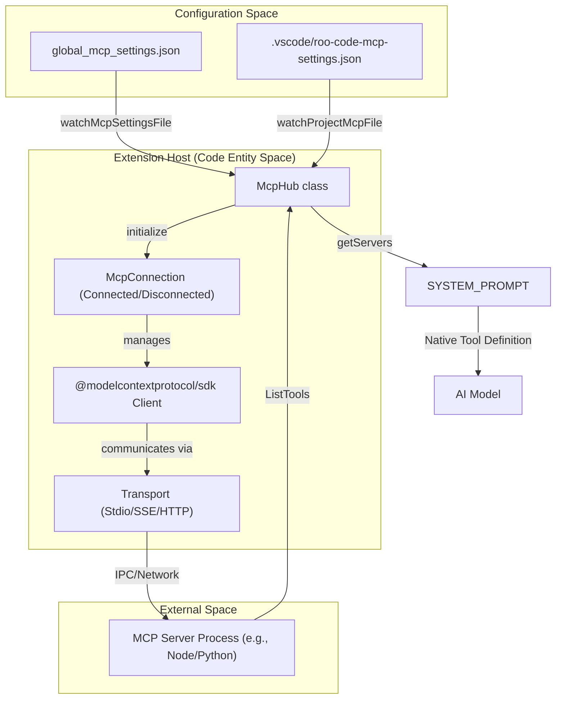
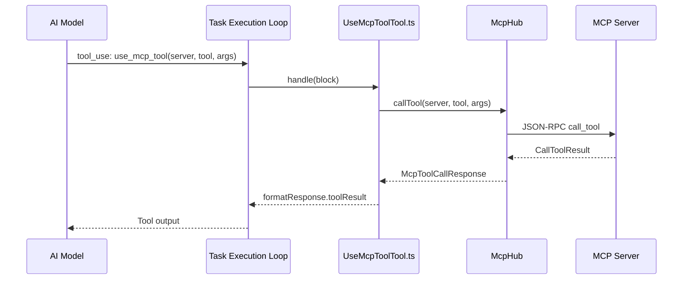

# MCP Tool Integration

<details>
<summary>Relevant source files</summary>

The following files were used as context for generating this wiki page:

- [src/api/providers/__tests__/bedrock-native-tools.spec.ts](src/api/providers/__tests__/bedrock-native-tools.spec.ts)
- [src/api/providers/__tests__/mistral.spec.ts](src/api/providers/__tests__/mistral.spec.ts)
- [src/core/prompts/tools/native-tools/__tests__/mcp_server.spec.ts](src/core/prompts/tools/native-tools/__tests__/mcp_server.spec.ts)
- [src/core/prompts/tools/native-tools/mcp_server.ts](src/core/prompts/tools/native-tools/mcp_server.ts)
- [src/core/tools/CodebaseSearchTool.ts](src/core/tools/CodebaseSearchTool.ts)
- [src/core/tools/ListFilesTool.ts](src/core/tools/ListFilesTool.ts)
- [src/core/tools/SearchFilesTool.ts](src/core/tools/SearchFilesTool.ts)
- [src/core/tools/UseMcpToolTool.ts](src/core/tools/UseMcpToolTool.ts)
- [src/core/tools/__tests__/useMcpToolTool.spec.ts](src/core/tools/__tests__/useMcpToolTool.spec.ts)
- [src/services/mcp/McpHub.ts](src/services/mcp/McpHub.ts)
- [src/services/mcp/__tests__/McpHub.spec.ts](src/services/mcp/__tests__/McpHub.spec.ts)
- [src/utils/__tests__/json-schema.spec.ts](src/utils/__tests__/json-schema.spec.ts)
- [src/utils/__tests__/mcp-name.spec.ts](src/utils/__tests__/mcp-name.spec.ts)
- [src/utils/json-schema.ts](src/utils/json-schema.ts)
- [src/utils/mcp-name.ts](src/utils/mcp-name.ts)
- [webview-ui/src/components/chat/McpExecution.tsx](webview-ui/src/components/chat/McpExecution.tsx)
- [webview-ui/src/components/mcp/McpResourceRow.tsx](webview-ui/src/components/mcp/McpResourceRow.tsx)
- [webview-ui/src/components/mcp/McpToolRow.tsx](webview-ui/src/components/mcp/McpToolRow.tsx)
- [webview-ui/src/components/mcp/McpView.tsx](webview-ui/src/components/mcp/McpView.tsx)
- [webview-ui/src/components/mcp/__tests__/McpToolRow.spec.tsx](webview-ui/src/components/mcp/__tests__/McpToolRow.spec.tsx)
- [webview-ui/src/components/ui/__tests__/toggle-switch.spec.tsx](webview-ui/src/components/ui/__tests__/toggle-switch.spec.tsx)
- [webview-ui/src/components/ui/index.ts](webview-ui/src/components/ui/index.ts)
- [webview-ui/src/components/ui/toggle-switch.tsx](webview-ui/src/components/ui/toggle-switch.tsx)
- [webview-ui/src/utils/mcp.ts](webview-ui/src/utils/mcp.ts)

</details>


This page documents Roo Code's integration with the **Model Context Protocol (MCP)**, a standard for connecting AI models to external tools and data sources. It covers the lifecycle of MCP servers, the `McpHub` orchestrator, and how MCP tools are exposed to the LLM.

## Overview

Roo Code acts as an MCP host, allowing it to connect to any MCP-compliant server via **stdio**, **SSE (Server-Sent Events)**, or **Streamable HTTP** transports. These servers provide:
- **Tools**: Executable functions the AI can call (e.g., `get_weather`, `query_database`). [src/services/mcp/McpHub.ts:27-28]()
- **Resources**: Data sources the AI can read (e.g., local logs, API documentation). [src/services/mcp/McpHub.ts:23-24]()
- **Resource Templates**: Parameterized URI patterns for dynamic data access. [src/services/mcp/McpHub.ts:25]()

The integration is managed by the `McpHub` class, which handles server discovery, connection persistence, and tool execution routing. [src/services/mcp/McpHub.ts:150-165]()

**Sources**: [src/services/mcp/McpHub.ts:22-29](), [src/services/mcp/McpHub.ts:150-165]()

---

## System Architecture

The following diagram illustrates the flow from a user's configuration to the AI's ability to invoke an MCP tool.

### MCP Data Flow: Configuration to Tool Call



**Sources**: [src/services/mcp/McpHub.ts:166-175](), [src/services/mcp/McpHub.ts:44-58](), [src/core/prompts/tools/native-tools/mcp_server.ts:7-10]()

---

## McpHub: The Central Orchestrator

The `McpHub` is responsible for the lifecycle of all MCP connections. It maintains a list of `McpConnection` objects, which are discriminated unions representing either a `connected` or `disconnected` state. [src/services/mcp/McpHub.ts:44-58]()

### Key Responsibilities
1.  **Server Initialization**: Reads configurations from both global settings and project-specific settings during construction. [src/services/mcp/McpHub.ts:171-174]()
2.  **Connection Management**: Spawns child processes for `stdio` servers or establishes connections for remote `sse` and `streamable-http` servers. [src/services/mcp/McpHub.ts:90-139]()
3.  **File Watching**: Monitors configuration files and server-specific `watchPaths` to trigger automatic restarts when code or settings change. [src/services/mcp/McpHub.ts:154-160]()
4.  **Tool Routing**: Provides the interface for `UseMcpToolTool` to call remote functions via the underlying MCP SDK client. [src/core/tools/UseMcpToolTool.ts:60-63]()

### Connection State Model
| State | Properties | Description |
| :--- | :--- | :--- |
| `connected` | `server`, `client`, `transport` | Active session over Stdio, SSE, or HTTP transport. [src/services/mcp/McpHub.ts:44-49]() |
| `disconnected` | `server`, `client: null`, `transport: null` | Configuration exists but the connection is inactive. [src/services/mcp/McpHub.ts:51-56]() |

**Sources**: [src/services/mcp/McpHub.ts:44-58](), [src/services/mcp/McpHub.ts:150-165](), [src/services/mcp/McpHub.ts:171-174]()

---

## MCP Tool Discovery and Prompting

To allow the LLM to use MCP tools, Roo Code transforms MCP tool definitions into a format the model understands (typically JSON Schema for function calling).

### Tool Naming Convention
To prevent collisions between different servers, MCP tools are namespaced using a specific separator:
`mcp--[server_name]--[tool_name]`

- **Prefix**: `mcp` [src/utils/mcp-name.ts:18]()
- **Separator**: `--` [src/utils/mcp-name.ts:13]()

The `buildMcpToolName` function handles sanitization and ensures the total length does not exceed 64 characters for compatibility with providers like Gemini. [src/utils/mcp-name.ts:127-137]()

### Schema Normalization
Before sending tool definitions to the LLM, Roo Code normalizes the JSON schemas via `normalizeToolSchema` to ensure compatibility with strict providers. [src/utils/json-schema.ts:116-125]()
- **Strict Mode**: Sets `additionalProperties: false` by default for object types. [src/utils/json-schema.ts:88]()
- **Nullable Types**: Converts `type: ["string", "null"]` array syntax to `anyOf` format for 2020-12 compliance. [src/utils/json-schema.ts:181-187]()
- **Format Stripping**: Removes unsupported `format` values (like `uri`) that cause errors in OpenAI's structured outputs. [src/utils/json-schema.ts:196-198]()
- **Array Specifics**: Moves properties like `items` and `minItems` inside the array variant when using `anyOf`. [src/utils/json-schema.ts:180-187]()

**Sources**: [src/utils/mcp-name.ts:13-18](), [src/utils/mcp-name.ts:127-137](), [src/utils/json-schema.ts:88](), [src/utils/json-schema.ts:116-125](), [src/utils/json-schema.ts:180-198]()

---

## Tool Execution Flow (`use_mcp_tool`)

When the LLM decides to use an MCP tool, it calls the native `use_mcp_tool` tool.

### Execution Sequence



### Validation and Safety
- **Missing Parameters**: If `server_name` or `tool_name` is missing, the tool records a mistake and returns a missing parameter error. [src/core/tools/UseMcpToolTool.ts:104-108]()
- **Invalid JSON**: If the arguments provided by the LLM are not valid JSON, the tool notifies the model for a retry. [src/core/tools/UseMcpToolTool.ts:180-184]()
- **Always Allow**: Users can configure specific tools or servers to bypass the manual approval dialog via the `alwaysAllow` setting. [src/services/mcp/McpHub.ts:70]()
- **Accessing Resources**: The AI can also use `access_mcp_resource` to read data via URIs provided by the server. [src/services/mcp/McpHub.ts:23-24]()

**Sources**: [src/core/tools/UseMcpToolTool.ts:98-108](), [src/core/tools/UseMcpToolTool.ts:180-184](), [src/services/mcp/McpHub.ts:70]()

---

## User Interface and Management

The MCP integration is exposed to the user through the **MCP View** in the React webview.

### McpView Components
- **ServerRow**: Displays connection status and allows restarting or deleting servers. [webview-ui/src/components/mcp/McpView.tsx:177-214]()
- **McpToolRow**: Lists available tools for a server, showing their descriptions, input parameters, and "Always Allow" toggles. [webview-ui/src/components/mcp/McpToolRow.tsx:43-67]()
- **McpResourceRow**: Displays resources and templates available on the server, including their MIME types. [webview-ui/src/components/mcp/McpResourceRow.tsx:7-10]()
- **McpEnabledToggle**: A global switch to enable or disable all MCP functionality. [webview-ui/src/components/mcp/McpView.tsx:58]()

### Status Indicators
- **Green**: Connected. [webview-ui/src/components/mcp/McpView.tsx:208]()
- **Yellow**: Connecting. [webview-ui/src/components/mcp/McpView.tsx:210]()
- **Red**: Disconnected. [webview-ui/src/components/mcp/McpView.tsx:212]()
- **Grey**: Disabled (either globally or per-server). [webview-ui/src/components/mcp/McpView.tsx:202]()

**Sources**: [webview-ui/src/components/mcp/McpView.tsx:177-214](), [webview-ui/src/components/mcp/McpToolRow.tsx:43-67](), [webview-ui/src/components/mcp/McpResourceRow.tsx:7-10](), [webview-ui/src/components/mcp/McpView.tsx:58]()

---

## Configuration Schema

MCP servers are defined using a Zod-validated schema that supports different transport types and common settings like timeouts and disabled tools. [src/services/mcp/McpHub.ts:143]()

```typescript
// Base configuration schema for common settings
const BaseConfigSchema = z.object({
	disabled: z.boolean().optional(),
	timeout: z.number().min(1).max(3600).optional().default(60),
	alwaysAllow: z.array(z.string()).default([]),
	watchPaths: z.array(z.string()).optional(),
	disabledTools: z.array(z.string()).default([]),
})

// Discriminated union for transport types (Simplified)
export const ServerConfigSchema = z.union([
    z.object({
        type: z.literal("stdio"),
        command: z.string(),
        args: z.array(z.string()).optional(),
        env: z.record(z.string()).optional()
    }),
    z.object({
        type: z.literal("sse"),
        url: z.string().url(),
        headers: z.record(z.string()).optional()
    }),
    z.object({
        type: z.literal("streamable-http"),
        url: z.string().url(),
        headers: z.record(z.string()).optional()
    })
]);
```

**Sources**: [src/services/mcp/McpHub.ts:67-73](), [src/services/mcp/McpHub.ts:89-143]()