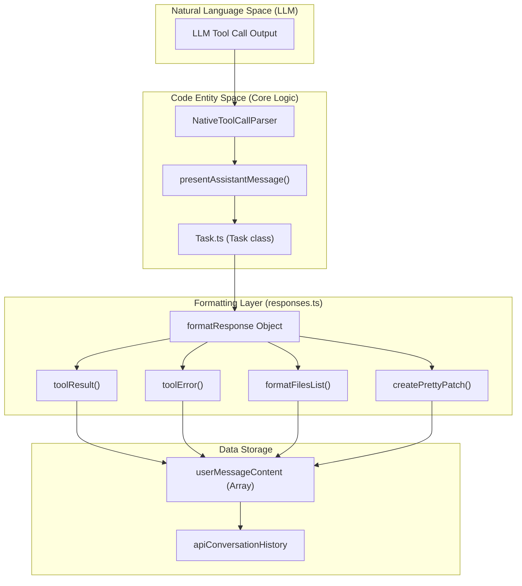

# Tool Result Formatting

<details>
<summary>Relevant source files</summary>

The following files were used as context for generating this wiki page:

- [packages/core/src/custom-tools/__tests__/custom-tool-registry.spec.ts](packages/core/src/custom-tools/__tests__/custom-tool-registry.spec.ts)
- [packages/types/src/tool.ts](packages/types/src/tool.ts)
- [src/core/assistant-message/NativeToolCallParser.ts](src/core/assistant-message/NativeToolCallParser.ts)
- [src/core/assistant-message/__tests__/presentAssistantMessage-custom-tool.spec.ts](src/core/assistant-message/__tests__/presentAssistantMessage-custom-tool.spec.ts)
- [src/core/assistant-message/__tests__/presentAssistantMessage-images.spec.ts](src/core/assistant-message/__tests__/presentAssistantMessage-images.spec.ts)
- [src/core/assistant-message/__tests__/presentAssistantMessage-unknown-tool.spec.ts](src/core/assistant-message/__tests__/presentAssistantMessage-unknown-tool.spec.ts)
- [src/core/assistant-message/presentAssistantMessage.ts](src/core/assistant-message/presentAssistantMessage.ts)
- [src/core/prompts/responses.ts](src/core/prompts/responses.ts)
- [src/core/prompts/tools/native-tools/edit.ts](src/core/prompts/tools/native-tools/edit.ts)
- [src/core/prompts/tools/native-tools/index.ts](src/core/prompts/tools/native-tools/index.ts)
- [src/core/tools/ExecuteCommandTool.ts](src/core/tools/ExecuteCommandTool.ts)
- [src/core/tools/__tests__/executeCommandTool.spec.ts](src/core/tools/__tests__/executeCommandTool.spec.ts)
- [src/shared/tools.ts](src/shared/tools.ts)

</details>


## Purpose and Scope

Tool Result Formatting defines the standardized output formats for tool execution results, errors, and user feedback in the Roo Code system. This system ensures that tool results are presented to the LLM in consistent, structured formats that enable reliable parsing and error handling. The formatting layer sits between raw tool execution outcomes and the API conversation history, managed primarily by the `formatResponse` object.

For information about tool execution and approval flows, see [Tool Approval and Safety](). For details on tool architecture and registration, see [Tool Architecture and Registry]().

**Sources:** [src/core/prompts/responses.ts:1-202]()

---

## Formatting Architecture Overview

The `formatResponse` object in `src/core/prompts/responses.ts` acts as the central factory for all tool-related feedback strings and message blocks. It translates internal execution states into standardized strings or structured message blocks compatible with provider APIs (e.g., Anthropic's `TextBlockParam` or `ImageBlockParam`).

**`formatResponse` method map — `src/core/prompts/responses.ts`**

```mermaid
graph TB
    subgraph "formatResponse[\"formatResponse (responses.ts)\"]"
        subgraph "JSON_FORMATS[\"JSON Status Responses\"]"
            DENIED["toolDenied()"]
            DENIED_FB["toolDeniedWithFeedback(feedback)"]
            APPROVED["toolApprovedWithFeedback(feedback)"]
            ERR["toolError(error)"]
            MISTAKES["tooManyMistakes(feedback)"]
            ROOIGNORE["rooIgnoreError(path)"]
        end
        subgraph "TEXT_FORMATS[\"Plain Text Responses\"]"
            NO_TOOLS["noToolsUsed()"]
            MISSING_PARAM["missingToolParameterError(paramName)"]
        end
        subgraph "FILE_FORMATS[\"File Operation Responses\"]"
            FILES_LIST["formatFilesList(...)"]
            DIFF["createPrettyPatch(filename, old, new)"]
        end
        subgraph "IMAGE_FORMATS[\"Image Responses\"]"
            IMG_BLOCKS["imageBlocks(images)"]
            TOOL_RESULT["toolResult(text, images)"]
        end
        subgraph "MCP_FORMATS[\"MCP Error Responses\"]"
            MCP_ARG["invalidMcpToolArgumentError(server, tool)"]
            MCP_TOOL["unknownMcpToolError(server, tool, available)"]
            MCP_SERVER["unknownMcpServerError(server, available)"]
        end
    end

    subgraph "Output"
        STR["string (JSON or plain text)"]
        BLOCKS["Array of TextBlockParam or ImageBlockParam"]
    end

    DENIED --> STR
    DENIED_FB --> STR
    APPROVED --> STR
    ERR --> STR
    MISTAKES --> STR
    ROOIGNORE --> STR
    NO_TOOLS --> STR
    MISSING_PARAM --> STR
    FILES_LIST --> STR
    DIFF --> STR
    MCP_ARG --> STR
    MCP_TOOL --> STR
    MCP_SERVER --> STR
    IMG_BLOCKS --> BLOCKS
    TOOL_RESULT --> STR
    TOOL_RESULT --> BLOCKS
```

**Sources:** [src/core/prompts/responses.ts:7-202]()

---

## Standardized JSON Response Formats

The `formatResponse` object provides JSON-formatted responses for common tool execution outcomes. All JSON responses follow a consistent structure with `status`, `message`, and contextual fields to help the model recover from errors or understand user intent.

### Response Structure

| Response Type | Format Function | Status Field | Use Case |
|--------------|----------------|--------------|----------|
| Tool Denied | `toolDenied()` | `"denied"` | User rejected tool execution [src/core/prompts/responses.ts:8-12]() |
| Tool Denied with Feedback | `toolDeniedWithFeedback(feedback)` | `"denied"` | User rejection with explanation [src/core/prompts/responses.ts:14-18]() |
| Tool Approved with Feedback | `toolApprovedWithFeedback(feedback)` | `"approved"` | User approval with guidance [src/core/prompts/responses.ts:20-24]() |
| Tool Error | `toolError(error)` | `"error"` | Tool execution failed [src/core/prompts/responses.ts:26-31]() |
| Too Many Mistakes | `tooManyMistakes(feedback)` | `"guidance"` | Consecutive mistake limit reached [src/core/prompts/responses.ts:57-61]() |

All JSON formatting functions use `JSON.stringify()` to produce a flat JSON object that the LLM can parse consistently.

**Sources:** [src/core/prompts/responses.ts:8-61]()

---

## Access Control and Validation Errors

### RooIgnore Access Denied
The `rooIgnoreError()` formatter provides structured error responses when file access is blocked by `.rooignore` patterns. This is checked in tools like `ExecuteCommandTool` and `ReadFileTool` [src/core/tools/ExecuteCommandTool.ts:58-64]().

```typescript
// Returns structured JSON with type, path, and suggestion
{
  "status": "error",
  "type": "access_denied",
  "message": "Access blocked by .rooignore",
  "path": "sensitive/config.json",
  "suggestion": "Try to continue without this file, or ask the user to update the .rooignore file"
}
```
**Sources:** [src/core/prompts/responses.ts:33-40]()

### Missing Tool Usage
The `noToolsUsed()` formatter detects when the LLM fails to invoke any tools and provides corrective guidance. It includes a reminder of tool instructions and specific next steps like using `attempt_completion` or `ask_followup_question`. [src/core/prompts/responses.ts:42-55]()

### Tool Parameter Validation
The `missingToolParameterError(paramName)` handles cases where required tool parameters are missing. It returns a plain text string informing the model of the specific missing parameter. [src/core/prompts/responses.ts:63-67]()

---

## MCP Tool Error Formatting

MCP (Model Context Protocol) tools have specialized error formats that provide context about server configuration and available tools. These are used when `use_mcp_tool` or native MCP tool calls fail [src/core/assistant-message/presentAssistantMessage.ts:105-127]().

| Function | `type` field | Key Fields |
|---|---|---|
| `invalidMcpToolArgumentError(server, tool)` | `"invalid_argument"` | `server`, `tool`, `suggestion` |
| `unknownMcpToolError(server, tool, available)` | `"unknown_tool"` | `server`, `tool`, `available_tools[]`, `suggestion` |
| `unknownMcpServerError(server, available)` | `"unknown_server"` | `server`, `available_servers[]` |

**Sources:** [src/core/prompts/responses.ts:69-97]()

---

## File Operation Formatting

### File List Formatting
The `formatFilesList()` function formats directory listings with special symbols for ignored and protected files. It performs natural sorting and groups files under their respective directories to help the model understand the workspace structure [src/core/prompts/responses.ts:117-151]().

**Access Control Indicators:**
- `🔒` (via `LOCK_TEXT_SYMBOL`) prefix for `.rooignore`-blocked files [src/core/prompts/responses.ts:170]()
- `🛡️` prefix for write-protected files identified by `RooProtectedController` [src/core/prompts/responses.ts:175]()

### Diff Patch Formatting
The `createPrettyPatch()` function generates unified diff format patches using the `diff` library. [src/core/prompts/responses.ts:193-201]()

**Implementation Details:**
- Uses `diff.createPatch()` [src/core/prompts/responses.ts:195]()
- Context size: 3 lines before/after changes [src/core/prompts/responses.ts:196]()
- Removes header lines (first 4 lines) for cleaner output [src/core/prompts/responses.ts:199]()

**Sources:** [src/core/prompts/responses.ts:117-201]()

---

## Image and Multi-Modal Formatting

### Tool Results with Images
`toolResult(text, images?)` supports both text-only and multi-modal responses.
- **No images** — returns `text` as a plain `string` [src/core/prompts/responses.ts:109]()
- **With images** — returns `Array<Anthropic.TextBlockParam | Anthropic.ImageBlockParam>`, with the text block first and image blocks appended after it [src/core/prompts/responses.ts:107]()

Images are placed after text because this ordering generally produces better reasoning results from multi-modal models [src/core/prompts/responses.ts:106]().

### Image Block Conversion
The internal helper `formatImagesIntoBlocks(images?)` converts `data:` URL strings into `Anthropic.ImageBlockParam` objects for provider APIs. [src/core/prompts/responses.ts:113-115]()

**Sources:** [src/core/prompts/responses.ts:99-116]()

---

## Tool Result Flow Diagram

This diagram bridges the Natural Language Space (LLM output) to Code Entity Space (internal classes and formatting functions).



**Sources:** [src/core/prompts/responses.ts:7-202](), [src/core/assistant-message/presentAssistantMessage.ts:61-127](), [src/core/assistant-message/NativeToolCallParser.ts:53-104]()

---

## Summary Table

| Formatting Function | Return Type | Primary Use Case |
|---------------------|-------------|------------------|
| `toolDenied()` | JSON string | User rejection without feedback |
| `toolDeniedWithFeedback(feedback)` | JSON string | User rejection with explanation |
| `toolApprovedWithFeedback(feedback)` | JSON string | User approval with guidance |
| `toolError(error)` | JSON string | Tool execution failure |
| `rooIgnoreError(path)` | JSON string | Access control violation |
| `noToolsUsed()` | Formatted string | No tool invocation detected |
| `tooManyMistakes(feedback)` | JSON string | Consecutive error limit reached |
| `missingToolParameterError(paramName)` | Formatted string | Required parameter missing |
| `invalidMcpToolArgumentError(...)` | JSON string | Invalid MCP tool argument |
| `unknownMcpToolError(...)` | JSON string | MCP tool not found |
| `unknownMcpServerError(...)` | JSON string | MCP server not configured |
| `toolResult(text, images?)` | String or Block array | Successful tool execution |
| `imageBlocks(images)` | `ImageBlockParam[]` | Convert images to blocks |
| `formatFilesList(...)` | String | Directory listing |
| `createPrettyPatch(filename, old, new)` | String | Unified diff output |

**Sources:** [src/core/prompts/responses.ts:7-202]()