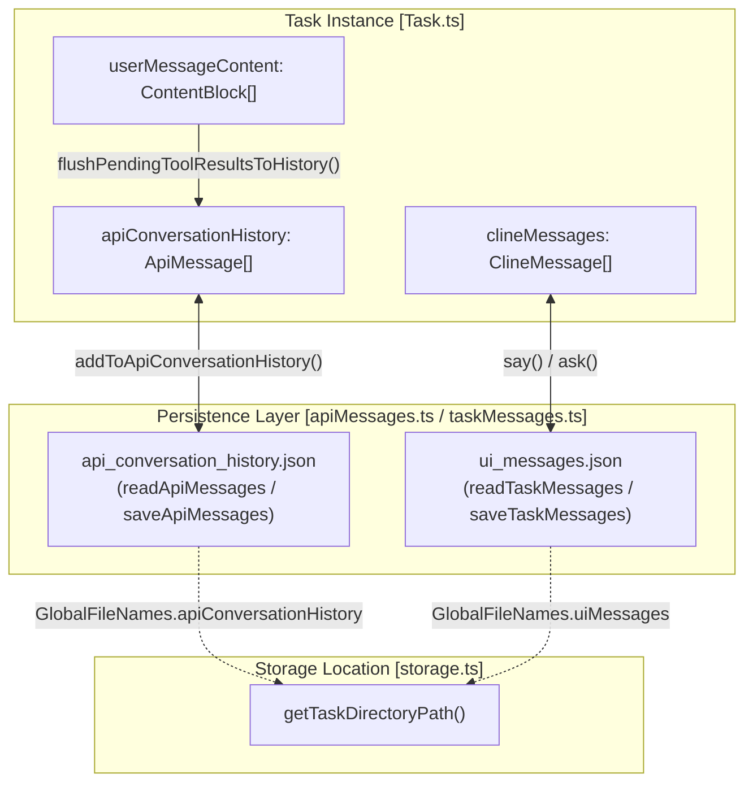
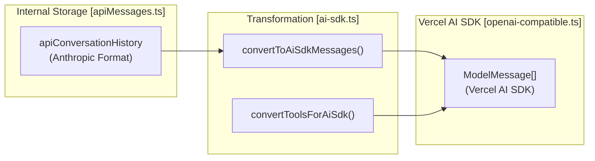

# Message History and Dual Storage

Relevant source files

The following files were used as context for generating this wiki page:

- [.roo/rules-code/use-safeWriteJson.md](.roo/rules-code/use-safeWriteJson.md)
- [packages/types/src/message.ts](packages/types/src/message.ts)
- [src/api/providers/fetchers/modelEndpointCache.ts](src/api/providers/fetchers/modelEndpointCache.ts)
- [src/api/providers/fireworks.ts](src/api/providers/fireworks.ts)
- [src/api/providers/openai-compatible.ts](src/api/providers/openai-compatible.ts)
- [src/api/providers/sambanova.ts](src/api/providers/sambanova.ts)
- [src/api/transform/__tests__/ai-sdk.spec.ts](src/api/transform/__tests__/ai-sdk.spec.ts)
- [src/api/transform/ai-sdk.ts](src/api/transform/ai-sdk.ts)
- [src/core/config/ContextProxy.ts](src/core/config/ContextProxy.ts)
- [src/core/config/ProviderSettingsManager.ts](src/core/config/ProviderSettingsManager.ts)
- [src/core/config/__tests__/ContextProxy.spec.ts](src/core/config/__tests__/ContextProxy.spec.ts)
- [src/core/config/__tests__/ProviderSettingsManager.spec.ts](src/core/config/__tests__/ProviderSettingsManager.spec.ts)
- [src/core/config/__tests__/importExport.spec.ts](src/core/config/__tests__/importExport.spec.ts)
- [src/core/config/importExport.ts](src/core/config/importExport.ts)
- [src/core/context-tracking/FileContextTracker.ts](src/core/context-tracking/FileContextTracker.ts)
- [src/core/task-persistence/__tests__/apiMessages.spec.ts](src/core/task-persistence/__tests__/apiMessages.spec.ts)
- [src/core/task-persistence/__tests__/taskMessages.spec.ts](src/core/task-persistence/__tests__/taskMessages.spec.ts)
- [src/core/task-persistence/apiMessages.ts](src/core/task-persistence/apiMessages.ts)
- [src/core/task-persistence/taskMessages.ts](src/core/task-persistence/taskMessages.ts)
- [src/core/task/__tests__/Task.sticky-profile-race.spec.ts](src/core/task/__tests__/Task.sticky-profile-race.spec.ts)
- [src/core/task/__tests__/Task.throttle.test.ts](src/core/task/__tests__/Task.throttle.test.ts)
- [src/core/task/__tests__/flushPendingToolResultsToHistory.spec.ts](src/core/task/__tests__/flushPendingToolResultsToHistory.spec.ts)
- [src/core/task/__tests__/grace-retry-errors.spec.ts](src/core/task/__tests__/grace-retry-errors.spec.ts)
- [src/core/task/__tests__/grounding-sources.test.ts](src/core/task/__tests__/grounding-sources.test.ts)
- [src/core/task/__tests__/reasoning-preservation.test.ts](src/core/task/__tests__/reasoning-preservation.test.ts)
- [src/integrations/misc/image-handler.ts](src/integrations/misc/image-handler.ts)
- [src/services/code-index/cache-manager.ts](src/services/code-index/cache-manager.ts)
- [src/utils/export.ts](src/utils/export.ts)

## Purpose and Scope

This document explains Roo Code's dual storage pattern for conversation history, where API messages and UI display messages are stored separately. This architecture ensures that the raw protocol-level communication with LLM providers remains decoupled from the user-facing interface state, allowing for complex protocol transformations without affecting the user experience.

## Dual Storage Architecture

Roo Code maintains two independent message histories for each task, stored in separate JSON files within the task directory. This separation allows the extension to transform protocol messages for different providers (e.g., converting Anthropic format to OpenAI or Vercel AI SDK formats) without losing UI-specific metadata like tool progress icons or approval states.

| File | Data Type | Purpose |
|------|-----------|---------|
| `api_conversation_history.json` | `ApiMessage[]` | Raw conversation history in provider-compatible format (primarily Anthropic protocol). |
| `ui_messages.json` | `ClineMessage[]` | User-facing messages, UI state, and interaction logs for the Webview. |

**Dual Storage System Architecture**

Sources: [src/core/task-persistence/apiMessages.ts:48-49](), [src/core/task-persistence/taskMessages.ts:16-17](), [src/core/task-persistence/apiMessages.ts:109-121](), [src/core/task-persistence/taskMessages.ts:28-40]()

## API Conversation History

### Structure and Format

The `apiConversationHistory` stores messages using the `ApiMessage` type, which extends `Anthropic.MessageParam` [src/core/task-persistence/apiMessages.ts:12-38](). This format serves as the "source of truth" for the LLM's context.

Key properties of `ApiMessage`:
- **role**: `"user"` or `"assistant"`.
- **content**: Array of text, image, `tool_use`, or `tool_result` blocks.
- **reasoning_content**: For DeepSeek/Z.ai interleaved thinking that must be preserved during tool sequences [src/core/task-persistence/apiMessages.ts:23-25]().
- **reasoning_details**: For OpenRouter/Gemini reasoning array formats [src/core/task-persistence/apiMessages.ts:21-22]().
- **condenseId / truncationId**: Metadata for non-destructive context management (summarization and sliding window) [src/core/task-persistence/apiMessages.ts:27-37]().

### Tool Result Synchronization and Flushing

A critical challenge in dual storage is ensuring `tool_result` blocks are correctly associated with their `tool_use` counterparts and persisted safely.

1.  **`assistantMessageSavedToHistory`**: This flag tracks whether the assistant's tool call has been successfully persisted before the extension attempts to send the results back to the API.
2.  **`validateAndFixToolResultIds`**: Before sending a user message containing tool results, Roo validates that every `tool_use_id` in the results has a matching `tool_use` ID in the most recent assistant message. This repairs mismatched IDs that might occur due to state corruption or partial history loads.
3.  **`flushPendingToolResultsToHistory`**: During a task execution loop, tool results are often accumulated in a temporary `userMessageContent` buffer. This function flushes these pending results into the formal `apiConversationHistory` and persists them to disk using `saveApiMessages` [src/core/task-persistence/apiMessages.ts:109-121]().

### Reasoning Preservation

For models that support internal reasoning (like DeepSeek or specific Anthropic models), Roo preserves this content in history. If `preserveReasoning` is enabled in `ModelInfo`, reasoning is prepended to the assistant's text content within `<think>` tags to ensure the model maintains its chain of thought in subsequent turns [src/core/task/__tests__/reasoning-preservation.test.ts:219-222]().

Sources: [src/core/task-persistence/apiMessages.ts:12-38](), [src/core/task/__tests__/reasoning-preservation.test.ts:185-243]()

## UI Messages (`clineMessages`)

The `clineMessages` array drives the React Webview. It uses `say()` and `ask()` patterns to update the user on progress.

-   **`say()`**: Adds a `ClineSay` message (e.g., `text`, `tool`, `command_output`, `reasoning`) which is purely informational [packages/types/src/message.ts:144-173]().
-   **`ask()`**: Adds a `ClineAsk` message (e.g., `tool` approval, `followup` question, `command`) and returns a promise that resolves when the user interacts with the UI [packages/types/src/message.ts:27-39]().

### State Synchronization

UI messages are synchronized to the webview via `postStateToWebview()`. This includes the full `clineMessages` array, allowing the UI to render the entire chat history with specialized components for tool calls, reasoning blocks, and terminal outputs.

Sources: [packages/types/src/message.ts:27-173]()

## Protocol Transformation (AI SDK)

Because Roo Code supports multiple providers, it uses transformation utilities to convert its internal Anthropic-style history into formats required by other SDKs, such as the Vercel AI SDK used for OpenAI-compatible providers [src/api/providers/openai-compatible.ts:15-16]().

**Message Transformation Flow**

The `convertToAiSdkMessages` function handles complex mappings, such as moving `tool_result` blocks into a specific `role: "tool"` message required by the AI SDK v6 schema [src/api/transform/ai-sdk.ts:98-103](). It also builds a `toolCallIdToName` map to resolve tool names for results, as some SDKs require the name in the result block [src/api/transform/ai-sdk.ts:22-31]().

Sources: [src/api/transform/ai-sdk.ts:18-153](), [src/api/transform/__tests__/ai-sdk.spec.ts:108-159](), [src/api/providers/openai-compatible.ts:161-166]()

## Persistence and Recovery

### Initialization and Migration

When a task is resumed, Roo loads both histories. The system includes migration logic to handle legacy file names (e.g., migrating from `claude_messages.json` to `api_conversation_history.json`) [src/core/task-persistence/apiMessages.ts:73-100]().

### Context Tracking

The `FileContextTracker` works alongside the message history to track which files have been "read" into the conversation context. It uses `TaskMetadata` (stored in `task_metadata.json`) to keep track of `roo_read_date`, `roo_edit_date`, and `user_edit_date` for files mentioned in the history [src/core/context-tracking/FileContextTracker.ts:114-126](). This metadata is used to detect if a file has been modified outside of Roo, potentially making the LLM's context stale [src/core/context-tracking/FileContextTracker.ts:12-16]().

Sources: [src/core/task-persistence/apiMessages.ts:73-100](), [src/core/context-tracking/FileContextTracker.ts:114-143]()