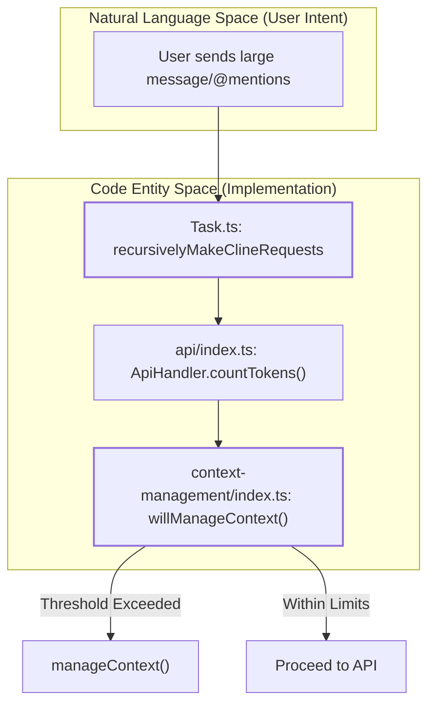
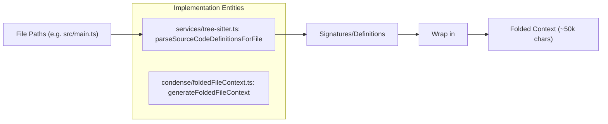

# Context Window Management

Relevant source files

The following files were used as context for generating this wiki page:

- [src/core/condense/__tests__/condense.spec.ts](src/core/condense/__tests__/condense.spec.ts)
- [src/core/condense/__tests__/foldedFileContext.spec.ts](src/core/condense/__tests__/foldedFileContext.spec.ts)
- [src/core/condense/__tests__/index.spec.ts](src/core/condense/__tests__/index.spec.ts)
- [src/core/condense/__tests__/nested-condense.spec.ts](src/core/condense/__tests__/nested-condense.spec.ts)
- [src/core/condense/__tests__/rewind-after-condense.spec.ts](src/core/condense/__tests__/rewind-after-condense.spec.ts)
- [src/core/condense/foldedFileContext.ts](src/core/condense/foldedFileContext.ts)
- [src/core/condense/index.ts](src/core/condense/index.ts)
- [src/core/context-management/__tests__/context-management.spec.ts](src/core/context-management/__tests__/context-management.spec.ts)
- [src/core/context-management/__tests__/truncation.spec.ts](src/core/context-management/__tests__/truncation.spec.ts)
- [src/core/context-management/index.ts](src/core/context-management/index.ts)
- [src/core/webview/__tests__/webviewMessageHandler.delete.spec.ts](src/core/webview/__tests__/webviewMessageHandler.delete.spec.ts)

This document explains how Roo Code manages conversation context to fit within model token limits while preserving critical information. It covers token counting, intelligent context condensation, truncation strategies, and error recovery mechanisms.

## Overview and Purpose

AI models have finite context windows (typically 128k-2M tokens). As conversations grow, Roo Code must intelligently manage what information to keep, summarize, or discard. The system employs a multi-layered approach:

1.  **Token Tracking**: Continuous monitoring of token usage using provider-specific counting logic via `ApiHandler.countTokens` [src/core/context-management/index.ts:35-41]().
2.  **Intelligent Condensation**: Summarizing older conversation turns while preserving critical state like active command blocks [src/core/condense/index.ts:187-200]().
3.  **Smart Code Folding**: Preserving lightweight structural maps of recently accessed code using tree-sitter to maintain architectural awareness [src/core/condense/foldedFileContext.ts:45-53]().
4.  **Non-Destructive Truncation**: A sliding window fallback that tags messages as hidden rather than deleting them, allowing for recovery during "rewind" operations [src/core/context-management/index.ts:53-61]().
5.  **Error Recovery**: Automatic context reduction when the API returns a `context_length_exceeded` error.

Sources: [src/core/context-management/index.ts:12-20](), [src/core/condense/index.ts:114-124](), [src/core/context-management/index.ts:35-41]()

## Token Counting and Budget Management

The system reserves a buffer to ensure the model has room to generate a response. The `TOKEN_BUFFER_PERCENTAGE` is set to 0.1 (10%) [src/core/context-management/index.ts:26]().

### Budget Calculation Logic

The `willManageContext` function determines if management is required based on the following flow:

**Diagram: Context Budget Decision Bridge**

The effective allowed tokens are calculated as:
`allowedTokens = contextWindow * (1 - TOKEN_BUFFER_PERCENTAGE) - reservedTokens` [src/core/context-management/index.ts:175-176]().
`reservedTokens` defaults to the model's `maxTokens` or `ANTHROPIC_DEFAULT_MAX_TOKENS` (8192) [src/core/context-management/index.ts:174]().

Sources: [src/core/context-management/index.ts:161-181](), [src/core/context-management/index.ts:26-41]()

## Intelligent Context Condensation

Condensation transforms a long history into a concise summary. This is handled by `summarizeConversation` in `src/core/condense/index.ts`.

### Condensation Process and Tool Handling

Because some providers (like Bedrock) require tool definitions if tool blocks are present in history, Roo Code converts `tool_use` and `tool_result` blocks into plain text during the summarization request to simplify the prompt [src/core/condense/index.ts:71-93]().

1.  **Transform**: `transformMessagesForCondensing` converts tool blocks to text [src/core/condense/index.ts:102-109]().
2.  **Summarize**: A system operation request is sent to the LLM with a `SUMMARY_PROMPT` [src/core/condense/index.ts:114-123]().
3.  **Inject Synthetic Results**: If condensation is triggered while a tool call is pending (orphan `tool_use`), the system injects a synthetic `tool_result` saying "Context condensation triggered. Tool execution deferred." to satisfy API requirements (especially for OpenAI) [src/core/condense/index.ts:134-178]().
4.  **Preserve Commands**: Active workflows wrapped in `<command>` tags are extracted using `extractCommandBlocks` and preserved to ensure continuity [src/core/condense/index.ts:187-200]().

Sources: [src/core/condense/index.ts:19-61](), [src/core/condense/index.ts:134-178](), [src/core/condense/index.ts:71-93]()

### Smart Code Folding

During condensation, Roo Code uses `generateFoldedFileContext` to maintain awareness of the codebase structure without full file contents.

**Diagram: Smart Code Folding Data Flow**

Each file is wrapped in a `<system-reminder>` block [src/core/condense/foldedFileContext.ts:114-117](). The system uses `parseSourceCodeDefinitionsForFile` to extract signatures [src/core/condense/foldedFileContext.ts:105](). It respects a `maxCharacters` budget (default 50,000) and will truncate definitions if necessary to fit [src/core/condense/foldedFileContext.ts:120-142]().

Sources: [src/core/condense/foldedFileContext.ts:76-152](), [src/core/condense/index.ts:13-15](), [src/core/condense/foldedFileContext.ts:105-117]()

## Truncation Strategy (Sliding Window)

If condensation is disabled or insufficient, the system uses a non-destructive sliding window truncation implemented in `truncateConversation` [src/core/context-management/index.ts:67]().

### Non-Destructive Tagging

Instead of deleting messages, Roo Code tags them with a `truncationParent` UUID [src/core/context-management/index.ts:70-104]().
*   **First Message**: Always retained [src/core/context-management/index.ts:81]().
*   **Removal Fraction**: A specified fraction of messages (rounded to an even number to keep user/assistant pairs) is hidden [src/core/context-management/index.ts:83-84]().
*   **Marker**: A `isTruncationMarker` message is inserted at the boundary to inform the model and UI [src/core/context-management/index.ts:113-119]().

### Recovery and Rewind

When a user deletes a message or rewinds the conversation (handled in `webviewMessageHandler.ts`), the system calls `cleanupAfterTruncation` [src/core/condense/index.ts:251](). This function:
1.  Checks if the `truncationId` or `condenseId` associated with hidden messages still exists in the visible history [src/core/condense/index.ts:262-273]().
2.  If the marker/summary is missing (deleted during rewind), it clears the `truncationParent`/`condenseParent` tags, effectively "reactivating" the old messages for the next API call [src/core/condense/index.ts:275-280]().

Sources: [src/core/context-management/index.ts:67-135](), [src/core/condense/index.ts:251-285](), [src/core/webview/__tests__/webviewMessageHandler.delete.spec.ts:85-120]()

## Context Length Exceeded Recovery

When an API request fails with a context length error, the system performs emergency management:

1.  **Detection**: The `Task` identifies the error type from the provider response.
2.  **Forced Reduction**: It triggers `manageContext` with a high `fracToRemove` or forced condensation.
3.  **History Persistence**: The updated (condensed/truncated) history is saved to disk using `saveTaskMessages` to ensure the task state remains consistent [src/core/webview/__tests__/webviewMessageHandler.delete.spec.ts:8-10]().

Sources: [src/core/context-management/index.ts:153-170](), [src/core/condense/__tests__/rewind-after-condense.spec.ts:149-160]()