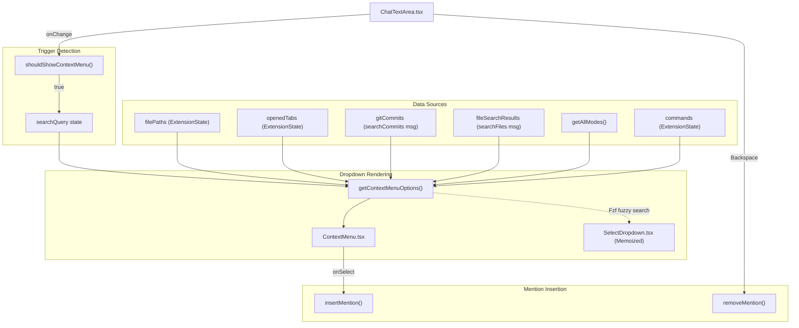
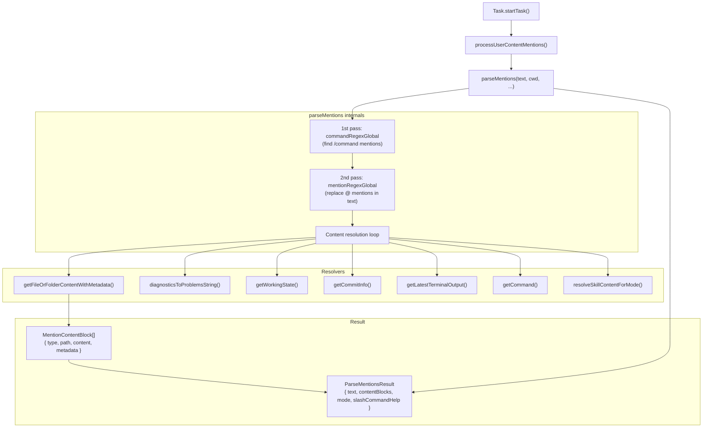

# Context Mentions System

<details>
<summary>Relevant source files</summary>

The following files were used as context for generating this wiki page:

- [src/__tests__/command-mentions.spec.ts](src/__tests__/command-mentions.spec.ts)
- [src/core/mentions/__tests__/processUserContentMentions.spec.ts](src/core/mentions/__tests__/processUserContentMentions.spec.ts)
- [src/core/mentions/index.ts](src/core/mentions/index.ts)
- [src/core/mentions/processUserContentMentions.ts](src/core/mentions/processUserContentMentions.ts)
- [src/core/task/Task.ts](src/core/task/Task.ts)
- [src/core/task/__tests__/Task.spec.ts](src/core/task/__tests__/Task.spec.ts)
- [src/core/tools/RunSlashCommandTool.ts](src/core/tools/RunSlashCommandTool.ts)
- [src/core/tools/SkillTool.ts](src/core/tools/SkillTool.ts)
- [src/core/tools/__tests__/runSlashCommandTool.spec.ts](src/core/tools/__tests__/runSlashCommandTool.spec.ts)
- [src/services/skills/__tests__/skillInvocation.spec.ts](src/services/skills/__tests__/skillInvocation.spec.ts)
- [src/shared/__tests__/context-mentions.spec.ts](src/shared/__tests__/context-mentions.spec.ts)
- [src/shared/context-mentions.ts](src/shared/context-mentions.ts)
- [webview-ui/src/__tests__/command-autocomplete.spec.ts](webview-ui/src/__tests__/command-autocomplete.spec.ts)
- [webview-ui/src/components/chat/ChatTextArea.tsx](webview-ui/src/components/chat/ChatTextArea.tsx)
- [webview-ui/src/components/chat/ContextMenu.tsx](webview-ui/src/components/chat/ContextMenu.tsx)
- [webview-ui/src/components/chat/__tests__/BatchFilePermission.spec.tsx](webview-ui/src/components/chat/__tests__/BatchFilePermission.spec.tsx)
- [webview-ui/src/components/common/CodeBlock.tsx](webview-ui/src/components/common/CodeBlock.tsx)
- [webview-ui/src/components/common/Thumbnails.tsx](webview-ui/src/components/common/Thumbnails.tsx)
- [webview-ui/src/components/common/__tests__/CodeBlock.spec.tsx](webview-ui/src/components/common/__tests__/CodeBlock.spec.tsx)
- [webview-ui/src/components/history/__tests__/BatchDeleteTaskDialog.spec.tsx](webview-ui/src/components/history/__tests__/BatchDeleteTaskDialog.spec.tsx)
- [webview-ui/src/components/ui/select-dropdown.tsx](webview-ui/src/components/ui/select-dropdown.tsx)
- [webview-ui/src/utils/__tests__/context-mentions.spec.ts](webview-ui/src/utils/__tests__/context-mentions.spec.ts)
- [webview-ui/src/utils/context-mentions.ts](webview-ui/src/utils/context-mentions.ts)

</details>


This page documents how `@`-mentions and `/`-commands are detected, presented as autocomplete suggestions, and resolved into structured content blocks that are included in AI message history. This covers the full pipeline from the user typing `@` in the chat input through to the AI receiving file contents, diagnostics, git info, or terminal output.

For the broader chat input component that hosts the mention textarea, see [8.4](). For slash command execution and mode switching, see [10.1]() and [10.2](). For how the resulting content blocks fit into conversation history, see [7.1]().

---

## Overview

The mentions system consists of two halves that communicate across the webview/extension boundary:

- **Frontend** (webview): Detects trigger characters (`@`, `/`), shows a dropdown, and inserts the chosen mention token into the text.
- **Backend** (extension host): On message send, parses mention tokens in the user text and resolves them into file contents, diagnostics, git data, or terminal output.

**Mention types supported:**

| Trigger syntax | Type | Resolved content |
|---|---|---|
| `@/path/to/file.ts` | File | Full file text (formatted like `read_file` output) |
| `@/path/to/folder/` | Folder | Directory listing + file contents |
| `@problems` | VS Code Diagnostics | Errors and warnings from the Problems panel |
| `@terminal` | Terminal | Last terminal session output |
| `@git-changes` | Working changes | `git diff` of uncommitted changes |
| `@abc1234` | Git commit (7–40 hex chars) | Commit metadata and diff |
| `@https://...` | URL | Passed through as a URL reference |
| `/command-name` | Slash command | Content from `.roo/commands/` or `.roo/skills/` |
| `/mode-slug` | Mode switch | Mode selection (not file content) |

Sources: [src/shared/context-mentions.ts:63-68](), [src/core/mentions/index.ts:49-71](), [src/core/mentions/index.ts:163-181]()

---

## Regex Engine

All mention detection — both in the frontend textarea and in the backend parser — is built on shared regex patterns exported from `src/shared/context-mentions.ts`.

**`mentionRegex`** — matches a single `@`-mention:

```
/(?:^|(?<=\s))(?<!\\)@((?:\/|\w+:\/\/)(?:[^\s\\]|\\ )+?|[a-f0-9]{7,40}\b|problems\b|git-changes\b|terminal\b)(?=[.,;:!?]?(?=[\s\r\n]|$))/
```

Key constraints:
- `@` must be at the start of a line or preceded by whitespace (prevents matching `email@example.com` or pasted log entries) [src/shared/context-mentions.ts:10-12]()
- A leading `\\` escapes the `@` (opt-out for the user) [src/shared/context-mentions.ts:14-15]()
- File paths use `/` prefix; URLs use `\w+://` protocol [src/shared/context-mentions.ts:20-26]()
- Spaces within file paths must be escaped as `\ ` (backslash-space) [src/shared/context-mentions.ts:31]()
- Trailing punctuation (`.`, `,`, etc.) is excluded from the match via lookahead [src/shared/context-mentions.ts:41-46]()

**`mentionRegexGlobal`** — same pattern with the `g` flag for finding all matches in a string. [src/shared/context-mentions.ts:65]()

**`commandRegexGlobal`** — matches slash commands anywhere in text:

```
/(?:^|\s)\/([a-zA-Z0-9_\.-]+)(?=\s|$)/g
```

Sources: [src/shared/context-mentions.ts:1-111](), [src/shared/context-mentions.ts:68]()

---

## Frontend: Autocomplete Dropdown

**Component Flow Diagram**



Sources: [webview-ui/src/components/chat/ChatTextArea.tsx:132-209](), [webview-ui/src/utils/context-mentions.ts:124-365](), [webview-ui/src/components/chat/ContextMenu.tsx:50-52](), [webview-ui/src/components/ui/select-dropdown.tsx:115-119]()

### Building Options: `getContextMenuOptions`

`getContextMenuOptions(query, selectedType, queryItems, dynamicSearchResults, modes, commands)` returns the list of `ContextMenuQueryItem` objects for the dropdown. Its logic:

1. **Slash command mode** (`query.startsWith("/")`): Uses [fzf](https://github.com/nicowillis/fzf) fuzzy matching against `commands` and `modes` lists. Returns `SectionHeader` dividers, then matching `Command` items, then matching `Mode` items. [webview-ui/src/utils/context-mentions.ts:134-215]()
2. **Empty `@` query**: Returns the top-level menu: `Problems`, `Terminal`, `URL`, `Folder`, `File`, `Git`. [webview-ui/src/utils/context-mentions.ts:225-245]()
3. **Non-empty `@` query**: Fuzzy-matches against `queryItems` (opened files, workspace files, git commits). Also appends `dynamicSearchResults` from the extension's file search. [webview-ui/src/utils/context-mentions.ts:246-365]()

### File Search (Dynamic Results)

When the `@` query is non-empty, `ChatTextArea` debounces a `searchFiles` webview message to the extension, which returns `fileSearchResults`. The result set is correlated by `searchRequestId` to avoid stale responses. [webview-ui/src/components/chat/ChatTextArea.tsx:117](), [webview-ui/src/components/chat/ChatTextArea.tsx:199-204]()

### Mention Insertion and Removal

**`insertMention(text, position, value, isSlashCommand)`**:
- Slash command: replaces the entire text with the selected value. [webview-ui/src/utils/context-mentions.ts:34-39]()
- `@` mention: finds the last `@` before the cursor, replaces text from `@` onward with `@<value> `. [webview-ui/src/utils/context-mentions.ts:59-73]()
- Paths containing spaces are escaped via `escapeSpaces` (e.g. `/my file.ts` → `/my\ file.ts`). [webview-ui/src/utils/context-mentions.ts:48-54]()

**`removeMention(text, position)`**:
- If the cursor is at the end of a mention token (matched by `mentionRegex`), removes the entire mention plus the trailing space. [webview-ui/src/utils/context-mentions.ts:78-93]()

Sources: [webview-ui/src/utils/context-mentions.ts:27-97]()

---

## Backend: Parsing Mentions

When the user sends a message, the extension host resolves all mention tokens into actual content. The entry points are `parseMentions` and `processUserContentMentions`.

**Backend Parsing Pipeline Diagram**



Sources: [src/core/mentions/index.ts:99-151](), [src/core/mentions/index.ts:163-181](), [src/core/mentions/processUserContentMentions.ts:36-56]()

### `parseMentions`

Signature:
```typescript
export async function parseMentions(
	text: string,
	cwd: string,
	fileContextTracker?: FileContextTracker,
	rooIgnoreController?: RooIgnoreController,
	showRooIgnoredFiles: boolean = false,
	includeDiagnosticMessages: boolean = true,
	maxDiagnosticMessages: number = 50,
	skillsManager?: SkillLookup,
	currentMode: string = "code",
): Promise<ParseMentionsResult>
```

**Pass 1 — Command mentions** (`commandRegexGlobal`):
- Finds all `/command-name` tokens.
- Calls `getCommand(cwd, commandName)` for each unique name. [src/core/mentions/index.ts:123]()
- If command is missing, it attempts `resolveSkillContentForMode(skillsManager, commandName, currentMode)`. [src/core/mentions/index.ts:128]()
- Valid commands are cached; the text is replaced with `"Command 'command-name' (see below for command content)"`. [src/core/mentions/index.ts:157]()

**Pass 2 — `@` mentions** (`mentionRegexGlobal`):
- Replaces each token in the text with a clean reference string (e.g. `'path/to/file'` or `"Terminal Output (see below for output)"`). [src/core/mentions/index.ts:163-181]()

**Content resolution loop**:
- Resolves file/folder content via `getFileOrFolderContentWithMetadata`. [src/core/mentions/index.ts:187]()
- Appends diagnostics, git changes, commit info, or terminal output to `contentBlocks`. [src/core/mentions/index.ts:47-64]()

Sources: [src/core/mentions/index.ts:99-239]()

### File and Folder Resolution

`getFileOrFolderContentWithMetadata` uses `extractTextFromFileWithMetadata` to retrieve content. [src/core/mentions/index.ts:12](). Files are tracked via `FileContextTracker` for context awareness. [src/core/mentions/index.ts:16]().

If a file is truncated, `formatFileReadResult` adds a Gemini-style truncation warning with instructions for using `read_file` with an offset. [src/core/mentions/index.ts:79-97]()

---

## `processUserContentMentions`

This function is the primary entry point for expanding mentions in user messages before they are sent to the AI. It operates on `Anthropic.Messages.ContentBlockParam[]`. [src/core/mentions/processUserContentMentions.ts:36-56]()

**Logic**:
- Only processes blocks containing the `<user_message>` tag. [src/core/mentions/processUserContentMentions.ts:65]()
- Converts `MentionContentBlock` objects into `TextPart` blocks. [src/core/mentions/processUserContentMentions.ts:22-27]()
- Appends these content blocks after the modified user text. [src/core/mentions/processUserContentMentions.ts:96-99]()
- Handles `tool_result` blocks by expanding mentions within their content. [src/core/mentions/processUserContentMentions.ts:111-215]()

Sources: [src/core/mentions/processUserContentMentions.ts:1-226]()

---

## FileContextTracker

The `FileContextTracker` is used during mention parsing to maintain a record of which files have been shared with the AI. This allows the system to manage context more effectively by knowing exactly what "code entity space" has been mapped into the conversation.

Sources: [src/core/mentions/index.ts:16](), [src/core/mentions/index.ts:102]()

---

## Key Code Entities Summary

| Symbol | File | Role |
|---|---|---|
| `mentionRegex` | `src/shared/context-mentions.ts` | Regex for detecting `@`-mentions. |
| `commandRegexGlobal` | `src/shared/context-mentions.ts` | Regex for detecting `/`-slash commands. |
| `parseMentions` | `src/core/mentions/index.ts` | Main parser for resolving mentions into content. |
| `processUserContentMentions` | `src/core/mentions/processUserContentMentions.ts` | Orchestrates mention expansion for AI messages. |
| `MentionContentBlock` | `src/core/mentions/index.ts` | Data structure for a resolved mention's content. |
| `getContextMenuOptions` | `webview-ui/src/utils/context-mentions.ts` | Logic for populating the autocomplete dropdown. |
| `convertToMentionPath` | `webview-ui/src/utils/path-mentions.ts` | Utility for formatting FS paths for mentions. |
| `ChatTextArea` | `webview-ui/src/components/chat/ChatTextArea.tsx` | UI component managing the mention input lifecycle. |

Sources: [src/shared/context-mentions.ts:63-68](), [src/core/mentions/index.ts:99](), [src/core/mentions/processUserContentMentions.ts:36](), [webview-ui/src/utils/context-mentions.ts:124](), [webview-ui/src/components/chat/ChatTextArea.tsx:61]()