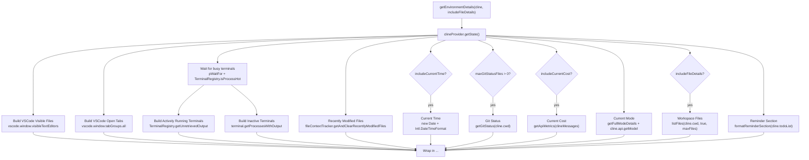
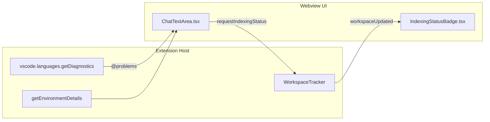
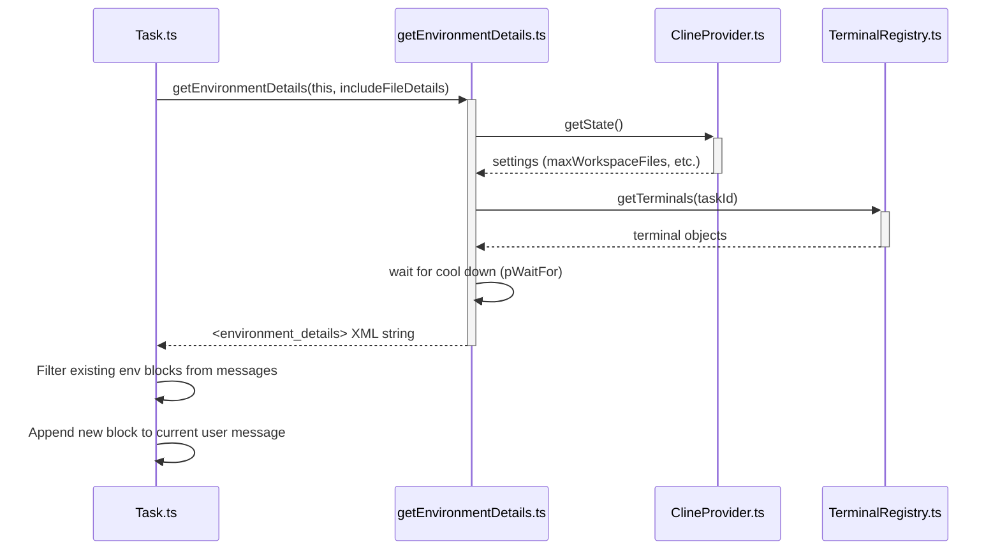

# Environment and Diagnostic Collection

<details>
<summary>Relevant source files</summary>

The following files were used as context for generating this wiki page:

- [packages/types/src/history.ts](packages/types/src/history.ts)
- [src/core/environment/__tests__/getEnvironmentDetails.spec.ts](src/core/environment/__tests__/getEnvironmentDetails.spec.ts)
- [src/core/environment/getEnvironmentDetails.ts](src/core/environment/getEnvironmentDetails.ts)
- [src/core/task-persistence/taskMetadata.ts](src/core/task-persistence/taskMetadata.ts)
- [src/core/task/__tests__/native-tools-filtering.spec.ts](src/core/task/__tests__/native-tools-filtering.spec.ts)
- [src/core/task/__tests__/task-tool-history.spec.ts](src/core/task/__tests__/task-tool-history.spec.ts)
- [src/core/tools/ReadFileTool.ts](src/core/tools/ReadFileTool.ts)
- [src/core/tools/__tests__/newTaskTool.spec.ts](src/core/tools/__tests__/newTaskTool.spec.ts)
- [src/core/tools/__tests__/readFileTool.spec.ts](src/core/tools/__tests__/readFileTool.spec.ts)
- [src/core/tools/helpers/__tests__/toolResultFormatting.spec.ts](src/core/tools/helpers/__tests__/toolResultFormatting.spec.ts)
- [src/core/tools/helpers/toolResultFormatting.ts](src/core/tools/helpers/toolResultFormatting.ts)
- [src/integrations/workspace/WorkspaceTracker.ts](src/integrations/workspace/WorkspaceTracker.ts)
- [src/utils/__tests__/path.spec.ts](src/utils/__tests__/path.spec.ts)
- [src/utils/path.ts](src/utils/path.ts)

</details>


This page covers how Roo Code collects runtime environment information — open files, terminal output, time, git status, cost, mode, and workspace files — and packages it into the `<environment_details>` block that is appended to every user turn sent to the AI. It also covers how VS Code diagnostics (errors and warnings) are gathered after file edits and on demand via the `@problems` mention.

For how the `<environment_details>` block is used within the broader message assembly process, see [Context Mentions System](#7.3). For how the system prompt is assembled (separate from per-turn context), see [System Prompt Generation](#9.1). For terminal integration specifics, see [Command Execution and Terminal Tools](#6.5).

---

## Overview

Every request the AI receives includes a freshly computed `<environment_details>` block describing the current state of the developer's editor and workspace. This block is computed by the `getEnvironmentDetails` function in [src/core/environment/getEnvironmentDetails.ts:23-23]() and injected into the user message content by `Task` before the message is sent to the API.

The block is an XML-delimited string, structured as a flat sequence of named sections:

```
<environment_details>
# VSCode Visible Files
...
# VSCode Open Tabs
...
# Actively Running Terminals
...
# Recently Modified Files
...
# Current Time
...
# Current Cost
...
# Current Mode
...
</environment_details>
```

Additionally, VS Code diagnostics (linter errors, type errors) are collected to report new problems caused by edits or to provide context when the user specifically requests workspace problems.

---

## `getEnvironmentDetails` Function

**File:** [src/core/environment/getEnvironmentDetails.ts:23-23]()

**Signature:**
```ts
export async function getEnvironmentDetails(cline: Task, includeFileDetails: boolean = false)
```

The function takes the active `Task` instance and a flag indicating whether to include a full workspace file listing (typically `true` for the first message of a new task). It reads provider state to determine which sections to include and what limits to apply [src/core/environment/getEnvironmentDetails.ts:26-28]().

### Data Sources and Sections

The table below maps each output section to its data source and the settings that control it.

| Output Section | Data Source | Controlling Setting | Default |
|---|---|---|---|
| `# VSCode Visible Files` | `vscode.window.visibleTextEditors` | — | Always included if non-empty [src/core/environment/getEnvironmentDetails.ts:32-46]() |
| `# VSCode Open Tabs` | `vscode.window.tabGroups.all` | `maxOpenTabsContext` | 20 tabs [src/core/environment/getEnvironmentDetails.ts:48-66]() |
| `# Actively Running Terminals` | `TerminalRegistry.getTerminals(true, taskId)` | — | Always if terminals busy [src/core/environment/getEnvironmentDetails.ts:69-114]() |
| `# Inactive Terminals with Completed Process Output` | `TerminalRegistry.getTerminals(false, taskId)` | — | Always if output pending [src/core/environment/getEnvironmentDetails.ts:118-156]() |
| `# Recently Modified Files` | `cline.fileContextTracker.getAndClearRecentlyModifiedFiles()` | — | Always if non-empty [src/core/environment/getEnvironmentDetails.ts:161-169]() |
| `# Current Time` | `new Date()` + `Intl.DateTimeFormat` | `includeCurrentTime` | `true` [src/core/environment/getEnvironmentDetails.ts:179-188]() |
| `# Git Status` | `getGitStatus(cline.cwd, maxGitStatusFiles)` | `maxGitStatusFiles` | `0` (disabled) [src/core/environment/getEnvironmentDetails.ts:191-204]() |
| `# Current Cost` | `getApiMetrics(cline.clineMessages).totalCost` | `includeCurrentCost` | `true` [src/core/environment/getEnvironmentDetails.ts:207-215]() |
| `# Current Mode` | `getFullModeDetails(currentMode, ...)` + `cline.api.getModel()` | — | Always included [src/core/environment/getEnvironmentDetails.ts:218-226]() |
| `# Current Workspace Directory Files` | `listFiles(cline.cwd, true, maxFiles)` | `includeFileDetails` flag + `maxWorkspaceFiles` | Only on first message [src/core/environment/getEnvironmentDetails.ts:229-258]() |

Paths in "VSCode Visible Files" and "VSCode Open Tabs" are filtered through `cline.rooIgnoreController.filterPaths()` before inclusion to respect exclusion rules [src/core/environment/getEnvironmentDetails.ts:39-41](), [src/core/environment/getEnvironmentDetails.ts:59-61]().

**`getEnvironmentDetails` internal flow:**

Title: Environment Data Flow

Sources: [src/core/environment/getEnvironmentDetails.ts:23-266](), [src/core/environment/__tests__/getEnvironmentDetails.spec.ts:143-211]()

---

## Terminal Output Collection

Terminal output is the most complex part of the environment details. The function handles two categories of terminals:

- **Busy terminals**: terminals where a process is currently running. The function calls `pWaitFor` with a 5-second timeout to wait for processes to "cool down" (measured by `TerminalRegistry.isProcessHot`) [src/core/environment/getEnvironmentDetails.ts:85-88](). If `cline.didEditFile` is true, a 300ms delay is added first to let the terminal react to file saves [src/core/environment/getEnvironmentDetails.ts:80-82]().
- **Inactive terminals with pending output**: terminals where a process has completed but output has not yet been retrieved. These are read via `terminal.getProcessesWithOutput()` and the output queue is cleared with `terminal.cleanCompletedProcessQueue()` after reading [src/core/environment/getEnvironmentDetails.ts:132-144]().

All output passes through `Terminal.compressTerminalOutput()` before inclusion [src/core/environment/getEnvironmentDetails.ts:110-111]().

Sources: [src/core/environment/getEnvironmentDetails.ts:68-156]()

---

## Workspace File Listing and Tracking

When `includeFileDetails` is `true` (typically only on task start), the function calls `listFiles(cline.cwd, true, maxFiles)` and formats the result using `formatResponse.formatFilesList(...)` [src/core/environment/getEnvironmentDetails.ts:245-251]().

### `WorkspaceTracker`
**File:** [src/integrations/workspace/WorkspaceTracker.ts:11-11]()

The `WorkspaceTracker` class maintains a live set of file paths in the current workspace up to a limit of `MAX_INITIAL_FILES` (1,000) [src/integrations/workspace/WorkspaceTracker.ts:8-8](). It uses `vscode.workspace.createFileSystemWatcher("**")` to listen for file creation and deletion events [src/integrations/workspace/WorkspaceTracker.ts:42-60](). It also monitors tab changes via `vscode.window.tabGroups.onDidChangeTabs` [src/integrations/workspace/WorkspaceTracker.ts:64-73]().

When the workspace updates, it debounces (300ms) and posts a `workspaceUpdated` message to the webview containing the relative file paths and open tab info [src/integrations/workspace/WorkspaceTracker.ts:112-129]().

Sources: [src/integrations/workspace/WorkspaceTracker.ts:11-175]()

---

## Diagnostic Collection

VS Code diagnostics (errors and warnings produced by language servers) are used to provide immediate feedback to the AI.

### 1. Post-Edit Diagnostics
When the AI writes or modifies a file, the system can snapshot diagnostics before and after the edit to report **new problems** caused by the change. This logic is typically handled in the `DiffViewProvider` logic. Only `DiagnosticSeverity.Error` entries are reported by default to avoid distraction.

### 2. On-Demand Workspace Diagnostics (`@problems` mention)
When the user types `@problems` in the chat, the system calls `vscode.languages.getDiagnostics()` to get the full current diagnostics snapshot. This includes both `Error` and `Warning` severity.

Title: Diagnostic Collection and UI State

Sources: [src/integrations/workspace/WorkspaceTracker.ts:122-126](), [src/core/environment/getEnvironmentDetails.ts:23-266]()

---

## Integration with Task

`getEnvironmentDetails` is called at two points in the task lifecycle:

1. **Task start**: Called with `includeFileDetails = true` to give the AI an initial snapshot of the workspace file tree.
2. **Each subsequent user turn**: Called with `includeFileDetails = false` to update terminal output, visible files, cost, and mode.

**How environment details are injected into a user turn:**

Title: Environment Injection Sequence

Sources: [src/core/environment/getEnvironmentDetails.ts:23-266](), [src/core/environment/__tests__/getEnvironmentDetails.spec.ts:143-164](), [src/core/task/__tests__/task-tool-history.spec.ts:153-162]()

---

## Settings Reference

| Setting Key | Type | Default | Effect |
|---|---|---|---|
| `maxWorkspaceFiles` | `number` | `200` | Max files in workspace file listing [src/core/environment/getEnvironmentDetails.ts:28]() |
| `maxOpenTabsContext` | `number` | `20` | Max open tabs reported [src/core/environment/getEnvironmentDetails.ts:49]() |
| `includeCurrentTime` | `boolean` | `true` | Include current time section [src/core/environment/getEnvironmentDetails.ts:176]() |
| `includeCurrentCost` | `boolean` | `true` | Include current API cost section [src/core/environment/getEnvironmentDetails.ts:176]() |
| `maxGitStatusFiles` | `number` | `0` | Max files in git status; `0` disables git section [src/core/environment/getEnvironmentDetails.ts:176]() |

Sources: [src/core/environment/getEnvironmentDetails.ts:28-204]()