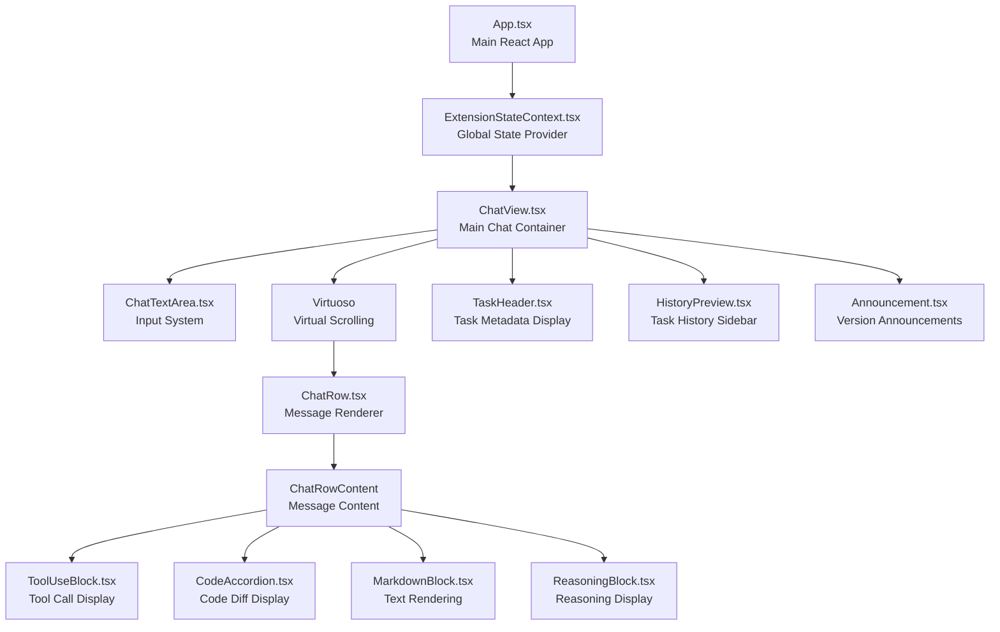
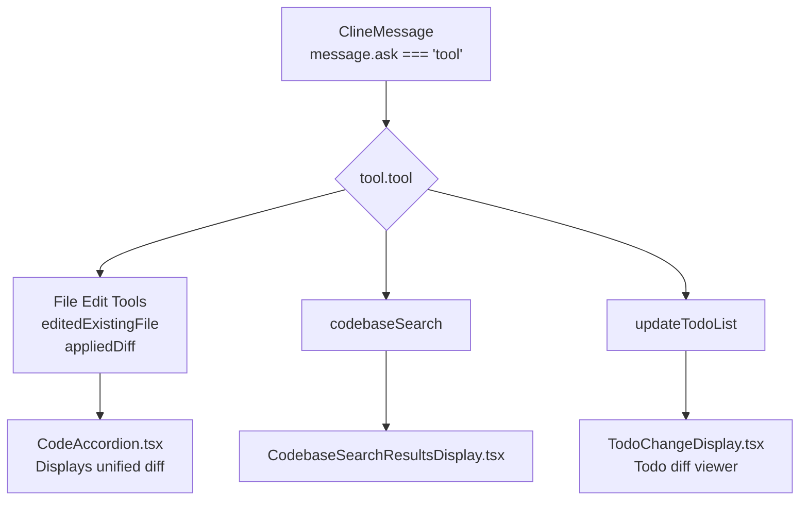
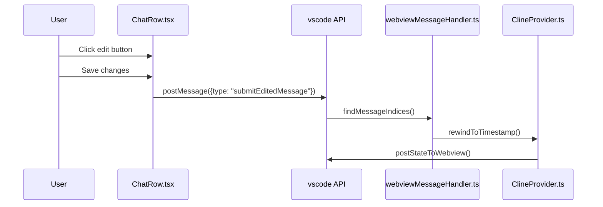

# Chat Interface System

<details>
<summary>Relevant source files</summary>

The following files were used as context for generating this wiki page:

- [packages/types/src/vscode-extension-host.ts](packages/types/src/vscode-extension-host.ts)
- [src/api/providers/fetchers/modelCache.ts](src/api/providers/fetchers/modelCache.ts)
- [src/core/webview/ClineProvider.ts](src/core/webview/ClineProvider.ts)
- [src/core/webview/__tests__/ClineProvider.spec.ts](src/core/webview/__tests__/ClineProvider.spec.ts)
- [src/core/webview/__tests__/webviewMessageHandler.spec.ts](src/core/webview/__tests__/webviewMessageHandler.spec.ts)
- [src/core/webview/webviewMessageHandler.ts](src/core/webview/webviewMessageHandler.ts)
- [src/shared/WebviewMessage.ts](src/shared/WebviewMessage.ts)
- [src/shared/__tests__/context-mentions.spec.ts](src/shared/__tests__/context-mentions.spec.ts)
- [src/shared/context-mentions.ts](src/shared/context-mentions.ts)
- [webview-ui/src/__tests__/command-autocomplete.spec.ts](webview-ui/src/__tests__/command-autocomplete.spec.ts)
- [webview-ui/src/components/chat/ChatRow.tsx](webview-ui/src/components/chat/ChatRow.tsx)
- [webview-ui/src/components/chat/ChatTextArea.tsx](webview-ui/src/components/chat/ChatTextArea.tsx)
- [webview-ui/src/components/chat/ChatView.tsx](webview-ui/src/components/chat/ChatView.tsx)
- [webview-ui/src/components/chat/ContextMenu.tsx](webview-ui/src/components/chat/ContextMenu.tsx)
- [webview-ui/src/components/chat/__tests__/BatchFilePermission.spec.tsx](webview-ui/src/components/chat/__tests__/BatchFilePermission.spec.tsx)
- [webview-ui/src/components/common/CodeBlock.tsx](webview-ui/src/components/common/CodeBlock.tsx)
- [webview-ui/src/components/common/Thumbnails.tsx](webview-ui/src/components/common/Thumbnails.tsx)
- [webview-ui/src/components/common/__tests__/CodeBlock.spec.tsx](webview-ui/src/components/common/__tests__/CodeBlock.spec.tsx)
- [webview-ui/src/components/history/__tests__/BatchDeleteTaskDialog.spec.tsx](webview-ui/src/components/history/__tests__/BatchDeleteTaskDialog.spec.tsx)
- [webview-ui/src/components/settings/SettingsView.tsx](webview-ui/src/components/settings/SettingsView.tsx)
- [webview-ui/src/components/ui/select-dropdown.tsx](webview-ui/src/components/ui/select-dropdown.tsx)
- [webview-ui/src/context/ExtensionStateContext.tsx](webview-ui/src/context/ExtensionStateContext.tsx)
- [webview-ui/src/utils/__tests__/context-mentions.spec.ts](webview-ui/src/utils/__tests__/context-mentions.spec.ts)
- [webview-ui/src/utils/context-mentions.ts](webview-ui/src/utils/context-mentions.ts)

</details>


## Purpose and Scope

The Chat Interface System is the React-based user interface layer that renders the conversational interaction between the user and the AI agent. This system encompasses message display, user input handling, tool call visualization, message editing/deletion workflows, and real-time streaming updates.

This document covers the webview UI components responsible for chat rendering and user interaction. For backend message handling and task orchestration, see [Webview Communication System](#3). For tool execution logic, see [Tool Execution System](#6). For context mention resolution, see [Context and Message Management](#7).

---

## System Architecture

The chat interface is built as a React application rendered in a VS Code webview, communicating bidirectionally with the extension host via the `postMessage` protocol [src/shared/WebviewMessage.ts:1-4]().

### Component Hierarchy



**Sources:** [webview-ui/src/components/chat/ChatView.tsx:68-171](), [webview-ui/src/components/chat/ChatRow.tsx:132-164](), [webview-ui/src/context/ExtensionStateContext.tsx:149-165]()

---

## ChatView Component

`ChatView` is the top-level chat container component that orchestrates message display, user input, and state synchronization.

For details, see [ChatView and Message Display](#8.1).

### Core Responsibilities

| Responsibility | Implementation |
|---------------|----------------|
| Message Display | Renders messages via `Virtuoso` virtual scroller [webview-ui/src/components/chat/ChatView.tsx:3-40]() |
| Input Handling | Manages `ChatTextArea` state and submission [webview-ui/src/components/chat/ChatView.tsx:139-143]() |
| Button State | Controls approve/reject/retry button visibility [webview-ui/src/components/chat/ChatView.tsx:150-153]() |
| Streaming Detection | Tracks partial messages and API request state [webview-ui/src/components/chat/ChatView.tsx:159-160]() |
| Sound Effects | Plays notification/celebration sounds [webview-ui/src/components/chat/ChatView.tsx:6-91]() |
| Auto-scroll | Maintains scroll position during updates via `useScrollLifecycle` [webview-ui/src/components/chat/ChatView.tsx:51-154]() |

### Key State Variables

```typescript
// webview-ui/src/components/chat/ChatView.tsx:139-173
const [inputValue, setInputValue] = useState("")
const [selectedImages, setSelectedImages] = useState<string[]>([])
const [sendingDisabled, setSendingDisabled] = useState(false)
const [clineAsk, setClineAsk] = useState<ClineAsk | undefined>(undefined)
const [enableButtons, setEnableButtons] = useState<boolean>(false)
const [primaryButtonText, setPrimaryButtonText] = useState<string | undefined>()
const [secondaryButtonText, setSecondaryButtonText] = useState<string | undefined>()
const [expandedRows, setExpandedRows] = useState<Record<number, boolean>>({})
```

**Sources:** [webview-ui/src/components/chat/ChatView.tsx:139-173]()

---

## Message Rendering System

### ChatRow Component

`ChatRow` is a memoized component that renders individual messages with deep equality comparison to prevent unnecessary re-renders. It uses `useSize` to detect height changes for scroll management [webview-ui/src/components/chat/ChatRow.tsx:132-164]().

For details, see [Message Components and Tool Display](#8.2).

```typescript
// webview-ui/src/components/chat/ChatRow.tsx:132-164
const ChatRow = memo(
  (props: ChatRowProps) => {
    const { isLast, onHeightChange, message } = props
    const [chatrow, { height }] = useSize(
      <div className="px-[15px] py-[10px] pr-[6px]">
        <ChatRowContent {...props} />
      </div>
    )
    // ... height change detection logic [webview-ui/src/components/chat/ChatRow.tsx:145-157]
    return chatrow
  },
  deepEqual
)
```

**Sources:** [webview-ui/src/components/chat/ChatRow.tsx:132-164]()

---

## Tool Call Visualization

Tool calls are displayed with specialized UI components based on tool type, such as `CodeAccordion` for diffs or `CodebaseSearchResultsDisplay` for searches.

For details, see [Message Components and Tool Display](#8.2).



**Sources:** [webview-ui/src/components/chat/ChatRow.tsx:26-50](), [webview-ui/src/components/chat/ChatRow.tsx:87-95]()

---

## User Input System (ChatTextArea)

`ChatTextArea` provides a rich input experience with mention autocomplete, image attachment, and mode switching [webview-ui/src/components/chat/ChatTextArea.tsx:61-84]().

For details, see [ChatTextArea Input System](#8.4).

### Mention and Command Autocomplete

The input system supports `@` mentions for context and `/` slash commands for workflow triggers. This is managed via `getContextMenuOptions` and `insertMention` utilities [webview-ui/src/utils/context-mentions.ts:124-215]().

For details, see [Context Menu and Autocomplete](#8.5) and [Path Mention Processing](#8.6).

**Sources:** [webview-ui/src/components/chat/ChatTextArea.tsx:15-32](), [webview-ui/src/utils/context-mentions.ts:124-215]()

---

## Message Editing and Deletion

The chat interface supports editing and deleting messages. The extension host handles the logic for rewinding state and managing checkpoints via `webviewMessageHandler` [src/core/webview/webviewMessageHandler.ts:197-211]().

For details, see [Message Editing and Deletion](#8.3).

### State Interaction for Edits



**Sources:** [src/core/webview/webviewMessageHandler.ts:197-211](), [src/core/webview/ClineProvider.ts:126-157](), [webview-ui/src/components/chat/ChatRow.tsx:186-201]()

---

## State Management and Synchronization

The chat interface maintains state through the `ExtensionStateContext`. To prevent race conditions, `mergeExtensionState` uses a sequence number (`clineMessagesSeq`) to ignore stale message updates [webview-ui/src/context/ExtensionStateContext.tsx:166-179]().

```typescript
// webview-ui/src/context/ExtensionStateContext.tsx:166-179
if (
  newState.clineMessagesSeq !== undefined &&
  prevState.clineMessagesSeq !== undefined &&
  newState.clineMessagesSeq <= prevState.clineMessagesSeq &&
  newState.clineMessages !== undefined
) {
  rest.clineMessages = prevState.clineMessages
  rest.clineMessagesSeq = prevState.clineMessagesSeq
}
```

**Sources:** [webview-ui/src/context/ExtensionStateContext.tsx:166-179](), [src/core/webview/ClineProvider.ts:168-168]()

---

## Streaming and Reasoning

The interface renders AI reasoning content in a collapsible `ReasoningBlock` and tracks streaming status to provide visual feedback [webview-ui/src/components/chat/ChatView.tsx:159-163]().

**Sources:** [webview-ui/src/components/chat/ChatView.tsx:159-163](), [webview-ui/src/components/chat/ChatRow.tsx:31-31]()