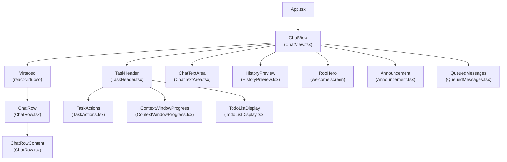
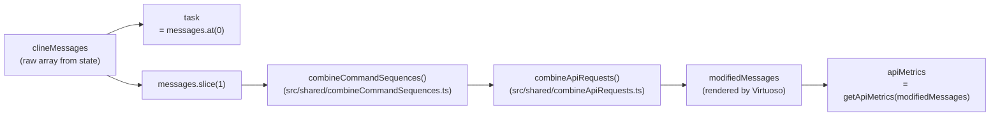
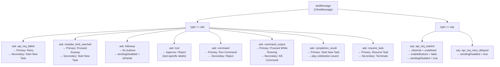
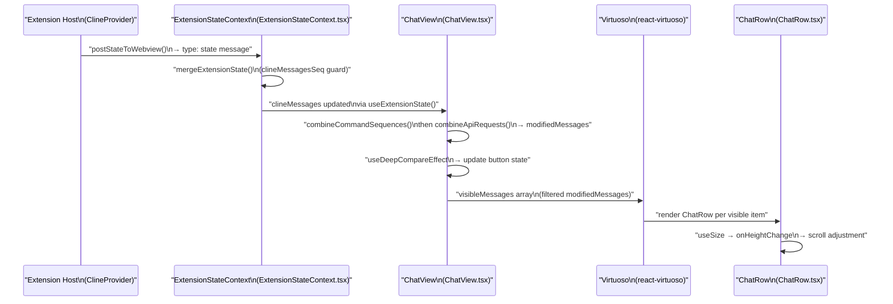

# ChatView and Message Display

Relevant source files

The following files were used as context for generating this wiki page:

- [packages/types/src/vscode-extension-host.ts](packages/types/src/vscode-extension-host.ts)
- [src/api/providers/fetchers/modelCache.ts](src/api/providers/fetchers/modelCache.ts)
- [src/core/webview/ClineProvider.ts](src/core/webview/ClineProvider.ts)
- [src/core/webview/__tests__/ClineProvider.spec.ts](src/core/webview/__tests__/ClineProvider.spec.ts)
- [src/core/webview/__tests__/webviewMessageHandler.spec.ts](src/core/webview/__tests__/webviewMessageHandler.spec.ts)
- [src/core/webview/webviewMessageHandler.ts](src/core/webview/webviewMessageHandler.ts)
- [src/shared/WebviewMessage.ts](src/shared/WebviewMessage.ts)
- [webview-ui/src/components/chat/ChatRow.tsx](webview-ui/src/components/chat/ChatRow.tsx)
- [webview-ui/src/components/chat/ChatView.tsx](webview-ui/src/components/chat/ChatView.tsx)
- [webview-ui/src/components/chat/TaskHeader.tsx](webview-ui/src/components/chat/TaskHeader.tsx)
- [webview-ui/src/components/history/HistoryPreview.tsx](webview-ui/src/components/history/HistoryPreview.tsx)
- [webview-ui/src/components/history/HistoryView.tsx](webview-ui/src/components/history/HistoryView.tsx)
- [webview-ui/src/components/history/SubtaskRow.tsx](webview-ui/src/components/history/SubtaskRow.tsx)
- [webview-ui/src/components/history/TaskGroupItem.tsx](webview-ui/src/components/history/TaskGroupItem.tsx)
- [webview-ui/src/components/history/__tests__/SubtaskRow.spec.tsx](webview-ui/src/components/history/__tests__/SubtaskRow.spec.tsx)
- [webview-ui/src/components/history/__tests__/TaskGroupItem.spec.tsx](webview-ui/src/components/history/__tests__/TaskGroupItem.spec.tsx)
- [webview-ui/src/components/history/__tests__/useGroupedTasks.spec.ts](webview-ui/src/components/history/__tests__/useGroupedTasks.spec.ts)
- [webview-ui/src/components/history/types.ts](webview-ui/src/components/history/types.ts)
- [webview-ui/src/components/history/useGroupedTasks.ts](webview-ui/src/components/history/useGroupedTasks.ts)
- [webview-ui/src/components/settings/SettingsView.tsx](webview-ui/src/components/settings/SettingsView.tsx)
- [webview-ui/src/context/ExtensionStateContext.tsx](webview-ui/src/context/ExtensionStateContext.tsx)
- [webview-ui/src/utils/format.ts](webview-ui/src/utils/format.ts)

## Purpose and Scope

This page documents the `ChatView` React component and its supporting components that form the primary chat interface in the Roo Code webview. It covers how messages are received, processed, and rendered; how the task header summarizes the active task; how scroll lifecycle and virtualized rendering work; and how button state is derived from the incoming message stream.

For information on how messages originate and are dispatched on the extension host side, see [ClineProvider (Core Orchestrator)]() and the [Ask/Say Pattern](). For the `ChatTextArea` input component, see [ChatTextArea Input System](). For individual message sub-components such as `CodeBlock`, `MarkdownBlock`, and tool display rows, see [Message Components and Tool Display](). For editing and deleting messages, see [Message Editing and Deletion]().

---

## Component Hierarchy

**Figure: ChatView Component Tree**

Sources: [webview-ui/src/components/chat/ChatView.tsx:39-52](), [webview-ui/src/components/chat/TaskHeader.tsx:23-27](), [webview-ui/src/components/chat/ChatRow.tsx:26-53]()

---

## ChatView Overview

`ChatView` is declared as a `forwardRef` component in [webview-ui/src/components/chat/ChatView.tsx:68-71]() and exported via the `ChatViewComponent` render function. It accepts a `ChatViewRef` imperative handle exposing `acceptInput`.

### Props

| Prop | Type | Purpose |
|---|---|---|
| `isHidden` | `boolean` | Whether the chat panel is currently hidden |
| `showAnnouncement` | `boolean` | Whether to display the announcement banner |
| `hideAnnouncement` | `() => void` | Callback to dismiss the announcement |

Sources: [webview-ui/src/components/chat/ChatView.tsx:54-62]()

### State from `ExtensionStateContext`

`ChatView` subscribes to the following fields via `useExtensionState()`:

| Field | Usage |
|---|---|
| `clineMessages` | The raw message array for the current task |
| `currentTaskItem` | Metadata for the active task (id, parentTaskId, childIds, etc.) |
| `currentTaskTodos` | Initial todo list for the current task |
| `taskHistory` | List of past tasks (used by `HistoryPreview`) |
| `apiConfiguration` | Current API provider configuration |
| `mode` | Active mode slug |
| `messageQueue` | Messages queued while the task is busy |
| `soundEnabled`, `soundVolume` | Audio playback settings |
| `cloudIsAuthenticated` | Whether cloud is connected |

Sources: [webview-ui/src/components/chat/ChatView.tsx:79-96]()

---

## Message Processing Pipeline

Before messages are rendered, they go through transformation steps to combine related messages into single display units.

**Figure: Message Processing Pipeline**

- `task` [webview-ui/src/components/chat/ChatView.tsx:116]() is always `messages.at(0)` — the initial user request that created the task.
- `modifiedMessages` [webview-ui/src/components/chat/ChatView.tsx:134]() is what `Virtuoso` actually renders, after reducing tool calls and command sequences.
- `apiMetrics` [webview-ui/src/components/chat/ChatView.tsx:137]() is passed to `TaskHeader` for the token/cost summary.

Sources: [webview-ui/src/components/chat/ChatView.tsx:116-137]()

---

## Ask/Button State Machine

A `useDeepCompareEffect` keyed on `[lastMessage, secondLastMessage]` [webview-ui/src/components/chat/ChatView.tsx:271-458]() drives the button/interaction state. The state variables involved are:

| Variable | Purpose |
|---|---|
| `clineAsk` | The current `ClineAsk` type the extension is waiting for |
| `enableButtons` | Whether the primary/secondary action buttons are active |
| `primaryButtonText` | Label for the primary button |
| `secondaryButtonText` | Label for the secondary button |
| `sendingDisabled` | Whether the text area send action is blocked |

**Figure: Ask-Type to Button State Mapping**

Sources: [webview-ui/src/components/chat/ChatView.tsx:271-458]()

---

## `isStreaming` Computation

The `isStreaming` boolean [webview-ui/src/components/chat/ChatView.tsx:523-565]() is computed from `modifiedMessages` and controls whether to show a cancel button vs. action buttons. The logic:

1. If the last message is an `ask` and `primaryButtonText` is set → **not streaming** (tool is asking for approval).
2. If the last message has `partial === true` → **streaming**.
3. If the last `api_req_started` message has no `cost` yet → **streaming** (API request in flight).
4. Otherwise → **not streaming**.

Sources: [webview-ui/src/components/chat/ChatView.tsx:523-565]()

---

## Virtualized Message List

`ChatView` uses [`react-virtuoso`](https://virtuoso.dev/) via a `VirtuosoHandle` ref [webview-ui/src/components/chat/ChatView.tsx:154]() to efficiently render large message lists.

- `expandedRows: Record<number, boolean>` [webview-ui/src/components/chat/ChatView.tsx:155]() tracks which rows (keyed by message timestamp) are expanded.
- `everVisibleMessagesTsRef` [webview-ui/src/components/chat/ChatView.tsx:165-170]() is an `LRUCache<number, boolean>` that tracks which message timestamps have ever been in the viewport.
- `useScrollLifecycle` [webview-ui/src/components/chat/ChatView.tsx:51]() manages scroll-to-bottom behavior on new messages and height changes.

Sources: [webview-ui/src/components/chat/ChatView.tsx:154-170]()

---

## ChatRow Component

`ChatRow` in [webview-ui/src/components/chat/ChatRow.tsx:132-164]() is a `memo`-wrapped component that uses `deepEqual` for prop comparison. It uses `useSize` to detect height changes and notify the parent via `onHeightChange` [webview-ui/src/components/chat/ChatRow.tsx:151-157]().

### ChatRowContent

`ChatRowContent` [webview-ui/src/components/chat/ChatRow.tsx:168-180]() contains the actual rendering logic. It switches over message types to render appropriate UI elements (Reasoning blocks, Markdown, Tool use blocks).

### Inline Message Editing

`ChatRowContent` manages its own edit state [webview-ui/src/components/chat/ChatRow.tsx:186-237]():
- `isEditing`: Whether this message is in edit mode.
- `editedContent`: The text being edited.
- `editImages`: Images attached during edit [webview-ui/src/components/chat/ChatRow.tsx:195-197]().

### Tool Message Rendering

The `tool` variable [webview-ui/src/components/chat/ChatRow.tsx:398-401]() is parsed from `message.text` when `message.ask === "tool"`. The component dispatches to specialized tool blocks like `UpdateTodoListToolBlock` [webview-ui/src/components/chat/ChatRow.tsx:27]() or `McpExecution` [webview-ui/src/components/chat/ChatRow.tsx:52]().

Sources: [webview-ui/src/components/chat/ChatRow.tsx:132-237](), [webview-ui/src/components/chat/ChatRow.tsx:398-560]()

---

## TaskHeader Component

`TaskHeader` in [webview-ui/src/components/chat/TaskHeader.tsx:46-]() renders the task summary card at the top of the message list. It has two display modes toggled by `isTaskExpanded`.

### Collapsed Mode
Displays a single-line summary with the task text rendered via `<Mention>` [webview-ui/src/components/chat/TaskHeader.tsx:197]() and a `<CircularProgress>` showing context window usage percentage.

### Expanded Mode
Shows full task text, attached images via `<Thumbnails>`, and a full token/cache/cost table via `<ContextWindowProgress>` [webview-ui/src/components/chat/TaskHeader.tsx:24]().

### Subtask Navigation
When `parentTaskId` is set [webview-ui/src/components/chat/TaskHeader.tsx:125-131](), a "Back to Parent Task" button posts `{ type: "showTaskWithId", text: parentTaskId }` to the extension host.

Sources: [webview-ui/src/components/chat/TaskHeader.tsx:29-44](), [webview-ui/src/components/chat/TaskHeader.tsx:72-83](), [webview-ui/src/components/chat/TaskHeader.tsx:125-131]()

---

## State Preservation Pattern (isHidden)

The `isHidden` prop [webview-ui/src/components/chat/ChatView.tsx:55]() is critical for preserving UI state when the user switches tabs (e.g., to Settings or History). Because the component is not unmounted but merely hidden via CSS, refs like `virtuosoRef` and `textAreaRef` maintain their values. 

`ExtensionStateContext` uses a sequence counter `clineMessagesSeq` [src/core/webview/ClineProvider.ts:168]() and `mergeExtensionState` [webview-ui/src/context/ExtensionStateContext.tsx:151]() to protect against stale state pushes overwriting current message history during concurrent async updates.

Sources: [src/core/webview/ClineProvider.ts:165-168](), [webview-ui/src/context/ExtensionStateContext.tsx:151-170]()

---

## Message Sending Logic

The `handleSendMessage` function [webview-ui/src/components/chat/ChatView.tsx:599-683]() handles user input submission:

1. **Queuing**: If the task is busy (`isStreaming` or `messageQueue` not empty), the message is queued via `vscode.postMessage({ type: "queueMessage", ... })` [webview-ui/src/components/chat/ChatView.tsx:616-621]().
2. **Direct Send**: If the task is idle, it sends a `newTask` message (if no active task) or an `askResponse` with `messageResponse` [webview-ui/src/components/chat/ChatView.tsx:653-678]().
3. **Primary Button**: `handlePrimaryButtonClick` [webview-ui/src/components/chat/ChatView.tsx:685-715]() handles the confirmation button for tool approvals or task resumption.

Sources: [webview-ui/src/components/chat/ChatView.tsx:599-715]()

---

## Data Flow Summary

**Figure: Message Data Flow from Extension Host to Rendered Row**

Sources: [webview-ui/src/context/ExtensionStateContext.tsx:151-190](), [webview-ui/src/components/chat/ChatView.tsx:116-137](), [webview-ui/src/components/chat/ChatView.tsx:271-458](), [webview-ui/src/components/chat/ChatRow.tsx:132-164]()