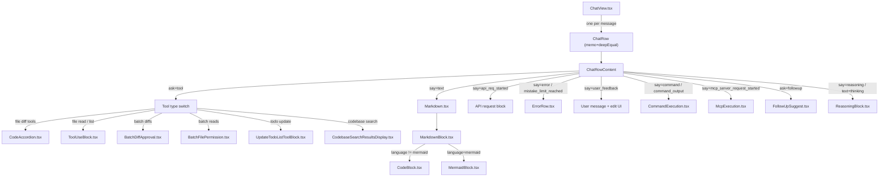
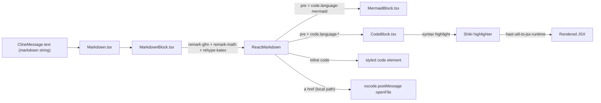
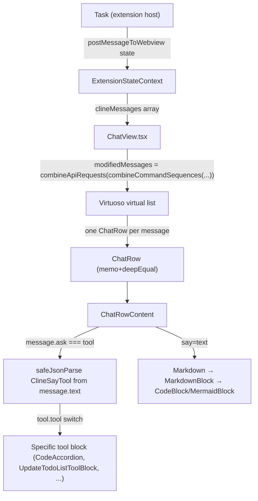

# Message Components and Tool Display

<details>
<summary>Relevant source files</summary>

The following files were used as context for generating this wiki page:

- [packages/cloud/src/CloudShareService.ts](packages/cloud/src/CloudShareService.ts)
- [packages/types/src/vscode-extension-host.ts](packages/types/src/vscode-extension-host.ts)
- [src/api/providers/fetchers/modelCache.ts](src/api/providers/fetchers/modelCache.ts)
- [src/core/webview/ClineProvider.ts](src/core/webview/ClineProvider.ts)
- [src/core/webview/__tests__/ClineProvider.spec.ts](src/core/webview/__tests__/ClineProvider.spec.ts)
- [src/core/webview/__tests__/webviewMessageHandler.spec.ts](src/core/webview/__tests__/webviewMessageHandler.spec.ts)
- [src/core/webview/webviewMessageHandler.ts](src/core/webview/webviewMessageHandler.ts)
- [src/shared/WebviewMessage.ts](src/shared/WebviewMessage.ts)
- [webview-ui/src/components/chat/ChatRow.tsx](webview-ui/src/components/chat/ChatRow.tsx)
- [webview-ui/src/components/chat/ChatView.tsx](webview-ui/src/components/chat/ChatView.tsx)
- [webview-ui/src/components/chat/ShareButton.tsx](webview-ui/src/components/chat/ShareButton.tsx)
- [webview-ui/src/components/chat/TaskActions.tsx](webview-ui/src/components/chat/TaskActions.tsx)
- [webview-ui/src/components/chat/__tests__/ShareButton.spec.tsx](webview-ui/src/components/chat/__tests__/ShareButton.spec.tsx)
- [webview-ui/src/components/chat/__tests__/TaskActions.spec.tsx](webview-ui/src/components/chat/__tests__/TaskActions.spec.tsx)
- [webview-ui/src/components/settings/SettingsView.tsx](webview-ui/src/components/settings/SettingsView.tsx)
- [webview-ui/src/context/ExtensionStateContext.tsx](webview-ui/src/context/ExtensionStateContext.tsx)
- [webview-ui/src/hooks/useCloudUpsell.ts](webview-ui/src/hooks/useCloudUpsell.ts)

</details>


This page covers the React components responsible for rendering individual chat messages, tool use blocks, and AI-generated content in the Roo Code webview. The primary subject is `ChatRow` and its sub-components, plus the reusable rendering primitives (`CodeBlock`, `CodeAccordion`, `MarkdownBlock`, `MermaidBlock`) that make up the display layer.

For the overall structure of the chat view that hosts these components, see [ChatView and Message Display](8.1). For input handling and message editing interactions, see [Message Editing and Deletion](8.3) and [ChatTextArea Input System](8.4).

---

## Component Landscape

The chat message display system is organized into three tiers: a routing layer (`ChatRow` / `ChatRowContent`), message-type-specific display blocks, and reusable rendering primitives.

**Component Hierarchy**



Sources: [webview-ui/src/components/chat/ChatRow.tsx:132-143](), [webview-ui/src/components/chat/ChatView.tsx:40-43](), [webview-ui/src/components/common/MarkdownBlock.tsx:256-293]()

---

## ChatRow

`ChatRow` is the top-level message wrapper rendered by the virtualized list in `ChatView`. It is memoized using `deepEqual` from `fast-deep-equal` to prevent unnecessary re-renders.

**File:** [webview-ui/src/components/chat/ChatRow.tsx:132-164]()

```
ChatRow (memo, deepEqual)
  └── uses `useSize` to measure height
      └── calls onHeightChange(isTaller) when last message grows
          └── renders ChatRowContent
```

### Props

| Prop | Type | Purpose |
|------|------|---------|
| `message` | `ClineMessage` | The message to render |
| `lastModifiedMessage` | `ClineMessage?` | Last message (used to detect active tool/command state) |
| `isExpanded` | `boolean` | Whether collapsible content is expanded |
| `isLast` | `boolean` | If true, height changes trigger parent scroll adjustments |
| `isStreaming` | `boolean` | Suppresses certain interactive elements during streaming |
| `onToggleExpand` | `(ts: number) => void` | Expand/collapse toggle callback |
| `onHeightChange` | `(isTaller: boolean) => void` | Called when rendered height changes |
| `onSuggestionClick` | optional | Handles follow-up suggestion clicks |
| `onBatchFileResponse` | optional | Handles batch file permission responses |

Sources: [webview-ui/src/components/chat/ChatRow.tsx:112-127]()

---

## ChatRowContent — Message Type Dispatch

`ChatRowContent` is the main rendering function. It first checks if the message is a tool-use request (`message.ask === "tool"`), parses the `ClineSayTool` JSON from `message.text`, and dispatches to the appropriate tool block. For all other message types, it renders based on the combined `type` variable derived from `message.type`:

```
type = message.type === "ask" ? message.ask : message.say
```

**Icon and title computation** ([webview-ui/src/components/chat/ChatRow.tsx:273-387]()) maps `type` to a Codicon or Lucide icon and a header label.

### Message Type to Renderer Map

| `message.ask` / `message.say` | Renderer |
|-------------------------------|----------|
| `ask=tool`, `tool.tool = editedExistingFile \| appliedDiff \| newFileCreated \| ...` | `CodeAccordion` (language `"diff"`) |
| `ask=tool`, `tool.tool = insertContent` | `CodeAccordion` (language `"diff"`) |
| `ask=tool`, `tool.tool = readFile` (single) | `ToolUseBlock` + `ToolUseBlockHeader` |
| `ask=tool`, `tool.tool = readFile` (batch) | `BatchFilePermission` |
| `ask=tool`, `tool.tool = listFilesTopLevel \| listFilesRecursive` (single) | `ToolUseBlock` |
| `ask=tool`, `tool.tool = listFilesTopLevel \| listFilesRecursive` (batch) | `BatchFilePermission` |
| `ask=tool`, `tool.tool = codebaseSearch` | `CodebaseSearchResultsDisplay` |
| `ask=tool`, `tool.tool = updateTodoList` | `UpdateTodoListToolBlock` |
| `ask=tool` with `batchDiffs` | `BatchDiffApproval` |
| `ask=followup` | `FollowUpSuggest` |
| `ask=command \| ask=command_output` | `CommandExecution` |
| `ask=use_mcp_server` | `McpExecution` |
| `say=text` | `Markdown` (wraps `MarkdownBlock`) |
| `say=completion_result` | `Markdown` |
| `say=api_req_started` | API request block with cost/status |
| `say=error \| say=mistake_limit_reached` | `ErrorRow` |
| `say=user_feedback` | User message bubble with edit/delete controls |
| `say=mcp_server_request_started \| say=mcp_server_response` | `McpExecution` |
| `say=command_output` | `CommandExecution` / `CommandExecutionError` |
| `say=checkpoint_saved` | `CheckpointSaved` |
| `say=condense_context` | `CondensationResultRow` |
| `say=truncate_context` | `TruncationResultRow` |

Sources: [webview-ui/src/components/chat/ChatRow.tsx:424-600]()

---

## Tool Display Components

### CodeAccordion

`CodeAccordion` ([webview-ui/src/components/common/CodeAccordion.tsx]()) is a collapsible file display used for diffs and file contents. Key props:

| Prop | Purpose |
|------|---------|
| `path` | File path shown in header |
| `code` | Content to display (diff or source) |
| `language` | Syntax language, typically `"diff"` |
| `progressStatus` | Streaming progress indicator |
| `isLoading` | Shows loading state when message is partial |
| `isExpanded` | Controlled expand/collapse |
| `onToggleExpand` | Expand toggle callback |
| `diffStats` | Additions/deletions count shown in header |

It is rendered inside a `<div className="pl-6">` wrapper for left indentation under the tool header.

Sources: [webview-ui/src/components/chat/ChatRow.tsx:477-491]()

### ToolUseBlock and ToolUseBlockHeader

`ToolUseBlock` and `ToolUseBlockHeader` form a generic container for non-diff tool results (file reads, directory listings, etc.). `ToolUseBlockHeader` is clickable and uses `vscode.postMessage({ type: "openFile" })` to jump to the file in the editor.

### BatchDiffApproval and BatchFilePermission

These components handle multi-file operations:

- **`BatchDiffApproval`**: Shown when `tool.batchDiffs` is a non-empty array. Displays each diff with individual approve/reject controls. [webview-ui/src/components/chat/ChatRow.tsx:492-500]()
- **`BatchFilePermission`**: Shown when `tool.batchFiles` is present for `readFile`, `listFilesTopLevel`, or `listFilesRecursive`. Calls `onBatchFileResponse` with a `{ [filePath]: boolean }` map. [webview-ui/src/components/chat/ChatRow.tsx:502-508]()

### McpExecution

`McpExecution` renders MCP (Model Context Protocol) tool calls and their responses. It receives the parsed `ClineAskUseMcpServer` JSON and uses `findMatchingResourceOrTemplate` to look up resource metadata from the MCP server registry. [webview-ui/src/components/chat/ChatRow.tsx:556-563]()

### CommandExecution and CommandExecutionError

`CommandExecution` displays shell command output. It handles:
- Command text (shown before the `COMMAND_OUTPUT_STRING` separator)
- Output text (shown after the separator)
- Running state (detected via `isCommandExecuting`)

`CommandExecutionError` handles command failure display. [webview-ui/src/components/chat/ChatRow.tsx:521-537]()

---

## Text Rendering Stack

The text rendering chain converts raw markdown strings (from AI responses) through multiple layers to final DOM output.

**Text Rendering Stack**



Sources: [webview-ui/src/components/common/MarkdownBlock.tsx:206-330](), [webview-ui/src/components/chat/Markdown.tsx:1-40]()

### Markdown

`Markdown` wraps `MarkdownBlock` and adds a copy-to-clipboard button. Accepts `markdown?: string` and `partial?: boolean`. [webview-ui/src/components/chat/Markdown.tsx:12-14]()

### MarkdownBlock

`MarkdownBlock` ([webview-ui/src/components/common/MarkdownBlock.tsx]()) is a memoized component using `ReactMarkdown` with three remark/rehype plugins:

| Plugin | Purpose |
|--------|---------|
| `remark-gfm` | GitHub-flavored markdown (tables, strikethrough, task lists) |
| `remark-math` | LaTeX math syntax (`$...$`, `$$...$$`) |
| `rehype-katex` | Renders math via KaTeX |

Custom renderers override `pre`, `code`, `a`, and `table` elements:

- **`pre` renderer**: Checks `className` for `language-mermaid`; routes to `MermaidBlock`, otherwise to `CodeBlock`. [webview-ui/src/components/common/MarkdownBlock.tsx:256-293]()
- **`a` renderer**: Intercepts `file://` and relative paths; sends `openFile` message to VS Code instead of navigating. [webview-ui/src/components/common/MarkdownBlock.tsx:216-255]()
- **`table` renderer**: Wraps in a `.table-wrapper` div for horizontal scroll. [webview-ui/src/components/common/MarkdownBlock.tsx:209-215]()

`StyledMarkdown` applies VS Code CSS variables for fonts, colors, and heading sizes. [webview-ui/src/components/common/MarkdownBlock.tsx:18-204]()

### CodeBlock

`CodeBlock` ([webview-ui/src/components/common/CodeBlock.tsx]()) renders syntax-highlighted code using Shiki (loaded asynchronously via `getHighlighter`). Features:

| Feature | Implementation |
|---------|---------------|
| Syntax highlighting | Shiki → HAST → JSX via `toJsxRuntime` |
| Word wrap toggle | `wordwrap` prop on `StyledPre`; `white-space: pre-wrap` vs `pre` |
| Window shade (collapse) | `windowshade` prop; `max-height: 500px` via `StyledPre` |
| Copy to clipboard | `useCopyToClipboard` hook; `rawSource` prop for unprocessed text |
| Language normalization | `normalizeLanguage()` utility |

Sources: [webview-ui/src/components/common/CodeBlock.tsx:168-330]()

### MermaidBlock

`MermaidBlock` renders Mermaid diagrams using the `mermaid` npm package. It is only instantiated when `MarkdownBlock`'s `pre` renderer detects `language-mermaid` in the code block class name. [webview-ui/src/components/common/MarkdownBlock.tsx:275-281]()

---

## Specialized Display Components

### ReasoningBlock

`ReasoningBlock` displays extended thinking content from models (like Claude 3.7 Sonnet) when the `say=text` message includes reasoning sections. It is collapsible and controlled by the `reasoningBlockCollapsed` setting. [webview-ui/src/components/chat/ChatRow.tsx:431-438]()

### FollowUpSuggest

`FollowUpSuggest` renders clickable suggestion chips for `ask=followup` messages. Parsed from `FollowUpData` JSON in `message.text` via `safeJsonParse`. Calls `onSuggestionClick` when a chip is selected. [webview-ui/src/components/chat/ChatRow.tsx:466-473]()

### UpdateTodoListToolBlock

This component handles the visualization of task-specific todo list updates. It uses `getPreviousTodos` to calculate differences and displays them via `TodoChangeDisplay`. [webview-ui/src/components/chat/ChatRow.tsx:509-519]()

### CheckpointSaved

`CheckpointSaved` renders the checkpoint marker row for `say=checkpoint_saved` messages, showing a branch icon and restore controls. [webview-ui/src/components/chat/ChatRow.tsx:440-447]()

Sources: [webview-ui/src/components/chat/ChatRow.tsx:38-52]()

---

## Inline Edit Mode

When a user message (`say=user_feedback`) is in edit mode, `ChatRowContent` renders a `ChatTextArea` component inline within the row. This allows in-place editing of previous prompts.

Edit state is managed by local state variables inside `ChatRowContent`:

| State | Purpose |
|-------|---------|
| `isEditing` | Whether the row is in edit mode |
| `editedContent` | Current edit buffer |
| `editImages` | Images being attached to the edited message |
| `editMode` | Mode selector for the edited message |

Saving calls `vscode.postMessage({ type: "submitEditedMessage", value: message.ts, editedMessageContent, images })`. [webview-ui/src/components/chat/ChatRow.tsx:186-237]()

---

## Data Flow Summary

**How a `ClineMessage` becomes DOM**



Sources: [webview-ui/src/components/chat/ChatView.tsx:80-134](), [webview-ui/src/components/chat/ChatRow.tsx:132-143](), [webview-ui/src/context/ExtensionStateContext.tsx:151-170]()