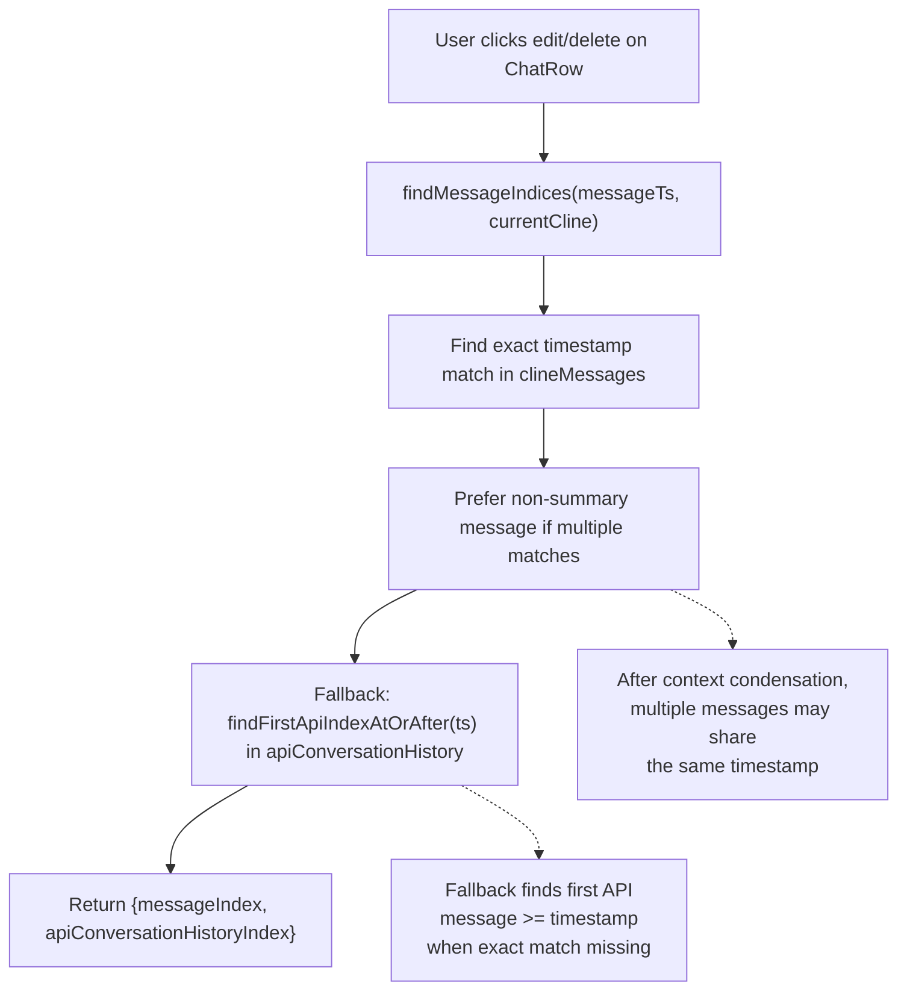
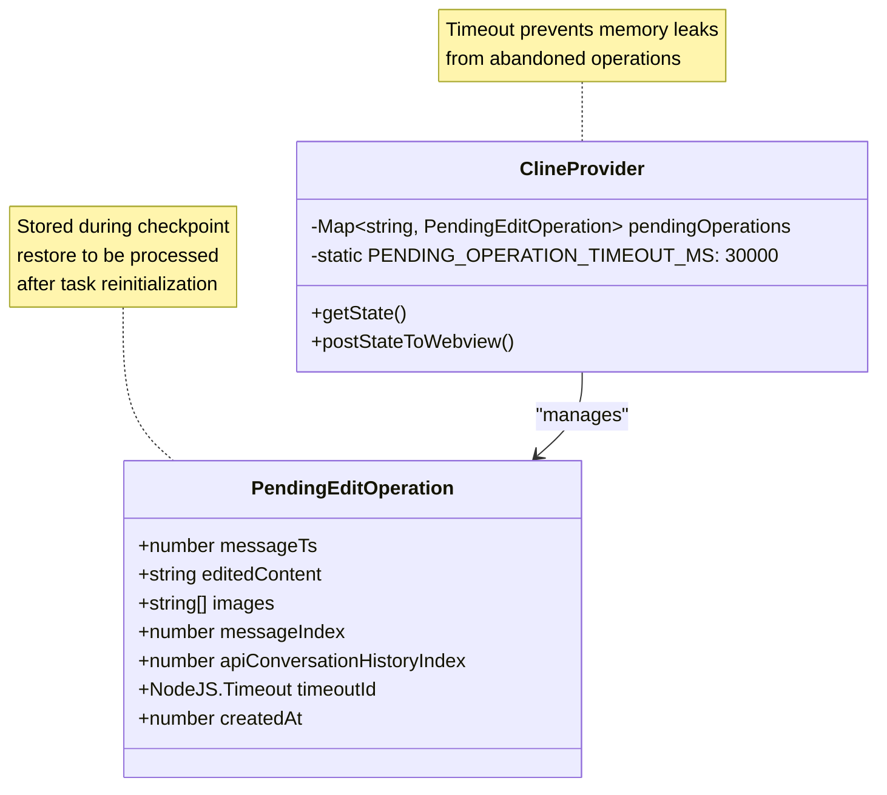
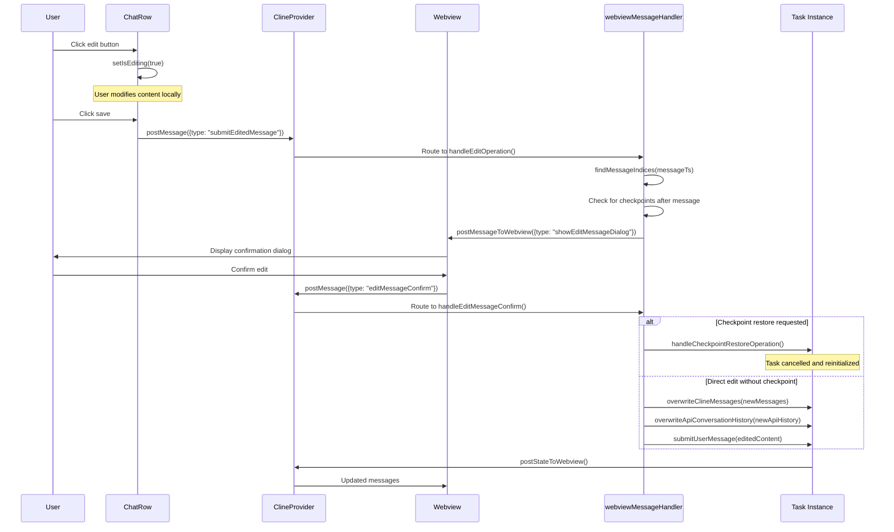
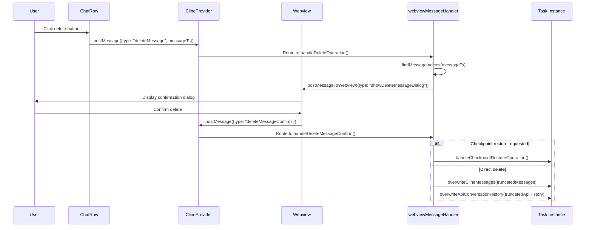
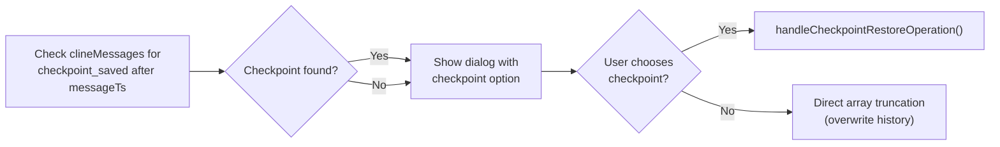

# Message Editing and Deletion

Relevant source files

The following files were used as context for generating this wiki page:

- [packages/types/src/vscode-extension-host.ts](packages/types/src/vscode-extension-host.ts)
- [src/api/providers/fetchers/modelCache.ts](src/api/providers/fetchers/modelCache.ts)
- [src/core/condense/__tests__/condense.spec.ts](src/core/condense/__tests__/condense.spec.ts)
- [src/core/condense/__tests__/foldedFileContext.spec.ts](src/core/condense/__tests__/foldedFileContext.spec.ts)
- [src/core/condense/__tests__/index.spec.ts](src/core/condense/__tests__/index.spec.ts)
- [src/core/condense/__tests__/nested-condense.spec.ts](src/core/condense/__tests__/nested-condense.spec.ts)
- [src/core/condense/__tests__/rewind-after-condense.spec.ts](src/core/condense/__tests__/rewind-after-condense.spec.ts)
- [src/core/condense/foldedFileContext.ts](src/core/condense/foldedFileContext.ts)
- [src/core/condense/index.ts](src/core/condense/index.ts)
- [src/core/context-management/__tests__/context-management.spec.ts](src/core/context-management/__tests__/context-management.spec.ts)
- [src/core/context-management/__tests__/truncation.spec.ts](src/core/context-management/__tests__/truncation.spec.ts)
- [src/core/context-management/index.ts](src/core/context-management/index.ts)
- [src/core/webview/ClineProvider.ts](src/core/webview/ClineProvider.ts)
- [src/core/webview/__tests__/ClineProvider.spec.ts](src/core/webview/__tests__/ClineProvider.spec.ts)
- [src/core/webview/__tests__/webviewMessageHandler.delete.spec.ts](src/core/webview/__tests__/webviewMessageHandler.delete.spec.ts)
- [src/core/webview/__tests__/webviewMessageHandler.spec.ts](src/core/webview/__tests__/webviewMessageHandler.spec.ts)
- [src/core/webview/webviewMessageHandler.ts](src/core/webview/webviewMessageHandler.ts)
- [src/shared/WebviewMessage.ts](src/shared/WebviewMessage.ts)
- [webview-ui/src/components/chat/ChatRow.tsx](webview-ui/src/components/chat/ChatRow.tsx)
- [webview-ui/src/components/chat/ChatView.tsx](webview-ui/src/components/chat/ChatView.tsx)
- [webview-ui/src/components/settings/SettingsView.tsx](webview-ui/src/components/settings/SettingsView.tsx)
- [webview-ui/src/context/ExtensionStateContext.tsx](webview-ui/src/context/ExtensionStateContext.tsx)

This document describes the system that allows users to edit or delete messages in the chat history. These operations involve coordination between the webview UI, the extension host, and the task's message manager to maintain consistent state while preserving checkpoints and supporting rollback scenarios.

For information about message display and rendering, see [8.1 ChatView and Message Display](). For information about the message storage system, see [7.1 Message History and Dual Storage](). For checkpoint restoration mechanics, see [5.6 Checkpoint System]().

---

## Overview

The message editing and deletion system provides users with the ability to modify conversation history during active tasks. The system handles:

- **Message identification** using monotonic timestamps (`ts`).
- **Edit operations** that replace a message and all subsequent messages with new user input.
- **Delete operations** that remove a message and all subsequent messages.
- **Checkpoint awareness** to offer git-based state restoration when available.
- **Pending operation tracking** with automatic timeout to prevent memory leaks.
- **State synchronization** between UI, extension host, and persistent storage.

The workflow involves confirmation dialogs, temporary operation storage, and coordination with the `Task` instance and its underlying message history to ensure atomicity.

Sources: [src/core/webview/ClineProvider.ts:116-124](), [src/core/webview/webviewMessageHandler.ts:192-222]()

---

## Message Identification and Indexing

Messages are uniquely identified by their `ts` (timestamp) field. When users request edit or delete operations, the system must locate the target message in both the display history (`clineMessages`) and the API conversation history (`apiConversationHistory`).

Title: Message Timestamp Indexing Strategy

The `findMessageIndices` function handles timestamp collisions that occur after context condensation operations, where a summary message may share the same timestamp as the original user message. The function prefers non-summary messages to ensure operations target user-visible content.

Sources: [src/core/webview/webviewMessageHandler.ts:192-222]()

---

## Pending Operations Management

To support checkpoint-aware workflows that may require asynchronous git operations (canceling and re-initializing tasks), edit operations are stored temporarily in a `pendingOperations` map within `ClineProvider`.

Title: Pending Operations Data Structure

The timeout mechanism ensures that operations abandoned due to errors or user cancellation are automatically cleaned up after 30 seconds. During checkpoint restoration, the operation is stored, the task is cancelled and reinitialized, then the edit is applied to the restored state.

Sources: [src/core/webview/ClineProvider.ts:116-124](), [src/core/webview/ClineProvider.ts:157-158]()

---

## Edit Workflow

Message editing follows a two-phase commit pattern: the user enters edit mode in the UI, then the system shows a confirmation dialog before applying changes. If a checkpoint exists after the target message, the user can choose to restore the checkpoint before applying the edit.

Title: Message Edit Sequence

The edit operation identifies the target index and replaces the content. If the user chooses to restore a checkpoint, `handleCheckpointRestoreOperation` is invoked, which handles the git checkout and task re-initialization.

Sources: [webview-ui/src/components/chat/ChatRow.tsx:186-242](), [src/core/webview/webviewMessageHandler.ts:349-514]()

---

## Delete Workflow

Message deletion removes a target message and all subsequent messages. Like editing, it is checkpoint-aware.

Title: Message Delete Sequence

When deleting, the system truncates both `clineMessages` and `apiConversationHistory` arrays at the identified indices. If a checkpoint is selected, the task is reverted to that specific git state.

Sources: [src/core/webview/webviewMessageHandler.ts:227-343](), [src/core/webview/webviewMessageHandler.ts:281-302]()

---

## Checkpoint Integration

Both edit and delete operations check for checkpoints (`checkpoint_saved`) that exist after the target message.

Title: Checkpoint-Aware Edit/Delete Flow

If a checkpoint is used, the system leverages `handleCheckpointRestoreOperation` (from `checkpointRestoreHandler.ts`). This involves canceling the current task instance and starting a new one from the checkpoint's commit hash.

Sources: [src/core/webview/webviewMessageHandler.ts:281-302](), [src/core/webview/checkpointRestoreHandler.ts:33]()

---

## UI Components and State Management

The frontend UI components manage local edit state and communicate with the extension host through the message-passing protocol.

### Message Protocol Mapping

| WebviewMessage Type | Purpose | Key Fields |
|---------------------|---------|------------|
| `deleteMessage` | Request deletion of a message | `messageTs: number` |
| `deleteMessageConfirm` | Confirm deletion with optional checkpoint restore | `messageTs: number`, `restoreCheckpoint?: boolean` |
| `submitEditedMessage` | Request edit of a message | `value: number` (ts), `editedMessageContent: string`, `images?: string[]` |
| `editMessageConfirm` | Confirm edit with optional checkpoint restore | `messageTs: number`, `text: string`, `restoreCheckpoint?: boolean`, `images?: string[]` |

| ExtensionMessage Type | Purpose | Key Fields |
|----------------------|---------|------------|
| `showDeleteMessageDialog` | Display delete confirmation dialog | `messageTs: number`, `hasCheckpoint: boolean` |
| `showEditMessageDialog` | Display edit confirmation dialog | `messageTs: number`, `text: string`, `hasCheckpoint: boolean` |
| `selectedImages` | Deliver selected images to edit context | `images: string[]`, `context: 'edit'`, `messageTs: number` |

Sources: [packages/types/src/vscode-extension-host.ts:85-86](), [src/shared/WebviewMessage.ts:1](), [webview-ui/src/components/chat/ChatRow.tsx:192-202]()

---

## Implementation Details

### Rewinding History
Unlike a standard "undo," the edit/delete system performs a "rewind." When a user edits a message at index `N`, all messages from `N` to the end of the conversation are removed, and a new user message is submitted. This prevents the AI from seeing its own "future" (messages that followed the one being edited).

### Image Selection in Edit Mode
When editing, the `ChatRow` component listens for `selectedImages` messages. If the `context` is set to `"edit"` and the `messageTs` matches the row being edited, the images are appended to the local `editImages` state instead of the main chat input.

Sources: [webview-ui/src/components/chat/ChatRow.tsx:192-202](), [webview-ui/src/components/chat/ChatRow.tsx:189]()

### Checkpoint Metadata Preservation
When performing a direct rewind (without checkpoint restore), the system preserves checkpoint metadata for the remaining messages. It iterates through the history, saves the `checkpoint` property for each message, and reapplies it after the truncation to ensure UI markers remain accurate.

Sources: [src/core/webview/webviewMessageHandler.ts:308-332](), [src/core/webview/webviewMessageHandler.ts:473-504]()

---

## Error Handling

- **Message Not Found**: If `findMessageIndices` fails to locate the timestamp, the operation is aborted with an error log. [src/core/webview/webviewMessageHandler.ts:273-276]()
- **Task Missing**: Operations require an active task instance; if `provider.getCurrentTask()` returns undefined, the handler logs an error. [src/core/webview/webviewMessageHandler.ts:231-234]()
- **Timeout**: Pending operations in `ClineProvider` are automatically cleared after `PENDING_OPERATION_TIMEOUT_MS` (30 seconds) to ensure memory safety. [src/core/webview/ClineProvider.ts:158]()

Sources: [src/core/webview/ClineProvider.ts:158](), [src/core/webview/webviewMessageHandler.ts:231-234](), [src/core/webview/webviewMessageHandler.ts:273-276]()