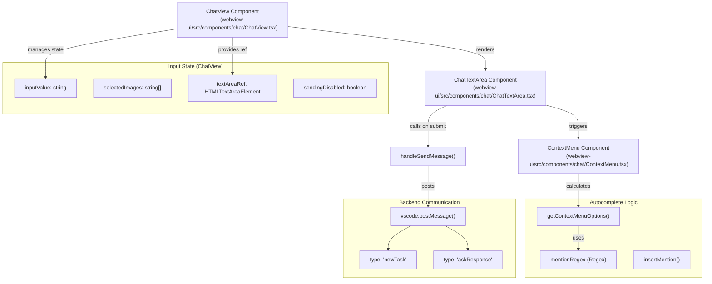
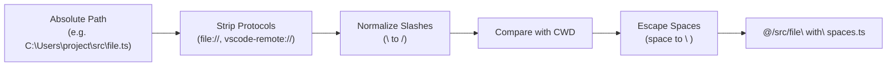

# ChatTextArea Input System

Relevant source files

The following files were used as context for generating this wiki page:

- [src/shared/__tests__/context-mentions.spec.ts](src/shared/__tests__/context-mentions.spec.ts)
- [src/shared/context-mentions.ts](src/shared/context-mentions.ts)
- [webview-ui/src/__tests__/command-autocomplete.spec.ts](webview-ui/src/__tests__/command-autocomplete.spec.ts)
- [webview-ui/src/components/chat/ChatTextArea.tsx](webview-ui/src/components/chat/ChatTextArea.tsx)
- [webview-ui/src/components/chat/ContextMenu.tsx](webview-ui/src/components/chat/ContextMenu.tsx)
- [webview-ui/src/components/chat/__tests__/BatchFilePermission.spec.tsx](webview-ui/src/components/chat/__tests__/BatchFilePermission.spec.tsx)
- [webview-ui/src/components/common/CodeBlock.tsx](webview-ui/src/components/common/CodeBlock.tsx)
- [webview-ui/src/components/common/Thumbnails.tsx](webview-ui/src/components/common/Thumbnails.tsx)
- [webview-ui/src/components/common/__tests__/CodeBlock.spec.tsx](webview-ui/src/components/common/__tests__/CodeBlock.spec.tsx)
- [webview-ui/src/components/history/__tests__/BatchDeleteTaskDialog.spec.tsx](webview-ui/src/components/history/__tests__/BatchDeleteTaskDialog.spec.tsx)
- [webview-ui/src/components/ui/select-dropdown.tsx](webview-ui/src/components/ui/select-dropdown.tsx)
- [webview-ui/src/utils/__tests__/context-mentions.spec.ts](webview-ui/src/utils/__tests__/context-mentions.spec.ts)
- [webview-ui/src/utils/context-mentions.ts](webview-ui/src/utils/context-mentions.ts)

## Purpose and Scope

The ChatTextArea Input System manages all user text input, image attachments, and contextual autocomplete in the chat interface. This system acts as the primary bridge between the user's natural language intent and the extension's execution logic.

Key responsibilities include:
- Text input collection and state management via `ChatView` and `ChatTextArea`.
- Contextual @mentions for files, folders, git commits, and terminal output.
- Slash command autocomplete for mode switching and custom commands.
- Image selection, processing, and attachment limits.
- Message submission logic, including queuing when the task is busy.
- Enter key behavior configuration and input validation.

## Component Architecture

The system is built on a provider-consumer pattern where `ChatView` orchestrates state and `ChatTextArea` provides the interactive UI.

**ChatTextArea Component Integration**

Sources: [webview-ui/src/components/chat/ChatTextArea.tsx:61-84](), [webview-ui/src/utils/context-mentions.ts:124-131](), [webview-ui/src/components/chat/ChatTextArea.tsx:32]()

## Contextual Mentions and Autocomplete

The system identifies and highlights mentions starting with `@` and slash commands starting with `/`.

### Mention Regex and Parsing
The system uses complex regex patterns to identify valid mentions while avoiding accidental matches (e.g., in pasted logs). Mentions must be at the start of a line or preceded by whitespace.

| Mention Type | Regex Pattern / Keyword | Purpose |
|--------------|-------------------------|---------|
| **File/Folder** | `(?:\/\|\w+:\/\/)(?:[^\s\\]\|\\ )+?` | Paths starting with `/` or protocols, supporting escaped spaces |
| **Problems** | `problems\b` | VS Code diagnostic markers |
| **Terminal** | `terminal\b` | Recent terminal output context |
| **Git Changes**| `git-changes\b` | Current uncommitted workspace changes |
| **Git Commits**| `[a-f0-9]{7,40}\b` | Specific git commit hashes |

Sources: [src/shared/context-mentions.ts:63-68](), [webview-ui/src/components/chat/ChatTextArea.tsx:8-10]()

### Autocomplete Flow
When a user types `@` or `/`, the `ChatTextArea` triggers a `ContextMenu`.

1. **Query Detection**: `shouldShowContextMenu` determines if the cursor is at a position requiring a dropdown. [webview-ui/src/components/chat/ChatTextArea.tsx:219-224]()
2. **Option Filtering**: `getContextMenuOptions` uses `Fzf` for fuzzy matching against available files, modes, and commands. [webview-ui/src/utils/context-mentions.ts:124-131]()
3. **Insertion**: `insertMention` replaces the partial query with the selected value. For file paths, it automatically escapes spaces using `escapeSpaces`. [webview-ui/src/utils/context-mentions.ts:27-76]()

## Path Mention Processing

To ensure paths are correctly interpreted by the AI and the file system, the system normalizes absolute paths into mention-friendly relative paths.

**Path Conversion Logic**
The `convertToMentionPath` function handles cross-platform path normalization.

Sources: [webview-ui/src/utils/path-mentions.ts:24-24](), [webview-ui/src/utils/context-mentions.ts:52-52]()

## Message Submission and Queuing

The submission logic determines whether to start a new task, respond to an existing "ask", or queue the message if the system is busy.

### Submission Decision Logic
- **New Task**: Triggered when a message is submitted and no active task exists.
- **Ask Response**: Triggered when the extension is waiting for user input (`clineAsk` is set).
- **Queuing**: If the system is currently streaming or busy, `ChatTextArea` provides an `onEnqueueMessage` callback. [webview-ui/src/components/chat/ChatTextArea.tsx:81-81]()

### User Interaction Tracking
The system monitors user input to manage automated workflows. For example, typing in the `ChatTextArea` can be used to cancel auto-approval timers for follow-up questions.

## Image Attachment System

The system allows multiple images per message, governed by `MAX_IMAGES_PER_MESSAGE`. [webview-ui/src/components/chat/ChatTextArea.tsx:31-31]()

**Image Handling Pipeline:**
1. **Selection**: Triggered via `onSelectImages` which invokes the extension's image picker. [webview-ui/src/components/chat/ChatTextArea.tsx:71-71]()
2. **Processing**: Images are handled as base64 strings.
3. **Display**: Thumbnails are rendered using the `Thumbnails` component, which supports deletion and opening the image in a full view. [webview-ui/src/components/chat/ChatTextArea.tsx:27-27](), [webview-ui/src/components/common/Thumbnails.tsx:35-37]()

## Input Enhancement and Editing

### Prompt Enhancement
Users can click the "Wand" icon (`WandSparkles`) to enhance their prompt. [webview-ui/src/components/chat/ChatTextArea.tsx:4-4]()
- The UI uses `document.execCommand("insertText", ...)` to replace the text while preserving the browser's undo/redo history. [webview-ui/src/components/chat/ChatTextArea.tsx:140-149]()
- If `execCommand` is unavailable, it falls back to `setInputValue`. [webview-ui/src/components/chat/ChatTextArea.tsx:151-151]()

### Edit Mode
When editing a previous message, `ChatTextArea` is initialized with `isEditMode={true}`. [webview-ui/src/components/chat/ChatTextArea.tsx:77-77]()
- It displays "Cancel" and "Save" buttons instead of the standard send icon. [webview-ui/src/components/chat/ChatTextArea.tsx:54-54]()
- Submission triggers the `onSend` callback which is expected to handle the message update logic. [webview-ui/src/components/chat/ChatTextArea.tsx:45-45]()

Sources: [webview-ui/src/components/chat/ChatTextArea.tsx:136-158](), [webview-ui/src/components/chat/ChatTextArea.tsx:77-81]()