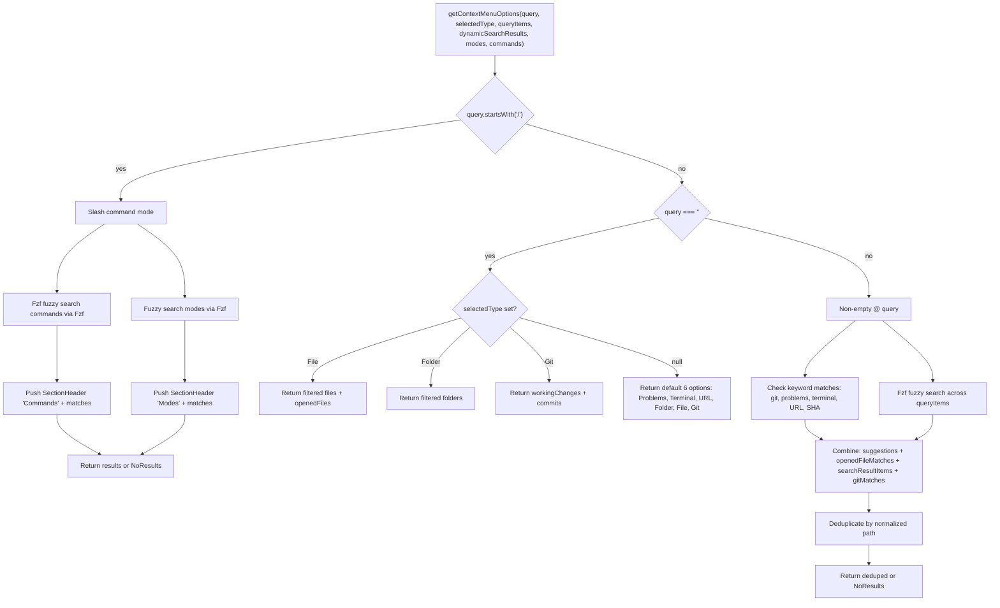
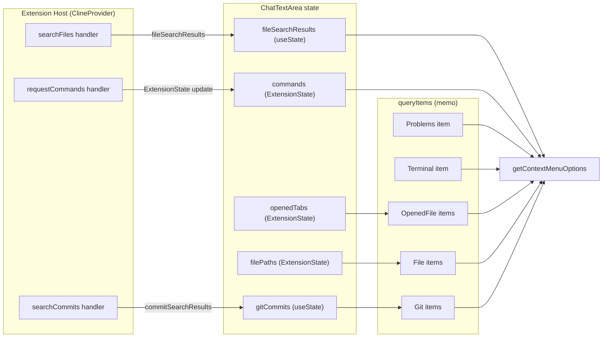
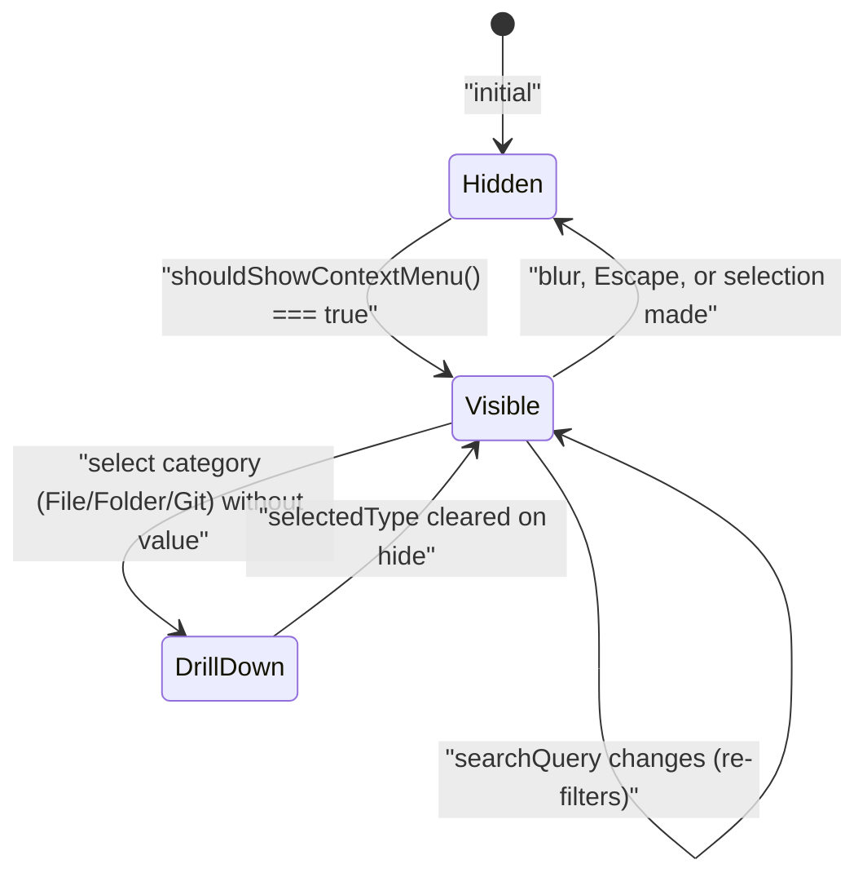

# Context Menu and Autocomplete

<details>
<summary>Relevant source files</summary>

The following files were used as context for generating this wiki page:

- [src/shared/__tests__/context-mentions.spec.ts](src/shared/__tests__/context-mentions.spec.ts)
- [src/shared/context-mentions.ts](src/shared/context-mentions.ts)
- [webview-ui/src/__tests__/command-autocomplete.spec.ts](webview-ui/src/__tests__/command-autocomplete.spec.ts)
- [webview-ui/src/components/chat/ChatTextArea.tsx](webview-ui/src/components/chat/ChatTextArea.tsx)
- [webview-ui/src/components/chat/ContextMenu.tsx](webview-ui/src/components/chat/ContextMenu.tsx)
- [webview-ui/src/components/chat/__tests__/BatchFilePermission.spec.tsx](webview-ui/src/components/chat/__tests__/BatchFilePermission.spec.tsx)
- [webview-ui/src/components/common/CodeBlock.tsx](webview-ui/src/components/common/CodeBlock.tsx)
- [webview-ui/src/components/common/Thumbnails.tsx](webview-ui/src/components/common/Thumbnails.tsx)
- [webview-ui/src/components/common/__tests__/CodeBlock.spec.tsx](webview-ui/src/components/common/__tests__/CodeBlock.spec.tsx)
- [webview-ui/src/components/history/__tests__/BatchDeleteTaskDialog.spec.tsx](webview-ui/src/components/history/__tests__/BatchDeleteTaskDialog.spec.tsx)
- [webview-ui/src/components/ui/select-dropdown.tsx](webview-ui/src/components/ui/select-dropdown.tsx)
- [webview-ui/src/utils/__tests__/context-mentions.spec.ts](webview-ui/src/utils/__tests__/context-mentions.spec.ts)
- [webview-ui/src/utils/context-mentions.ts](webview-ui/src/utils/context-mentions.ts)

</details>


This page covers the in-chat context menu and autocomplete system: the popup that appears when a user types `@` (for context mentions) or `/` (for slash commands) in the `ChatTextArea`. It documents the `ContextMenu` component, the `getContextMenuOptions` logic, `ContextMenuOptionType` values, and how the `ChatTextArea` manages menu state.

- For the processing of `@`-mentions into AI context after selection, see [Context Mentions System (7.3)]().
- For path-to-mention conversion utilities (`escapeSpaces`, `convertToMentionPath`), see [Path Mention Processing (8.6)]().
- For slash command discovery and execution semantics, see [Slash Commands System (10)]().
- For the `ChatTextArea` component itself (images, keyboard shortcuts, send behavior), see [ChatTextArea Input System (8.4)]().

---

## System Overview

The context menu is a floating dropdown rendered above the `ChatTextArea` input. It appears under two conditions and serves two distinct purposes:

| Trigger | Condition | Purpose |
|---|---|---|
| `@` mention | `@` typed anywhere in input, no unescaped space after it | Insert context (file, folder, URL, git commit, diagnostics, terminal) |
| `/` command | Input starts with `/` and contains no space | Select a slash command or switch mode |

**Trigger detection** is handled by `shouldShowContextMenu` in [webview-ui/src/utils/context-mentions.ts:367-397](). The `ChatTextArea` calls this on every input change and sets `showContextMenu` state accordingly [webview-ui/src/components/chat/ChatTextArea.tsx:596-649]().

Sources: [webview-ui/src/components/chat/ChatTextArea.tsx:596-649](), [webview-ui/src/utils/context-mentions.ts:367-397]()

---

## Trigger and Visibility Logic

### `shouldShowContextMenu`
Located in [webview-ui/src/utils/context-mentions.ts:367-397]().
```typescript
shouldShowContextMenu(text, cursorPosition) → boolean
```
1. **Slash command path**: If `text.startsWith("/")` and no space exists yet → return `true` [webview-ui/src/utils/context-mentions.ts:373-375]().
2. **@ mention path**: Find the last `@` before the cursor. If it exists, check whether `textAfterAt` contains an unescaped whitespace character (`/(?<!\\)\s/`). If there's no unescaped space and the text after `@` doesn't start with `http`, return `true` [webview-ui/src/utils/context-mentions.ts:377-394]().
3. Otherwise: return `false` [webview-ui/src/utils/context-mentions.ts:396]().

### Mention Regex
The `mentionRegex` and `mentionRegexGlobal` in [src/shared/context-mentions.ts:63-65]() define what constitutes a valid mention. The `@` symbol must be at the start of a line or preceded by whitespace to prevent accidental matches in pasted logs [src/shared/context-mentions.ts:57-64]().

The `commandRegexGlobal` in [src/shared/context-mentions.ts:68]() matches `/command-name` patterns for syntax highlighting.

Sources: [src/shared/context-mentions.ts:63-68](), [webview-ui/src/utils/context-mentions.ts:367-397]()

---

## `ContextMenuOptionType` Values

Defined as an enum in [webview-ui/src/utils/context-mentions.ts:99-111]().

| Value | String | Description |
|---|---|---|
| `OpenedFile` | `"openedFile"` | Currently open VS Code tabs |
| `File` | `"file"` | Workspace files |
| `Folder` | `"folder"` | Workspace directories |
| `Problems` | `"problems"` | VS Code diagnostics (errors/warnings) |
| `Terminal` | `"terminal"` | Active terminal output |
| `URL` | `"url"` | A URL typed or pasted after `@` |
| `Git` | `"git"` | Git commits or working changes |
| `NoResults` | `"noResults"` | Placeholder when nothing matches |
| `Mode` | `"mode"` | AI mode switch via `/slug` |
| `Command` | `"command"` | User-defined slash command via `/name` |
| `SectionHeader` | `"sectionHeader"` | Non-selectable visual grouping label |

`NoResults`, `URL`, and `SectionHeader` are **non-selectable** — clicking or keyboard-selecting them has no effect. This is enforced by `isOptionSelectable` in [webview-ui/src/components/chat/ContextMenu.tsx:249-255]().

Sources: [webview-ui/src/utils/context-mentions.ts:99-122](), [webview-ui/src/components/chat/ContextMenu.tsx:249-255]()

---

## `getContextMenuOptions` Logic

The `getContextMenuOptions` function in [webview-ui/src/utils/context-mentions.ts:124-365]() is the central routing function that maps `(query, selectedType, queryItems, dynamicSearchResults, modes, commands)` → `ContextMenuQueryItem[]`.

**Option generation diagram:**



Sources: [webview-ui/src/utils/context-mentions.ts:124-365]()

### Default `@` Options (empty query)
When the user types `@` and nothing else, the menu shows top-level categories including `Problems`, `Terminal`, `URL`, `Folder`, `File`, and `Git` [webview-ui/src/utils/context-mentions.ts:225-242](). Selecting `File`, `Folder`, or `Git` without a value sets `selectedType` state in `ChatTextArea`, drilling into that category on the next render.

### Slash Command Mode
When `query.startsWith("/")`, the function:
1. Strips the leading `/` to get `slashQuery` [webview-ui/src/utils/context-mentions.ts:135]().
2. Uses `Fzf` fuzzy search on command names and mode names [webview-ui/src/utils/context-mentions.ts:147-150]().
3. Commands appear first under a `"Commands"` section header, followed by modes under `"Modes"` [webview-ui/src/utils/context-mentions.ts:169-211]().

### Fuzzy Search
All text matching uses the `Fzf` library [webview-ui/src/utils/context-mentions.ts:1](). The `searchStr` for each item is a concatenation of properties like `label`, `value`, or `name`.

Sources: [webview-ui/src/utils/context-mentions.ts:124-365]()

---

## Dynamic Data Sources

The menu draws from several categories of data, populated through extension host messages and state updates.

**Data source diagram:**



| Data | State Variable | How Populated |
|---|---|---|
| Workspace files/folders | `filePaths`, `openedTabs` | Pushed from extension host via `ExtensionStateContext` [webview-ui/src/components/chat/ChatTextArea.tsx:87-88]() |
| Git commits | `gitCommits` | `searchCommits` message → `commitSearchResults` response [webview-ui/src/components/chat/ChatTextArea.tsx:189-198]() |
| File search | `fileSearchResults` | `searchFiles` message → `fileSearchResults` response [webview-ui/src/components/chat/ChatTextArea.tsx:199-204]() |
| Slash commands | `commands` | Pushed from extension host via `ExtensionStateContext` [webview-ui/src/components/chat/ChatTextArea.tsx:98]() |

The `queryItems` memo in `ChatTextArea` builds a static array combining `Problems`, `Terminal`, `gitCommits`, `openedTabs`, and `filePaths` [webview-ui/src/components/chat/ChatTextArea.tsx:276-295]().

Sources: [webview-ui/src/components/chat/ChatTextArea.tsx:86-102](), [webview-ui/src/components/chat/ChatTextArea.tsx:189-209](), [webview-ui/src/components/chat/ChatTextArea.tsx:276-295]()

---

## `ContextMenu` Component

Located at [webview-ui/src/components/chat/ContextMenu.tsx](). It is a presentational component that receives options and callbacks from `ChatTextArea`.

### Rendering
The `filteredOptions` are derived via `useMemo` calling `getContextMenuOptions` [webview-ui/src/components/chat/ContextMenu.tsx:50-52]().

Each option is rendered by `renderOptionContent`, which switches on `option.type`:
- **Modes/Commands**: Displays slash command, argument hints, and descriptions [webview-ui/src/components/chat/ContextMenu.tsx:89-140]().
- **Git**: Shows commit subject and metadata (hash, author, date) [webview-ui/src/components/chat/ContextMenu.tsx:150-169]().
- **Files/Folders**: Displays the basename and a dimmed relative folder path [webview-ui/src/components/chat/ContextMenu.tsx:170-209]().

**Icons:**
- `File`, `Folder`, `OpenedFile`: Uses `vscode-material-icons` [webview-ui/src/components/chat/ContextMenu.tsx:240-247]().
- All other types: Uses VS Code codicons via `getIconForOption` [webview-ui/src/components/chat/ContextMenu.tsx:213-238]().

**Selection highlight:** Active item uses `--vscode-list-activeSelectionBackground`. A `useEffect` ensures the selected element is scrolled into view [webview-ui/src/components/chat/ContextMenu.tsx:54-68]().

Sources: [webview-ui/src/components/chat/ContextMenu.tsx:50-247]()

---

## State Management in `ChatTextArea`

**Context menu state diagram:**



### Keyboard Handling
Handled in `handleKeyDown` [webview-ui/src/components/chat/ChatTextArea.tsx:413-574]() when `showContextMenu` is true:
- **ArrowUp/ArrowDown**: Move `selectedMenuIndex` through selectable options, skipping `SectionHeader` or `NoResults` [webview-ui/src/components/chat/ChatTextArea.tsx:437-458]().
- **Enter/Tab**: Call `handleMentionSelect` with the selected option [webview-ui/src/components/chat/ChatTextArea.tsx:422-436]().
- **Escape**: Resets `selectedType` and hides the menu [webview-ui/src/components/chat/ChatTextArea.tsx:417-421]().

Sources: [webview-ui/src/components/chat/ChatTextArea.tsx:413-574]()

---

## Selection Handling: `handleMentionSelect`

Located at [webview-ui/src/components/chat/ChatTextArea.tsx:316-411]().

1. **Modes**: Calls `setMode(value)` and clears input [webview-ui/src/components/chat/ChatTextArea.tsx:325-337]().
2. **Commands**: Inserts the command name into the textarea [webview-ui/src/components/chat/ChatTextArea.tsx:338-341]().
3. **Drill-down**: If selecting a category like "File" without a specific path, sets `selectedType` to filter the next menu view [webview-ui/src/components/chat/ChatTextArea.tsx:343-347]().
4. **Insertion**: Uses `insertMention` to update the textarea value with the selected context item [webview-ui/src/components/chat/ChatTextArea.tsx:355-385]().

### `insertMention` Utility
[webview-ui/src/utils/context-mentions.ts:27-76]()
- **@ mention**: Finds the last `@` before the cursor and replaces it with `@{value} `.
- **Path escaping**: If the value is a file path with spaces, it calls `escapeSpaces` [webview-ui/src/utils/context-mentions.ts:49-54]().
- **Slash command**: If `isSlashCommand` is true, it replaces the entire text with the selected value [webview-ui/src/utils/context-mentions.ts:33-38]().

### `removeMention` Utility
[webview-ui/src/utils/context-mentions.ts:78-97]()
When a user deletes a mention, this function identifies the mention boundary using `mentionRegex` and removes the entire block plus the trailing space [webview-ui/src/utils/context-mentions.ts:83-93]().

Sources: [webview-ui/src/utils/context-mentions.ts:27-97](), [webview-ui/src/components/chat/ChatTextArea.tsx:316-411]()

---

## Path Mention Processing

The system includes utilities to convert absolute system paths into mention-friendly strings.

- **`escapeSpaces`**: Replaces spaces with `\ ` for regex compatibility [webview-ui/src/utils/path-mentions.ts:11-13]().
- **`unescapeSpaces`**: Replaces `\ ` with a standard space character [src/shared/context-mentions.ts:109-111]().
- **`convertToMentionPath`**: Converts absolute paths to relative paths prefixed with `@` if they are within the current working directory (CWD). It also handles protocol stripping (e.g., `file://`) and URI decoding [webview-ui/src/utils/path-mentions.ts:25-80]().

Sources: [webview-ui/src/utils/path-mentions.ts:1-80](), [src/shared/context-mentions.ts:109-111]()