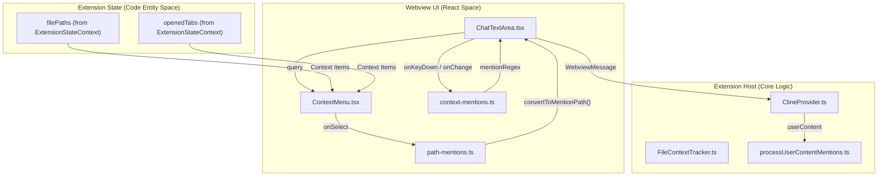
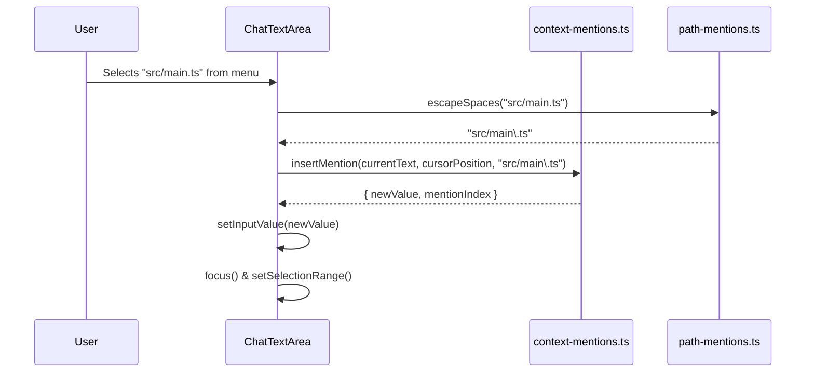
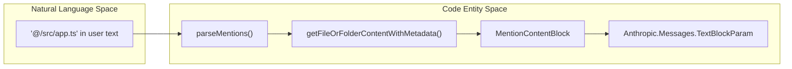

# Path Mention Processing

Relevant source files

The following files were used as context for generating this wiki page:

- [src/__tests__/command-mentions.spec.ts](src/__tests__/command-mentions.spec.ts)
- [src/core/mentions/__tests__/processUserContentMentions.spec.ts](src/core/mentions/__tests__/processUserContentMentions.spec.ts)
- [src/core/mentions/index.ts](src/core/mentions/index.ts)
- [src/core/mentions/processUserContentMentions.ts](src/core/mentions/processUserContentMentions.ts)
- [src/core/task/Task.ts](src/core/task/Task.ts)
- [src/core/task/__tests__/Task.spec.ts](src/core/task/__tests__/Task.spec.ts)
- [src/core/tools/RunSlashCommandTool.ts](src/core/tools/RunSlashCommandTool.ts)
- [src/core/tools/SkillTool.ts](src/core/tools/SkillTool.ts)
- [src/core/tools/__tests__/runSlashCommandTool.spec.ts](src/core/tools/__tests__/runSlashCommandTool.spec.ts)
- [src/services/skills/__tests__/skillInvocation.spec.ts](src/services/skills/__tests__/skillInvocation.spec.ts)
- [src/shared/__tests__/context-mentions.spec.ts](src/shared/__tests__/context-mentions.spec.ts)
- [src/shared/context-mentions.ts](src/shared/context-mentions.ts)
- [webview-ui/src/__tests__/command-autocomplete.spec.ts](webview-ui/src/__tests__/command-autocomplete.spec.ts)
- [webview-ui/src/components/chat/ChatTextArea.tsx](webview-ui/src/components/chat/ChatTextArea.tsx)
- [webview-ui/src/components/chat/ContextMenu.tsx](webview-ui/src/components/chat/ContextMenu.tsx)
- [webview-ui/src/components/chat/__tests__/BatchFilePermission.spec.tsx](webview-ui/src/components/chat/__tests__/BatchFilePermission.spec.tsx)
- [webview-ui/src/components/common/CodeBlock.tsx](webview-ui/src/components/common/CodeBlock.tsx)
- [webview-ui/src/components/common/Thumbnails.tsx](webview-ui/src/components/common/Thumbnails.tsx)
- [webview-ui/src/components/common/__tests__/CodeBlock.spec.tsx](webview-ui/src/components/common/__tests__/CodeBlock.spec.tsx)
- [webview-ui/src/components/history/__tests__/BatchDeleteTaskDialog.spec.tsx](webview-ui/src/components/history/__tests__/BatchDeleteTaskDialog.spec.tsx)
- [webview-ui/src/components/ui/select-dropdown.tsx](webview-ui/src/components/ui/select-dropdown.tsx)
- [webview-ui/src/utils/__tests__/context-mentions.spec.ts](webview-ui/src/utils/__tests__/context-mentions.spec.ts)
- [webview-ui/src/utils/context-mentions.ts](webview-ui/src/utils/context-mentions.ts)

## Purpose and Scope

This page documents the client-side path mention processing system that resolves `@file` and `@folder` mentions in user messages. While the core logic for reading file contents and formatting them for the AI resides in the extension host, the Webview UI handles the initial regex-based identification, autocomplete suggestions, and path normalization to ensure a seamless user experience.

For extension-host side mention processing and context collection, see [Context Mentions System (7.3)](). For the autocomplete UI implementation, see [Context Menu and Autocomplete (8.5)]().

---

## Architecture Overview

Path mention processing begins in the `ChatTextArea` component. As a user types, the system uses regex to detect `@` symbols and triggers the `ContextMenu`. When a path is selected, it is normalized and inserted into the text area.

**Diagram: Path Mention UI Data Flow**

**Sources:**
- [webview-ui/src/components/chat/ChatTextArea.tsx:86-102]()
- [webview-ui/src/utils/context-mentions.ts:27-76]()
- [src/core/mentions/processUserContentMentions.ts:36-56]()

---

## Regex Identification

The system relies on a sophisticated regex to identify mentions while avoiding accidental triggers (e.g., in pasted email addresses or logs).

### Mention Regex Breakdown
The `mentionRegex` ensures that:
1. The `@` symbol is at the start of a line or preceded by whitespace `(?:^|(?<=\s))`.
2. The `@` symbol is not escaped `(?<!\\)`.
3. It captures file paths, URLs, or specific keywords like `problems`, `terminal`, or `git-changes`.
4. It ignores trailing punctuation like commas or periods `(?=[.,;:!?]?(?=[\s\r\n]|$))`.

| Regex Component | Purpose |
|:---|:---|
| `(?:\/\|\w+:\/\/)(?:[^\s\\]|\\ )+?` | Matches absolute paths or URLs with escaped spaces. |
| `[a-f0-9]{7,40}\b` | Matches Git commit hashes. |
| `problems\b\|terminal\b\|git-changes\b` | Matches specific system context keywords. |

**Sources:**
- [src/shared/context-mentions.ts:63-65]()
- [src/shared/context-mentions.ts:9-57]()

---

## Path Normalization and Conversion

When a file is selected from the autocomplete menu or dragged into the chat, it must be converted from an absolute system path to a "mention-friendly" relative path.

### `convertToMentionPath` Logic
This function transforms absolute paths into the `@/path/to/file` format used by the AI.

1. **Protocol Stripping**: Removes `file://` or `vscode-remote://` prefixes.
2. **CWD Relativization**: If the path is within the Current Working Directory (CWD), it strips the CWD prefix to make the path relative.
3. **Space Escaping**: Spaces in paths are escaped with backslashes (e.g., `@/My\ Documents/file.txt`) to satisfy the regex requirements [webview-ui/src/utils/context-mentions.ts:51-53]().
4. **Windows Handling**: Normalizes slashes for cross-platform compatibility.

**Sources:**
- [webview-ui/src/utils/context-mentions.ts:47-54]()
- [webview-ui/src/components/chat/ChatTextArea.tsx:24]()

---

## UI Integration and Interaction

### Insertion Flow
When a user selects a suggestion in the `ContextMenu`, `insertMention` is called to update the `ChatTextArea` state.

**Diagram: Mention Insertion Sequence**

**Sources:**
- [webview-ui/src/utils/context-mentions.ts:27-76]()
- [webview-ui/src/components/chat/ChatTextArea.tsx:159-188]()

### Context Menu Rendering
The `ContextMenu` differentiates between various mention types using `ContextMenuOptionType`. File and folder mentions are rendered with breadcrumbs to help users distinguish between files with the same name in different directories.

| Option Type | Icon | Rendering Logic |
|:---|:---|:---|
| `OpenedFile` | `window` | Highlighted as currently open in editor [webview-ui/src/components/chat/ContextMenu.tsx:220](). |
| `File` | `file` | Shows filename and `folderPath` (RTL direction) [webview-ui/src/components/chat/ContextMenu.tsx:176-205](). |
| `Folder` | `folder` | Indicates directory type [webview-ui/src/components/chat/ContextMenu.tsx:224](). |
| `Git` | `git-commit` | Shows commit subject and hash [webview-ui/src/components/chat/ContextMenu.tsx:150-166](). |

**Sources:**
- [webview-ui/src/components/chat/ContextMenu.tsx:170-206]()
- [webview-ui/src/utils/context-mentions.ts:99-111]()

---

## Extension-Side Processing

Once the message is sent, the extension host processes the mentions using `processUserContentMentions`.

### Mention Content Resolution
The `parseMentions` function [src/core/mentions/index.ts:99-109]() is responsible for:
1. **Path Unescaping**: Using `unescapeSpaces` to convert backslash-escaped spaces back into standard spaces [src/shared/context-mentions.ts:109-111]().
2. **Content Extraction**: Reading the actual file content or gathering system info (diagnostics, git changes) [src/core/mentions/index.ts:187-193]().
3. **Block Formatting**: Converting mentions into `MentionContentBlock` objects which are then formatted to look like `read_file` tool results for the AI [src/core/mentions/index.ts:79-97]().

**Diagram: Content Block Transformation**

**Sources:**
- [src/core/mentions/index.ts:99-109]()
- [src/core/mentions/processUserContentMentions.ts:22-27]()
- [src/core/mentions/processUserContentMentions.ts:62-99]()