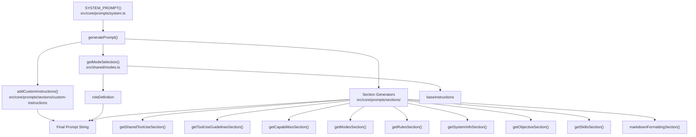
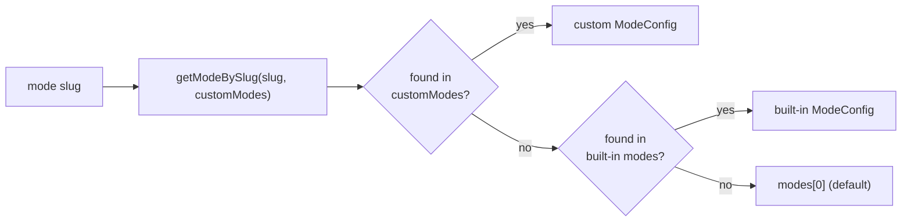
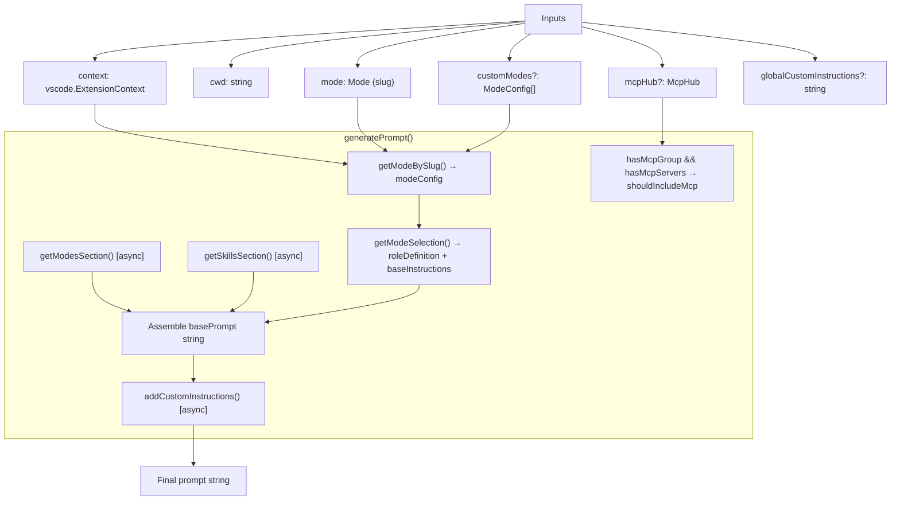
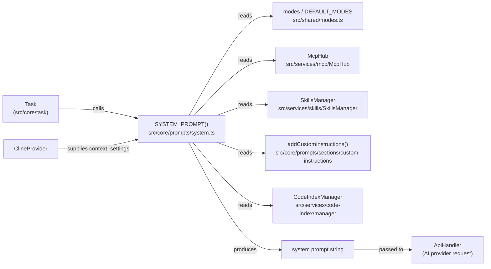

# System Prompt and Modes

Relevant source files

The following files were used as context for generating this wiki page:

- [packages/cloud/src/__tests__/CloudSettingsService.parsing.test.ts](packages/cloud/src/__tests__/CloudSettingsService.parsing.test.ts)
- [packages/types/src/tool-params.ts](packages/types/src/tool-params.ts)
- [src/core/assistant-message/__tests__/NativeToolCallParser.spec.ts](src/core/assistant-message/__tests__/NativeToolCallParser.spec.ts)
- [src/core/prompts/system.ts](src/core/prompts/system.ts)
- [src/core/prompts/tools/__tests__/filter-tools-for-mode.spec.ts](src/core/prompts/tools/__tests__/filter-tools-for-mode.spec.ts)
- [src/core/prompts/tools/filter-tools-for-mode.ts](src/core/prompts/tools/filter-tools-for-mode.ts)
- [src/core/prompts/tools/native-tools/__tests__/read_file.spec.ts](src/core/prompts/tools/native-tools/__tests__/read_file.spec.ts)
- [src/core/prompts/tools/native-tools/read_file.ts](src/core/prompts/tools/native-tools/read_file.ts)
- [src/core/task/build-tools.ts](src/core/task/build-tools.ts)
- [src/core/tools/__tests__/validateToolUse.spec.ts](src/core/tools/__tests__/validateToolUse.spec.ts)
- [src/core/tools/validateToolUse.ts](src/core/tools/validateToolUse.ts)
- [src/shared/__tests__/modes.spec.ts](src/shared/__tests__/modes.spec.ts)
- [src/shared/modes.ts](src/shared/modes.ts)

This page covers the system prompt construction pipeline and the modes configuration system in Roo Code. It explains how the AI agent's behavioral instructions are assembled from modular sections, how modes define the agent's role and tool access, and how custom instructions are layered on top of built-in defaults.

For details on specific subsystems, see:
- [System Prompt Generation](#9.1) — the `SYSTEM_PROMPT` function and `generatePrompt` orchestration.
- [Modes System](#9.2) — `ModeConfig` structure, `DEFAULT_MODES`, and the mode resolution chain.
- [Prompt Sections and Assembly](#9.3) — individual section generators like `getRulesSection` and `getCapabilitiesSection`.
- [Custom Instructions and Rules](#9.4) — `addCustomInstructions`, `.roo` directory, and shell-specific rules.
- [Skills Management System](#9.5) — `SkillsManager` and the `getSkillsSection` integration.
- [Tool Descriptions and Guidelines](#9.6) — tool documentation and usage guidelines in the prompt.

---

## Overview

Each time the agent processes a task, a single large system prompt string is constructed and sent to the AI provider. This prompt is assembled dynamically from the active mode, workspace context, MCP server state, user-defined custom instructions, and various rule sections.

The entry point is `SYSTEM_PROMPT` in [src/core/prompts/system.ts:112-158](), which delegates to `generatePrompt`. The assembled sections are joined into a single string that becomes the `system` field in the AI API request.

**System Prompt and Modes — Top-Level Components**

Sources: [src/core/prompts/system.ts:1-158](), [src/core/prompts/system.ts:15-26]()

---

## Modes System

A **mode** defines the agent's behavioral persona for a session. Each mode specifies its role, when it should be used, and which tools it has access to.

| Field | Type | Description |
|---|---|---|
| `slug` | `string` | Unique identifier, e.g. `"code"`, `"architect"` |
| `name` | `string` | Human-readable display name |
| `roleDefinition` | `string` | The opening role paragraph in the system prompt |
| `description` | `string` | Short description shown in the UI |
| `whenToUse` | `string` | Guidance for the AI on when to recommend this mode |
| `customInstructions` | `string` | Mode-specific baseline instructions |
| `groups` | `GroupEntry[]` | Tool groups enabled for this mode |

The built-in modes are defined in `DEFAULT_MODES` (from `@roo-code/types`) and re-exported from [src/shared/modes.ts:45]() as `modes`. The first entry is the default mode (`defaultModeSlug`) [src/shared/modes.ts:48]().

**Mode Resolution Chain**

Sources: [src/shared/modes.ts:51-59](), [src/shared/modes.ts:111-132]()

Custom modes can **override** an existing built-in mode (by matching its `slug`) or **add** entirely new modes. `getAllModes` merges custom and built-in modes, with custom modes taking precedence [src/shared/modes.ts:70-91]().

### Tool Access and Filtering

Tools are filtered per mode using `filterNativeToolsForMode` [src/core/task/build-tools.ts:117-125](). This ensures the model only sees tool definitions relevant to its current persona. For example, `architect` mode typically lacks `execute_command` but has access to `read` and `mcp` groups [src/core/tools/__tests__/validateToolUse.spec.ts:34-38]().

### FileRestrictionError

Modes can restrict which files the agent may edit via `groups` entries. If a tool attempts to write a file outside the allowed patterns, a `FileRestrictionError` is thrown [src/shared/modes.ts:135-143](). This validation occurs in `isToolAllowedForMode` [src/core/tools/validateToolUse.ts:206-213]().

---

## System Prompt Assembly

`SYSTEM_PROMPT` is an `async` function that accepts the extension context, workspace directory, mode, and a set of optional configuration inputs. It resolves the prompt component for the current mode and calls `generatePrompt`.

**generatePrompt inputs and outputs**

Sources: [src/core/prompts/system.ts:41-110]()

### Prompt Section Order

The sections are concatenated in the following order inside `generatePrompt`:

1. `roleDefinition` (from mode config) [src/core/prompts/system.ts:85]()
2. `markdownFormattingSection()` [src/core/prompts/system.ts:87]()
3. `getSharedToolUseSection()` [src/core/prompts/system.ts:89]()
4. `getToolUseGuidelinesSection()` [src/core/prompts/system.ts:91]()
5. `getCapabilitiesSection(cwd, mcpHub?)` [src/core/prompts/system.ts:93]()
6. `getModesSection(context)` [src/core/prompts/system.ts:95]()
7. `getSkillsSection(skillsManager)` [src/core/prompts/system.ts:96]()
8. `getRulesSection(cwd, settings)` [src/core/prompts/system.ts:97]()
9. `getSystemInfoSection(cwd)` [src/core/prompts/system.ts:99]()
10. `getObjectiveSection()` [src/core/prompts/system.ts:101]()
11. `addCustomInstructions(...)` [src/core/prompts/system.ts:103]()

### MCP Gating

MCP server documentation is conditionally included. The `getCapabilitiesSection` receives `mcpHub` only when both of these are true:

- The current mode's `groups` array includes a `"mcp"` entry (`hasMcpGroup`) [src/core/prompts/system.ts:68]()
- At least one MCP server is registered (`hasMcpServers`) [src/core/prompts/system.ts:69]()

This prevents MCP tool descriptions from cluttering the prompt when MCP is not available or not permitted for the active mode [src/core/prompts/system.ts:70-71]().

Sources: [src/core/prompts/system.ts:68-71]()

---

## getPromptComponent

`getPromptComponent` [src/core/prompts/system.ts:29-39]() looks up a `PromptComponent` override for the current mode from `customModePrompts`. If the result is an empty object, it returns `undefined` — preventing an empty override from clobbering the built-in role definition.

This feeds into `getModeSelection`, which applies the following precedence:

| Priority | Source |
|---|---|
| 1 (highest) | `customModes` entry matching the slug [src/shared/modes.ts:116]() |
| 2 | `promptComponent` override fields (`roleDefinition`, `customInstructions`) [src/shared/modes.ts:128-129]() |
| 3 | Built-in mode (`modes` array) [src/shared/modes.ts:125]() |
| 4 | `modes[0]` (fallback default) [src/shared/modes.ts:125]() |

Sources: [src/shared/modes.ts:111-132](), [src/core/prompts/system.ts:29-39]()

---

## Relationship to Other Systems

Sources: [src/core/prompts/system.ts:1-158](), [src/shared/modes.ts:1-160]()

The `SYSTEM_PROMPT` function is typically called by the `Task` orchestrator. The resulting string is generated based on the current extension state and provided to the `ApiHandler` for each conversation turn.

For information about how the `Task` system manages the agent loop, see [Task Lifecycle and Execution](#5.1). For information about how custom modes are persisted, see [Core Services](#2.2).