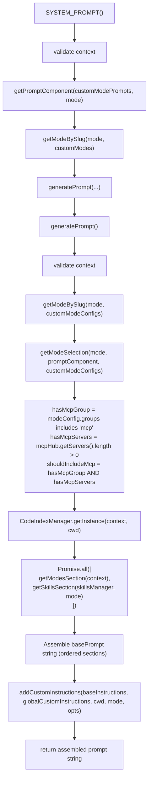
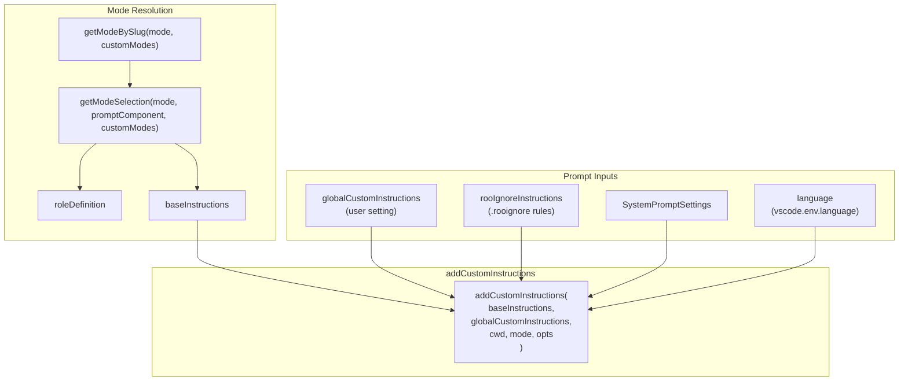

# System Prompt Generation

<details>
<summary>Relevant source files</summary>

The following files were used as context for generating this wiki page:

- [packages/types/src/providers/ollama.ts](packages/types/src/providers/ollama.ts)
- [src/api/providers/__tests__/native-ollama.spec.ts](src/api/providers/__tests__/native-ollama.spec.ts)
- [src/api/providers/fetchers/__tests__/ollama.test.ts](src/api/providers/fetchers/__tests__/ollama.test.ts)
- [src/api/providers/fetchers/ollama.ts](src/api/providers/fetchers/ollama.ts)
- [src/api/providers/native-ollama.ts](src/api/providers/native-ollama.ts)
- [src/core/prompts/__tests__/__snapshots__/add-custom-instructions/architect-mode-prompt.snap](src/core/prompts/__tests__/__snapshots__/add-custom-instructions/architect-mode-prompt.snap)
- [src/core/prompts/__tests__/__snapshots__/add-custom-instructions/mcp-server-creation-disabled.snap](src/core/prompts/__tests__/__snapshots__/add-custom-instructions/mcp-server-creation-disabled.snap)
- [src/core/prompts/__tests__/__snapshots__/system-prompt/consistent-system-prompt.snap](src/core/prompts/__tests__/__snapshots__/system-prompt/consistent-system-prompt.snap)
- [src/core/prompts/__tests__/__snapshots__/system-prompt/with-computer-use-support.snap](src/core/prompts/__tests__/__snapshots__/system-prompt/with-computer-use-support.snap)
- [src/core/prompts/__tests__/__snapshots__/system-prompt/with-diff-enabled-false.snap](src/core/prompts/__tests__/__snapshots__/system-prompt/with-diff-enabled-false.snap)
- [src/core/prompts/__tests__/__snapshots__/system-prompt/with-diff-enabled-true.snap](src/core/prompts/__tests__/__snapshots__/system-prompt/with-diff-enabled-true.snap)
- [src/core/prompts/__tests__/__snapshots__/system-prompt/with-diff-enabled-undefined.snap](src/core/prompts/__tests__/__snapshots__/system-prompt/with-diff-enabled-undefined.snap)
- [src/core/prompts/__tests__/__snapshots__/system-prompt/with-different-viewport-size.snap](src/core/prompts/__tests__/__snapshots__/system-prompt/with-different-viewport-size.snap)
- [src/core/prompts/__tests__/__snapshots__/system-prompt/with-mcp-hub-provided.snap](src/core/prompts/__tests__/__snapshots__/system-prompt/with-mcp-hub-provided.snap)
- [src/core/prompts/__tests__/__snapshots__/system-prompt/with-undefined-mcp-hub.snap](src/core/prompts/__tests__/__snapshots__/system-prompt/with-undefined-mcp-hub.snap)
- [src/core/prompts/__tests__/add-custom-instructions.spec.ts](src/core/prompts/__tests__/add-custom-instructions.spec.ts)
- [src/core/prompts/__tests__/sections.spec.ts](src/core/prompts/__tests__/sections.spec.ts)
- [src/core/prompts/__tests__/system-prompt.spec.ts](src/core/prompts/__tests__/system-prompt.spec.ts)
- [src/core/prompts/system.ts](src/core/prompts/system.ts)
- [src/core/prompts/types.ts](src/core/prompts/types.ts)
- [src/core/webview/generateSystemPrompt.ts](src/core/webview/generateSystemPrompt.ts)

</details>


The system prompt generation system constructs the foundational instructions that define the AI assistant's behavior, capabilities, and operational context. This page documents the `SYSTEM_PROMPT` function and the `generatePrompt` pipeline that assembles modular prompt sections into a cohesive system message. For information about the individual prompt sections (modes, skills, rules, etc.), see [Prompt Sections and Assembly](9.3). For mode-specific configurations, see [Modes System](9.2).

## Overview

The system prompt is generated dynamically for each task based on:
- **Selected mode** (Code, Architect, Ask, etc.) and its role definition [[src/core/prompts/system.ts:64-65]]().
- **Workspace context** (cwd, language, OS, shell) [[src/core/prompts/system.ts:99-107]]().
- **Available tools and capabilities** (MCP servers, code index) [[src/core/prompts/system.ts:68-72]]().
- **User customizations** (global instructions, `.rooignore` rules, custom mode prompts) [[src/core/prompts/system.ts:103-107]]().

The generation process has a single path: `SYSTEM_PROMPT` resolves the mode and prompt component, then delegates to `generatePrompt` which assembles modular sections into a complete prompt string.

Sources: [[src/core/prompts/system.ts:1-159]]()

## System Prompt Generation Flow

The following diagram bridges the **Natural Language Space** (the final prompt text) with the **Code Entity Space** (the functions and classes responsible for generation).

**End-to-End System Prompt Assembly**



Sources: [[src/core/prompts/system.ts:41-158]]()

## SYSTEM_PROMPT Function

The `SYSTEM_PROMPT` async function at [[src/core/prompts/system.ts:112-158]]() is the primary entry point for system prompt generation. It resolves the active mode and any custom prompt component, then delegates to `generatePrompt`.

### Parameters

| Parameter | Type | Purpose |
|-----------|------|---------|
| `context` | `vscode.ExtensionContext` | Extension context for resources and storage |
| `cwd` | `string` | Current working directory (workspace root) |
| `supportsComputerUse` | `boolean` | Whether the model supports computer use |
| `mcpHub` | `McpHub?` | Hub for MCP server management |
| `diffStrategy` | `DiffStrategy?` | Active diff strategy for file editing |
| `mode` | `Mode` | Active mode slug (defaults to `defaultModeSlug`) |
| `customModePrompts` | `CustomModePrompts?` | User-defined prompt components per mode |
| `customModes` | `ModeConfig[]?` | User-defined custom mode configurations |
| `globalCustomInstructions` | `string?` | User's global custom instructions |
| `experiments` | `Record<string, boolean>?` | Feature flags |
| `language` | `string?` | UI language for localization |
| `rooIgnoreInstructions` | `string?` | Instructions derived from `.rooignore` |
| `settings` | `SystemPromptSettings?` | System prompt behavior settings |
| `todoList` | `TodoItem[]?` | Active to-do items for the session |
| `modelId` | `string?` | The model identifier in use |
| `skillsManager` | `SkillsManager?` | Manager for the skills system |

### Execution Steps

1. **Validate context**: Throws if `context` is missing [[src/core/prompts/system.ts:130-132]]().
2. **Resolve prompt component**: Calls `getPromptComponent(customModePrompts, mode)` to get any custom `PromptComponent` for the mode [[src/core/prompts/system.ts:135]]().
3. **Resolve mode config**: Calls `getModeBySlug(mode, customModes)` with fallback to built-in modes [[src/core/prompts/system.ts:138]]().
4. **Delegate**: Calls `generatePrompt(...)` with all resolved values and returns the result [[src/core/prompts/system.ts:140-157]]().

Sources: [[src/core/prompts/system.ts:112-158]]()


## generatePrompt Pipeline

The `generatePrompt` function at [[src/core/prompts/system.ts:41-110]]() assembles all system prompt sections into a single string. It is called exclusively by `SYSTEM_PROMPT`.

### Key Processing Steps

1. **Mode configuration resolution** [[src/core/prompts/system.ts:64-65]]():
   - Retrieves full `ModeConfig` via `getModeBySlug(mode, customModeConfigs)`, falling back through built-in modes to `modes[0]`.
   - Extracts `roleDefinition` and `baseInstructions` from `getModeSelection(mode, promptComponent, customModeConfigs)`.
2. **MCP availability check** [[src/core/prompts/system.ts:68-70]]():
   - `hasMcpGroup`: whether `"mcp"` appears in `modeConfig.groups`.
   - `hasMcpServers`: whether `mcpHub.getServers().length > 0`.
   - `shouldIncludeMcp = hasMcpGroup && hasMcpServers` — gates MCP content in capabilities section.
3. **Code index initialization** [[src/core/prompts/system.ts:72]]():
   - Calls `CodeIndexManager.getInstance(context, cwd)` to ensure the instance is ready.
4. **Parallel section loading** [[src/core/prompts/system.ts:77-80]]():
   - Awaits `Promise.all([getModesSection(context), getSkillsSection(skillsManager, mode)])` concurrently.
5. **Base prompt assembly** [[src/core/prompts/system.ts:85-107]]():
   - Concatenates all sections in fixed order (see table below).
   - `skillsSection` is included only when non-empty.
   - `mcpHub` is passed to `getCapabilitiesSection` only when `shouldIncludeMcp` is true.
6. **Custom instructions appended** [[src/core/prompts/system.ts:103-107]]():
   - Calls `addCustomInstructions(baseInstructions, globalCustomInstructions, cwd, mode, opts)` as the final section.

### Section Assembly Order

The prompt is constructed as a template literal starting at [[src/core/prompts/system.ts:85]]().

**Ordered System Prompt Sections and Their Source Functions**

```mermaid
flowchart LR
    RoleDef["roleDefinition\n(from getModeSelection)"]
    Markdown["markdownFormattingSection()"]
    ToolUse["getSharedToolUseSection()"]
    ToolGuide["getToolUseGuidelinesSection()"]
    Caps["getCapabilitiesSection(cwd, mcpHub?)"]
    Modes["getModesSection(context)"]
    Skills["getSkillsSection(skillsManager, mode)\n(conditional)"]
    Rules["getRulesSection(cwd, settings)"]
    SysInfo["getSystemInfoSection(cwd)"]
    Obj["getObjectiveSection()"]
    Custom["addCustomInstructions(baseInstructions,\nglobalCustomInstructions, cwd, mode, opts)"]

    RoleDef --> Markdown --> ToolUse --> ToolGuide --> Caps --> Modes --> Skills --> Rules --> SysInfo --> Obj --> Custom
```



| Position | Section Function | Source File |
|----------|-----------------|-------------|
| 1 | `roleDefinition` (from `getModeSelection`) | [[src/core/prompts/system.ts:65]]() |
| 2 | `markdownFormattingSection()` | [[src/core/prompts/sections/index.ts]]() |
| 3 | `getSharedToolUseSection()` | [[src/core/prompts/sections/index.ts]]() |
| 4 | `getToolUseGuidelinesSection()` | [[src/core/prompts/sections/index.ts]]() |
| 5 | `getCapabilitiesSection(cwd, mcpHub?)` | [[src/core/prompts/sections/index.ts]]() |
| 6 | `getModesSection(context)` | [[src/core/prompts/sections/index.ts]]() |
| 7 | `getSkillsSection(skillsManager, mode)` *(if non-empty)* | [[src/core/prompts/sections/index.ts]]() |
| 8 | `getRulesSection(cwd, settings)` | [[src/core/prompts/sections/index.ts]]() |
| 9 | `getSystemInfoSection(cwd)` | [[src/core/prompts/sections/index.ts]]() |
| 10 | `getObjectiveSection()` | [[src/core/prompts/sections/index.ts]]() |
| 11 | `addCustomInstructions(...)` | [[src/core/prompts/sections/index.ts]]() |

Sources: [[src/core/prompts/system.ts:41-110]]()

## Prompt Section Integration

The final section of the prompt is the most dynamic, merging mode-specific instructions with user-defined rules.

**Inputs to Custom Instruction Assembly**



Sources: [[src/core/prompts/system.ts:85-109]]()

## Helper Functions

### getPromptComponent

The `getPromptComponent` helper at [[src/core/prompts/system.ts:29-39]]() extracts a custom prompt component from the `CustomModePrompts` mapping for the active mode.

**Signature**: `getPromptComponent(customModePrompts: CustomModePrompts | undefined, mode: string): PromptComponent | undefined`

**Behavior**:
- Looks up `customModePrompts?.[mode]` [[src/core/prompts/system.ts:33]]().
- Returns `undefined` if the component is empty (uses `isEmpty` from `src/utils/object.ts`) [[src/core/prompts/system.ts:35-37]]().
- Filters out empty objects to prevent stale or unset overrides from affecting prompt generation [[src/core/prompts/system.ts:38]]().

**Usage**: Called by `SYSTEM_PROMPT` at [[src/core/prompts/system.ts:135]]() before passing a `promptComponent` to `generatePrompt`. If no non-empty component exists, `undefined` is passed and `getModeSelection` falls back to the built-in mode defaults.

Sources: [[src/core/prompts/system.ts:29-39]]()

## Protocol Notes

The codebase uses **native tool calling** exclusively [[src/core/prompts/system.ts:74-75]]():

```typescript
// Tool calling is native-only.
const effectiveProtocol = "native"
```

Tool definitions are provided directly to the API as native tool schemas rather than embedded in the prompt text. As a result, the `toolsCatalog` variable is set to an empty string [[src/core/prompts/system.ts:83]]() and omitted from the assembled prompt. See [Native Tool Calling Protocol](6.2) for details.

Sources: [[src/core/prompts/system.ts:74-75]](), [[src/core/prompts/system.ts:83]]()

## Error Handling

The system prompt generation pipeline includes validation at [[src/core/prompts/system.ts:59-61]]() and [[src/core/prompts/system.ts:130-132]]():

```typescript
if (!context) {
    throw new Error("Extension context is required for generating system prompt")
}
```

This ensures that critical dependencies are available before attempting prompt generation, preventing runtime errors during task initialization.

Sources: [[src/core/prompts/system.ts:59-61]](), [[src/core/prompts/system.ts:130-132]]()