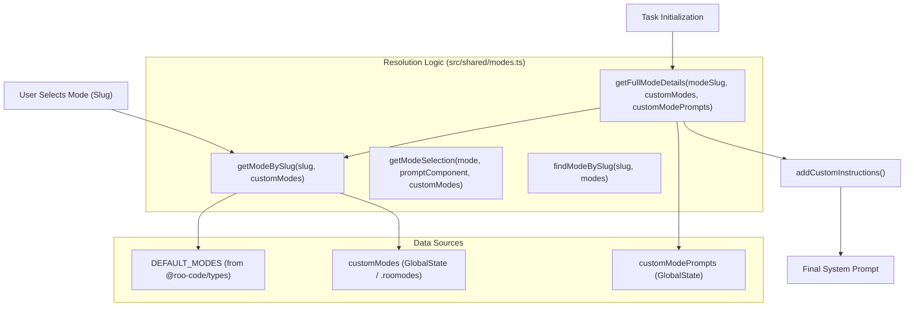
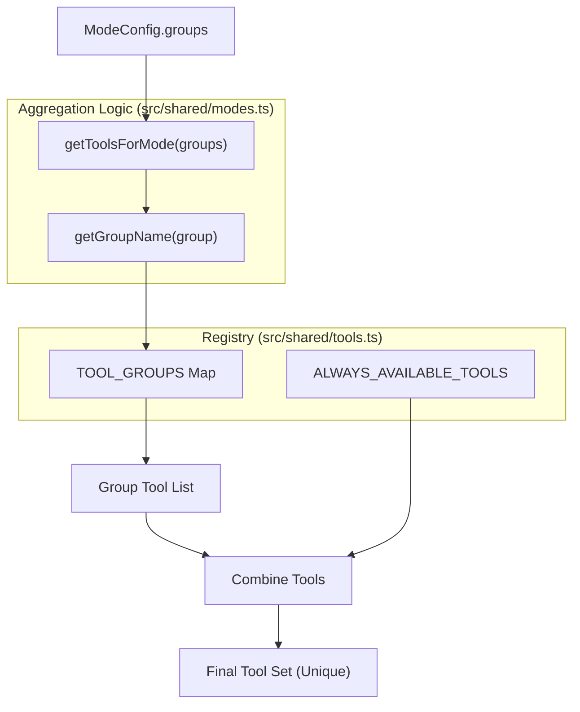

# Modes System

<details>
<summary>Relevant source files</summary>

The following files were used as context for generating this wiki page:

- [.roo/rules-docs-extractor/1_extraction_workflow.xml](.roo/rules-docs-extractor/1_extraction_workflow.xml)
- [.roo/rules-docs-extractor/2_verification_workflow.xml](.roo/rules-docs-extractor/2_verification_workflow.xml)
- [.roo/rules-docs-extractor/3_output_format.xml](.roo/rules-docs-extractor/3_output_format.xml)
- [.roo/rules-issue-writer/1_workflow.xml](.roo/rules-issue-writer/1_workflow.xml)
- [.roo/rules-issue-writer/3_best_practices.xml](.roo/rules-issue-writer/3_best_practices.xml)
- [.roo/rules-issue-writer/4_common_mistakes_to_avoid.xml](.roo/rules-issue-writer/4_common_mistakes_to_avoid.xml)
- [.roomodes](.roomodes)
- [AGENTS.md](AGENTS.md)
- [packages/cloud/src/__tests__/CloudSettingsService.parsing.test.ts](packages/cloud/src/__tests__/CloudSettingsService.parsing.test.ts)
- [packages/types/src/tool-params.ts](packages/types/src/tool-params.ts)
- [src/core/assistant-message/__tests__/NativeToolCallParser.spec.ts](src/core/assistant-message/__tests__/NativeToolCallParser.spec.ts)
- [src/core/config/CustomModesManager.ts](src/core/config/CustomModesManager.ts)
- [src/core/config/__tests__/CustomModesManager.exportImportSlugChange.spec.ts](src/core/config/__tests__/CustomModesManager.exportImportSlugChange.spec.ts)
- [src/core/config/__tests__/CustomModesManager.spec.ts](src/core/config/__tests__/CustomModesManager.spec.ts)
- [src/core/prompts/tools/__tests__/filter-tools-for-mode.spec.ts](src/core/prompts/tools/__tests__/filter-tools-for-mode.spec.ts)
- [src/core/prompts/tools/filter-tools-for-mode.ts](src/core/prompts/tools/filter-tools-for-mode.ts)
- [src/core/prompts/tools/native-tools/__tests__/read_file.spec.ts](src/core/prompts/tools/native-tools/__tests__/read_file.spec.ts)
- [src/core/prompts/tools/native-tools/read_file.ts](src/core/prompts/tools/native-tools/read_file.ts)
- [src/core/task/build-tools.ts](src/core/task/build-tools.ts)
- [src/core/tools/__tests__/validateToolUse.spec.ts](src/core/tools/__tests__/validateToolUse.spec.ts)
- [src/core/tools/validateToolUse.ts](src/core/tools/validateToolUse.ts)
- [src/services/marketplace/SimpleInstaller.ts](src/services/marketplace/SimpleInstaller.ts)
- [src/services/marketplace/__tests__/SimpleInstaller.spec.ts](src/services/marketplace/__tests__/SimpleInstaller.spec.ts)
- [src/shared/__tests__/modes.spec.ts](src/shared/__tests__/modes.spec.ts)
- [src/shared/modes.ts](src/shared/modes.ts)
- [src/utils/__tests__/migrateSettings.spec.ts](src/utils/__tests__/migrateSettings.spec.ts)
- [src/utils/globalContext.ts](src/utils/globalContext.ts)
- [src/utils/migrateSettings.ts](src/utils/migrateSettings.ts)
- [webview-ui/src/__tests__/SearchableSelect.spec.tsx](webview-ui/src/__tests__/SearchableSelect.spec.tsx)
- [webview-ui/src/components/modes/ModesView.tsx](webview-ui/src/components/modes/ModesView.tsx)
- [webview-ui/src/components/modes/__tests__/ModesView.spec.tsx](webview-ui/src/components/modes/__tests__/ModesView.spec.tsx)
- [webview-ui/src/components/settings/ContextManagementSettings.tsx](webview-ui/src/components/settings/ContextManagementSettings.tsx)
- [webview-ui/src/components/settings/PromptsSettings.tsx](webview-ui/src/components/settings/PromptsSettings.tsx)
- [webview-ui/src/components/settings/__tests__/ContextManagementSettings.spec.tsx](webview-ui/src/components/settings/__tests__/ContextManagementSettings.spec.tsx)
- [webview-ui/src/components/ui/searchable-select.tsx](webview-ui/src/components/ui/searchable-select.tsx)
- [webview-ui/src/hooks/useEscapeKey.spec.ts](webview-ui/src/hooks/useEscapeKey.spec.ts)
- [webview-ui/src/hooks/useEscapeKey.ts](webview-ui/src/hooks/useEscapeKey.ts)

</details>


The Modes System controls AI behavior by defining distinct operational personas, each with specific tool access, file editing restrictions, and customized instructions. Modes determine which tools are available to the AI, what files it can modify, and what role-specific guidance it receives. This system enables the same underlying AI to operate in specialized contexts like code development, architecture planning, debugging, or general assistance.

For information about how modes integrate into the overall system prompt generation, see [9.1 System Prompt Generation](). For details about individual prompt sections, see [9.3 Prompt Sections and Assembly](). For custom instructions that extend mode behavior, see [9.4 Custom Instructions and Rules]().

## Mode Configuration Structure

A mode is defined by the `ModeConfig` type from `@roo-code/types`, which specifies the mode's identity, available tools, and behavioral instructions. The core structure includes:

| Field | Type | Purpose |
|-------|------|---------|
| `slug` | `string` | Unique identifier for the mode (e.g., "code", "architect") [src/shared/modes.ts:16]() |
| `name` | `string` | Display name shown to users [src/shared/modes.ts:30]() |
| `groups` | `readonly GroupEntry[]` | Tool groups available in this mode. Can be a string or `[group, { fileRegex, description }]` [src/shared/modes.ts:19-25]() |
| `roleDefinition` | `string` | Primary description of the AI's role [src/shared/modes.ts:118]() |
| `whenToUse` | `string` | User-facing guidance on when the AI should switch to this mode [src/shared/modes.ts:152]() |
| `description` | `string` | Brief summary of the mode's purpose for the UI [src/shared/modes.ts:121]() |
| `customInstructions` | `string` | Additional instructions specific to this mode [src/shared/modes.ts:119]() |

**Sources:** [src/shared/modes.ts:1-173](), [packages/types/src/index.ts]() (implied by imports in `modes.ts`)

## Mode Resolution Architecture

The system resolves modes through a tiered hierarchy. The `getModeBySlug` function implements basic lookup, checking custom modes first before falling back to built-in modes.

Title: Mode Selection and Prompt Generation Flow


**Mode Resolution Flow**
- `getModeBySlug`: Checks `customModes` array first, then built-in `modes` [src/shared/modes.ts:51-59]().
- `getModeSelection`: Used during prompt generation to merge custom mode definitions with `PromptComponent` overrides [src/shared/modes.ts:111-132]().
- `getFullModeDetails`: Provides the final resolved configuration including file-based custom instructions via `addCustomInstructions` [src/shared/modes.ts:176-217]().

**Sources:** [src/shared/modes.ts:51-132](), [src/shared/modes.ts:176-217]()

## Default and Custom Modes

### Built-in Modes
The extension ships with `DEFAULT_MODES` (Code, Architect, Ask, Debug). These are loaded as the `modes` constant [src/shared/modes.ts:45]() and serve as the foundation.

### Custom Modes Manager
The `CustomModesManager` class handles the lifecycle of user-defined modes [src/core/config/CustomModesManager.ts:47]().
- **Project-specific modes**: Stored in a `.roomodes` file (YAML/JSON) in the workspace root [src/core/config/CustomModesManager.ts:19](), [src/core/config/CustomModesManager.ts:93-104]().
- **Global modes**: Stored in the extension's global storage [src/core/config/CustomModesManager.ts:13]().
- **Parsing**: Includes sophisticated cleaning of problematic invisible characters (e.g., non-breaking spaces, smart quotes) before YAML parsing [src/core/config/CustomModesManager.ts:122-142]().

The `getAllModes` function merges these: custom modes with matching slugs override built-in modes; otherwise, they are appended [src/shared/modes.ts:70-91]().

**Sources:** [src/shared/modes.ts:45-91](), [src/core/config/CustomModesManager.ts:47-215](), [.roomodes:1-138]()

## Tool Group Mapping

Tool availability is determined by mapping mode `groups` to the central `TOOL_GROUPS` registry.

Title: Tool Discovery and Aggregation


**Tool Resolution Process**
1. `getGroupName`: Extracts the group identifier (e.g., "edit", "read", "mcp") [src/shared/modes.ts:19-25]().
2. `getToolsForMode`: Iterates through the mode's groups, looks up tools in `TOOL_GROUPS`, and adds `ALWAYS_AVAILABLE_TOOLS` (like `ask_followup_question`) [src/shared/modes.ts:28-42]().
3. `buildNativeToolsArray`: The `Task` system uses this to filter tools based on the active mode before sending them to the LLM [src/core/task/build-tools.ts:65-169]().

**Sources:** [src/shared/modes.ts:14-42](), [src/core/task/build-tools.ts:65-169](), [src/core/prompts/tools/filter-tools-for-mode.ts:1-200]()

## File Restriction System

Modes can restrict file modifications using `fileRegex`. Enforcement occurs in `validateToolUse.ts` and `filter-tools-for-mode.ts`.

### FileRestrictionError
When a tool (usually `write_to_file` or `apply_diff`) attempts to modify a file that doesn't match the mode's pattern, a `FileRestrictionError` is thrown [src/shared/modes.ts:135-143]().

```typescript
export class FileRestrictionError extends Error {
	constructor(mode: string, pattern: string, description: string | undefined, filePath: string, tool?: string) {
		const toolInfo = tool ? `Tool '${tool}' in mode '${mode}'` : `This mode (${mode})`
		super(
			`${toolInfo} can only edit files matching pattern: ${pattern}${description ? ` (${description})` : ""}. Got: ${filePath}`,
		)
		this.name = "FileRestrictionError"
	}
}
```

### Mode-Specific Patterns
Example patterns from built-in and project modes:
- **Architect**: Restricted to `.md` files [src/shared/__tests__/modes.spec.ts:212]().
- **Translate**: Restricted to `(.*\.(md|ts|tsx|js|jsx)$|.*\.json$)` [.roomodes:11]().
- **Docs Extractor**: Restricted to `.roo/extraction/` path [.roomodes:94]().

**Sources:** [src/shared/modes.ts:135-143](), [src/shared/__tests__/modes.spec.ts:47-220](), [.roomodes:10-95]()

## UI and Management

The `ModesView` component provides the interface for customizing these behaviors [webview-ui/src/components/modes/ModesView.tsx:66]().

- **Prompt Customization**: Users can override default `roleDefinition` and `customInstructions` for any mode [webview-ui/src/components/modes/ModesView.tsx:126-149]().
- **Tool Group Toggles**: Users can enable/disable specific tool groups (Read, Edit, Command, MCP, Browser) per mode [webview-ui/src/components/modes/ModesView.tsx:92]().
- **Import/Export**: Modes can be exported to YAML or imported into the global or project scope [webview-ui/src/components/modes/ModesView.tsx:95-98]().
- **Context Management**: Mode-specific context limits (like `maxOpenTabsContext`) are configured in the `ContextManagementSettings` component [webview-ui/src/components/settings/ContextManagementSettings.tsx:66-140]().

**Sources:** [webview-ui/src/components/modes/ModesView.tsx:66-217](), [webview-ui/src/components/settings/ContextManagementSettings.tsx:66-140]()