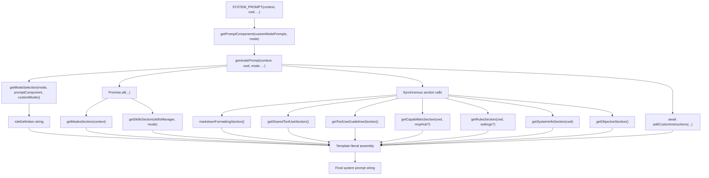
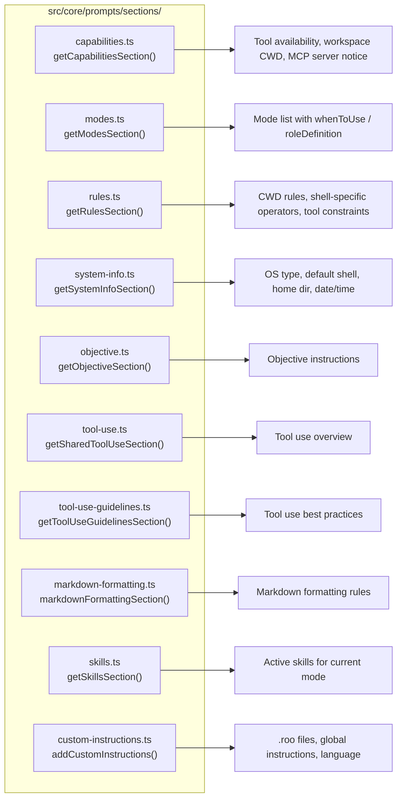
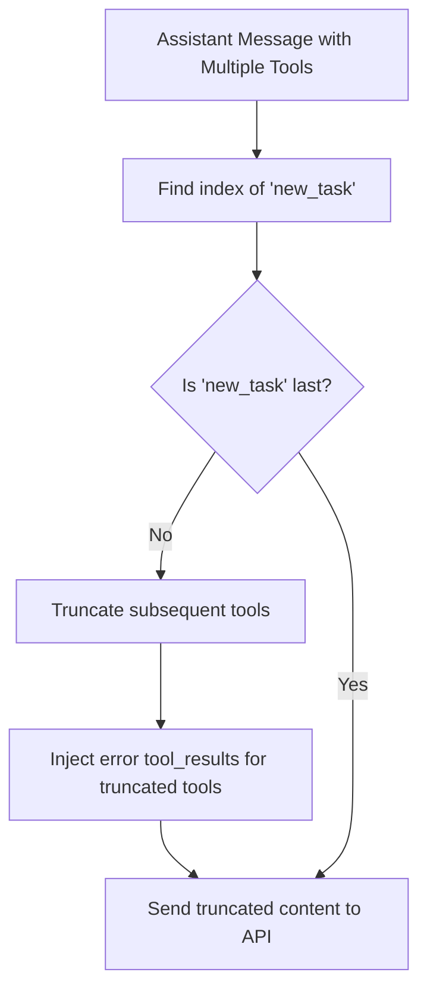

# Prompt Sections and Assembly

Relevant source files

The following files were used as context for generating this wiki page:

- [src/core/prompts/sections/__tests__/objective.spec.ts](src/core/prompts/sections/__tests__/objective.spec.ts)
- [src/core/prompts/sections/__tests__/tool-use-guidelines.spec.ts](src/core/prompts/sections/__tests__/tool-use-guidelines.spec.ts)
- [src/core/prompts/sections/__tests__/tool-use.spec.ts](src/core/prompts/sections/__tests__/tool-use.spec.ts)
- [src/core/prompts/sections/capabilities.ts](src/core/prompts/sections/capabilities.ts)
- [src/core/prompts/sections/modes.ts](src/core/prompts/sections/modes.ts)
- [src/core/prompts/sections/objective.ts](src/core/prompts/sections/objective.ts)
- [src/core/prompts/sections/rules.ts](src/core/prompts/sections/rules.ts)
- [src/core/prompts/sections/tool-use-guidelines.ts](src/core/prompts/sections/tool-use-guidelines.ts)
- [src/core/prompts/sections/tool-use.ts](src/core/prompts/sections/tool-use.ts)
- [src/core/prompts/system.ts](src/core/prompts/system.ts)
- [src/core/prompts/tools/native-tools/new_task.ts](src/core/prompts/tools/native-tools/new_task.ts)
- [src/core/task/__tests__/new-task-isolation.spec.ts](src/core/task/__tests__/new-task-isolation.spec.ts)
- [webview-ui/src/components/settings/ExperimentalSettings.tsx](webview-ui/src/components/settings/ExperimentalSettings.tsx)

This document describes the individual sections that comprise the system prompt sent to LLM providers and how these sections are generated and assembled. Each section provides specific context, guidelines, or capabilities to the AI assistant.

For information about the overall system prompt generation orchestration, see [System Prompt Generation](). For mode-specific behavior customization, see [Modes System](). For custom instructions loading from the filesystem, see [Custom Instructions and Rules]().

## Purpose and Structure

The system prompt is constructed from multiple discrete sections, each serving a specific purpose. These sections are defined as separate generator functions in `src/core/prompts/sections/`. Each section returns a formatted string that typically begins with a `====` separator and a section name in UPPERCASE.

The modular section architecture enables:
- **Separation of concerns**: Each section focuses on one aspect of AI behavior.
- **Dynamic content**: Sections can incorporate runtime state, workspace context, and user settings.
- **Conditional inclusion**: Sections can be omitted or modified based on configuration.
- **Testability**: Individual sections can be tested in isolation.

Sources: [src/core/prompts/sections/index.ts:15-26]()

## Prompt Assembly Order

The `generatePrompt()` function in `system.ts` is the internal implementation that assembles all sections into the final prompt string [src/core/prompts/system.ts:41-58](). The public entry point is `SYSTEM_PROMPT`, which resolves mode-specific overrides before delegating to `generatePrompt()` [src/core/prompts/system.ts:112-158]().

**Prompt assembly order (from `generatePrompt()`):**

| Position | Content | Generator |
|----------|---------|-----------|
| 1 | Role definition | `getModeSelection()` → `roleDefinition` |
| 2 | Markdown formatting rules | `markdownFormattingSection()` |
| 3 | Shared tool use section | `getSharedToolUseSection()` |
| 4 | Tool use guidelines | `getToolUseGuidelinesSection()` |
| 5 | Capabilities | `getCapabilitiesSection()` |
| 6 | Available modes | `getModesSection()` |
| 7 | Skills (if any) | `getSkillsSection()` |
| 8 | Rules | `getRulesSection()` |
| 9 | System information | `getSystemInfoSection()` |
| 10 | Objective | `getObjectiveSection()` |
| 11 | Custom instructions | `addCustomInstructions()` |

The assembly template literal in `generatePrompt()` is located at [src/core/prompts/system.ts:85-107]().

**Prompt assembly flow — `SYSTEM_PROMPT` → `generatePrompt()`:**

Sources: [src/core/prompts/system.ts:41-110](), [src/core/prompts/system.ts:112-158]()

## Section Catalog

**Section generator functions mapped to source files:**

Sources: [src/core/prompts/sections/index.ts:15-26]()

## Section Export Registry

The [src/core/prompts/sections/index.ts]() file is the central re-export point for all section generators:

| Export Name | Source File | Async? | Dynamic Inputs |
|-------------|-------------|--------|----------------|
| `getRulesSection` | `rules.ts` | No | `cwd`, shell detection, `SystemPromptSettings` |
| `getSystemInfoSection` | `system-info.ts` | No | `cwd`, OS/shell detection |
| `getObjectiveSection` | `objective.ts` | No | None (static) |
| `addCustomInstructions` | `custom-instructions.ts` | **Yes** | Filesystem `.roo` directory, `globalCustomInstructions` |
| `getSharedToolUseSection` | `tool-use.ts` | No | None (static) |
| `getToolUseGuidelinesSection` | `tool-use-guidelines.ts` | No | None (static) |
| `getCapabilitiesSection` | `capabilities.ts` | No | `cwd`, optional `McpHub` |
| `getModesSection` | `modes.ts` | **Yes** | `vscode.ExtensionContext` → `globalState` |
| `markdownFormattingSection` | `markdown-formatting.ts` | No | None (static) |
| `getSkillsSection` | `skills.ts` | **Yes** | `SkillsManager`, mode slug |

Sources: [src/core/prompts/sections/index.ts:15-26]()

## Shared Tool Use Section

`getSharedToolUseSection()` in `tool-use.ts` defines the baseline for how the AI should interact with tools. It explicitly mandates the use of the provider-native tool-calling mechanism and discourages XML markup [src/core/prompts/sections/tool-use.ts:1-7]().

Key requirements established in this section:
- **Mandatory Tool Call**: The AI must call at least one tool per response [src/core/prompts/sections/tool-use.ts:6]().
- **Batching**: AI is encouraged to call multiple tools in a single turn to reduce latency [src/core/prompts/sections/tool-use.ts:6]().

Sources: [src/core/prompts/sections/tool-use.ts:1-7](), [src/core/prompts/sections/__tests__/tool-use.spec.ts:1-31]()

## Tool Use Guidelines Section

`getToolUseGuidelinesSection()` provides a strategic framework for tool selection and execution [src/core/prompts/sections/tool-use-guidelines.ts:1-9]().

**Guidelines include:**
1. **Assessment**: Evaluate current information before proceeding [src/core/prompts/sections/tool-use-guidelines.ts:4]().
2. **Appropriateness**: Choose tools based on descriptions (e.g., preferring `list_files` over `ls`) [src/core/prompts/sections/tool-use-guidelines.ts:5]().
3. **Iterative Reasoning**: Each step must be informed by the results of the previous step [src/core/prompts/sections/tool-use-guidelines.ts:6]().

Sources: [src/core/prompts/sections/tool-use-guidelines.ts:1-9](), [src/core/prompts/sections/__tests__/tool-use-guidelines.spec.ts:1-39]()

## Objective Section

`getObjectiveSection()` defines the iterative problem-solving loop the AI must follow [src/core/prompts/sections/objective.ts:1-14]().

**Core Logic:**
- **Analysis**: Analyze file structure in `environment_details` before tool invocation [src/core/prompts/sections/objective.ts:10]().
- **Parameter Inference**: If a required parameter is missing and cannot be inferred, the AI must use `ask_followup_question` instead of using "filler" values [src/core/prompts/sections/objective.ts:10]().
- **Completion**: Tasks must be finalized using the `attempt_completion` tool [src/core/prompts/sections/objective.ts:11]().
- **Conversation Style**: Explicitly forbids ending responses with generic questions or offers for further assistance [src/core/prompts/sections/objective.ts:12]().

Sources: [src/core/prompts/sections/objective.ts:1-14]()

## Rules Section

`getRulesSection(cwd, settings?)` in `rules.ts` provides critical operational constraints, including environment-specific pathing and shell execution rules [src/core/prompts/sections/rules.ts:65-95]().

**Key Constraints:**
- **Shell-Specific Chaining**: Dynamically determines the operator (e.g., `&&` for Unix/Cmd, `;` for PowerShell) via `getCommandChainOperator()` [src/core/prompts/sections/rules.ts:12-28]().
- **Pathing**: Enforces relative paths to the project base directory [src/core/prompts/sections/rules.ts:74-76]().
- **Mode Restrictions**: Warns that certain modes (e.g., Architect) have file edit restrictions that trigger `FileRestrictionError` [src/core/prompts/sections/rules.ts:79-81]().
- **Vendor Confidentiality**: Injected via `getVendorConfidentialitySection()`, preventing the AI from identifying its creator or company [src/core/prompts/sections/rules.ts:50-63]().

Sources: [src/core/prompts/sections/rules.ts:1-95]()

## Capabilities Section

`getCapabilitiesSection(cwd, mcpHub?)` in `capabilities.ts` produces the `CAPABILITIES` section. It describes tool availability and workspace context to the AI.

In `generatePrompt()`, `mcpHub` is only passed when `shouldIncludeMcp` is true — which requires the current mode to have an `"mcp"` group **and** at least one configured MCP server [src/core/prompts/system.ts:68-70]().

Sources: [src/core/prompts/system.ts:68-70](), [src/core/prompts/system.ts:93](), [src/core/prompts/sections/capabilities.ts:3-17]()

## Modes Section

`getModesSection(context)` in `modes.ts` produces the `MODES` section — a formatted list of all available modes with their descriptions, incorporating live overrides from extension state [src/core/prompts/sections/modes.ts:8-35]().

**Mode Description Priority:**
For each mode, the description field uses this fallback hierarchy:
1. **Primary**: `mode.whenToUse` — context-specific guidance on when to pick this mode [src/core/prompts/sections/modes.ts:23-26]().
2. **Fallback**: First sentence of `mode.roleDefinition` [src/core/prompts/sections/modes.ts:28]().

Sources: [src/core/prompts/sections/modes.ts:20-32](), [src/core/prompts/system.ts:77-80]()

## Special Tool Constraints: `new_task`

The assembly logic must respect specific tool constraints, such as the isolation requirement for `new_task`.

| Tool | Constraint | Enforcement |
|------|------------|-------------|
| `new_task` | Must be called alone [src/core/prompts/tools/native-tools/new_task.ts:3-5]() | `Task.ts` logic truncates subsequent tools in the same message [src/core/task/__tests__/new-task-isolation.spec.ts:20-55]() |

**`new_task` Isolation Enforcement:**

Sources: [src/core/prompts/tools/native-tools/new_task.ts:3-5](), [src/core/task/__tests__/new-task-isolation.spec.ts:20-55]()

## Async vs Sync Sections

| Function | Async? | Reason |
|----------|--------|--------|
| `getCapabilitiesSection` | No | Pure text formatting |
| `getRulesSection` | No | Runtime shell detection |
| `getModesSection` | **Yes** | Reads `globalState` via `getAllModesWithPrompts` [src/core/prompts/sections/modes.ts:13]() |
| `getSkillsSection` | **Yes** | Reads skill definitions via `SkillsManager` [src/core/prompts/system.ts:79]() |
| `addCustomInstructions` | **Yes** | Filesystem I/O for `.roo` directory [src/core/prompts/system.ts:103]() |

Sources: [src/core/prompts/system.ts:77-107]()