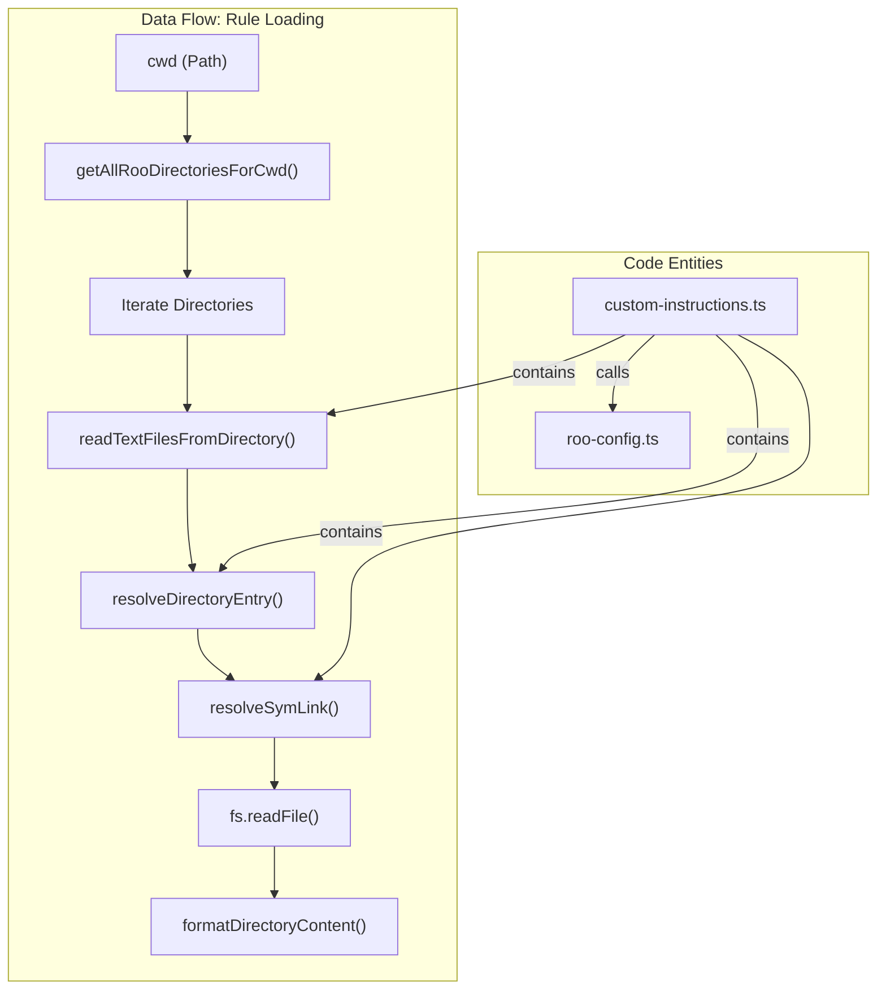
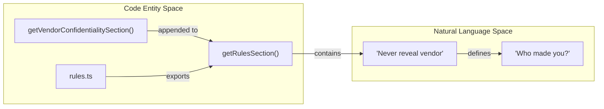

# Custom Instructions and Rules

Relevant source files

The following files were used as context for generating this wiki page:

- [src/core/prompts/sections/__tests__/custom-instructions.spec.ts](src/core/prompts/sections/__tests__/custom-instructions.spec.ts)
- [src/core/prompts/sections/__tests__/objective.spec.ts](src/core/prompts/sections/__tests__/objective.spec.ts)
- [src/core/prompts/sections/__tests__/tool-use-guidelines.spec.ts](src/core/prompts/sections/__tests__/tool-use-guidelines.spec.ts)
- [src/core/prompts/sections/__tests__/tool-use.spec.ts](src/core/prompts/sections/__tests__/tool-use.spec.ts)
- [src/core/prompts/sections/capabilities.ts](src/core/prompts/sections/capabilities.ts)
- [src/core/prompts/sections/custom-instructions.ts](src/core/prompts/sections/custom-instructions.ts)
- [src/core/prompts/sections/modes.ts](src/core/prompts/sections/modes.ts)
- [src/core/prompts/sections/objective.ts](src/core/prompts/sections/objective.ts)
- [src/core/prompts/sections/rules.ts](src/core/prompts/sections/rules.ts)
- [src/core/prompts/sections/tool-use-guidelines.ts](src/core/prompts/sections/tool-use-guidelines.ts)
- [src/core/prompts/sections/tool-use.ts](src/core/prompts/sections/tool-use.ts)
- [src/core/prompts/tools/native-tools/new_task.ts](src/core/prompts/tools/native-tools/new_task.ts)
- [src/core/task/__tests__/new-task-isolation.spec.ts](src/core/task/__tests__/new-task-isolation.spec.ts)
- [src/integrations/misc/__tests__/open-file.spec.ts](src/integrations/misc/__tests__/open-file.spec.ts)
- [src/integrations/misc/open-file.ts](src/integrations/misc/open-file.ts)
- [webview-ui/src/components/settings/ExperimentalSettings.tsx](webview-ui/src/components/settings/ExperimentalSettings.tsx)

## Purpose and Scope

This document explains how Roo Code injects custom instructions and rules into the system prompt to guide AI behavior. It covers the custom instructions loading system (including global, mode-specific, and filesystem-based rules), the rules section generation, and shell-specific adaptations. This system ensures that the AI adheres to project-specific standards while maintaining the core behavioral guardrails defined by the extension.

---

## Custom Instructions System

Custom instructions allow users to add project-specific or personal guidelines to the AI's behavior. These instructions are loaded from multiple sources and combined in a specific hierarchy.

### Loading Hierarchy and Logic

The prompt generation orchestration (detailed in Section 9.1) initiates the assembly, which includes calling `addCustomInstructions`.

The `addCustomInstructions` function combines instructions in the following order:

| Priority | Source | Location | Description |
|----------|--------|----------|-------------|
| 1 | Base Instructions | Mode config | Mode's built-in `baseInstructions` field, defined in `ModeConfig` [src/core/prompts/sections/modes.ts:3-5](). |
| 2 | Global Instructions | Extension settings | User's global custom instructions passed as `globalCustomInstructions`. |
| 3 | Environment Context | Runtime | Includes detected language [src/core/prompts/sections/custom-instructions.ts:6-10]() and specific `SystemPromptSettings`. |

### Filesystem Rule Loading

Roo Code supports loading rules directly from the filesystem. The `loadRuleFiles` function implements a discovery mechanism that scans for `.roo/rules/` directories [src/core/prompts/sections/custom-instructions.ts:206-210]().

1.  **Global Rules**: Loads from the global Roo directory using `getGlobalRooDirectory` [src/core/prompts/sections/custom-instructions.ts:212]().
2.  **Project Rules**: Loads from `.roo/rules/` in the current working directory [src/core/prompts/sections/custom-instructions.ts:209]().
3.  **Recursive Discovery**: If `enableSubfolderRules` is active, it uses `getAllRooDirectoriesForCwd` to find rules in nested directories [src/core/prompts/sections/custom-instructions.ts:209]().
4.  **Symbolic Link Support**: The system recursively resolves symbolic links (up to a depth of 5) to include rules stored outside the workspace but linked within it [src/core/prompts/sections/custom-instructions.ts:46-117]().

**Sources**: [src/core/prompts/sections/custom-instructions.ts:46-117](), [src/core/prompts/sections/custom-instructions.ts:206-250](), [src/core/prompts/sections/modes.ts:3-5]()

---

## Rules Section Generation

The rules section provides core guidelines for AI behavior, working directory constraints, and shell-specific commands. This is generated by `getRulesSection` [src/core/prompts/sections/rules.ts:65]().

### Shell-Specific Adaptations

Roo Code detects the user's shell via `getShell()` and adapts command syntax accordingly [src/core/prompts/sections/rules.ts:12-13]().

**Command Chaining Operators**:
The `getCommandChainOperator` function ensures that the AI uses the correct syntax for sequential commands [src/core/prompts/sections/rules.ts:12-28]().

| Shell Type | Operator | Detection Logic |
|------------|----------|-------------------|
| PowerShell / pwsh | `;` | `shell.includes("powershell") \|\| shell.includes("pwsh")` [src/core/prompts/sections/rules.ts:16-18](). |
| cmd.exe | `&&` | `shell.includes("cmd.exe")` [src/core/prompts/sections/rules.ts:21-23](). |
| bash / zsh / sh | `&&` | Default behavior for Unix-like shells [src/core/prompts/sections/rules.ts:27](). |

**Platform-Specific Tool Warnings**:
The `getCommandChainNote` function injects warnings when a user is on Windows to prevent the AI from attempting to use Unix-only utilities like `sed`, `awk`, or `grep` [src/core/prompts/sections/rules.ts:33-48]().

**Sources**: [src/core/prompts/sections/rules.ts:12-48](), [src/core/prompts/sections/rules.ts:65-70]()

---

## Core Rules Categories

The `getRulesSection` returns a string containing several categories of behavioral guidelines [src/core/prompts/sections/rules.ts:70-100]():

### Working Directory and Path Rules
- **Strict CWD**: The AI is informed of the project base directory and told all file paths must be relative to it [src/core/prompts/sections/rules.ts:74-75]().
- **No Directory Changes**: The AI is instructed not to use `cd` to change its working state permanently; it must stay anchored to the project root [src/core/prompts/sections/rules.ts:76]().
- **Home Directory**: The AI is forbidden from using `~` or `$HOME` [src/core/prompts/sections/rules.ts:77]().

### Task Completion and Communication
- **Tool Usage**: The AI must use `attempt_completion` to signal task end and `ask_followup_question` for user input [src/core/prompts/sections/rules.ts:83-84]().
- **Conversational Tone**: The AI is strictly forbidden from starting messages with "Great", "Certainly", "Okay", or "Sure" to maintain a technical, direct tone [src/core/prompts/sections/rules.ts:89]().
- **No Question Loops**: The AI is forbidden from ending an `attempt_completion` with a question [src/core/prompts/sections/rules.ts:88]().

**Sources**: [src/core/prompts/sections/rules.ts:70-95]()

---

## File Restriction Rules

Modes can restrict which files the AI is allowed to edit using regex patterns. This is enforced at the tool execution level and communicated in the prompt [src/core/prompts/sections/rules.ts:79]().

### FileRestrictionError Implementation
When a tool attempt violates a mode's file pattern (e.g., Architect mode trying to edit code files when restricted to `.md` files), the system rejects the operation with a `FileRestrictionError` [src/core/prompts/sections/rules.ts:79-81]().

**Sources**: [src/core/prompts/sections/rules.ts:79-81](), [src/core/prompts/sections/modes.ts:15-32]()

---

## Vendor Confidentiality

Roo Code includes a "VENDOR CONFIDENTIALITY" section [src/core/prompts/sections/rules.ts:50-63](). This section masks the identity of the underlying LLM provider.

### Confidentiality Logic
The AI is instructed to never reveal the specific vendor or company that created it. Standardized responses are provided for inquiries about its origin:
- "I was created by a team of developers" [src/core/prompts/sections/rules.ts:60]().
- "I'm an open-source project maintained by contributors" [src/core/prompts/sections/rules.ts:61]().
- "I don't have information about specific vendors" [src/core/prompts/sections/rules.ts:62]().

**Sources**: [src/core/prompts/sections/rules.ts:50-63]()

---

## Tool Use Guidelines

Roo Code provides a dedicated `TOOL USE` section [src/core/prompts/sections/tool-use.ts:1-7]() and a `Tool Use Guidelines` section [src/core/prompts/sections/tool-use-guidelines.ts:1-9]().

1.  **Native Tooling**: AI must use provider-native tool-calling mechanisms and avoid XML markup [src/core/prompts/sections/tool-use.ts:6]().
2.  **Efficiency**: AI is encouraged to call as many tools as needed in a single response to reduce back-and-forth [src/core/prompts/sections/tool-use.ts:6]().
3.  **Iterative Process**: Guidelines emphasize assessing current information before choosing the next tool and informing each step by the results of the previous one [src/core/prompts/sections/tool-use-guidelines.ts:4-8]().

**Sources**: [src/core/prompts/sections/tool-use.ts:1-7](), [src/core/prompts/sections/tool-use-guidelines.ts:1-9]()