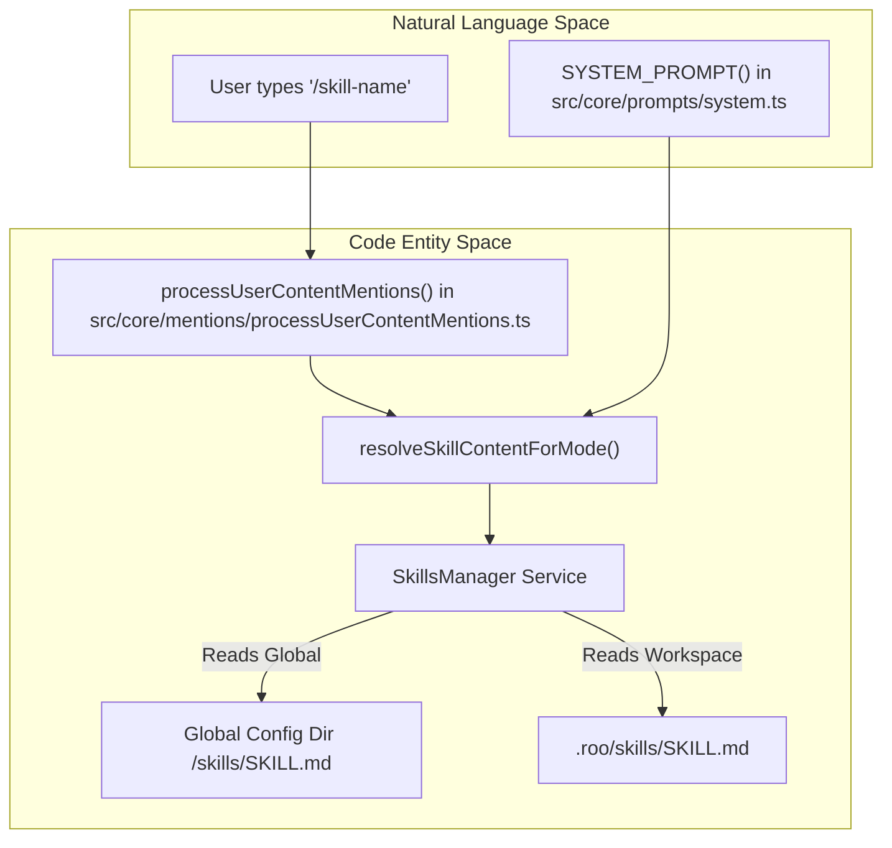
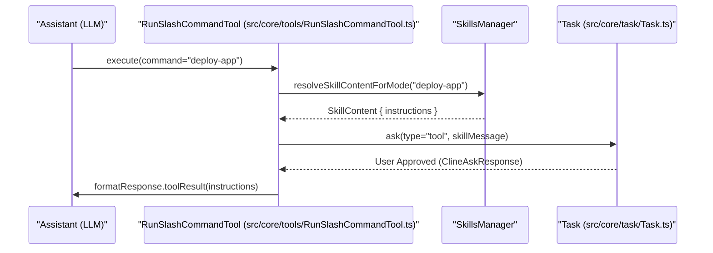

# Skills Management System

<details>
<summary>Relevant source files</summary>

The following files were used as context for generating this wiki page:

- [src/__tests__/command-mentions.spec.ts](src/__tests__/command-mentions.spec.ts)
- [src/core/mentions/__tests__/processUserContentMentions.spec.ts](src/core/mentions/__tests__/processUserContentMentions.spec.ts)
- [src/core/mentions/index.ts](src/core/mentions/index.ts)
- [src/core/mentions/processUserContentMentions.ts](src/core/mentions/processUserContentMentions.ts)
- [src/core/task/Task.ts](src/core/task/Task.ts)
- [src/core/task/__tests__/Task.spec.ts](src/core/task/__tests__/Task.spec.ts)
- [src/core/tools/RunSlashCommandTool.ts](src/core/tools/RunSlashCommandTool.ts)
- [src/core/tools/SkillTool.ts](src/core/tools/SkillTool.ts)
- [src/core/tools/__tests__/runSlashCommandTool.spec.ts](src/core/tools/__tests__/runSlashCommandTool.spec.ts)
- [src/services/skills/__tests__/skillInvocation.spec.ts](src/services/skills/__tests__/skillInvocation.spec.ts)
- [webview-ui/src/i18n/locales/ca/settings.json](webview-ui/src/i18n/locales/ca/settings.json)
- [webview-ui/src/i18n/locales/de/settings.json](webview-ui/src/i18n/locales/de/settings.json)
- [webview-ui/src/i18n/locales/en/settings.json](webview-ui/src/i18n/locales/en/settings.json)
- [webview-ui/src/i18n/locales/es/settings.json](webview-ui/src/i18n/locales/es/settings.json)
- [webview-ui/src/i18n/locales/fr/settings.json](webview-ui/src/i18n/locales/fr/settings.json)
- [webview-ui/src/i18n/locales/hi/settings.json](webview-ui/src/i18n/locales/hi/settings.json)
- [webview-ui/src/i18n/locales/it/settings.json](webview-ui/src/i18n/locales/it/settings.json)
- [webview-ui/src/i18n/locales/ja/settings.json](webview-ui/src/i18n/locales/ja/settings.json)
- [webview-ui/src/i18n/locales/ko/settings.json](webview-ui/src/i18n/locales/ko/settings.json)
- [webview-ui/src/i18n/locales/pl/settings.json](webview-ui/src/i18n/locales/pl/settings.json)
- [webview-ui/src/i18n/locales/pt-BR/settings.json](webview-ui/src/i18n/locales/pt-BR/settings.json)
- [webview-ui/src/i18n/locales/tr/settings.json](webview-ui/src/i18n/locales/tr/settings.json)
- [webview-ui/src/i18n/locales/vi/settings.json](webview-ui/src/i18n/locales/vi/settings.json)
- [webview-ui/src/i18n/locales/zh-CN/settings.json](webview-ui/src/i18n/locales/zh-CN/settings.json)

</details>


## Overview

The Skills Management System enables the discovery, loading, and invocation of reusable capability packages (skills) stored in the `.roo/skills` directory. These skills extend the agent's capabilities by providing specialized instructions and workflows that are injected into the system prompt or invoked via slash commands and dedicated tools.

The system consists of several key components:
- **`SkillsManager`**: The central service for discovering and caching skills from the filesystem.
- **`SkillTool`**: A tool that allows the AI to explicitly invoke a skill's functionality.
- **`getSkillsSection`**: A prompt assembly function that injects active skill descriptions into the system prompt.
- **`SkillLookup`**: An interface used for resolving skill content during mention parsing and tool execution.

Sources: [src/core/prompts/system.ts:12-13](), [src/core/prompts/system.ts:25-26](), [src/core/task/Task.ts:95-97]()

## Skill Discovery and Format

Skills are stored in the `.roo/skills` directory within the workspace or in a global configuration directory. Each skill is a directory containing a `SKILL.md` file which defines its behavior, instructions, and metadata.

### SKILL.md Format
The `SKILL.md` file follows a structured format used to inform the LLM of the skill's purpose:
1. **Metadata**: Name, description, and version.
2. **Instructions**: Detailed guidelines for the AI on how to perform the skill.
3. **Usage Criteria**: Definitions of when the skill should be triggered.

### Mode-Specific Resolution
Skills can be restricted to specific modes (e.g., `code`, `architect`, `ask`). The `SkillsManager` filters available skills based on the `currentMode` to keep the context window light and relevant to the current task. Users can configure mode availability via the Settings UI, choosing between "Any mode" or specific restricted modes.

Sources: [src/core/task/Task.ts:180-192](), [webview-ui/src/i18n/locales/en/settings.json:105-130](), [webview-ui/src/i18n/locales/en/settings.json:114-116]()

## SkillsManager and SkillLookup

The `SkillsManager` implements the `SkillLookup` interface, providing methods to find and retrieve skill content. It is initialized as a core service during extension activation and handles both Workspace Skills and Global Skills.

### Key Functions
- **Discovery**: Scans `.roo/skills` for directories containing `SKILL.md`.
- **`resolveSkillContentForMode`**: A utility function that returns specific instructions for a skill given the current operating mode.
- **`getSkillContent`**: Retrieves the full `SkillContent` object, including its filesystem path and source (Global vs Project).

**Skill Resolution Data Flow**



Sources: [src/core/task/Task.ts:128-129](), [src/core/prompts/system.ts:96-97](), [webview-ui/src/i18n/locales/en/settings.json:105-116](), [webview-ui/src/i18n/locales/en/settings.json:145-148]()

## Skill Invocation via Tools

Skills are triggered through two primary mechanisms in the tool system:
1. **Slash Commands**: Handled by `RunSlashCommandTool`, which treats skills as a fallback if a command script is not found in `.roo/commands`.
2. **`SkillTool`**: A dedicated tool for the assistant to interact with the skills system.

### Skill Execution Flow
When a skill is invoked via `RunSlashCommandTool`:
1. The tool checks the standard command registry in `.roo/commands`.
2. If not found, it queries the `SkillsManager` for a matching skill name in `.roo/skills`.
3. If a skill exists, it requests user approval via a `say` or `ask` message (e.g., `ClineAsk` of type `tool`).
4. Upon approval, the skill's `SKILL.md` content is injected as a tool result, providing the AI with the necessary instructions to proceed.

**Skill Invocation Sequence**



Sources: [src/core/tools/RunSlashCommandTool.ts:57-72](), [src/core/task/Task.ts:17-18](), [src/core/task/Task.ts:31-32](), [src/core/task/Task.ts:71-72]()

## Integration with System Prompt

The `SYSTEM_PROMPT` generator includes a dedicated section for skills to ensure the AI is aware of available specialized workflows.

### `getSkillsSection`
This function is called during the prompt assembly in `src/core/prompts/system.ts`. It retrieves the list of skills enabled for the current mode and formats their descriptions into the prompt. This allows the AI to know *when* it should suggest using a specific skill or slash command.

```typescript
// Logic from src/core/prompts/system.ts
const skillsSection = await getSkillsSection(skillsManager, mode);
// Injected into the final system prompt string via getSkillsSection() call
```

Sources: [src/core/prompts/system.ts:77-80](), [src/core/prompts/system.ts:95-97]()

## Mentions and Skill Fallback

The mentions system in `src/core/mentions` facilitates the "Natural Language" to "Skill" mapping.

- **Precedence**: Workspace commands in `.roo/commands` take precedence over skills in `.roo/skills`.
- **Fallback**: If a user uses a slash mention that does not correspond to a command, `processUserContentMentions` (invoked via `Task.ts`) attempts to resolve it as a skill.
- **Formatting**: Resolved skills are presented to the LLM with clear headers to provide structural context, often utilizing `formatToolInvocation` for consistency.

Sources: [src/core/mentions/processUserContentMentions.ts:15-25](), [src/core/tools/RunSlashCommandTool.ts:59-65](), [src/core/task/Task.ts:128-129](), [src/core/task/Task.ts:17-18]()

## Summary of Key Classes

| Class/Interface | File Path | Responsibility |
|:---|:---|:---|
| `SkillsManager` | `src/services/skills/SkillsManager.ts` | Handles filesystem discovery, CRUD, and caching of skills. |
| `SkillTool` | `src/core/tools/SkillTool.ts` | Provides the LLM with a tool-based interface to the skills system. |
| `RunSlashCommandTool` | `src/core/tools/RunSlashCommandTool.ts` | Orchestrates the execution of commands with skill fallback. |
| `SkillLookup` | `src/services/skills/skillInvocation.ts` | Abstract interface for skill resolution used by tools and prompts. |
| `Task` | `src/core/task/Task.ts` | Manages the task lifecycle, handling `ask`/`say` interactions for skill approval. |

Sources: [src/core/tools/RunSlashCommandTool.ts:19-20](), [src/core/tools/SkillTool.ts:1-10](), [src/core/task/Task.ts:162-165](), [src/core/task/Task.ts:100-108]()