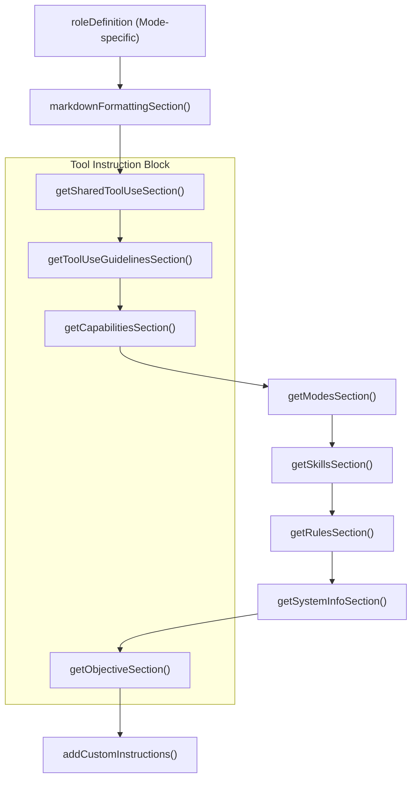
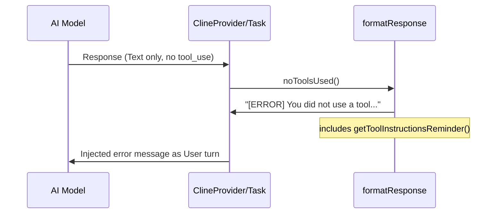

# Tool Descriptions and Guidelines

Relevant source files

The following files were used as context for generating this wiki page:

- [src/core/prompts/responses.ts](src/core/prompts/responses.ts)
- [src/core/prompts/sections/__tests__/objective.spec.ts](src/core/prompts/sections/__tests__/objective.spec.ts)
- [src/core/prompts/sections/__tests__/tool-use-guidelines.spec.ts](src/core/prompts/sections/__tests__/tool-use-guidelines.spec.ts)
- [src/core/prompts/sections/__tests__/tool-use.spec.ts](src/core/prompts/sections/__tests__/tool-use.spec.ts)
- [src/core/prompts/sections/capabilities.ts](src/core/prompts/sections/capabilities.ts)
- [src/core/prompts/sections/modes.ts](src/core/prompts/sections/modes.ts)
- [src/core/prompts/sections/objective.ts](src/core/prompts/sections/objective.ts)
- [src/core/prompts/sections/rules.ts](src/core/prompts/sections/rules.ts)
- [src/core/prompts/sections/tool-use-guidelines.ts](src/core/prompts/sections/tool-use-guidelines.ts)
- [src/core/prompts/sections/tool-use.ts](src/core/prompts/sections/tool-use.ts)
- [src/core/prompts/tools/native-tools/new_task.ts](src/core/prompts/tools/native-tools/new_task.ts)
- [src/core/task/__tests__/new-task-isolation.spec.ts](src/core/task/__tests__/new-task-isolation.spec.ts)
- [webview-ui/src/components/settings/ExperimentalSettings.tsx](webview-ui/src/components/settings/ExperimentalSettings.tsx)

This page documents how tool usage instructions are embedded in the system prompt via the `getSharedToolUseSection` and `getToolUseGuidelinesSection` functions, and how operational guidelines are enforced through the `formatResponse` mechanism. For the underlying tool type registry and dispatch logic, see **6.1 Tool Architecture and Registry**. For how the overall system prompt is assembled, see **9.1 System Prompt Generation**.

---

## Overview

The tool description infrastructure provides the AI agent with the necessary mental model to interact with the VS Code environment. It consists of:

1.  **Shared Tool Use Section**: Defines the "how" of tool calling (the native protocol).
2.  **Tool Use Guidelines**: Defines the "strategy" for tool selection and sequencing.
3.  **Tool Result Formatting**: Standardizes how tool outputs, errors, and denials are reported back to the model.
4.  **Operational Constraints**: Enforces rules like "one tool per turn" for specific tools (e.g., `new_task`).

Sources: [src/core/prompts/sections/tool-use.ts:1-7](), [src/core/prompts/sections/tool-use-guidelines.ts:1-9](), [src/core/prompts/responses.ts:7-40]()

---

## System Prompt Assembly

Tool-related sections are placed early in the prompt generation sequence to establish the interaction contract before specific capabilities or rules are defined. The `SYSTEM_PROMPT` function (and its constituent parts) orchestrates this by concatenating modular sections.

**Prompt Section Flow:**

Sources: [src/core/prompts/sections/tool-use.ts:1-7](), [src/core/prompts/sections/tool-use-guidelines.ts:1-9](), [src/core/prompts/sections/capabilities.ts:3-17](), [src/core/prompts/sections/objective.ts:1-13]()

---

## Tool Protocol: Native vs. Catalog

Roo Code uses a **native-only** tool calling protocol. The architecture relies on the model provider's native API (e.g., Anthropic Tool Use or OpenAI Function Calling) rather than custom XML parsing for tool invocation.

-   **`getSharedToolUseSection`**: Instructs the model to "Use the provider-native tool-calling mechanism" and explicitly forbids XML markup or examples [src/core/prompts/sections/tool-use.ts:6]().
-   **Multi-Tool Calling**: It sets a requirement that the assistant "must call at least one tool per assistant response" and encourages calling "as many tools as are reasonably needed in a single response" to reduce latency [src/core/prompts/sections/tool-use.ts:6]().

Sources: [src/core/prompts/sections/tool-use.ts:1-7](), [src/core/prompts/sections/__tests__/tool-use.spec.ts:4-16]()

---

## Operational Guidelines and Objectives

The system prompt provides a multi-layered framework for tool interaction, split between general guidelines and high-level objectives.

### Tool Use Guidelines
The `getToolUseGuidelinesSection` provides a three-step framework:
1.  **Assessment**: Evaluate current information vs. task requirements [src/core/prompts/sections/tool-use-guidelines.ts:4]().
2.  **Selection**: Choose the most efficient tool (e.g., preferring `list_files` over a terminal `ls` command) [src/core/prompts/sections/tool-use-guidelines.ts:5]().
3.  **Iteration**: Use tools multiple times or in parallel if appropriate, but never assume outcomes; every step must be informed by the previous result [src/core/prompts/sections/tool-use-guidelines.ts:6]().

### Objective Analysis and Parameter Inference
The `getObjectiveSection` adds critical logic for parameter validation. It instructs the model to:
-   Analyze file structure in `environment_details` before calling tools [src/core/prompts/sections/objective.ts:10]().
-   **Parameter Inference**: If a required parameter is missing and cannot be reasonably inferred, the model must **not** invoke the tool with fillers; it must use `ask_followup_question` instead [src/core/prompts/sections/objective.ts:10]().

Sources: [src/core/prompts/sections/tool-use-guidelines.ts:1-9](), [src/core/prompts/sections/objective.ts:1-13]()

---

## Tool Result Formatting (`formatResponse`)

The `formatResponse` object in `responses.ts` standardizes the feedback loop. When a tool finishes execution, its output is wrapped in a JSON structure or specific block types.

### Key Formatting Methods

| Method | Purpose | Implementation Detail |
| :--- | :--- | :--- |
| `toolResult` | Successful execution | Can return a string or an array of `TextBlock` and `ImageBlock` [src/core/prompts/responses.ts:99-111](). |
| `toolError` | Execution failure | Returns a JSON string with `status: "error"` and the error message [src/core/prompts/responses.ts:26-31](). |
| `toolDenied` | User rejected tool | Returns `status: "denied"` [src/core/prompts/responses.ts:8-12](). |
| `rooIgnoreError` | Security/Policy block | Specific error for `.rooignore` violations [src/core/prompts/responses.ts:33-40](). |
| `formatFilesList` | File system output | Handles relative path conversion, sorting, and truncation logic [src/core/prompts/responses.ts:117-191](). |

### File List Formatting Logic
The `formatFilesList` method applies specific visual cues to the tool output:
-   **Lock Symbol (`🔒`)**: Files blocked by `.rooignore` [src/core/prompts/responses.ts:170]().
-   **Shield Symbol (`🛡️`)**: Files that are write-protected (managed by `RooProtectedController`) [src/core/prompts/responses.ts:173-175]().
-   **Truncation**: Adds a reminder to use `list_files` on subdirectories if the list is too long [src/core/prompts/responses.ts:182-185]().

Sources: [src/core/prompts/responses.ts:7-40](), [src/core/prompts/responses.ts:117-191]()

---

## Tool Isolation: The `new_task` Exception

While general guidelines encourage parallel tool calls, the `new_task` tool (used for task delegation/mode switching) has a **CRITICAL** restriction: it must be called alone.

-   **Description**: The tool description explicitly warns: "Do NOT call this tool alongside other tools in the same message turn" [src/core/prompts/tools/native-tools/new_task.ts:3-5]().
-   **Enforcement**: The `Task` system implements "Isolation Enforcement." If `new_task` is detected in a multi-tool call, subsequent tools are truncated and their results are pre-injected with an error message to prevent orphaned operations [src/core/task/__tests__/new-task-isolation.spec.ts:40-49]().

Sources: [src/core/prompts/tools/native-tools/new_task.ts:3-5](), [src/core/task/__tests__/new-task-isolation.spec.ts:20-55]()

---

## Error Recovery and Reminders

If the model fails to use a tool when one is expected, the system injects an automated error message.

**Logic Flow for Missing Tools:**

The `formatResponse.noToolsUsed()` and `formatResponse.missingToolParameterError()` methods ensure the model recovers from formatting mistakes or missing required parameters without requiring user intervention by providing a reminder of the tool-use protocol [src/core/prompts/responses.ts:42-67]().

Sources: [src/core/prompts/responses.ts:42-55](), [src/core/prompts/responses.ts:63-67]()