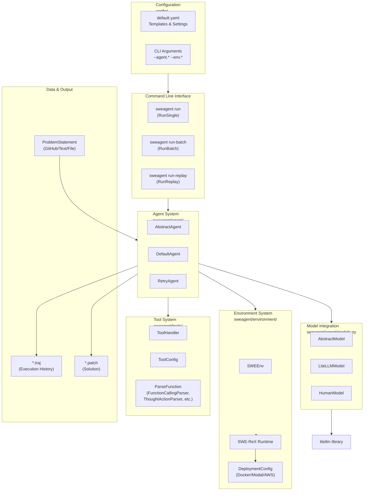
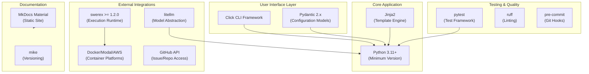

# Overview

<details>
<summary>Relevant source files</summary>

The following files were used as context for generating this wiki page:

- [.github/CODE_OF_CONDUCT.md](.github/CODE_OF_CONDUCT.md)
- [README.md](README.md)
- [docs/assets/mini_logo.svg](docs/assets/mini_logo.svg)
- [docs/assets/mini_logo_text_below.svg](docs/assets/mini_logo_text_below.svg)
- [docs/config/env.md](docs/config/env.md)
- [docs/index.md](docs/index.md)
- [docs/installation/changelog.md](docs/installation/changelog.md)
- [docs/overrides/main.html](docs/overrides/main.html)
- [docs/usage/cl_tutorial.md](docs/usage/cl_tutorial.md)
- [mkdocs.yml](mkdocs.yml)
- [sweagent/__init__.py](sweagent/__init__.py)
- [tests/test_models.py](tests/test_models.py)

</details>


This document provides a high-level introduction to SWE-agent, its purpose, architecture, and major components. For detailed information about specific subsystems, see the relevant sections: [Installation and Setup](#2), [Agent Framework](#3), [Environment System](#4), [Execution and Run System](#5), [Tool System](#6), and [Command Line Interface](#7).

## What is SWE-agent?

SWE-agent is an autonomous software engineering agent that enables language models (such as GPT-4o or Claude Sonnet 4) to solve real-world software engineering tasks. The system can fix issues in GitHub repositories, find cybersecurity vulnerabilities, and perform custom coding tasks.

**Key characteristics:**

- **State-of-the-art performance:** Achieves leading results on SWE-bench among open-source projects
- **Model flexibility:** Supports 7+ language model providers through litellm
- **Highly configurable:** All behavior governed by YAML configuration files
- **Research-oriented:** Simple, hackable architecture designed for experimentation
- **Sandboxed execution:** Safe code execution via containerized environments

**Primary use cases:**

1. Fixing GitHub issues autonomously
2. Benchmarking on SWE-bench and other evaluation datasets
3. Solving coding challenges
4. Custom software engineering tasks

Sources: [README.md:14-24](), [docs/index.md:16-24]()

## System Architecture

SWE-agent is organized into several major subsystems that work together to enable autonomous software engineering:



**Architecture Diagram: Major Components and Code Locations**

This diagram shows how the system is organized into logical subsystems with their corresponding code locations. Each component is implemented in specific modules that can be found at the indicated paths.

Sources: [sweagent/__init__.py:1-115](), [README.md:14-24](), Diagram 1 from provided architecture

## Core Components to Code Mapping

The following table maps high-level system concepts to their concrete implementations in the codebase:

| Component | Code Entity | Location | Purpose |
|-----------|-------------|----------|---------|
| **Agent** | `DefaultAgent` | `sweagent/agent/agents.py` | Core problem-solving logic, manages agent lifecycle |
| **Retry System** | `RetryAgent` | `sweagent/agent/agents.py` | Multi-attempt orchestration with solution evaluation |
| **Model Abstraction** | `LiteLLMModel` | `sweagent/agent/models.py` | Language model interface via litellm |
| **Environment** | `SWEEnv` | `sweagent/environment/swe_env.py` | Manages execution environment and communication |
| **Runtime** | SWE-ReX | External package `swerex` | Sandboxed command execution in containers |
| **Tool Handler** | `ToolHandler` | `sweagent/tools/tools.py` | Tool lifecycle management and action execution |
| **Action Parser** | `ParseFunction` | `sweagent/tools/parsing.py` | Extracts actions from model outputs |
| **Run Orchestrator** | `RunSingle`, `RunBatch` | `sweagent/run/` | Coordinates agent execution for single/batch runs |
| **Configuration** | `RunSingleConfig` | `sweagent/run/run_single.py` | Pydantic models for configuration |
| **Problem Input** | `ProblemStatement` | `sweagent/agent/problem_statement.py` | Union type for various problem sources |

Sources: [sweagent/__init__.py:28-47](), architecture diagrams, [mkdocs.yml:99-118]()

## Execution Flow Overview

The following diagram illustrates the high-level execution flow from user input to solution output:

```mermaid
sequenceDiagram
    participant User
    participant RunOrchestrator["RunSingle/RunBatch<br/>sweagent/run/"]
    participant Agent["DefaultAgent<br/>sweagent/agent/agents.py"]
    participant Model["LiteLLMModel<br/>sweagent/agent/models.py"]
    participant ToolHandler["ToolHandler<br/>sweagent/tools/tools.py"]
    participant SWEEnv["SWEEnv<br/>sweagent/environment/swe_env.py"]
    participant SWERex["SWE-ReX Runtime<br/>swerex package"]
    
    User->>RunOrchestrator: sweagent run --config ...
    RunOrchestrator->>SWEEnv: Initialize environment
    SWEEnv->>SWERex: Start container (Docker/Modal/AWS)
    SWERex-->>SWEEnv: Environment ready
    
    RunOrchestrator->>Agent: Create agent instance
    Agent->>Model: Initialize model (via litellm)
    Agent->>ToolHandler: Load tool bundles
    
    RunOrchestrator->>Agent: setup(problem_statement, env)
    
    loop Agent Step Loop
        RunOrchestrator->>Agent: step()
        Agent->>Model: query(history)
        Model-->>Agent: Response with action
        Agent->>ToolHandler: parse_actions(response)
        ToolHandler-->>Agent: Parsed thought + action
        Agent->>ToolHandler: should_block_action(action)?
        alt Action allowed
            Agent->>SWEEnv: communicate(action)
            SWEEnv->>SWERex: Execute command
            SWERex-->>SWEEnv: Observation
            SWEEnv-->>Agent: Observation + state
        else Action blocked
            Agent->>Agent: Add error to history
        end
        Agent->>Agent: Check exit conditions
    end
    
    Agent-->>RunOrchestrator: AgentRunResult
    RunOrchestrator->>RunOrchestrator: Extract patch from trajectory
    RunOrchestrator-->>User: Save *.traj and *.patch
```

**Execution Flow Sequence Diagram**

This sequence shows the interaction between major components during a typical agent run. The `RunOrchestrator` coordinates the overall flow, while the `Agent` manages the problem-solving loop by querying the `Model`, parsing actions via `ToolHandler`, and executing them in `SWEEnv`.

Sources: Diagram 2 from provided architecture, [sweagent/run/run_single.py](), [sweagent/agent/agents.py]()

## Major Subsystems

### 1. Command Line Interface (CLI)

The CLI provides three main commands implemented in `sweagent/cli/`:

- **`sweagent run`**: Execute agent on a single problem instance ([details](#7.1))
- **`sweagent run-batch`**: Parallel execution on multiple instances ([details](#5.2))
- **`sweagent run-replay`**: Replay previously recorded trajectories

All commands use a hierarchical configuration system that merges YAML files, environment variables, and command-line arguments ([details](#7.2)).

Sources: [docs/usage/cl_tutorial.md:20-59](), [mkdocs.yml:84]()

### 2. Agent Framework

The agent framework implements the core problem-solving logic:

- **`AbstractAgent`**: Base interface defining the agent contract
- **`DefaultAgent`**: Main implementation with setup/step/completion lifecycle
- **`RetryAgent`**: Meta-orchestration for multi-attempt strategies
- **`AbstractRetryLoop`**: Interface for solution evaluation and selection

Agents maintain a `History` of messages and a `Trajectory` of action-observation pairs ([details](#3)).

Sources: [sweagent/agent/agents.py](), architecture diagrams, [mkdocs.yml:106-112]()

### 3. Model Integration

The model integration layer abstracts over multiple language model providers:

- **`AbstractModel`**: Interface for all model implementations
- **`LiteLLMModel`**: Primary implementation using litellm for API-based models
- **`HumanModel`**: Human-in-the-loop mode for testing
- **`ReplayModel`**: Replays actions from recorded trajectories

The system supports OpenAI, Anthropic, AWS Bedrock, Together AI, Groq, DeepSeek, and local models ([details](#3.2)).

Sources: [sweagent/agent/models.py](), [tests/test_models.py:11-23](), [docs/installation/changelog.md:78-141]()

### 4. Environment System

The environment system manages safe code execution:

- **`SWEEnv`**: Main environment manager that coordinates execution
- **SWE-ReX Runtime**: External package (`swerex >= 1.2.0`) for sandboxed execution
- **Deployment configurations**: Docker (local), Modal (cloud), AWS Fargate

The environment handles repository cloning, tool installation, and command execution with configurable timeouts ([details](#4)).

Sources: [sweagent/__init__.py:17-18](), [sweagent/environment/](), architecture diagrams

### 5. Tool System

Tools define the actions available to the agent:

- **`ToolConfig`**: Defines available tools and commands
- **Tool Bundles**: Modular collections (e.g., `edit_anthropic`, `registry`, `submit`)
- **`ToolHandler`**: Manages tool lifecycle, action blocking, and state
- **`ParseFunction`**: Extracts actions from model outputs (function calling, thought-action, JSON, XML formats)

Tools can include file editing commands, bash execution, code search, and submission ([details](#6)).

Sources: [sweagent/tools/](), [mkdocs.yml:92](), [docs/usage/cl_tutorial.md:217-265]()

### 6. Configuration System

Configuration uses a hierarchical merge system with pydantic-settings:

1. **YAML files**: `config/default.yaml` and custom configs
2. **Environment variables**: Prefixed with `SWE_AGENT_*`
3. **CLI arguments**: Override any config value via `--key.subkey=value`

The system supports union types for flexible configuration (e.g., `ProblemStatement` can be GitHub issue, text, or file) ([details](#7.2)).

Sources: [docs/usage/cl_tutorial.md:62-138](), [docs/config/env.md:1-24](), [sweagent/__init__.py:40-46]()

### 7. Data and Output

SWE-agent produces several output formats:

- **Trajectory files (`.traj`)**: Complete execution history in JSON format ([details](#8.1))
- **Patch files (`.patch`)**: Solutions in git diff format
- **Predictions (`preds.json`)**: SWE-bench compatible evaluation format
- **Demo files (`.demo.yaml`)**: Replay-ready action sequences

Trajectories can be inspected using the command-line TUI or web viewer ([details](#8.2)).

Sources: [mkdocs.yml:85](), [docs/usage/cl_tutorial.md:276-297]()

## Technology Stack



**Technology Stack Diagram**

Key dependencies and version requirements:

- **Python**: 3.11+ minimum ([sweagent/__init__.py:16]())
- **SWE-ReX**: 1.2.0+ minimum, 1.2.1+ recommended ([sweagent/__init__.py:17-18]())
- **Configuration**: pydantic-settings for hierarchical config merging
- **Templates**: Jinja2 for system/instance/error prompts
- **Models**: litellm for unified API across all providers
- **Testing**: pytest with fixtures and mock models
- **Documentation**: MkDocs Material with versioning via mike

Sources: [sweagent/__init__.py:15-104](), [mkdocs.yml:1-183](), [docs/installation/changelog.md:119-138]()

## Version Information

Current version: **1.1.0**

The package exposes version information and dependency checks:

- `sweagent.__version__`: Current version string
- `sweagent.get_agent_version_info()`: Full version info including commit hashes
- Automatic SWE-ReX version validation on import

The system enforces minimum version requirements for dependencies and logs warnings for recommended updates.

Sources: [sweagent/__init__.py:15-106]()

## Getting Started

To begin using SWE-agent:

1. **Installation**: See [Installation and Setup](#2) for pip installation and dependency setup
2. **Configuration**: Set up API keys as described in [API Keys and Model Configuration](#2.2)
3. **First Run**: Follow the [Command Line Basics](#7.1) tutorial to run your first agent
4. **Benchmarking**: See [Batch Processing](#5.2) for evaluation on SWE-bench

For developers contributing to the codebase, see [Development and Testing](#9).

Sources: [README.md:35-45](), [docs/index.md:28-67]()