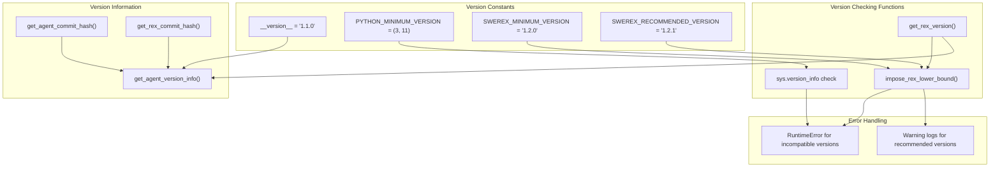
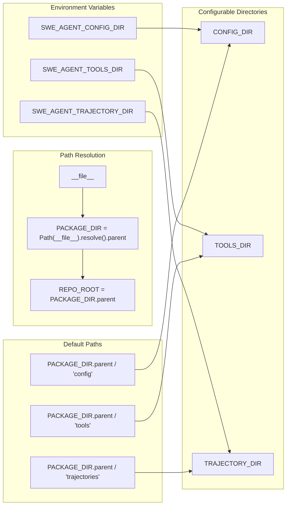
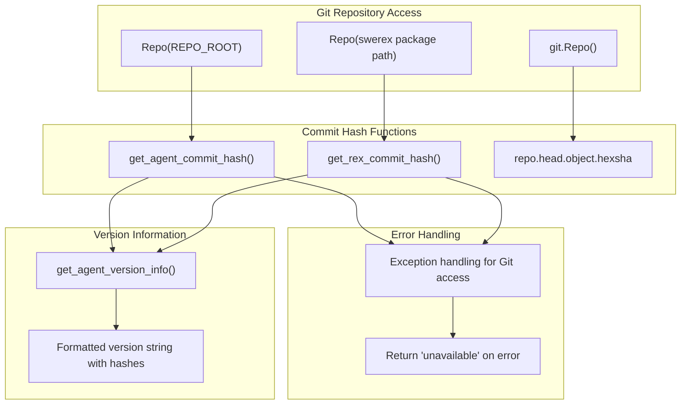
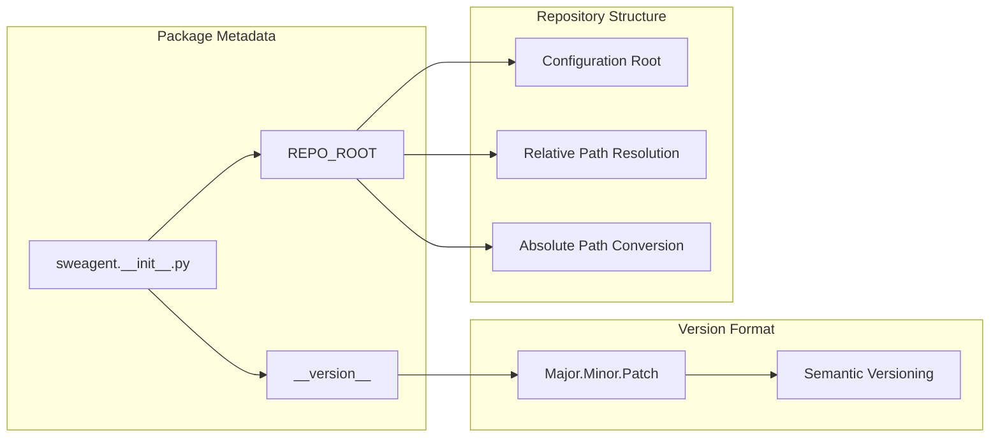

# Package Structure and Utilities

Relevant source files

The following files were used as context for generating this wiki page:

- [.github/CODE_OF_CONDUCT.md](.github/CODE_OF_CONDUCT.md)
- [docs/config/env.md](docs/config/env.md)
- [docs/installation/changelog.md](docs/installation/changelog.md)
- [sweagent/__init__.py](sweagent/__init__.py)
- [tests/test_models.py](tests/test_models.py)

This document covers the internal package organization and utility functions that support the core SWE-agent functionality. It includes package initialization, version management, path constants, dependency checking, and environment configuration.

For information about the core agent framework, see [Agent Framework](#3). For details about the command-line interface, see [Command Line Interface](#7). For configuration file formats and options, see [Configuration Options](#7.2).

## Package Initialization and Constants

The SWE-agent package initialization system establishes core constants, manages dependencies, and configures the runtime environment through `sweagent/__init__.py`.

### Package Structure and Initialization

```mermaid
graph TB
    subgraph "Package Initialization"
        InitFile["sweagent.__init__.py"]
        VersionConstant["__version__ = '1.1.0'"]
        PythonVersionCheck["PYTHON_MINIMUM_VERSION = (3, 11)"]
        SWEReXVersionCheck["SWEREX_MINIMUM_VERSION"]
    end
    
    subgraph "Path Constants"
        PackageDir["PACKAGE_DIR"]
        RepoRoot["REPO_ROOT"]
        ConfigDir["CONFIG_DIR"]
        ToolsDir["TOOLS_DIR"]
        TrajectoryDir["TRAJECTORY_DIR"]
    end
    
    subgraph "Environment Variables"
        ConfigDirEnv["SWE_AGENT_CONFIG_DIR"]
        ToolsDirEnv["SWE_AGENT_TOOLS_DIR"]
        TrajectoryDirEnv["SWE_AGENT_TRAJECTORY_DIR"]
    end
    
    subgraph "Version Functions"
        GetAgentCommitHash["get_agent_commit_hash()"]
        GetRexCommitHash["get_rex_commit_hash()"]
        GetAgentVersionInfo["get_agent_version_info()"]
        ImposeRexLowerBound["impose_rex_lower_bound()"]
    end
    
    InitFile --> VersionConstant
    InitFile --> PythonVersionCheck
    InitFile --> SWEReXVersionCheck
    
    InitFile --> PackageDir
    PackageDir --> RepoRoot
    ConfigDirEnv --> ConfigDir
    ToolsDirEnv --> ToolsDir
    TrajectoryDirEnv --> TrajectoryDir
    
    InitFile --> GetAgentCommitHash
    InitFile --> GetRexCommitHash
    InitFile --> GetAgentVersionInfo
    InitFile --> ImposeRexLowerBound
```

**Package Initialization and Path Management System**

The package initialization system manages version compatibility, establishes directory constants, and configures the runtime environment.

Sources: [sweagent/__init__.py:1-115]()

## Version Management and Dependencies

The version management system ensures compatibility between SWE-agent and its dependencies, particularly SWE-ReX, and provides version information functions.

### Version Compatibility System

**Version Management and Dependency Validation System**

The version management system provides several key functions:

| Function | Purpose | Behavior |
|----------|---------|----------|
| `get_agent_commit_hash()` | Get current SWE-agent Git commit hash | Returns hash or "unavailable" if not in Git repo |
| `get_rex_commit_hash()` | Get current SWE-ReX Git commit hash | Returns hash or "unavailable" if not accessible |
| `get_rex_version()` | Get installed SWE-ReX version | Returns version string from swerex package |
| `impose_rex_lower_bound()` | Enforce minimum SWE-ReX version | Raises RuntimeError if too old, warns if not recommended |
| `get_agent_version_info()` | Get comprehensive version information | Returns formatted string with all version details |

Sources: [sweagent/__init__.py:15-18](), [sweagent/__init__.py:50-105]()

## Path Management and Environment Configuration

The path management system establishes directory constants and supports environment variable configuration for flexible deployment scenarios.

### Directory Constants and Environment Variables

**Path Constants and Environment Configuration System**

The path management system provides these key constants:

| Constant | Default Value | Environment Variable | Purpose |
|----------|---------------|---------------------|---------|
| `PACKAGE_DIR` | `Path(__file__).resolve().parent` | N/A | SWE-agent package directory |
| `REPO_ROOT` | `PACKAGE_DIR.parent` | N/A | Repository root directory |
| `CONFIG_DIR` | `REPO_ROOT / "config"` | `SWE_AGENT_CONFIG_DIR` | Configuration files location |
| `TOOLS_DIR` | `REPO_ROOT / "tools"` | `SWE_AGENT_TOOLS_DIR` | Tool definitions location |
| `TRAJECTORY_DIR` | `REPO_ROOT / "trajectories"` | `SWE_AGENT_TRAJECTORY_DIR` | Trajectory storage location |

Sources: [sweagent/__init__.py:28-47](), [docs/config/env.md:14-16]()

## Git Integration and Version Tracking

The Git integration system provides functions for extracting version information from Git repositories and managing repository metadata.

### Git Repository Integration

**Git Repository Integration and Version Tracking System**

The Git integration provides robust version tracking with fallback handling:

- `get_agent_commit_hash()` - Extracts commit hash from SWE-agent repository [sweagent/__init__.py:50-59]()
- `get_rex_commit_hash()` - Extracts commit hash from SWE-ReX installation [sweagent/__init__.py:62-69]()
- `get_agent_version_info()` - Combines version numbers and commit hashes into comprehensive version string [sweagent/__init__.py:78-82]()

All functions handle Git repository access errors gracefully by returning `"unavailable"` when repository information cannot be accessed.

Sources: [sweagent/__init__.py:50-82]()

## Package Metadata and Versioning

The package metadata system provides version information and repository structure constants used throughout the codebase.

### Version Management

**Package Metadata and Repository Structure Constants**

The version follows semantic versioning with major.minor.patch format, validated to ensure proper structure [tests/test_packaging.py:6-7](). The `REPO_ROOT` constant provides a reference point for all relative path operations throughout the system.

Sources: [tests/test_packaging.py:1-8](), [sweagent/utils/config.py:9]()

## Testing Infrastructure

The utility testing infrastructure validates path handling, URL parsing, and configuration management functionality.

### Test Coverage Areas

| Test Module | Coverage Area | Key Validations |
|-------------|---------------|-----------------|
| `test_utils.py` | Path conversion utilities | Absolute/relative path handling |
| `test_env_utils.py` | GitHub URL parsing, trajectory formatting | URL validation, markdown processing |
| `test_packaging.py` | Package metadata | Version format validation |

The tests ensure robust handling of edge cases in path processing, URL parsing, and configuration management across different operating systems and deployment environments.

Sources: [tests/test_utils.py:1-16](), [tests/test_env_utils.py:1-90](), [tests/test_packaging.py:1-8]()