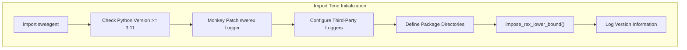
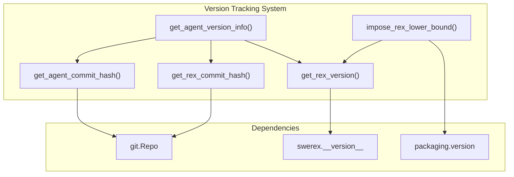
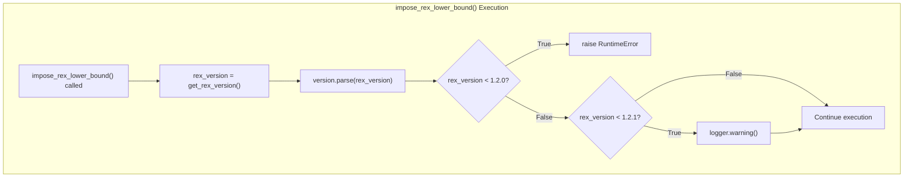
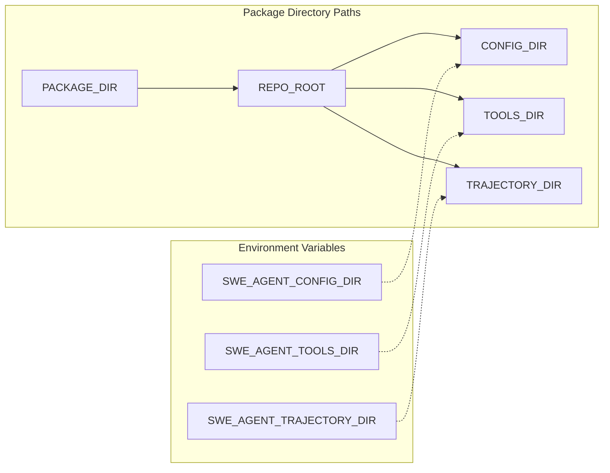
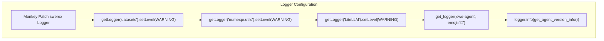
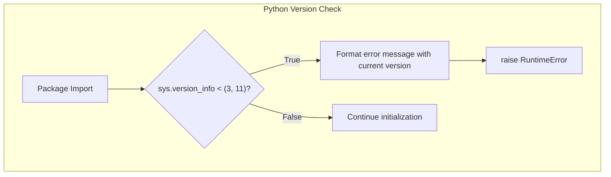

# Package Initialization and Versioning

<details>
<summary>Relevant source files</summary>

The following files were used as context for generating this wiki page:

- [.github/CODE_OF_CONDUCT.md](.github/CODE_OF_CONDUCT.md)
- [docs/config/env.md](docs/config/env.md)
- [docs/installation/changelog.md](docs/installation/changelog.md)
- [sweagent/__init__.py](sweagent/__init__.py)
- [tests/test_models.py](tests/test_models.py)

</details>


This document covers the SWE-agent package initialization process, version management system, dependency enforcement (particularly SWE-ReX version checking), and directory path configuration. The core initialization logic resides in `sweagent/__init__.py`, which executes critical setup steps whenever the package is imported.

For runtime configuration options and CLI usage, see [Configuration System](7.2). For API key configuration, see [API Keys and Model Configuration](2.2).

## Package Initialization Overview

The `sweagent/__init__.py` module executes several critical initialization steps on import:



**Key Initialization Steps:**

1. **Python Version Check** [sweagent/__init__.py:30-35](): Raises `RuntimeError` if Python < 3.11
2. **Logger Setup** [sweagent/__init__.py:20-26](): Monkey-patches SWE-ReX logger and configures third-party loggers
3. **Directory Path Configuration** [sweagent/__init__.py:28-47](): Defines `PACKAGE_DIR`, `REPO_ROOT`, `CONFIG_DIR`, `TOOLS_DIR`, `TRAJECTORY_DIR`
4. **SWE-ReX Version Check** [sweagent/__init__.py:104](): Calls `impose_rex_lower_bound()` to enforce minimum SWE-ReX version
5. **Version Logging** [sweagent/__init__.py:105](): Logs complete version information including commit hashes

Sources: [sweagent/__init__.py:1-115]()

## Version Management System

SWE-agent uses semantic versioning with additional version tracking for both the main package and its SWE-ReX dependency.

### Version Constants

| Constant | Value (v1.1.0) | Purpose | Line Reference |
|----------|----------------|---------|----------------|
| `__version__` | `"1.1.0"` | SWE-agent package version | [sweagent/__init__.py:15]() |
| `PYTHON_MINIMUM_VERSION` | `(3, 11)` | Minimum Python version tuple | [sweagent/__init__.py:16]() |
| `SWEREX_MINIMUM_VERSION` | `"1.2.0"` | Hard requirement for SWE-ReX | [sweagent/__init__.py:17]() |
| `SWEREX_RECOMMENDED_VERSION` | `"1.2.1"` | Recommended SWE-ReX version | [sweagent/__init__.py:18]() |

### Version Information Functions

**Package Initialization and Version Tracking Functions**



**Function Descriptions:**

| Function | Return Type | Purpose | Line Reference |
|----------|-------------|---------|----------------|
| `get_agent_commit_hash()` | `str` | Returns Git commit hash of SWE-agent, or `"unavailable"` | [sweagent/__init__.py:50-59]() |
| `get_rex_commit_hash()` | `str` | Returns Git commit hash of SWE-ReX, or `"unavailable"` | [sweagent/__init__.py:62-69]() |
| `get_rex_version()` | `str` | Returns SWE-ReX version string from `swerex.__version__` | [sweagent/__init__.py:72-75]() |
| `get_agent_version_info()` | `str` | Returns complete version string with all commit hashes | [sweagent/__init__.py:78-82]() |
| `impose_rex_lower_bound()` | `None` | Validates SWE-ReX version meets minimum requirements | [sweagent/__init__.py:85-101]() |

**Example Version String Format:**

```
This is SWE-agent version 1.1.0 (hash='abc123...') with SWE-ReX version 1.2.1 (rex_hash='def456...')
```

Sources: [sweagent/__init__.py:50-82](), [docs/installation/changelog.md:3-6]()

## SWE-ReX Dependency Enforcement

SWE-agent requires SWE-ReX >= 1.2.0 for proper functionality. The version enforcement occurs automatically on package import.

### Dependency Checking Flow



**Version Check Logic:**

1. **Hard Requirement (>= 1.2.0)** [sweagent/__init__.py:88-94](): Raises `RuntimeError` with upgrade instructions if not met
2. **Recommended Version (>= 1.2.1)** [sweagent/__init__.py:95-101](): Logs warning but allows execution to continue

**Error Message Format:**

```
RuntimeError: SWE-ReX version 1.1.0 is too old. Please update to at least 1.2.0 by 
running `pip install --upgrade swe-rex`.
You can also rerun `pip install -e .` in this repository to install the latest version.
```

Sources: [sweagent/__init__.py:85-104]()

## Directory Path Configuration

SWE-agent defines standard directory paths on initialization, all configurable via environment variables. This allows flexible deployment without code changes.

### Directory Path Constants

**Directory Path Initialization Flow**



**Directory Path Definitions:**

| Constant | Default Value | Environment Override | Purpose | Line Reference |
|----------|--------------|---------------------|---------|----------------|
| `PACKAGE_DIR` | `Path(__file__).resolve().parent` | None | SWE-agent package directory | [sweagent/__init__.py:28]() |
| `REPO_ROOT` | `PACKAGE_DIR.parent` | None | Repository root directory | [sweagent/__init__.py:38-39]() |
| `CONFIG_DIR` | `REPO_ROOT / "config"` | `SWE_AGENT_CONFIG_DIR` | Configuration files location | [sweagent/__init__.py:40-41]() |
| `TOOLS_DIR` | `REPO_ROOT / "tools"` | `SWE_AGENT_TOOLS_DIR` | Tool bundles location | [sweagent/__init__.py:43-44]() |
| `TRAJECTORY_DIR` | `REPO_ROOT / "trajectories"` | `SWE_AGENT_TRAJECTORY_DIR` | Trajectory output location | [sweagent/__init__.py:46-47]() |

**Validation:**

Each directory path is validated with `assert path.is_dir()` after initialization to ensure it exists [sweagent/__init__.py:37,39,41,44,47]().

**Non-Editable Installation:**

When installing with `pip install sweagent` (non-editable), you must set the environment variables:
- `SWE_AGENT_CONFIG_DIR`
- `SWE_AGENT_TOOLS_DIR`
- `SWE_AGENT_TRAJECTORY_DIR`

Otherwise, the paths will point to non-existent directories within the installed package.

Sources: [sweagent/__init__.py:28-47](), [docs/config/env.md:12-16]()

## Logger Configuration

SWE-agent configures logging for both its own components and third-party libraries during package initialization.

### Logger Setup Process

**Logger Initialization and Configuration**



**Logger Configuration Details:**

1. **SWE-ReX Logger Monkey Patch** [sweagent/__init__.py:20-21](): Replaces `swerex.utils.log.get_logger` with SWE-agent's implementation using a 🦖 emoji
2. **Third-Party Logger Suppression** [sweagent/__init__.py:23-26](): Sets `WARNING` level for verbose libraries:
   - `datasets`: HuggingFace datasets library
   - `numexpr.utils`: Numerical expression evaluator
   - `LiteLLM`: Language model API wrapper
3. **Version Info Logging** [sweagent/__init__.py:105](): Logs complete version information on import

**Additional Logging Environment Variables:**

| Variable | Effect | Line Reference |
|----------|--------|----------------|
| `SWE_AGENT_LOG_TIME` | Add timestamps to log output | [docs/config/env.md:20]() |
| `SWE_AGENT_LOG_STREAM_LEVEL` | Set CLI log level (`TRACE`, `DEBUG`, etc.) | [docs/config/env.md:21]() |

Sources: [sweagent/__init__.py:20-26,105](), [docs/config/env.md:18-21]()

## Python Version Requirements

SWE-agent enforces a minimum Python version at import time to prevent runtime errors from incompatible Python features.

### Python Version Check Implementation

**Python Version Validation Flow**



**Implementation Details:**

```python
PYTHON_MINIMUM_VERSION = (3, 11)

if sys.version_info < PYTHON_MINIMUM_VERSION:
    msg = (
        f"Python {sys.version_info.major}.{sys.version_info.minor} is not supported. "
        "SWE-agent requires Python 3.11 or higher."
    )
    raise RuntimeError(msg)
```

The check occurs immediately after constant definition [sweagent/__init__.py:30-35](), preventing any further initialization if the Python version is too old.

**Why Python 3.11+:**

Python 3.11 introduced several features and performance improvements that SWE-agent relies on:
- Improved error messages
- Performance optimizations (10-60% faster than 3.10)
- Exception groups and `except*` syntax
- Typing improvements

Sources: [sweagent/__init__.py:16,30-35](), [docs/installation/changelog.md:92]()

## Integration with Package Structure

The configuration system integrates closely with the overall package structure, providing consistent path handling and environment management across all components.

### Key Integration Points

| Component | Integration Point | Purpose |
|-----------|------------------|---------|
| `REPO_ROOT` | Base directory reference | Provides consistent root path for all relative path operations |
| `SWE_AGENT_CONFIG_ROOT` | Environment variable | Allows override of configuration base directory |
| Logger system | `get_logger("swea-config")` | Provides consistent logging for configuration operations |
| Path utilities | Cross-component path resolution | Ensures consistent path handling across all modules |

The configuration utilities are designed to work seamlessly with the broader SWE-agent architecture, providing the foundation for:
- Tool bundle path resolution
- Template file location
- Environment configuration
- Repository path management
- Output directory handling

Sources: [sweagent/utils/config.py:9-12](), [sweagent/utils/config.py:15-21]()