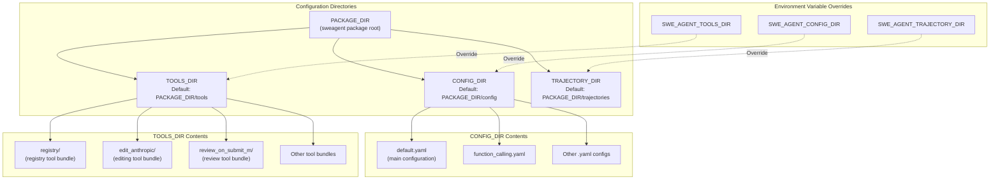
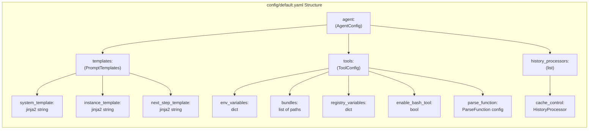
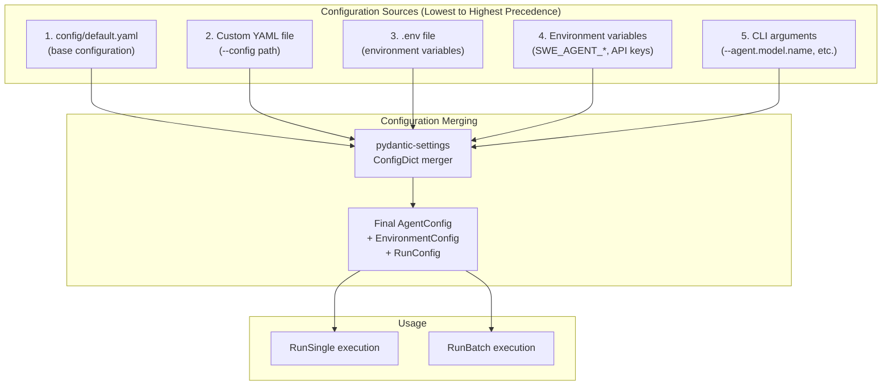
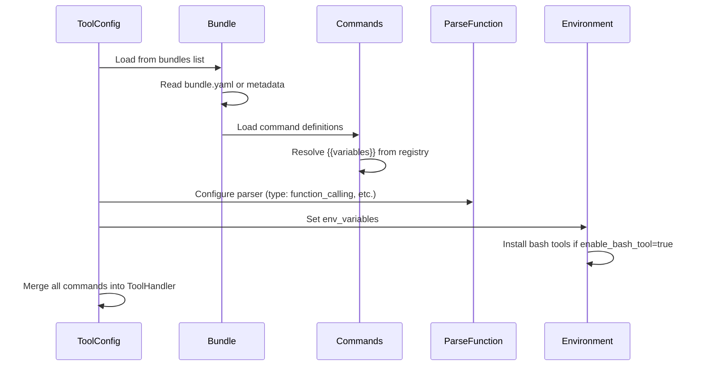

# Configuration Files Reference

<details>
<summary>Relevant source files</summary>

The following files were used as context for generating this wiki page:

- [.github/CODE_OF_CONDUCT.md](.github/CODE_OF_CONDUCT.md)
- [config/default.yaml](config/default.yaml)
- [docs/config/env.md](docs/config/env.md)
- [docs/installation/changelog.md](docs/installation/changelog.md)
- [sweagent/__init__.py](sweagent/__init__.py)
- [tests/test_models.py](tests/test_models.py)

</details>


This page provides reference documentation for SWE-agent's configuration files, including the structure of YAML configuration files, agent prompt templates, tool configurations, and environment variables. This is a technical reference for understanding and modifying configuration files.

For information on how to use the configuration system from the command line and how configurations are merged, see [Configuration System](#7.2). For API key configuration, see [API Keys and Model Configuration](#2.2).

## Configuration Directory Structure

SWE-agent uses several directories for configuration and tool definitions, which can be customized via environment variables or default to locations relative to the package installation.



**Sources:** [sweagent/__init__.py:28-47](), [docs/config/env.md:12-16]()

### Directory Resolution

| Directory | Default Location | Environment Variable Override | Purpose |
|-----------|-----------------|------------------------------|----------|
| `CONFIG_DIR` | `<PACKAGE_DIR>/config` | `SWE_AGENT_CONFIG_DIR` | YAML configuration files |
| `TOOLS_DIR` | `<PACKAGE_DIR>/tools` | `SWE_AGENT_TOOLS_DIR` | Tool bundle definitions |
| `TRAJECTORY_DIR` | `<PACKAGE_DIR>/trajectories` | `SWE_AGENT_TRAJECTORY_DIR` | Saved execution trajectories |

The `PACKAGE_DIR` is automatically resolved as the parent directory of the `sweagent/__init__.py` file at [sweagent/__init__.py:28-39](). All directory paths must exist or SWE-agent will raise an assertion error during package initialization.

**Sources:** [sweagent/__init__.py:40-47]()

## Default Configuration File Structure

The primary configuration file is `config/default.yaml`, which defines the default agent behavior, templates, and tools. The configuration is organized into an `agent` section containing templates, tools, and history processors.



**Sources:** [config/default.yaml:1-70]()

### Agent Templates Section

The `agent.templates` section defines Jinja2 templates used to construct prompts sent to the language model. These templates support variable interpolation and are rendered during agent execution.

| Template Key | Purpose | Available Variables |
|--------------|---------|-------------------|
| `system_template` | System message defining agent role | None (static) |
| `instance_template` | Initial task description | `working_dir`, `problem_statement` |
| `next_step_template` | Format for observations | `observation` |
| `next_step_no_output_template` | Message for empty output | None (static) |

**Example from default.yaml:**

```yaml
system_template: |-
  You are a helpful assistant that can interact with a computer to solve tasks.

instance_template: |-
  <uploaded_files>
  {{working_dir}}
  </uploaded_files>
  I've uploaded a python code repository in the directory {{working_dir}}. 
  Consider the following PR description:
  
  <pr_description>
  {{problem_statement}}
  </pr_description>
```

The templates use Jinja2 syntax with `{{variable}}` for interpolation. Multi-line templates use the `|-` YAML syntax to preserve formatting.

**Sources:** [config/default.yaml:5-32]()

### Tool Configuration Section

The `agent.tools` section configures the tool system, including environment variables, tool bundles, registry variables, and action parsing.

#### Environment Variables

Environment variables set in the execution environment for all commands:

```yaml
env_variables:
  PAGER: cat
  MANPAGER: cat
  LESS: -R
  PIP_PROGRESS_BAR: 'off'
  TQDM_DISABLE: '1'
  GIT_PAGER: cat
```

These variables are injected into the bash session to suppress interactive prompts and pagination.

**Sources:** [config/default.yaml:34-40]()

#### Tool Bundles

Tool bundles are directories containing tool definitions. Each bundle is specified by a `path` relative to `TOOLS_DIR`:

```yaml
bundles:
  - path: tools/registry
  - path: tools/edit_anthropic
  - path: tools/review_on_submit_m
```

The `path` can be:
- Relative to `SWE_AGENT_CONFIG_ROOT` (if set) or `PACKAGE_DIR`
- Absolute path

**Sources:** [config/default.yaml:41-44](), [docs/config/env.md:6-8]()

#### Registry Variables

Registry variables are custom key-value pairs available to tools via the registry system:

```yaml
registry_variables:
  USE_FILEMAP: 'true'
  SUBMIT_REVIEW_MESSAGES:
    - |
      Thank you for your work on this issue. Please carefully follow the steps below...
```

Variables can be strings, booleans, or lists. The `SUBMIT_REVIEW_MESSAGES` example shows a multi-line list used by the review tool bundle.

**Sources:** [config/default.yaml:45-63]()

#### Parse Function Configuration

The `parse_function` section specifies how to extract actions from model outputs:

```yaml
parse_function:
  type: function_calling
```

Available types include:
- `function_calling`: For models supporting native function calling
- `thought_action`: For models using thought/action format
- `json`: For models outputting JSON
- `xml`: For models using XML function calling format

**Sources:** [config/default.yaml:65-66]()

### History Processors Section

History processors modify the conversation history before sending to the model:

```yaml
history_processors:
  - type: cache_control
    last_n_messages: 2
```

The `cache_control` processor adds Anthropic's prompt caching markers to the last N messages to reduce API costs.

**Sources:** [config/default.yaml:67-69]()

## Configuration Loading and Resolution

SWE-agent uses a hierarchical configuration system where settings can come from multiple sources with a defined precedence order.



**Sources:** [sweagent/__init__.py:40-44](), [docs/config/env.md:1-24]()

### Configuration Precedence Rules

1. **Default YAML**: Base configuration loaded from `config/default.yaml`
2. **Custom YAML**: User-specified config via `--config` flag
3. **Environment File**: Variables from `.env` file in current directory
4. **Environment Variables**: Shell environment variables (prefixed with `SWE_AGENT_`)
5. **CLI Arguments**: Command-line arguments (highest precedence)

Later sources override earlier ones. For nested configurations, the merge happens hierarchically - you can override `agent.model.name` without replacing the entire `agent.model` section.

**Sources:** [docs/installation/changelog.md:58]()

## Environment Variables Reference

### Directory and Path Variables

| Variable | Default | Purpose | Set As |
|----------|---------|---------|--------|
| `SWE_AGENT_CONFIG_DIR` | `<PACKAGE_DIR>/config` | Location of YAML configuration files | Env var only |
| `SWE_AGENT_TOOLS_DIR` | `<PACKAGE_DIR>/tools` | Location of tool bundles | Env var only |
| `SWE_AGENT_TRAJECTORY_DIR` | `<PACKAGE_DIR>/trajectories` | Location for saved trajectories | Env var only |
| `SWE_AGENT_CONFIG_ROOT` | `<PACKAGE_DIR>` | Root for resolving relative paths in configs | Env var or config |

**Sources:** [docs/config/env.md:12-16](), [sweagent/__init__.py:40-47]()

### Logging Variables

| Variable | Purpose | Values |
|----------|---------|--------|
| `SWE_AGENT_LOG_TIME` | Add timestamps to log output | Any value enables |
| `SWE_AGENT_LOG_STREAM_LEVEL` | Console log level | `TRACE`, `DEBUG`, `INFO`, `WARNING`, `ERROR` |

The `TRACE` level is a custom level below `DEBUG` for very detailed logging. These variables only affect `run` and `run-replay` commands, not `run-batch`.

**Sources:** [docs/config/env.md:18-21]()

### API Key Variables

All API keys can be provided as environment variables. The specific variable names depend on the model provider:

| Provider | Variable Examples | Notes |
|----------|------------------|-------|
| OpenAI | `OPENAI_API_KEY` | Standard OpenAI models |
| Anthropic | `ANTHROPIC_API_KEY` | Claude models |
| Azure OpenAI | `AZURE_API_KEY`, `AZURE_API_BASE`, `AZURE_API_VERSION` | Azure-hosted models |
| AWS Bedrock | `AWS_ACCESS_KEY_ID`, `AWS_SECRET_ACCESS_KEY`, `AWS_REGION_NAME` | Bedrock models |
| GitHub | `GITHUB_TOKEN` | For accessing private repos and creating PRs |
| Together AI | `TOGETHER_API_KEY` | Together AI models |
| Groq | `GROQ_API_KEY` | Groq models |

See [API Keys and Model Configuration](#2.2) for detailed configuration of each provider.

**Sources:** [docs/config/env.md:5](), [docs/installation/changelog.md:312]()

### Other Configuration Variables

Variables prefixed with `SWE_AGENT_` can be used to override any configuration key. For example:
- `SWE_AGENT_AGENT_MODEL_NAME` → `agent.model.name`
- `SWE_AGENT_ENV_DEPLOYMENT_TYPE` → `env.deployment.type`

This is handled by the `pydantic-settings` library with the `env_prefix` set to `"SWE_AGENT_"`.

**Sources:** [docs/installation/changelog.md:41]()

## Tool Bundle Structure

Tool bundles are directories in `TOOLS_DIR` that define commands available to the agent. Each bundle contains tool definitions and can include shell scripts, Python code, or configuration files.

### Common Tool Bundles

| Bundle Path | Purpose | Key Commands |
|-------------|---------|--------------|
| `tools/registry` | File navigation and registry management | `file_editor`, `registry` commands |
| `tools/edit_anthropic` | Anthropic-inspired editing commands | File viewing and editing with windowed interface |
| `tools/review_on_submit_m` | Solution review before submission | `submit` command with review prompts |

**Sources:** [config/default.yaml:41-44]()

### Bundle Loading Process



**Sources:** [config/default.yaml:33-66]()

### Bundle Configuration Format

While `config/default.yaml` references tool bundles by path, each bundle directory typically contains:
- Command definition files (shell scripts or Python)
- Optional metadata files
- Optional configuration for command behavior

The registry variables from `config/default.yaml` are available to all tools in all bundles via the registry system.

**Sources:** [config/default.yaml:45-63]()

## Special Configuration Features

### Jinja2 Template Variables

Agent templates can use any variables passed to the rendering context:

| Variable | Available In | Type | Description |
|----------|--------------|------|-------------|
| `working_dir` | `instance_template` | string | Repository working directory path |
| `problem_statement` | `instance_template` | string | Issue description or task |
| `observation` | `next_step_template` | string | Output from previous command |
| `diff` | Tool templates | string | Git diff of changes made |

Templates support full Jinja2 syntax including conditionals, loops, and filters.

**Sources:** [config/default.yaml:8-31]()

### Parse Function Types

The `parse_function.type` determines how the agent extracts actions from model outputs:

```yaml
# Option 1: Function calling (recommended for GPT-4, Claude 3.5+)
parse_function:
  type: function_calling

# Option 2: Thought-action format
parse_function:
  type: thought_action

# Option 3: JSON format
parse_function:
  type: json

# Option 4: XML function calling
parse_function:
  type: xml
```

Each type expects different output formats from the model and uses different parsing logic. The `function_calling` type is recommended for modern models that support native function calling.

**Sources:** [config/default.yaml:65-66]()

### History Processor Configuration

History processors can be chained to apply multiple transformations:

```yaml
history_processors:
  - type: cache_control
    last_n_messages: 2
  # Additional processors could be added here
```

The `cache_control` processor is specific to Anthropic models and adds prompt caching markers to reduce costs. The `last_n_messages` parameter controls how many recent messages to mark for caching.

**Sources:** [config/default.yaml:67-69]()

## Environment Variable Persistence

Environment variables can be set in multiple ways with different persistence:

1. **Shell export**: Temporary, current session only
   ```bash
   export SWE_AGENT_CONFIG_DIR=/custom/path
   ```

2. **`.env` file**: Persistent, project-specific
   ```
   SWE_AGENT_CONFIG_DIR=/custom/path
   OPENAI_API_KEY=sk-...
   ```

3. **Shell profile** (`.bashrc`, `.zshrc`): Persistent, user-wide
   ```bash
   export SWE_AGENT_CONFIG_DIR=/custom/path
   ```

The `.env` file is automatically loaded by SWE-agent using `pydantic-settings` and is the recommended method for local development.

**Sources:** [docs/config/env.md:23-24]()

## Version-Specific Configuration Notes

### Changes in Version 1.1.0

- Tool bundles using "windowed" file viewer were renamed (e.g., `defaults` → `edit_anthropic`)
- `review_on_submit` tool bundle removed, replaced by `review_on_submit_m`
- Default configuration changed from previous configs to `default.yaml` (formerly `anthropic_filemap.yaml`)

**Sources:** [docs/installation/changelog.md:13-14]()

### Changes in Version 1.0.0

- All configuration now uses `pydantic` models instead of plain dictionaries
- Templates changed from custom format to Jinja2
- Model configuration unified under `litellm` instead of provider-specific configs

**Sources:** [docs/installation/changelog.md:135-137]()