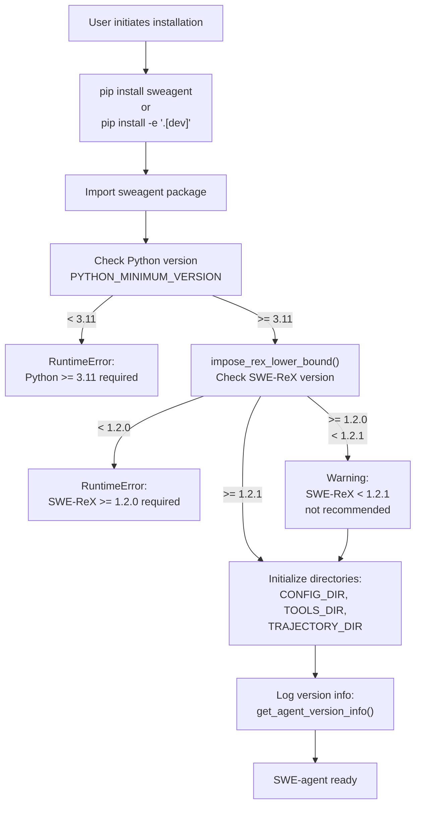
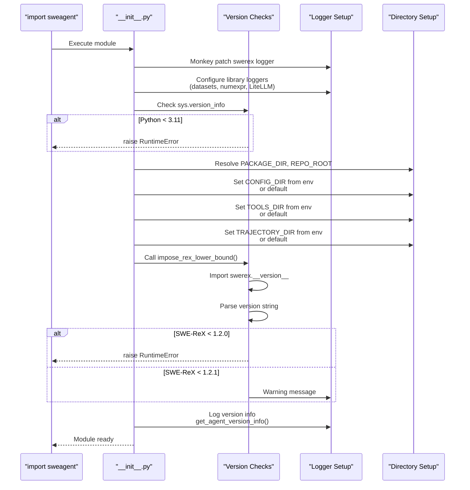
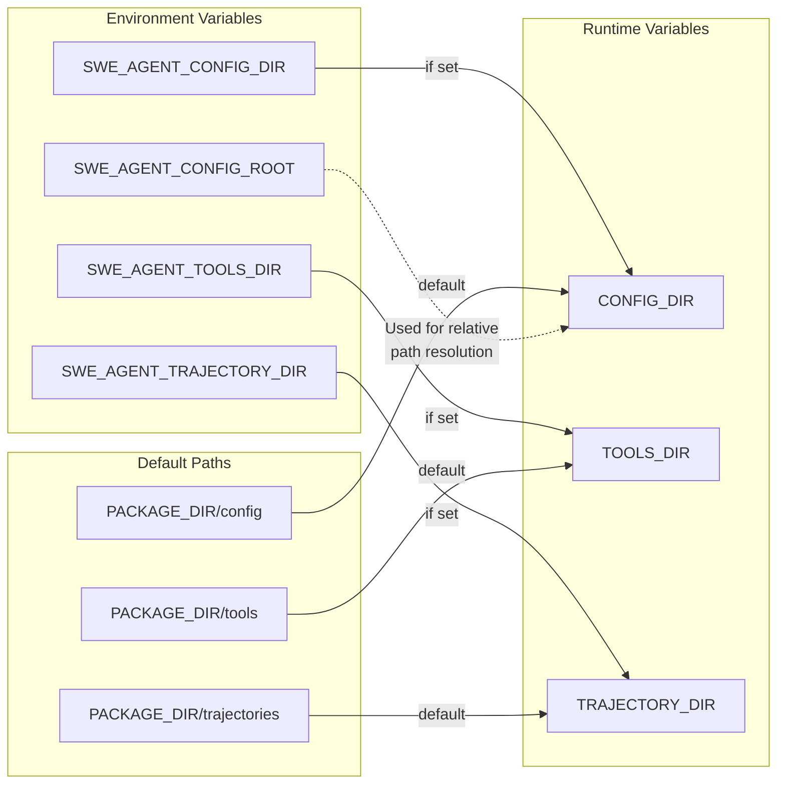
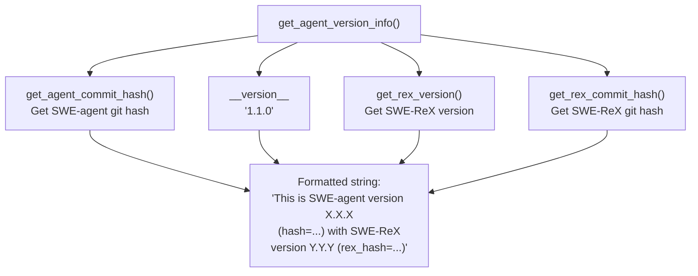

# Installation and Setup

<details>
<summary>Relevant source files</summary>

The following files were used as context for generating this wiki page:

- [.github/CODE_OF_CONDUCT.md](.github/CODE_OF_CONDUCT.md)
- [CONTRIBUTING.md](CONTRIBUTING.md)
- [docs/_footer.md](docs/_footer.md)
- [docs/assets/navigation_cards.css](docs/assets/navigation_cards.css)
- [docs/config/env.md](docs/config/env.md)
- [docs/dev/contribute.md](docs/dev/contribute.md)
- [docs/dev/formatting_conflicts.md](docs/dev/formatting_conflicts.md)
- [docs/installation/changelog.md](docs/installation/changelog.md)
- [docs/installation/index.md](docs/installation/index.md)
- [docs/usage/index.md](docs/usage/index.md)
- [mlc_config.json](mlc_config.json)
- [sweagent/__init__.py](sweagent/__init__.py)
- [tests/test_models.py](tests/test_models.py)

</details>


This page provides an overview of installing SWE-agent and configuring the basic system requirements. It covers system prerequisites, installation methods, dependency verification, and directory configuration.

For detailed API key configuration and language model setup, see [API Keys and Model Configuration](#2.2).
For step-by-step installation procedures, see [Installing SWE-agent](#2.1).

## System Requirements

SWE-agent has specific version requirements enforced at runtime:

| Component | Requirement | Verification Location |
|-----------|-------------|---------------------|
| Python | >= 3.11 | [sweagent/\_\_init\_\_.py:16](), [sweagent/\_\_init\_\_.py:30-35]() |
| SWE-ReX | >= 1.2.0 (recommended >= 1.2.1) | [sweagent/\_\_init\_\_.py:17-18](), [sweagent/\_\_init\_\_.py:85-104]() |
| Docker | Required for environment execution | (external dependency) |

The Python version check occurs immediately on import and will raise a `RuntimeError` if the version is insufficient. The SWE-ReX version check is performed by the `impose_rex_lower_bound()` function, which warns if the version is below the recommended threshold and raises an error if below the minimum.

**Installation Flow**



Sources: [sweagent/\_\_init\_\_.py:1-115](), [docs/dev/contribute.md:16-22]()

## Installation Methods

SWE-agent supports two primary installation modes:

### Basic Installation

```bash
pip install sweagent
```

This installs the core package with runtime dependencies. The package is distributed via PyPI with version management handled by the `__version__` variable in [sweagent/\_\_init\_\_.py:15]().

### Development Installation

```bash
pip install -e '.[dev]'
```

This installs the package in editable mode with additional development dependencies including:
- Testing frameworks (`pytest`, `pytest-xdist`)
- Code quality tools (`ruff`, `pre-commit`)
- Debugging utilities (`pdbpp`)
- Documentation tools (`mkdocs`)

After development installation, pre-commit hooks should be configured:

```bash
pre-commit install
```

Sources: [docs/dev/contribute.md:18-29](), [docs/installation/changelog.md:1-150]()

## Package Initialization and Dependency Verification

**Package Initialization Sequence**



The `impose_rex_lower_bound()` function performs runtime dependency verification:

```python
# From sweagent/__init__.py:85-104
def impose_rex_lower_bound() -> None:
    rex_version = get_rex_version()
    minimal_rex_version = "1.2.0"
    if version.parse(rex_version) < version.parse(minimal_rex_version):
        # Raises RuntimeError with upgrade instructions
    if version.parse(rex_version) < version.parse(SWEREX_RECOMMENDED_VERSION):
        # Logs warning message
```

Sources: [sweagent/\_\_init\_\_.py:1-115]()

## Directory Structure and Environment Variables

SWE-agent uses three primary directories for configuration and data storage. These can be customized via environment variables:

**Directory Configuration**



| Environment Variable | Default Value | Purpose | Code Reference |
|---------------------|---------------|---------|----------------|
| `SWE_AGENT_CONFIG_DIR` | `<PACKAGE>/config` | Configuration files (YAML) | [sweagent/\_\_init\_\_.py:40]() |
| `SWE_AGENT_TOOLS_DIR` | `<PACKAGE>/tools` | Tool bundle definitions | [sweagent/\_\_init\_\_.py:43]() |
| `SWE_AGENT_TRAJECTORY_DIR` | `<PACKAGE>/trajectories` | Execution trajectory storage | [sweagent/\_\_init\_\_.py:46]() |
| `SWE_AGENT_CONFIG_ROOT` | `<PACKAGE>` | Root for relative path resolution | Used in config system |

**Important**: When installing with `pip install` (non-editable), these environment variables should be set to point to accessible directories, as the package directory may not be writable.

Sources: [sweagent/\_\_init\_\_.py:28-47](), [docs/config/env.md:1-24]()

## Logging Configuration

SWE-agent configures logging on import with several customization options:

**Additional Environment Variables**

| Variable | Purpose | Default |
|----------|---------|---------|
| `SWE_AGENT_LOG_TIME` | Add timestamps to log messages | Not set |
| `SWE_AGENT_LOG_STREAM_LEVEL` | Console log level (TRACE, DEBUG, INFO, etc.) | INFO |

The initialization process also modifies third-party library logging levels to reduce noise:

```python
# From sweagent/__init__.py:20-26
# Monkey patch the logger to use our implementation
log_swerex.get_logger = partial(get_logger, emoji="🦖")

# Reduce verbosity of common libraries
getLogger("datasets").setLevel(WARNING)
getLogger("numexpr.utils").setLevel(WARNING)
getLogger("LiteLLM").setLevel(WARNING)
```

Sources: [sweagent/\_\_init\_\_.py:13-26](), [docs/config/env.md:18-22]()

## Version Information and Diagnostics

SWE-agent provides functions to retrieve version and commit information for debugging:

**Version Information Functions**



These functions are defined in [sweagent/\_\_init\_\_.py:50-83]() and provide diagnostic information logged on startup.

Sources: [sweagent/\_\_init\_\_.py:50-83](), [sweagent/\_\_init\_\_.py:105]()

## Testing Installation

After installation, you can verify the setup by checking the version:

```python
import sweagent
print(sweagent.__version__)
print(sweagent.get_agent_version_info())
```

A minimal test to verify model integration works:

```python
from pydantic import SecretStr
from sweagent.agent.models import GenericAPIModelConfig, get_model
from sweagent.tools.parsing import Identity
from sweagent.tools.tools import ToolConfig
from sweagent.types import History

# Create a mock model (no API key needed)
model = get_model(
    GenericAPIModelConfig(
        name="gpt-4o",
        completion_kwargs={"mock_response": "Hello, world!"},
        api_key=SecretStr("dummy_key"),
        top_p=None,
    ),
    ToolConfig(parse_function=Identity()),
)

# Test query
response = model.query(History([{"role": "user", "content": "Test"}]))
print(response)
```

Sources: [tests/test_models.py:1-24]()

## Development Setup

For contributors, additional setup steps are required:

1. **Install with development dependencies**
   ```bash
   pip install -e '.[dev]'
   ```

2. **Configure pre-commit hooks**
   ```bash
   pre-commit install
   ```
   
   Pre-commit runs automated formatting (`ruff`) and checks (`typos`) before each commit. Most issues are auto-fixed; if pre-commit fails, run `git commit` again after reviewing changes.

3. **Optional: Enable unsafe auto-fixes**
   ```bash
   pipx run ruff check --fix --unsafe-fixes
   ```

4. **Run tests to verify setup**
   ```bash
   # All tests
   pytest
   
   # Exclude slow tests
   pytest -m "not slow"
   
   # Parallel execution
   pytest -n auto
   ```

Sources: [docs/dev/contribute.md:16-63]()

## Common Installation Issues

**SWE-ReX Version Mismatch**

If you encounter:
```
RuntimeError: SWE-ReX version X.X.X is too old. Please update to at least 1.2.0
```

Solution:
```bash
pip install --upgrade swe-rex
# Or reinstall SWE-agent
pip install -e .
```

**Directory Not Found Errors**

If directories cannot be found after non-editable installation, set environment variables:
```bash
export SWE_AGENT_CONFIG_DIR=/path/to/config
export SWE_AGENT_TOOLS_DIR=/path/to/tools
export SWE_AGENT_TRAJECTORY_DIR=/path/to/trajectories
```

Environment variables can also be stored in a `.env` file in the working directory.

Sources: [sweagent/\_\_init\_\_.py:85-104](), [docs/config/env.md:23-24]()

## Next Steps

After completing installation:

1. **Configure API Keys**: Set up authentication for language model providers. See [API Keys and Model Configuration](#2.2) for details on configuring OpenAI, Anthropic, and other providers.

2. **Verify Docker**: Ensure Docker is installed and running, as SWE-agent uses Docker containers for isolated code execution via SWE-ReX.

3. **Explore Configuration**: Review the default configuration files in `CONFIG_DIR` to understand available options.

4. **Run Your First Task**: Follow the getting started guide to run SWE-agent on a simple task.

Sources: [docs/installation/index.md:1-34](), [docs/config/env.md:1-24]()