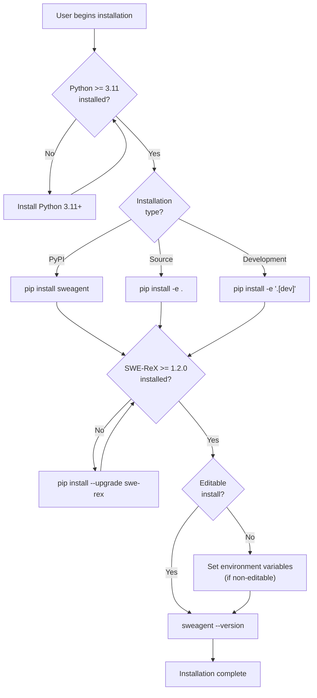
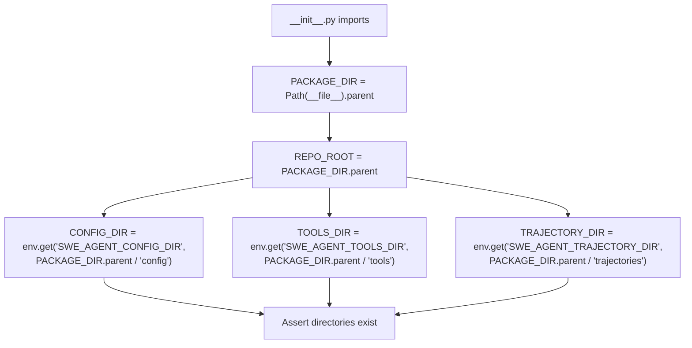
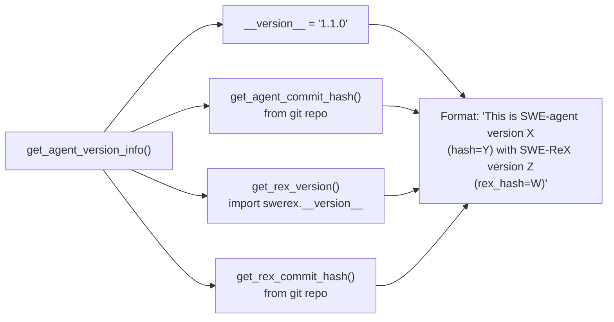

# Installing SWE-agent

<details>
<summary>Relevant source files</summary>

The following files were used as context for generating this wiki page:

- [.github/CODE_OF_CONDUCT.md](.github/CODE_OF_CONDUCT.md)
- [CONTRIBUTING.md](CONTRIBUTING.md)
- [docs/_footer.md](docs/_footer.md)
- [docs/assets/navigation_cards.css](docs/assets/navigation_cards.css)
- [docs/config/env.md](docs/config/env.md)
- [docs/dev/contribute.md](docs/dev/contribute.md)
- [docs/dev/formatting_conflicts.md](docs/dev/formatting_conflicts.md)
- [docs/installation/changelog.md](docs/installation/changelog.md)
- [docs/installation/index.md](docs/installation/index.md)
- [docs/usage/index.md](docs/usage/index.md)
- [mlc_config.json](mlc_config.json)
- [sweagent/__init__.py](sweagent/__init__.py)
- [tests/test_models.py](tests/test_models.py)

</details>


This page provides detailed instructions for installing SWE-agent on your system. It covers system requirements, installation methods, and verification steps. For configuring API keys and language models after installation, see [API Keys and Model Configuration](#2.2).

## Prerequisites

### Python Version Requirement

SWE-agent requires Python 3.11 or higher. This requirement is enforced at import time by the package initialization code.

**Version Check Implementation:**

[sweagent/__init__.py:16]() defines `PYTHON_MINIMUM_VERSION = (3, 11)`, and [sweagent/__init__.py:30-35]() performs the version check:

```python
if sys.version_info < PYTHON_MINIMUM_VERSION:
    msg = (
        f"Python {sys.version_info.major}.{sys.version_info.minor} is not supported. "
        "SWE-agent requires Python 3.11 or higher."
    )
    raise RuntimeError(msg)
```

### SWE-ReX Dependency

SWE-agent depends on the SWE-ReX library for code execution. The minimum required version is automatically enforced.

| Dependency | Minimum Version | Recommended Version |
|------------|----------------|---------------------|
| swerex | 1.2.0 | 1.2.1 |

The version enforcement occurs automatically when importing the package [sweagent/__init__.py:85-104]():

```python
def impose_rex_lower_bound() -> None:
    rex_version = get_rex_version()
    minimal_rex_version = "1.2.0"
    if version.parse(rex_version) < version.parse(minimal_rex_version):
        msg = (
            f"SWE-ReX version {rex_version} is too old. Please update to at least {minimal_rex_version} by "
            "running `pip install --upgrade swe-rex`."
        )
        raise RuntimeError(msg)
```

**Sources:** [sweagent/__init__.py:16-18](), [sweagent/__init__.py:30-35](), [sweagent/__init__.py:85-104]()

## Installation Methods

### Installation Flow



**Sources:** [sweagent/__init__.py:85-104](), [docs/dev/contribute.md:18-22]()

### Method 1: Install from PyPI (Recommended for Users)

Install the latest stable release from PyPI:

```bash
pip install sweagent
```

This installs SWE-agent as a standard Python package. For non-editable installations, you must configure directory paths using environment variables (see [Environment Variables](#environment-variables-for-non-editable-installs)).

**Sources:** [docs/installation/changelog.md:305]()

### Method 2: Install from Source (Recommended for Development)

Clone the repository and install in editable mode:

```bash
git clone https://github.com/SWE-agent/SWE-agent.git
cd SWE-agent
pip install -e .
```

The `-e` flag creates an editable installation, allowing code changes to take effect immediately without reinstalling.

**Sources:** [docs/dev/contribute.md:18]()

### Method 3: Development Installation with Extra Dependencies

For contributing to SWE-agent, install with development dependencies:

```bash
git clone https://github.com/SWE-agent/SWE-agent.git
cd SWE-agent
pip install -e '.[dev]'
```

This includes additional tools for testing, linting, and documentation building. After installation, set up pre-commit hooks:

```bash
pre-commit install
```

Pre-commit hooks automatically check formatting and syntax before commits. Most issues are auto-fixed; if a commit fails, simply run `git commit` again.

**Sources:** [docs/dev/contribute.md:18-36]()

## Package Structure and Directory Configuration

### Directory Initialization



**Sources:** [sweagent/__init__.py:28-47]()

### Default Directory Structure

For editable installations, SWE-agent uses the following directory structure:

| Directory | Purpose | Default Path | Code Reference |
|-----------|---------|--------------|----------------|
| `PACKAGE_DIR` | Package source code | `<repo>/sweagent` | [sweagent/__init__.py:28]() |
| `REPO_ROOT` | Repository root | `<repo>` | [sweagent/__init__.py:38-39]() |
| `CONFIG_DIR` | Configuration files | `<repo>/config` | [sweagent/__init__.py:40-41]() |
| `TOOLS_DIR` | Tool bundles | `<repo>/tools` | [sweagent/__init__.py:43-44]() |
| `TRAJECTORY_DIR` | Execution trajectories | `<repo>/trajectories` | [sweagent/__init__.py:46-47]() |

**Sources:** [sweagent/__init__.py:28-47](), [docs/config/env.md:12-16]()

### Environment Variables for Non-Editable Installs

When installing without the `--editable` option (e.g., `pip install sweagent`), the package is installed to your Python site-packages directory. In this case, you must set environment variables to point to the correct directories:

```bash
export SWE_AGENT_CONFIG_DIR=/path/to/config
export SWE_AGENT_TOOLS_DIR=/path/to/tools
export SWE_AGENT_TRAJECTORY_DIR=/path/to/trajectories
```

These environment variables override the default paths that assume an editable installation. The package initialization checks these variables [sweagent/__init__.py:40-47]():

```python
CONFIG_DIR = Path(os.getenv("SWE_AGENT_CONFIG_DIR", PACKAGE_DIR.parent / "config"))
TOOLS_DIR = Path(os.getenv("SWE_AGENT_TOOLS_DIR", PACKAGE_DIR.parent / "tools"))
TRAJECTORY_DIR = Path(os.getenv("SWE_AGENT_TRAJECTORY_DIR", PACKAGE_DIR.parent / "trajectories"))
```

**Sources:** [docs/config/env.md:12-16](), [sweagent/__init__.py:40-47]()

## Verifying Installation

### Version Information

Check the installed version:

```bash
sweagent --version
```

This outputs version information including the SWE-agent version, commit hash, and SWE-ReX version.

### Version Retrieval Implementation



**Implementation Details:**

- `__version__` constant: [sweagent/__init__.py:15]()
- `get_agent_commit_hash()`: [sweagent/__init__.py:50-59]() - Retrieves git commit hash from the repository
- `get_rex_version()`: [sweagent/__init__.py:72-75]() - Imports SWE-ReX version
- `get_rex_commit_hash()`: [sweagent/__init__.py:62-69]() - Retrieves git commit hash of SWE-ReX installation
- `get_agent_version_info()`: [sweagent/__init__.py:78-82]() - Combines all version information

The version information is automatically logged on import [sweagent/__init__.py:105]().

**Sources:** [sweagent/__init__.py:15](), [sweagent/__init__.py:50-82](), [sweagent/__init__.py:105]()

### Dependency Verification

The package automatically verifies dependencies on import:

1. **Python Version Check**: Runs immediately at import [sweagent/__init__.py:30-35]()
2. **SWE-ReX Version Check**: Runs via `impose_rex_lower_bound()` [sweagent/__init__.py:104]()

If dependencies are not met, a `RuntimeError` is raised with instructions for resolution.

**Sources:** [sweagent/__init__.py:30-35](), [sweagent/__init__.py:85-104]()

## Troubleshooting Common Installation Issues

### Python Version Too Old

**Error Message:**
```
RuntimeError: Python 3.10 is not supported. SWE-agent requires Python 3.11 or higher.
```

**Solution:** Install Python 3.11 or higher and create a new virtual environment.

### SWE-ReX Version Too Old

**Error Message:**
```
RuntimeError: SWE-ReX version 1.1.0 is too old. Please update to at least 1.2.0 by running `pip install --upgrade swe-rex`.
```

**Solution:** Run the upgrade command:
```bash
pip install --upgrade swe-rex
```

Or reinstall SWE-agent to get the latest dependencies:
```bash
pip install -e .
```

**Sources:** [sweagent/__init__.py:85-101]()

### Missing Directories (Non-Editable Install)

**Error Message:**
```
AssertionError: /path/to/site-packages/config
```

**Solution:** Set the required environment variables to point to valid directories containing configuration files, tools, and trajectories. You can copy these from the repository:

```bash
git clone https://github.com/SWE-agent/SWE-agent.git
export SWE_AGENT_CONFIG_DIR=/path/to/SWE-agent/config
export SWE_AGENT_TOOLS_DIR=/path/to/SWE-agent/tools
export SWE_AGENT_TRAJECTORY_DIR=/path/to/SWE-agent/trajectories
```

**Sources:** [docs/config/env.md:12-16](), [sweagent/__init__.py:40-47]()

## Next Steps

After installation, proceed to:

- **[API Keys and Model Configuration](#2.2)**: Set up authentication for language model providers
- **[Basic Usage and Commands](#7.1)**: Learn how to run SWE-agent
- **[Development Setup](#9.1)**: Additional setup for contributors

**Sources:** Table of contents structure