# API Keys and Model Configuration

<details>
<summary>Relevant source files</summary>

The following files were used as context for generating this wiki page:

- [.devcontainer/bashrc_epilog.sh](.devcontainer/bashrc_epilog.sh)
- [docs/config/models.md](docs/config/models.md)
- [docs/installation/keys.md](docs/installation/keys.md)
- [docs/usage/hello_world.md](docs/usage/hello_world.md)
- [sweagent/agent/agents.py](sweagent/agent/agents.py)
- [sweagent/agent/models.py](sweagent/agent/models.py)
- [sweagent/agent/reviewer.py](sweagent/agent/reviewer.py)
- [sweagent/types.py](sweagent/types.py)

</details>


This page documents how SWE-agent authenticates with language model providers and configures model behavior. It covers API key management, model configuration options, cost tracking, and integration with various LM providers through litellm.

For information about specific model setup and troubleshooting, see the installation guide documentation at [docs/installation/keys.md](). For the full configuration system including how model config fits into the larger config hierarchy, see [Configuration System](#7.2).

---

## API Key Authentication

### Authentication Methods

SWE-agent supports three methods for providing API keys, evaluated in the following priority order:

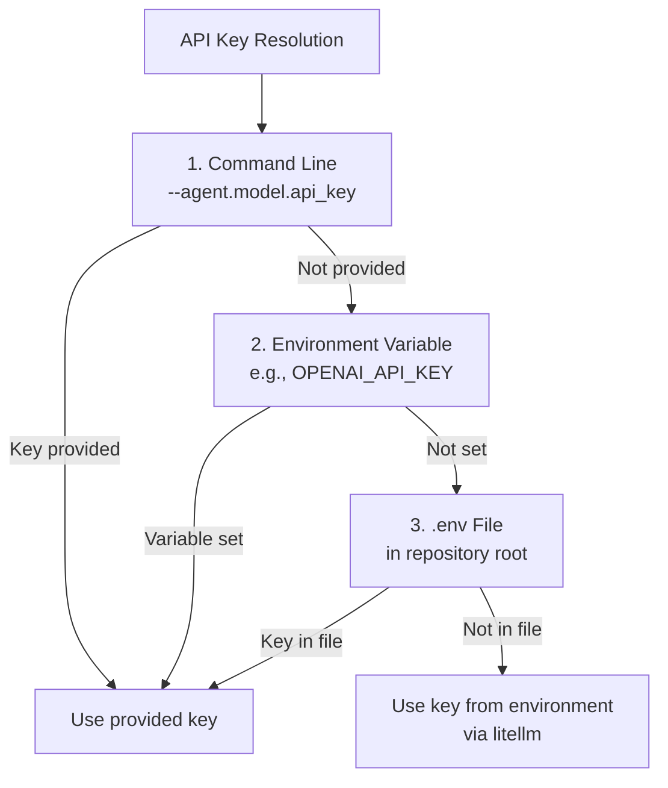

**Sources:** [sweagent/agent/models.py:66-124](), [docs/installation/keys.md:9-30]()

### API Key Configuration

The `GenericAPIModelConfig` class handles API key configuration:

| Field | Type | Description |
|-------|------|-------------|
| `api_key` | `SecretStr \| None` | API key for the model provider |
| `api_base` | `str \| None` | Base URL for API requests |
| `api_version` | `str \| None` | API version string |

**Key Features:**

1. **Environment Variable References:** Keys starting with `$` are treated as environment variable names
2. **Multiple Keys:** Concatenate keys with `:::` separator for rotation
3. **Thread-Based Selection:** When `choose_api_key_by_thread=True`, each thread consistently uses the same key

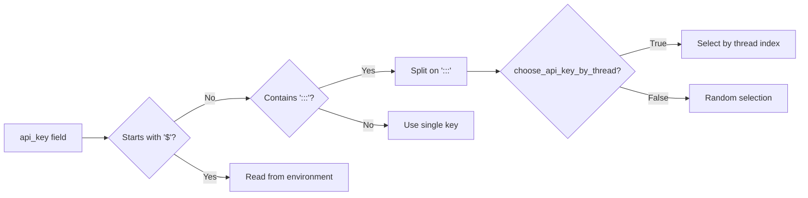

**Sources:** [sweagent/agent/models.py:85-91](), [sweagent/agent/models.py:155-190]()

### Multiple API Key Rotation

The key rotation system ensures efficient use of multiple API keys while preserving prompt caching:

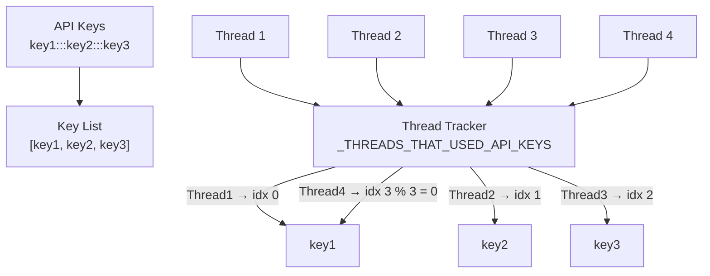

Each thread is assigned a consistent key based on its index modulo the number of available keys. This ensures that prompt caching remains effective within a single thread while distributing load across multiple keys.

**Sources:** [sweagent/agent/models.py:51-53](), [sweagent/agent/models.py:172-190]()

---

## Model Configuration Classes

### Configuration Hierarchy

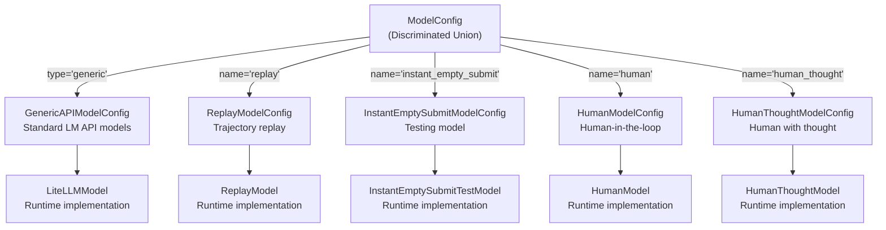

**Sources:** [sweagent/agent/models.py:263-270]()

### GenericAPIModelConfig

The primary configuration class for API-based language models:

| Field | Type | Default | Description |
|-------|------|---------|-------------|
| `name` | `str` | Required | Model identifier (e.g., `claude-sonnet-4-20250514`) |
| `temperature` | `float` | `0.0` | Sampling temperature |
| `top_p` | `float \| None` | `1.0` | Nucleus sampling parameter |
| `per_instance_cost_limit` | `float` | `3.0` | Cost limit per task ($) |
| `total_cost_limit` | `float` | `0.0` | Total cost limit across all tasks ($) |
| `per_instance_call_limit` | `int` | `0` | Maximum API calls per task |
| `api_base` | `str \| None` | `None` | API endpoint override |
| `api_version` | `str \| None` | `None` | API version string |
| `api_key` | `SecretStr \| None` | `None` | API key |
| `stop` | `list[str]` | `[]` | Custom stop sequences |
| `completion_kwargs` | `dict[str, Any]` | `{}` | Additional litellm.completion arguments |
| `convert_system_to_user` | `bool` | `False` | Convert system messages to user messages |
| `delay` | `float` | `0.0` | Minimum delay between queries (seconds) |
| `fallbacks` | `list[dict[str, Any]]` | `[]` | Fallback model configurations |
| `choose_api_key_by_thread` | `bool` | `True` | Enable thread-based key selection |
| `max_input_tokens` | `int \| None` | `None` | Override maximum input tokens |
| `max_output_tokens` | `int \| None` | `None` | Override maximum output tokens |
| `litellm_model_registry` | `str \| None` | `None` | Path to custom model registry |
| `custom_tokenizer` | `dict[str, Any] \| None` | `None` | Custom tokenizer configuration |

**Sources:** [sweagent/agent/models.py:66-153]()

### Retry Configuration

The `RetryConfig` class controls how failed API calls are retried:

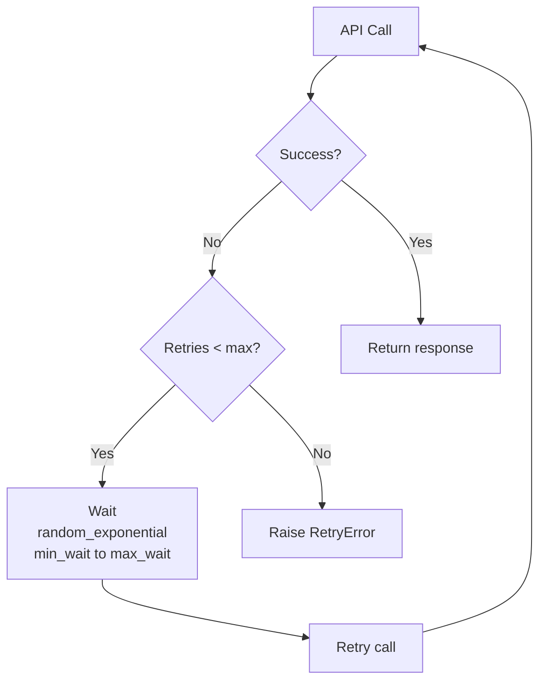

| Field | Type | Default | Description |
|-------|------|---------|-------------|
| `retries` | `int` | `20` | Maximum number of retry attempts |
| `min_wait` | `float` | `10` | Minimum wait time between retries (seconds) |
| `max_wait` | `float` | `120` | Maximum wait time between retries (seconds) |

The retry mechanism uses exponential backoff with random jitter via the `tenacity` library.

**Sources:** [sweagent/agent/models.py:55-64](), [sweagent/agent/models.py:20-26]()

---

## Cost Tracking System

### Cost Tracking Architecture

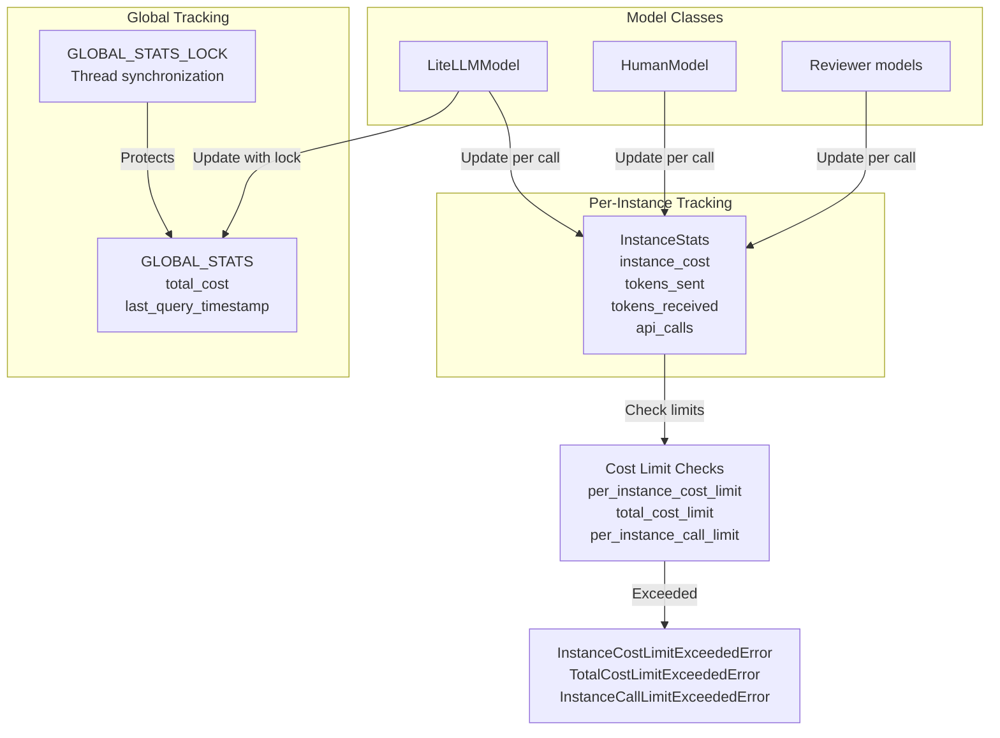

**Sources:** [sweagent/agent/models.py:273-309](), [sweagent/agent/models.py:632-671]()

### Cost Calculation Flow

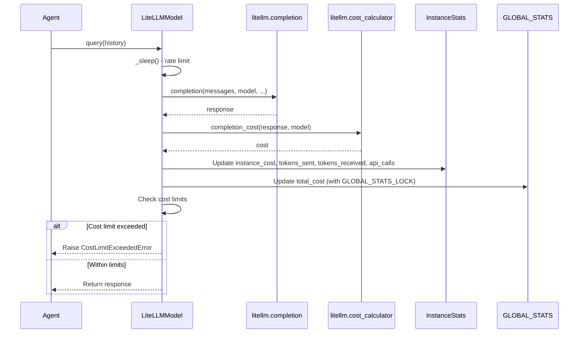

**Sources:** [sweagent/agent/models.py:632-671](), [sweagent/agent/models.py:679-774]()

### Cost Limits and Exceptions

Three types of cost limits are enforced:

1. **Per-Instance Cost Limit:** Maximum cost for a single task
2. **Total Cost Limit:** Maximum cost across all tasks
3. **Per-Instance Call Limit:** Maximum number of API calls per task

```python
# Exceptions hierarchy
CostLimitExceededError
├── InstanceCostLimitExceededError  # per_instance_cost_limit exceeded
├── TotalCostLimitExceededError     # total_cost_limit exceeded
└── InstanceCallLimitExceededError  # per_instance_call_limit exceeded
```

**Sources:** [sweagent/agent/models.py:32-38](), [sweagent/exceptions.py]()

---

## LiteLLM Integration

### Model Serving Architecture

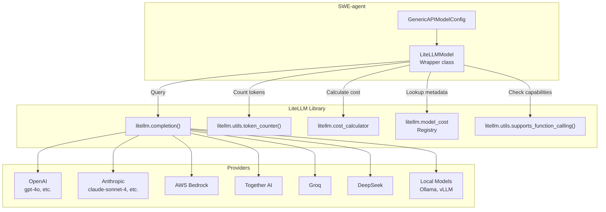

**Sources:** [sweagent/agent/models.py:578-626]()

### LiteLLMModel Implementation

The `LiteLLMModel` class wraps litellm's completion API and provides:

1. **Token Counting:** Pre-flight token counting to enforce context window limits
2. **Cost Calculation:** Automatic cost tracking via litellm's cost calculator
3. **Function Calling Support:** Detection and handling of function calling capabilities
4. **Custom Model Registries:** Support for models not in litellm's default registry

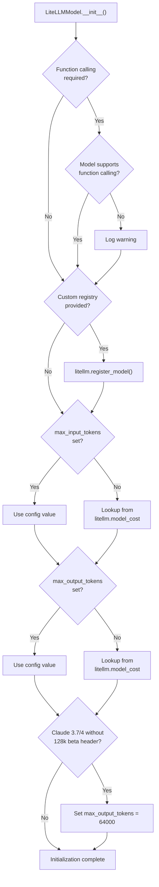

**Sources:** [sweagent/agent/models.py:578-626]()

### Custom Model Registry

For models not in litellm's default registry (local models, new models, or to override costs):

```json
{
  "ollama/llama2": {
    "max_tokens": 8192,
    "max_input_tokens": 8192,
    "max_output_tokens": 8192,
    "input_cost_per_token": 0.00002,
    "output_cost_per_token": 0.00006,
    "litellm_provider": "ollama",
    "mode": "chat"
  }
}
```

Configure in YAML:

```yaml
agent:
  model:
    litellm_model_registry: "path/to/registry.json"
```

**Sources:** [sweagent/agent/models.py:141-144](), [sweagent/agent/models.py:595-598](), [docs/config/models.md:93-131]()

---

## Query Execution Flow

### Single Query Execution

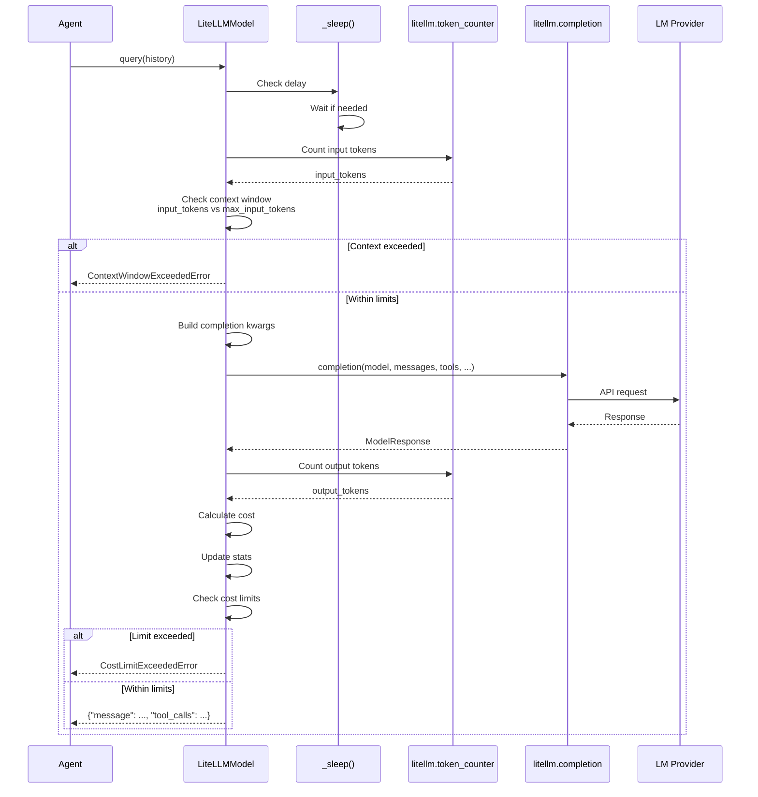

**Sources:** [sweagent/agent/models.py:679-774]()

### Retry Mechanism with Tenacity

The query execution includes automatic retry with exponential backoff:

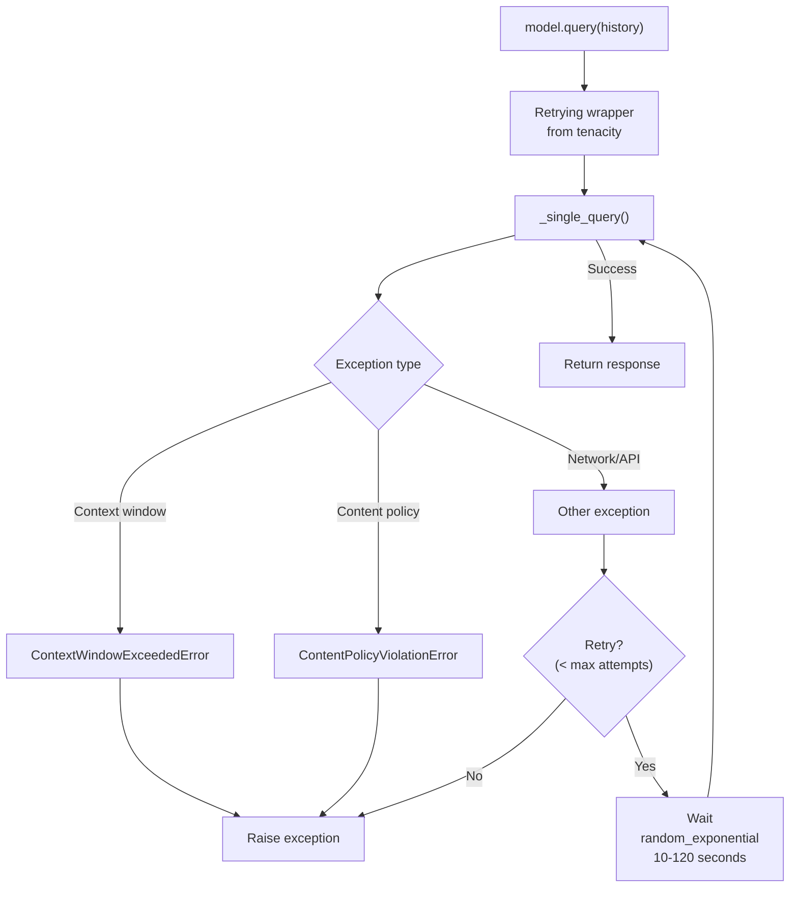

The retry logic skips certain exceptions (context window, content policy) that won't be resolved by retrying.

**Sources:** [sweagent/agent/models.py:778-819]()

---

## Token Limit Management

### Token Limit Configuration

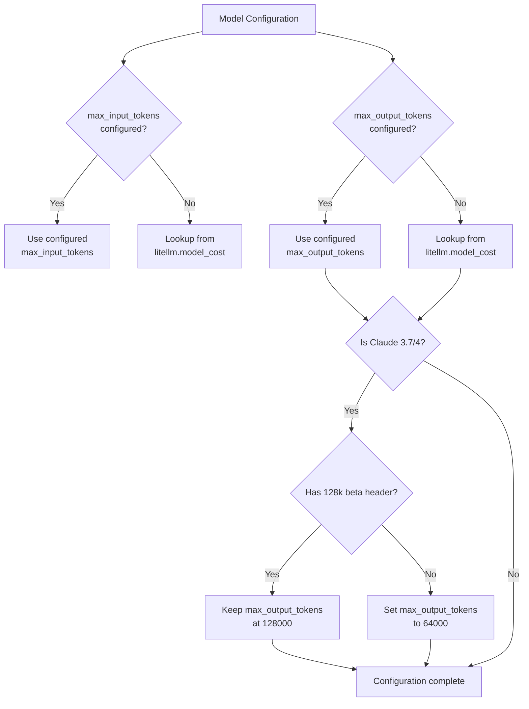

Special handling for Claude 3.7/4 models: By default, these models support only 64k output tokens. To enable 128k output, the `anthropic-beta: output-128k-2025-02-19` header must be set in `completion_kwargs`.

**Sources:** [sweagent/agent/models.py:599-621]()

### Custom Tokenizer Support

For models with non-standard tokenizers:

```yaml
agent:
  model:
    custom_tokenizer:
      identifier: "hf-internal-testing/llama-tokenizer"
```

This creates a pretrained tokenizer via `litellm.utils.create_pretrained_tokenizer()` used for accurate token counting.

**Sources:** [sweagent/agent/models.py:146-150](), [sweagent/agent/models.py:623-625]()

---

## Testing and Special Models

### Testing Model Types

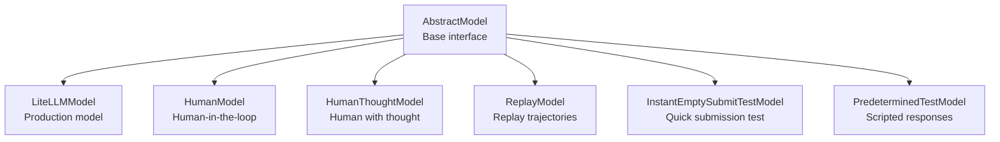

**Sources:** [sweagent/agent/models.py:311-327]()

### HumanModel

Prompts user for input at each step:

- Supports multi-line commands with end keywords
- Saves/loads readline history for autocomplete
- Can simulate cost by using `spend_money` command
- Special `raise_*` commands for testing error handling

**Sources:** [sweagent/agent/models.py:344-443]()

### ReplayModel

Replays actions from a trajectory file:

- Loads actions from `.traj` file
- Steps through actions sequentially
- Handles both string and dict action formats
- Auto-submits if trajectory ends prematurely

**Sources:** [sweagent/agent/models.py:464-527]()

### InstantEmptySubmitTestModel

Creates minimal reproduction file and immediately submits:

- Useful for testing infrastructure
- Creates `reproduce.py` file
- Submits after 2 actions
- Configurable delay for timing tests

**Sources:** [sweagent/agent/models.py:551-576]()

---

## Model Integration with Agents

### Model Initialization in Agents

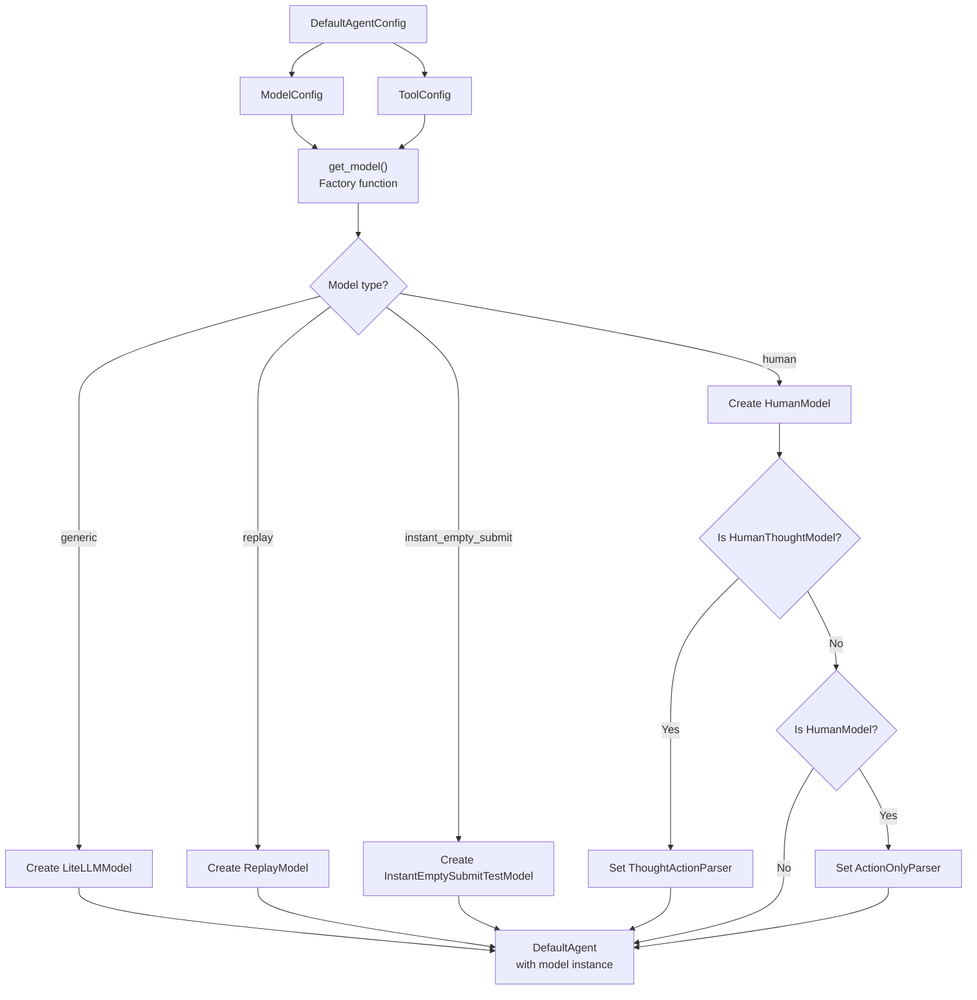

**Sources:** [sweagent/agent/agents.py:501-514](), [sweagent/agent/models.py:467-470]()

### Model Usage in Reviewer

Reviewers use separate model instances for scoring solutions:

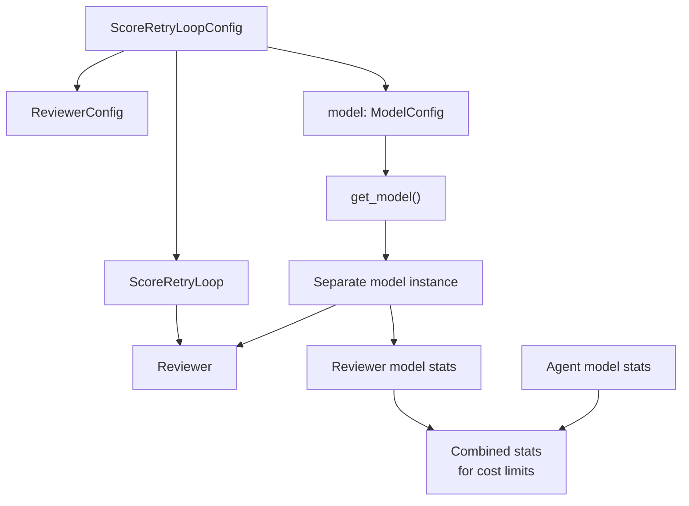

The reviewer's model costs are tracked separately but combined with agent costs for total cost limit checks.

**Sources:** [sweagent/agent/reviewer.py:559-568]()

---

## Advanced Configuration Options

### Completion Kwargs

The `completion_kwargs` field allows passing arbitrary arguments to `litellm.completion()`:

```yaml
agent:
  model:
    completion_kwargs:
      extra_headers:
        anthropic-beta: "output-128k-2025-02-19"
      reasoning_effort: "high"
      stream: false
```

**Sources:** [sweagent/agent/models.py:95-96](), [sweagent/agent/models.py:711-724]()

### Fallback Models

Configure fallback models for automatic failover:

```yaml
agent:
  model:
    name: "gpt-4o"
    fallbacks:
      - model: "gpt-4o-mini"
        context_window_fallbacks: [{"model": "gpt-4-turbo"}]
```

Follows litellm's fallback format.

**Sources:** [sweagent/agent/models.py:113-117](), [sweagent/agent/models.py:722]()

### Convert System Messages

Some models (e.g., o1) don't support system messages:

```yaml
agent:
  model:
    convert_system_to_user: true
```

This flag converts system messages to user messages before sending to the model.

**Sources:** [sweagent/agent/models.py:98-101]()

### Rate Limiting

Control request rate with delay:

```yaml
agent:
  model:
    delay: 2.0  # Minimum 2 seconds between requests
```

Uses `GLOBAL_STATS.last_query_timestamp` to enforce delays across all model instances.

**Sources:** [sweagent/agent/models.py:108-111](), [sweagent/agent/models.py:672-677]()