# Agent Framework

<details>
<summary>Relevant source files</summary>

The following files were used as context for generating this wiki page:

- [sweagent/agent/agents.py](sweagent/agent/agents.py)
- [sweagent/agent/models.py](sweagent/agent/models.py)
- [sweagent/agent/reviewer.py](sweagent/agent/reviewer.py)
- [sweagent/types.py](sweagent/types.py)

</details>


The Agent Framework is the core decision-making layer of SWE-agent that orchestrates problem-solving behavior. It defines how agents interact with language models to generate actions, execute those actions in environments, maintain conversational context, and iterate toward solutions. This page covers the agent architecture, model abstraction, execution flow, and retry mechanisms.

For information about the environment where agents execute commands, see [Environment System](#4). For details on the tools and actions available to agents, see [Tool System](#6). For orchestration of agent runs across multiple instances, see [Execution and Run System](#5).

---

## Core Agent Architecture

The agent system is built around a class hierarchy that separates concerns between basic problem-solving (`DefaultAgent`) and meta-orchestration (`RetryAgent`).

### Agent Class Hierarchy

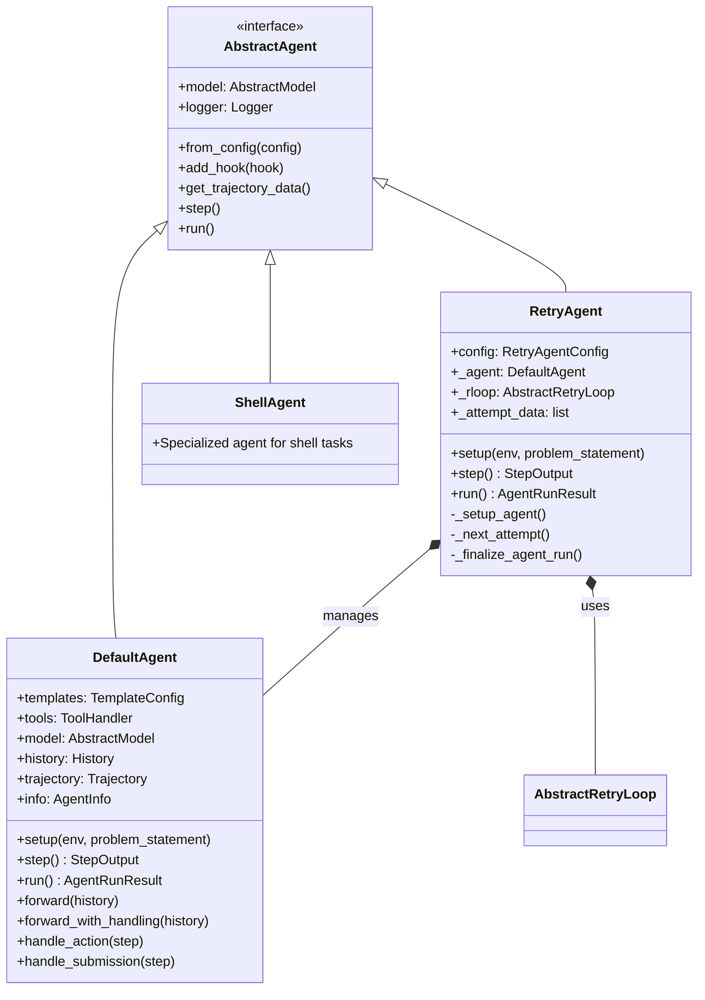

**Sources:** [sweagent/agent/agents.py:224-255]()

### DefaultAgent: The Core Problem-Solving Agent

`DefaultAgent` implements the primary agent logic. It maintains conversation history, generates actions via language models, executes those actions in the environment, and tracks the solution trajectory.

**Key Attributes:**

| Attribute | Type | Purpose |
|-----------|------|---------|
| `templates` | `TemplateConfig` | Jinja2 templates for system messages, instance prompts, observations |
| `tools` | `ToolHandler` | Manages available commands and action parsing |
| `model` | `AbstractModel` | Language model for generating actions |
| `history` | `History` | Full conversational context (list of `HistoryItem`) |
| `trajectory` | `Trajectory` | Action-observation pairs (list of `TrajectoryStep`) |
| `info` | `AgentInfo` | Metadata about the run (costs, exit status, submission) |

**Sources:** [sweagent/agent/agents.py:443-500]()

### RetryAgent: Multi-Attempt Orchestration

`RetryAgent` wraps around `DefaultAgent` to enable multiple solution attempts with evaluation and selection. It manages the retry loop, tracks costs across attempts, and selects the best solution using a review mechanism.

**Architecture:**

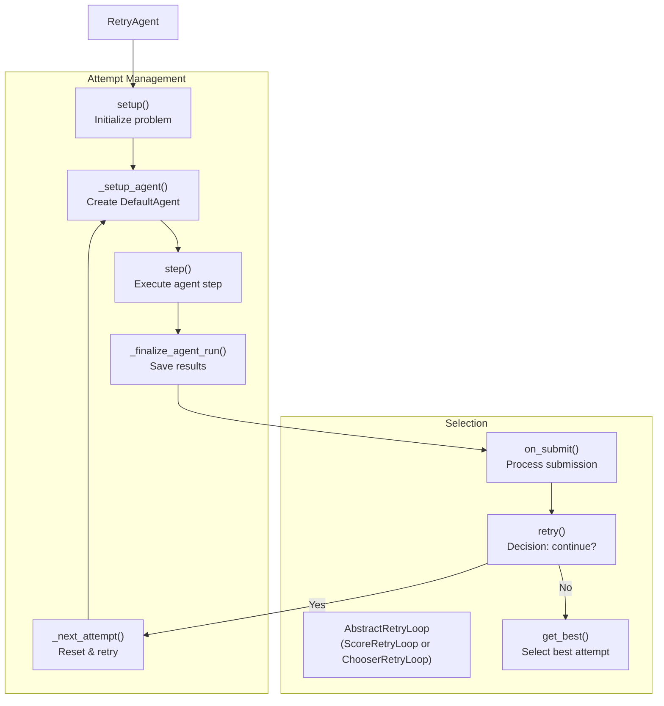

**Sources:** [sweagent/agent/agents.py:257-441]()

### Agent Configuration

Agents are configured via pydantic models that define their behavior, model selection, templates, and tools.

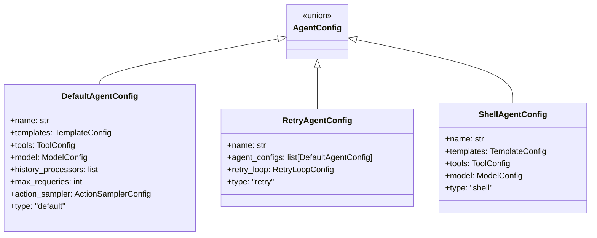

**Sources:** [sweagent/agent/agents.py:149-196]()

---

## Agent Lifecycle and Execution Flow

The agent follows a structured lifecycle from initialization through problem-solving to completion.

### Agent Lifecycle Phases

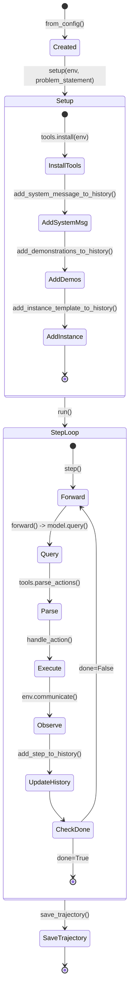

**Sources:** [sweagent/agent/agents.py:561-606](), [sweagent/agent/agents.py:1157-1198]()

### The Step Method: Core Execution Loop

The `step()` method is the heart of agent execution. Each step queries the model, parses actions, executes them, and updates the history.

**Execution Flow:**

1. **Query Model:** Call `forward_with_handling()` which invokes `model.query(history)`
2. **Parse Actions:** Extract thought and action from model output via `tools.parse_actions()`
3. **Execute Action:** Run command in environment via `handle_action()` → `env.communicate()`
4. **Handle Submission:** Check if action was a submit command via `handle_submission()`
5. **Update State:** Add step to history and trajectory, collect execution statistics

**Sources:** [sweagent/agent/agents.py:1157-1198](), [sweagent/agent/agents.py:1006-1060]()

### Error Handling and Requeries

The agent includes sophisticated error handling with automatic recovery:

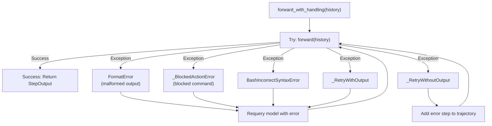

The agent will requery up to `max_requeries` times (default 3) when encountering recoverable errors.

**Sources:** [sweagent/agent/agents.py:1062-1155]()

---

## Model Abstraction Layer

The model abstraction decouples agent logic from specific language model implementations, enabling support for multiple providers and interaction modes.

### Model Class Hierarchy

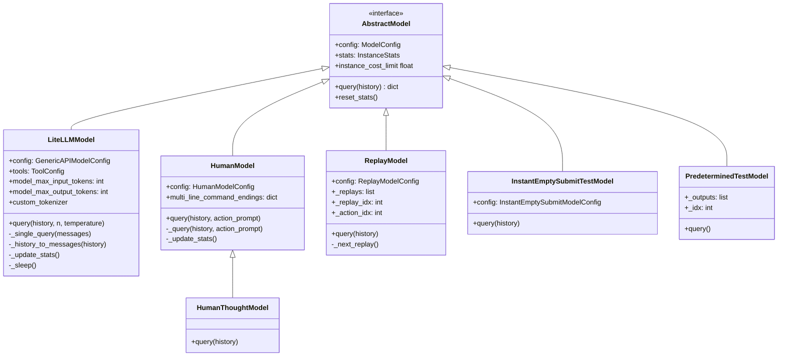

**Sources:** [sweagent/agent/models.py:311-327](), [sweagent/agent/models.py:578-866]()

### LiteLLMModel: API-Based Language Models

`LiteLLMModel` provides unified access to 100+ language model providers via the `litellm` library. It handles API calls, cost tracking, retry logic, and context window management.

**Key Features:**

| Feature | Implementation |
|---------|----------------|
| **Provider Support** | OpenAI, Anthropic, AWS Bedrock, Together, Groq, DeepSeek, Ollama, etc. |
| **Cost Tracking** | Token counting, per-instance and total cost limits |
| **Retry Logic** | Exponential backoff for rate limits, configurable retry attempts |
| **Context Window** | Automatic detection of model limits, raises `ContextWindowExceededError` |
| **Function Calling** | Native support for tool/function calling APIs |
| **Caching** | Support for prompt caching (e.g., Anthropic's cache control) |
| **Custom Tokenizers** | Override default tokenizers for local/custom models |

**Sources:** [sweagent/agent/models.py:578-866]()

### Model Configuration

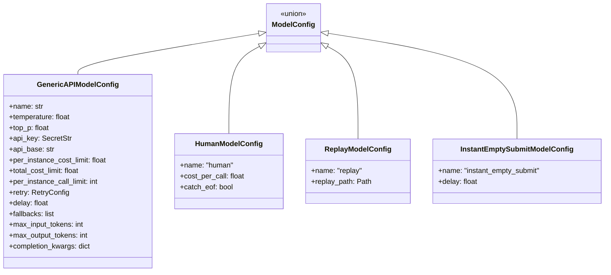

**Sources:** [sweagent/agent/models.py:66-270]()

### Special Model Types

**HumanModel:** Allows human-in-the-loop interaction. Prompts user for actions via `input()`, supports multiline commands, saves readline history.

**HumanThoughtModel:** Extends `HumanModel` to explicitly separate thought and action input, useful for testing thought-action parsing.

**ReplayModel:** Replays actions from a `.traj` file, used for trajectory replay and debugging.

**InstantEmptySubmitTestModel:** Immediately creates a trivial file and submits, used for testing infrastructure.

**PredeterminedTestModel:** Outputs a predetermined sequence of messages, used for unit testing.

**Sources:** [sweagent/agent/models.py:344-576]()

---

## History and Trajectory Management

The agent maintains two parallel data structures to track execution: **History** (conversational messages) and **Trajectory** (action-observation pairs).

### History vs Trajectory

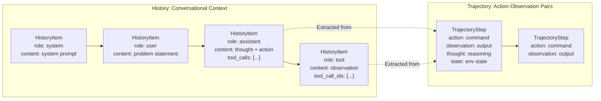

**History (`History`):** A list of `HistoryItem` objects representing the full conversational context. Each item has a `role` (system/user/assistant/tool), `content`, and optional metadata like `tool_calls`, `thinking_blocks`, `cache_control`. This is what gets sent to the language model.

**Trajectory (`Trajectory`):** A list of `TrajectoryStep` objects capturing action-observation pairs. Each step includes the `action` executed, `observation` received, `thought` generated, environment `state`, and execution metadata. This is what gets saved for analysis and replay.

**Sources:** [sweagent/types.py:44-78]()

### HistoryItem Structure

```python
class HistoryItem(TypedDict):
    role: str  # "system", "user", "assistant", "tool"
    content: str | list[dict[str, Any]]
    message_type: Literal["thought", "action", "observation"]
    
    # Optional fields:
    agent: str  # Agent name for multi-agent scenarios
    is_demo: bool  # Marks demonstration messages
    thought: str
    action: str
    tool_calls: list[dict]  # For function calling
    tool_call_ids: list[str]  # Links tool results to calls
    cache_control: dict  # Prompt caching metadata
    thinking_blocks: list[dict]  # Extended thinking (e.g., o1)
```

**Sources:** [sweagent/types.py:56-75]()

### TrajectoryStep Structure

```python
class TrajectoryStep(TypedDict):
    action: str  # Command executed
    observation: str  # Output received
    response: str  # Raw model output
    state: dict[str, str]  # Environment state (working_dir, open_file, etc.)
    thought: str  # Model reasoning
    execution_time: float  # Command execution time
    query: list[dict]  # Full query sent to model
    extra_info: dict  # Additional metadata
```

**Sources:** [sweagent/types.py:44-53]()

### History Processors

History processors modify the conversational history before sending it to the model. They enable features like prompt caching and context filtering.

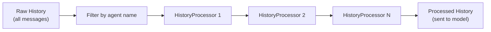

**DefaultHistoryProcessor:** Adds Anthropic cache control markers to enable prompt caching, reducing costs for repeated context.

**Sources:** [sweagent/agent/agents.py:540-551](), [sweagent/agent/history_processors.py]()

---

## Retry and Review System

The retry system enables agents to make multiple solution attempts and select the best one based on automated evaluation.

### Retry Loop Architecture

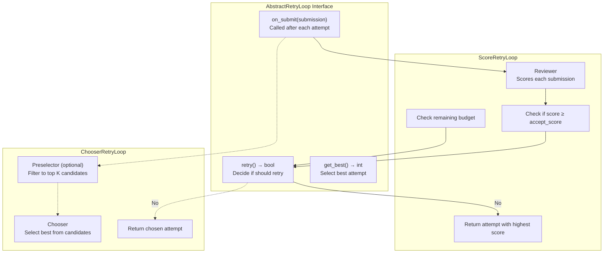

**Sources:** [sweagent/agent/reviewer.py:91-123]()

### ScoreRetryLoop: Score-Based Selection

`ScoreRetryLoop` uses an LM-based reviewer to score each submission. The agent retries until a submission scores above `accept_score` or budget/attempt limits are reached.

**Configuration:**

| Parameter | Purpose |
|-----------|---------|
| `reviewer_config` | Configuration for the reviewer model and templates |
| `accept_score` | Minimum score to accept a submission |
| `max_accepts` | Maximum number of accepted submissions before stopping |
| `max_attempts` | Maximum number of total attempts |
| `cost_limit` | Total budget for all attempts + reviews (excluding final review) |
| `min_budget_for_new_attempt` | Minimum remaining budget to start a new attempt |

**Reviewer Operation:**

1. **Format Messages:** Combine problem statement, submission, and trajectory into reviewer prompt
2. **Sample Scores:** Query reviewer model `n_sample` times (default 5) for score averaging
3. **Interpret Scores:** Extract numerical score from model responses, validate against `score_range`
4. **Apply Penalties:** Subtract `failure_score_penalty` if submission didn't properly exit
5. **Reduce by Std:** Optionally subtract `reduce_by_std * std` to penalize inconsistent scores

**Sources:** [sweagent/agent/reviewer.py:200-235](), [sweagent/agent/reviewer.py:559-659]()

### ChooserRetryLoop: LM-Based Selection

`ChooserRetryLoop` defers selection to the end. After all attempts, a chooser LM compares submissions and selects the best one.

**Architecture:**

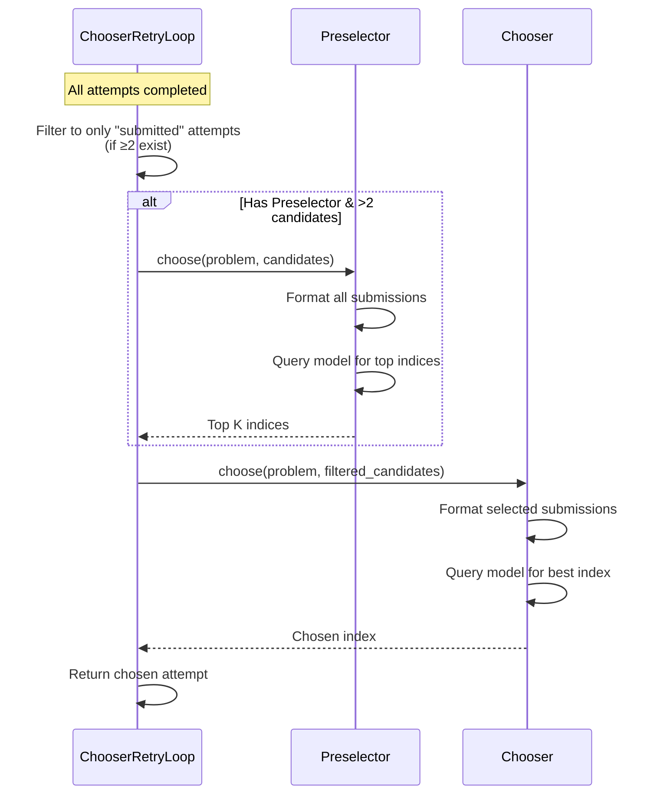

**Chooser Prompting:** The chooser receives formatted submissions (including patches) and must output the index of the best solution. Regex extracts the last number from the response.

**Preselector (Optional):** Pre-filters candidates before the chooser to reduce context length and costs when many attempts exist.

**Sources:** [sweagent/agent/reviewer.py:180-198](), [sweagent/agent/reviewer.py:499-556]()

### Reviewer Configuration

**TrajFormatterConfig:** Controls how trajectories are formatted in reviewer prompts.

| Parameter | Purpose |
|-----------|---------|
| `filter` | List of action prefixes to exclude from trajectory (e.g., `["find"]`) |
| `output_filter` | List of actions whose outputs should be hidden |
| `item_template` | Jinja2 template for formatting each trajectory step |
| `only_show_last_n_output` | Only show observation for last N steps |

**ReviewerConfig:** Defines the reviewer model and scoring behavior.

| Parameter | Purpose |
|-----------|---------|
| `system_template` | System prompt for reviewer |
| `instance_template` | Template for formatting problem + submission |
| `failure_score_penalty` | Score penalty for submissions that exit abnormally |
| `n_sample` | Number of times to query reviewer for score averaging |
| `reduce_by_std` | Multiplier for standard deviation penalty |
| `score_range` | Expected score range for validation |

**Sources:** [sweagent/agent/reviewer.py:145-178]()

---

## Template System

Agents use Jinja2 templates to format messages sent to language models. Templates enable dynamic content injection and consistent formatting.

### TemplateConfig

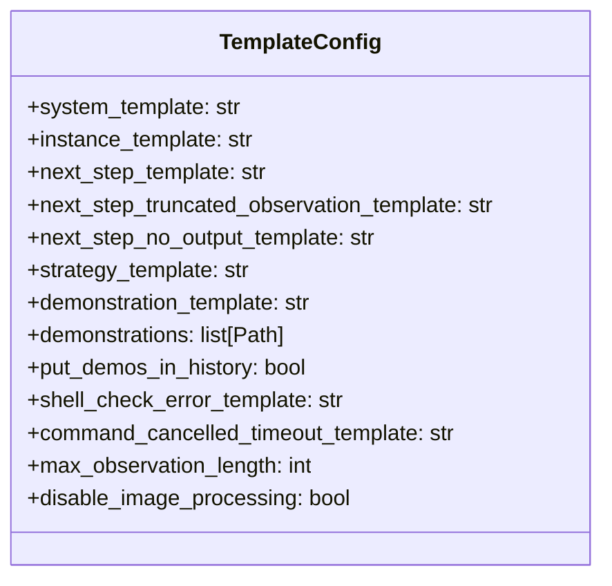

**Key Templates:**

| Template | Purpose | Variables |
|----------|---------|-----------|
| `system_template` | Agent's system message | `command_docs`, `problem_statement`, `repo`, env variables |
| `instance_template` | Problem statement presentation | `problem_statement`, `repo`, extra fields from problem statement |
| `next_step_template` | Format observation after action | `observation`, environment state variables |
| `next_step_truncated_observation_template` | Format truncated observations | `observation`, `max_observation_length`, `elided_chars` |
| `shell_check_error_template` | Bash syntax error message | `bash_stdout`, `bash_stderr` |
| `command_cancelled_timeout_template` | Command timeout message | `command`, `timeout` |

**Sources:** [sweagent/agent/agents.py:60-147]()

### Template Rendering

Templates are rendered using `Template(template_str).render(**format_dict)` where `format_dict` includes:

```python
format_dict = {
    "command_docs": self.tools.config.command_docs,
    **self.tools.config.env_variables,
    "problem_statement": problem_statement.get_problem_statement(),
    "repo": env.repo.repo_name,
    **problem_statement.get_extra_fields(),
    # Plus any additional kwargs passed to the rendering method
}
```

**Sources:** [sweagent/agent/agents.py:658-673]()

### Demonstrations

Demonstrations are example trajectories that can be added to agent history to provide few-shot learning.

**Two modes:**

1. **Single Message:** All demo steps concatenated into one user message (uses `demonstration_template`)
2. **In History:** Each demo step added as separate history item (uses `put_demos_in_history=True`)

**Demo Format:** `.yaml` or `.json` files containing a `history` field with `HistoryItem` objects.

**Sources:** [sweagent/agent/agents.py:617-656]()

---

## Integration Points

### Agent-Model-Environment Interaction Flow

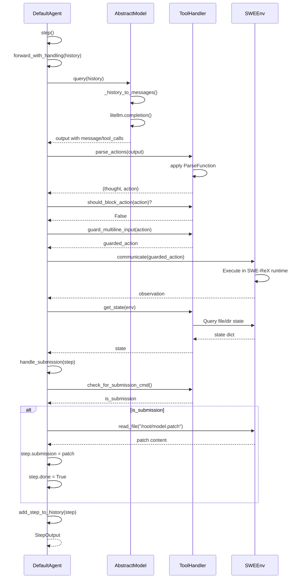

**Sources:** [sweagent/agent/agents.py:1157-1198](), [sweagent/agent/agents.py:936-1004]()

### Factory Functions

```python
# Get agent from config
def get_agent_from_config(config: AgentConfig) -> AbstractAgent:
    if config.type == "default":
        return DefaultAgent.from_config(config)
    elif config.type == "retry":
        return RetryAgent.from_config(config)
    elif config.type == "shell":
        return ShellAgent.from_config(config)
```

```python
# Get model from config
def get_model(args: ModelConfig, tools: ToolConfig) -> AbstractModel:
    if args.name == "human":
        return HumanModel(args, tools)
    elif args.name == "replay":
        return ReplayModel(args, tools)
    elif args.name == "instant_empty_submit":
        return InstantEmptySubmitTestModel(args, tools)
    else:
        return LiteLLMModel(args, tools)
```

**Sources:** [sweagent/agent/agents.py:242-255](), [sweagent/agent/models.py:868-896]()

---

## Statistics and Cost Tracking

### InstanceStats

Tracks resource usage for a single problem instance:

```python
class InstanceStats(BaseModel):
    instance_cost: float = 0  # $ spent on this instance
    tokens_sent: int = 0      # Total input tokens
    tokens_received: int = 0  # Total output tokens
    api_calls: int = 0        # Number of API calls
```

**Operations:** Supports `+` and `-` operators for combining/comparing stats across attempts.

**Sources:** [sweagent/agent/models.py:292-309]()

### GlobalStats

Tracks aggregate usage across all instances:

```python
class GlobalStats(BaseModel):
    total_cost: float = 0  # Cumulative cost
    last_query_timestamp: float = 0  # For rate limiting
```

**Thread Safety:** Access via `GLOBAL_STATS_LOCK` to prevent race conditions in batch runs.

**Sources:** [sweagent/agent/models.py:273-290]()

### Cost Limit Enforcement

Cost limits are checked at multiple points:

1. **Before Query:** `LiteLLMModel._update_stats()` checks after each API call
2. **During Retry:** `RetryAgent.step()` checks total cost before each step
3. **Retry Loop:** `ScoreRetryLoop.retry()` and `ChooserRetryLoop.retry()` check remaining budget

**Exceptions:**
- `InstanceCostLimitExceededError`: Per-instance limit reached
- `TotalCostLimitExceededError`: Total limit reached (stops all execution)

**Sources:** [sweagent/agent/models.py:632-671]()

---

## Agent Hooks

Hooks enable observation and modification of agent behavior at specific lifecycle points.

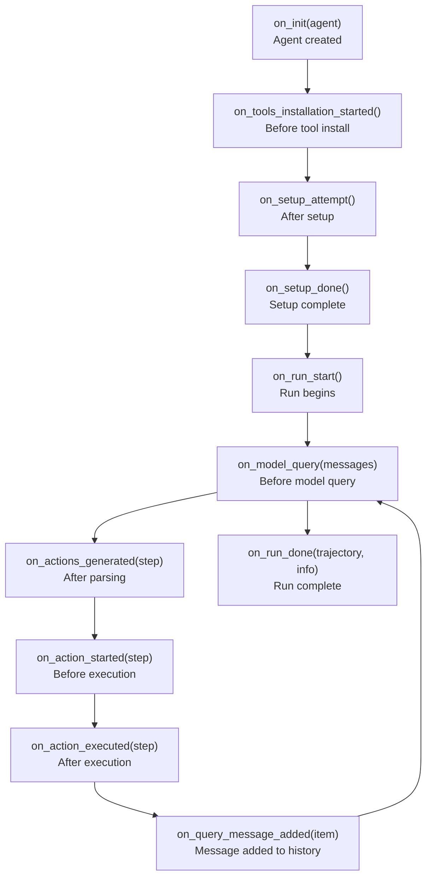

**CombinedAgentHook:** Aggregates multiple hooks and dispatches events to all of them. Agents use a single `CombinedAgentHook` internally and expose `add_hook()` to register additional hooks.

**Sources:** [sweagent/agent/hooks/abstract.py](), [sweagent/agent/agents.py:516-519]()

---

## Error Handling and Recovery

### Exception Hierarchy

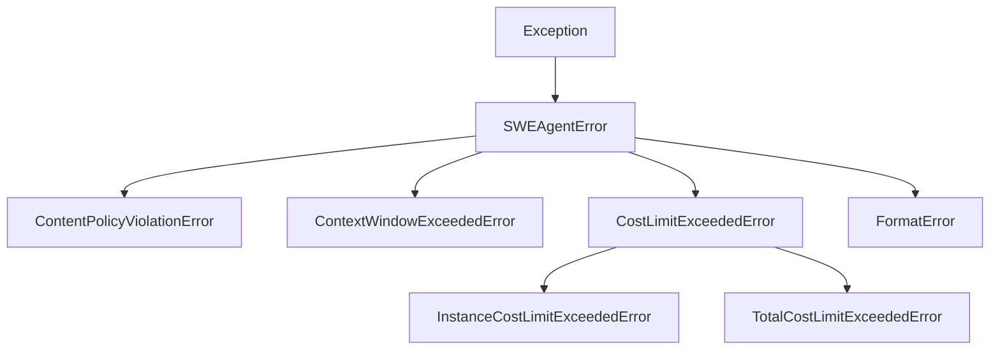

**Sources:** [sweagent/exceptions.py]()

### Automatic Submission on Error

When critical errors occur (cost limits, context exceeded, runtime crashes), the agent attempts to extract and submit whatever patch exists:

1. **Check Runtime:** Is environment still alive?
2. **Try Submit Command:** Execute `git add -A && git diff --cached > /root/model.patch`
3. **Read Patch:** Read `/root/model.patch` from environment
4. **Fallback:** If runtime dead, try to extract diff from last trajectory step state
5. **Mark Submission:** Set `step.done = True` and `step.exit_status = "submitted (error_type)"`

**Sources:** [sweagent/agent/agents.py:823-868]()

---

## Summary

The Agent Framework provides a flexible, extensible architecture for autonomous problem-solving:

- **DefaultAgent** implements core logic: query models, parse actions, execute in environments, track history/trajectory
- **RetryAgent** adds meta-orchestration: multiple attempts with automated evaluation and selection
- **AbstractModel** abstracts language model providers via litellm, supporting 100+ APIs and special modes (human, replay)
- **History/Trajectory** maintain dual views: conversational context for models vs. action-observation pairs for analysis
- **Retry Loops** enable sophisticated attempt strategies: score-based (with reviewer) or chooser-based (with LM comparison)
- **Templates** provide flexible message formatting with Jinja2, supporting dynamic content and demonstrations
- **Hooks** enable observation and modification of agent behavior at key lifecycle points

This architecture separates concerns cleanly: agents orchestrate, models generate, environments execute, and tools define capabilities.