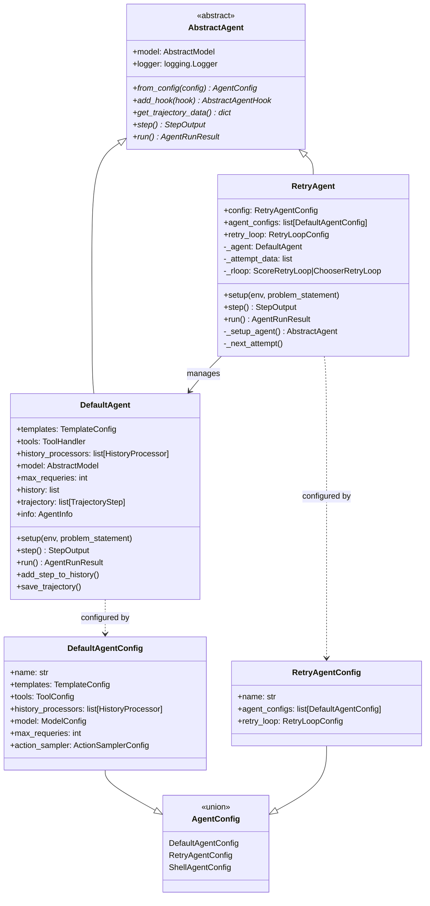
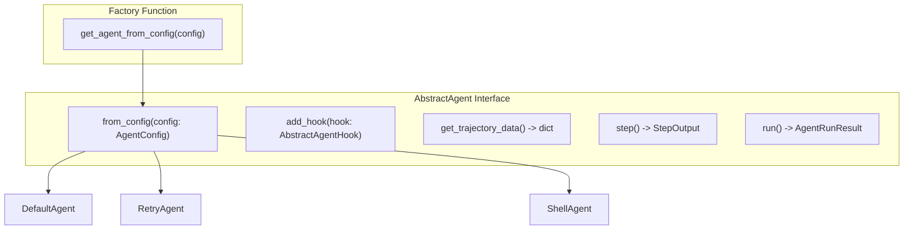
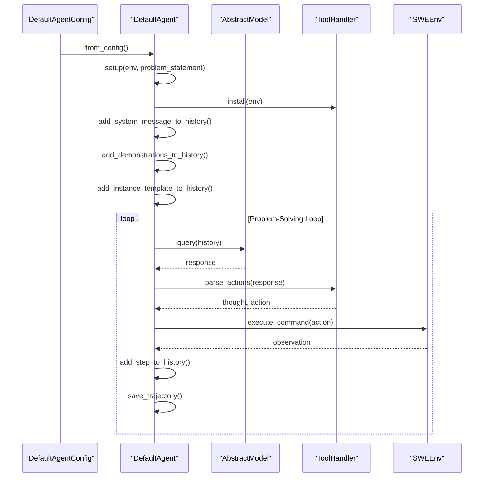
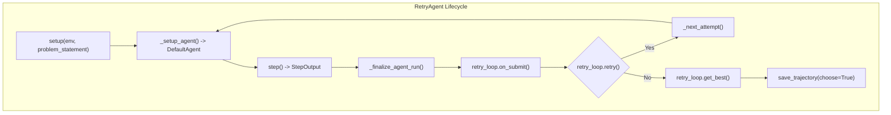
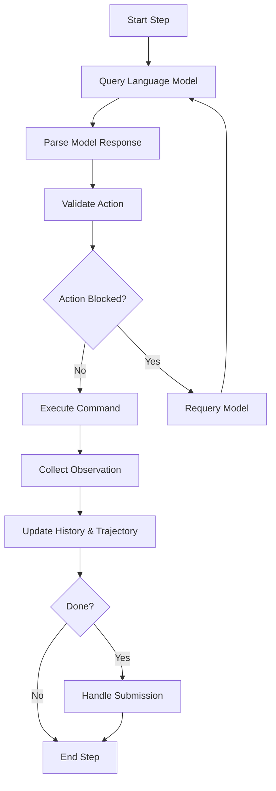
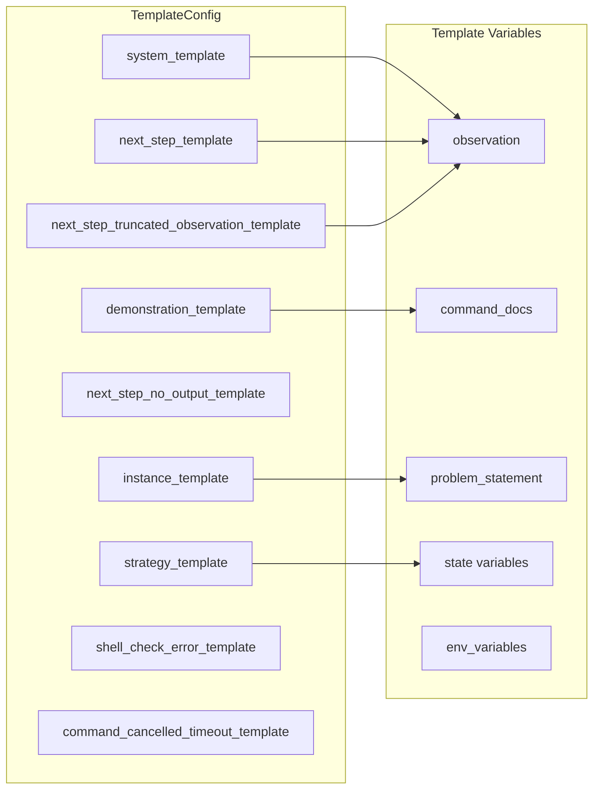
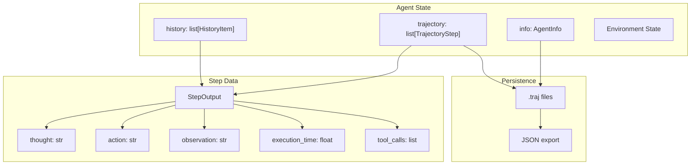
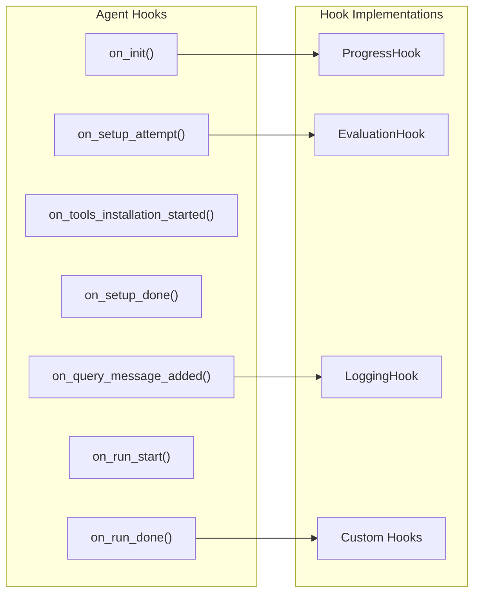

# Core Agent System

Relevant source files

The following files were used as context for generating this wiki page:

- [sweagent/agent/agents.py](sweagent/agent/agents.py)
- [sweagent/agent/models.py](sweagent/agent/models.py)
- [sweagent/agent/reviewer.py](sweagent/agent/reviewer.py)
- [sweagent/run/hooks/swe_bench_evaluate.py](sweagent/run/hooks/swe_bench_evaluate.py)
- [sweagent/types.py](sweagent/types.py)
- [tests/test_agent.py](tests/test_agent.py)
- [tests/test_batch_instance.py](tests/test_batch_instance.py)
- [tests/test_run_batch.py](tests/test_run_batch.py)
- [tests/test_run_single.py](tests/test_run_single.py)

The Core Agent System forms the central reasoning and execution engine of SWE-agent. This system defines the abstract agent interface, concrete agent implementations, and the complete agent execution lifecycle. It orchestrates interactions between language models, tools, and the execution environment to solve software engineering problems.

For information about language model integration and configuration, see [Models and Language Models](#3.2). For details on retry mechanisms and review loops, see [Retry and Review System](#3.3). For conversation and context management, see [History Management](#3.4). For tool system integration, see [Tool System](#6).

## Agent Architecture Overview

The Core Agent System is built around an abstract agent interface with multiple concrete implementations. The system supports both single-attempt problem solving and multi-attempt retry strategies.

**Sources:** [sweagent/agent/agents.py:224-255](), [sweagent/agent/agents.py:443-514](), [sweagent/agent/agents.py:257-284](), [sweagent/agent/agents.py:149-196]()

## Agent Types and Implementations

### AbstractAgent Interface

The `AbstractAgent` class defines the core interface that all agent implementations must follow. It establishes the contract for agent initialization, execution, and data retrieval.

**Sources:** [sweagent/agent/agents.py:224-240](), [sweagent/agent/agents.py:242-254]()

### DefaultAgent Implementation

The `DefaultAgent` class provides the primary agent implementation that handles single-attempt problem solving. It manages the complete interaction cycle between language models, tools, and the execution environment.

Key responsibilities include:
- **Setup and Initialization**: Environment configuration and template setup
- **Step Execution**: Single interaction steps with observation-action cycles  
- **History Management**: Maintaining conversation history and context
- **Tool Integration**: Parsing model outputs and executing commands
- **Trajectory Tracking**: Recording all interactions for analysis

**Sources:** [sweagent/agent/agents.py:443-514](), [sweagent/agent/agents.py:561-606](), [sweagent/agent/agents.py:914-1145]()

### RetryAgent Implementation

The `RetryAgent` class wraps multiple `DefaultAgent` instances to implement retry strategies with review mechanisms. It manages multiple problem-solving attempts and selects the best solution.

Key features include:
- **Multi-Attempt Management**: Coordinating multiple solution attempts
- **Agent Cycling**: Using different agent configurations for each attempt
- **Review Integration**: Scoring and selecting the best attempt
- **Cost Management**: Tracking cumulative costs across attempts
- **Environment Reset**: Preparing clean environments for each attempt

**Sources:** [sweagent/agent/agents.py:257-284](), [sweagent/agent/agents.py:303-327](), [sweagent/agent/agents.py:390-440]()

## Agent Execution Lifecycle

### Setup Phase

The agent setup phase prepares the environment and initializes the agent state for problem solving.

| Setup Component | Description | Configuration |
|-----------------|-------------|---------------|
| Environment Variables | Sets problem statement and tool configurations | `ProblemStatement.get_problem_statement_for_env()` |
| Tool Installation | Installs and configures available tools | `ToolHandler.install(env)` |
| System Message | Adds system prompt to conversation history | `TemplateConfig.system_template` |
| Demonstrations | Loads example trajectories if configured | `TemplateConfig.demonstrations` |
| Instance Template | Adds problem-specific prompt | `TemplateConfig.instance_template` |

**Sources:** [sweagent/agent/agents.py:561-606](), [sweagent/agent/agents.py:608-656]()

### Step Execution Cycle

Each step represents one complete interaction cycle with the language model and environment.

**Sources:** [sweagent/agent/agents.py:914-1145](), [sweagent/agent/agents.py:1146-1227]()

### Error Handling and Recovery

The agent system includes comprehensive error handling with automatic recovery mechanisms:

- **Format Errors**: Requery model when output cannot be parsed
- **Blocked Actions**: Requery when commands are on blocklist  
- **Syntax Errors**: Requery when bash commands have syntax issues
- **Timeout Errors**: Handle command timeouts and environment failures
- **Cost Limits**: Stop execution when cost limits are exceeded

**Sources:** [sweagent/agent/agents.py:788-821](), [sweagent/agent/agents.py:822-867]()

## Agent Configuration System

### Template Configuration

The `TemplateConfig` class manages all message templates used for agent-model communication.

**Sources:** [sweagent/agent/agents.py:60-147]()

### Agent Configuration Types

| Configuration Type | Purpose | Key Fields |
|-------------------|---------|------------|
| `DefaultAgentConfig` | Single-attempt agent setup | `templates`, `tools`, `model`, `history_processors` |
| `RetryAgentConfig` | Multi-attempt retry setup | `agent_configs`, `retry_loop`, `max_attempts` |
| `ShellAgentConfig` | Shell-focused agent variant | `templates`, `tools`, `model` (shell-optimized) |

**Sources:** [sweagent/agent/agents.py:149-196]()

## Agent-Environment Integration

### State Management

Agents maintain comprehensive state throughout execution:

**Sources:** [sweagent/agent/agents.py:481-483](), [sweagent/types.py:15-40](), [sweagent/types.py:42-74]()

### Hook System Integration

Agents support a hook system for extensibility and monitoring:

**Sources:** [sweagent/agent/agents.py:516-519](), [sweagent/agent/agents.py:485]()