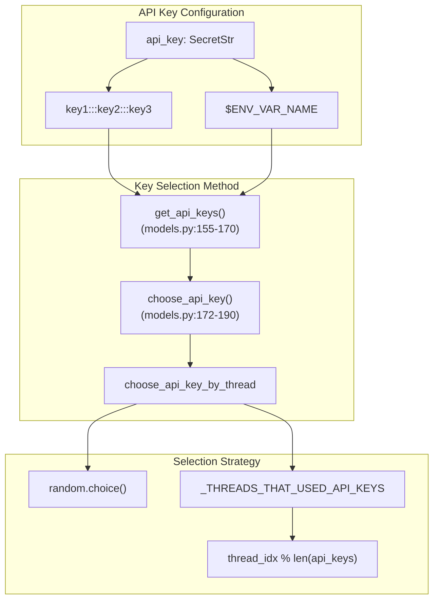
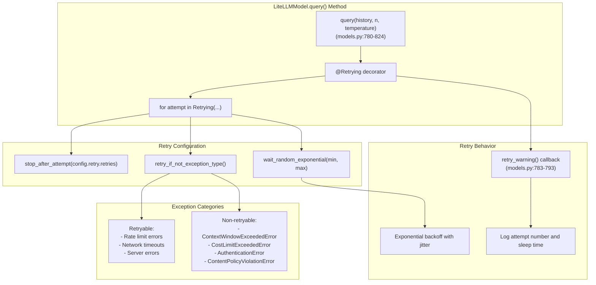
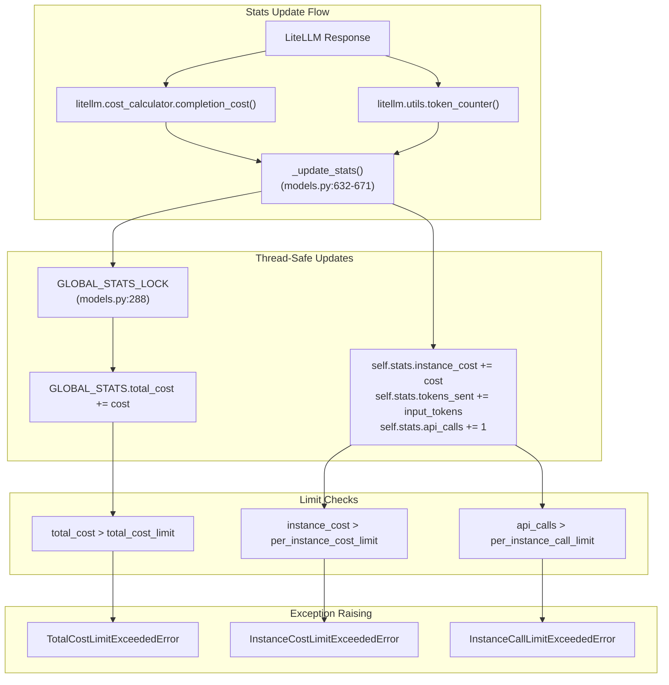
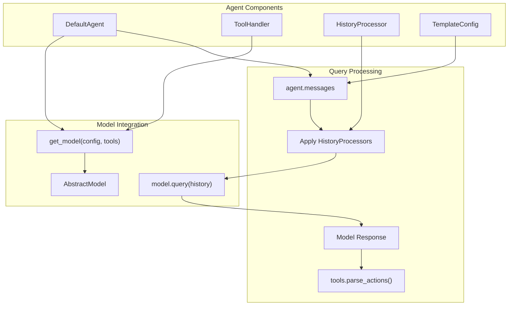

# Models and Language Models

<details>
<summary>Relevant source files</summary>

The following files were used as context for generating this wiki page:

- [.devcontainer/bashrc_epilog.sh](.devcontainer/bashrc_epilog.sh)
- [docs/config/models.md](docs/config/models.md)
- [docs/installation/keys.md](docs/installation/keys.md)
- [docs/usage/hello_world.md](docs/usage/hello_world.md)
- [sweagent/agent/agents.py](sweagent/agent/agents.py)
- [sweagent/agent/models.py](sweagent/agent/models.py)
- [sweagent/agent/reviewer.py](sweagent/agent/reviewer.py)
- [sweagent/types.py](sweagent/types.py)

</details>


This page documents the model system in SWE-agent, which provides a unified interface for interacting with various language models including API-based models (via LiteLLM), human interaction models, and specialized testing models. The system is built around the `ModelConfig` union type and the `get_model()` factory function, which handle query formatting, response parsing, cost tracking, and error handling for all language model interactions within the agent framework.

For information about how models integrate with the overall agent system, see [Core Agent System](#3.1). For details about retry mechanisms and review systems that use models, see [Retry and Review System](#3.3).

## Model Architecture Overview

The model system is built around the `AbstractModel` interface with multiple implementations controlled by the `ModelConfig` union type and instantiated through the `get_model()` factory function.

**Model System Architecture**

```mermaid
graph TB
    subgraph "Configuration Layer"
        ModelConfig["ModelConfig<br/>(Union Type)"]
        GenericAPIModelConfig["GenericAPIModelConfig"]
        ReplayModelConfig["ReplayModelConfig"]
        HumanModelConfig["HumanModelConfig"]
        HumanThoughtModelConfig["HumanThoughtModelConfig"]
        InstantEmptySubmitModelConfig["InstantEmptySubmitModelConfig"]
    end
    
    subgraph "Factory & Interface"
        get_model["get_model()<br/>(models.py:859-887)"]
        AbstractModel["AbstractModel<br/>(models.py:311-327)"]
        query_method["query(history) -> dict"]
        reset_stats["reset_stats()"]
        instance_cost_limit["instance_cost_limit"]
    end
    
    subgraph "Concrete Implementations"
        LiteLLMModel["LiteLLMModel<br/>(models.py:578-857)"]
        HumanModel["HumanModel<br/>(models.py:344-443)"]
        HumanThoughtModel["HumanThoughtModel<br/>(models.py:446-461)"]
        ReplayModel["ReplayModel<br/>(models.py:464-526)"]
        InstantEmptySubmitTestModel["InstantEmptySubmitTestModel<br/>(models.py:551-575)"]
    end
    
    subgraph "Usage Statistics"
        InstanceStats["InstanceStats<br/>(models.py:292-308)"]
        GlobalStats["GlobalStats<br/>(models.py:273-281)"]
        GLOBAL_STATS_LOCK["GLOBAL_STATS_LOCK"]
    end
    
    ModelConfig --> GenericAPIModelConfig
    ModelConfig --> ReplayModelConfig
    ModelConfig --> HumanModelConfig
    ModelConfig --> HumanThoughtModelConfig
    ModelConfig --> InstantEmptySubmitModelConfig
    
    get_model --> ModelConfig
    get_model --> AbstractModel
    
    AbstractModel --> query_method
    AbstractModel --> reset_stats
    AbstractModel --> instance_cost_limit
    
    LiteLLMModel --> AbstractModel
    HumanModel --> AbstractModel
    HumanThoughtModel --> AbstractModel
    ReplayModel --> AbstractModel
    InstantEmptySubmitTestModel --> AbstractModel
    
    LiteLLMModel --> InstanceStats
    HumanModel --> InstanceStats
    GlobalStats --> GLOBAL_STATS_LOCK
```


Sources: [sweagent/agent/models.py:263-270](), [sweagent/agent/models.py:859-887](), [sweagent/agent/models.py:311-327]()

## AbstractModel Interface

The `AbstractModel` class defines the core interface that all model implementations must follow. It provides methods for querying models and tracking usage statistics.

| Method | Purpose | Returns |
|--------|---------|---------|
| `query(history, action_prompt)` | Send a conversation history to the model | `dict` with model response |
| `reset_stats()` | Reset usage statistics for new instance | `None` |
| `instance_cost_limit` | Get cost limit for current instance | `float` |

The `query` method is the primary interface for model interaction, taking a `History` object (list of conversation messages) and returning a dictionary containing the model's response. All models must implement this method to provide consistent behavior across different model types.

```mermaid
graph LR
    subgraph "Input Processing"
        History["History<br/>(list[HistoryItem])"]
        format_messages["_history_to_messages()"]
        litellm_messages["LiteLLM Messages"]
    end
    
    subgraph "Model Query"
        single_query["_single_query()"]
        litellm_completion["litellm.completion()"]
        response["ModelResponse"]
    end
    
    subgraph "Response Processing"
        extract_content["Extract content & tool_calls"]
        update_stats["_update_stats()"]
        output_dict["dict[message, tool_calls]"]
    end
    
    History --> format_messages
    format_messages --> litellm_messages
    litellm_messages --> single_query
    single_query --> litellm_completion
    litellm_completion --> response
    response --> extract_content
    extract_content --> update_stats
    update_stats --> output_dict
```



Sources: [sweagent/agent/models.py:311-327](), [sweagent/agent/models.py:769-824]()

## LiteLLM Integration

The `LiteLLMModel` class provides the primary implementation for API-based language models using the LiteLLM library. This enables support for models from OpenAI, Anthropic, and other providers through a unified interface.

## GenericAPIModelConfig

The `GenericAPIModelConfig` class at [sweagent/agent/models.py:66-153]() provides the primary configuration for API-based language models, supporting extensive customization for LiteLLM integration.

### Core Configuration Options

| Configuration Option | Purpose | Default | Code Reference |
|---------------------|---------|---------|----------------|
| `name` | Model identifier (e.g., "gpt-4o", "claude-3-5-sonnet") | Required | [sweagent/agent/models.py:71]() |
| `temperature` | Sampling temperature | 0.0 | [sweagent/agent/models.py:79]() |
| `top_p` | Nucleus sampling parameter | 1.0 | [sweagent/agent/models.py:81]() |
| `per_instance_cost_limit` | Cost limit per problem instance | 3.0 | [sweagent/agent/models.py:73-76]() |
| `total_cost_limit` | Total cost limit across all instances | 0.0 | [sweagent/agent/models.py:77]() |
| `api_key` | API key (supports multiple keys separated by ":::") | None | [sweagent/agent/models.py:85-91]() |
| `completion_kwargs` | Additional parameters for litellm.completion | {} | [sweagent/agent/models.py:95-96]() |
| `max_input_tokens` | Override model's max input tokens | None | [sweagent/agent/models.py:125-131]() |
| `max_output_tokens` | Override model's max output tokens | None | [sweagent/agent/models.py:133-139]() |

### API Key Management

The configuration system supports multiple API keys for load balancing through the `choose_api_key()` method at [sweagent/agent/models.py:172-190](). It automatically chooses keys based on thread to maintain prompt caching effectiveness during batch processing via the `choose_api_key_by_thread` option.

**API Key Selection Logic**


Sources: [sweagent/agent/models.py:66-153](), [sweagent/agent/models.py:155-190](), [sweagent/agent/models.py:51-52]()

## Error Handling and Retry Logic

The `LiteLLMModel` implements comprehensive error handling with configurable retry logic through the `RetryConfig` class at [sweagent/agent/models.py:55-64]() and tenacity-based retry mechanism at [sweagent/agent/models.py:795-824]().

### RetryConfig Parameters

| Parameter | Purpose | Default | Code Reference |
|-----------|---------|---------|----------------|
| `retries` | Maximum number of retry attempts | 20 | [sweagent/agent/models.py:58]() |
| `min_wait` | Minimum wait time between retries (seconds) | 10 | [sweagent/agent/models.py:60]() |
| `max_wait` | Maximum wait time between retries (seconds) | 120 | [sweagent/agent/models.py:62]() |

**Retry Logic Implementation**


### Exception Mapping

The retry logic at [sweagent/agent/models.py:799-817]() categorizes exceptions into retryable and non-retryable types:

**Non-retryable exceptions** (immediate failure):
- `ContextWindowExceededError` - Input too long for model
- `CostLimitExceededError` - Budget exceeded  
- `AuthenticationError` - Invalid API credentials
- `ContentPolicyViolationError` - Request violates model policies
- `TypeError`, `IndexError` - Programming errors

**Retryable exceptions** (with exponential backoff):
- Rate limit errors from API providers
- Network timeouts and connection errors  
- Temporary server errors (5xx responses)

Sources: [sweagent/agent/models.py:55-64](), [sweagent/agent/models.py:780-824](), [sweagent/agent/models.py:799-817]()

## ModelConfig Union Type System

The system uses a `ModelConfig` union type defined at [sweagent/agent/models.py:263-270]() to support multiple specialized model configurations. The `get_model()` factory function at [sweagent/agent/models.py:859-887]() automatically instantiates the correct model class based on the configuration type.

### Configuration Type Mapping

| Config Type | Model Implementation | Purpose | Key Features |
|-------------|-------------------|---------|--------------|
| `GenericAPIModelConfig` | `LiteLLMModel` | Standard API models | Full LiteLLM support, cost tracking, retry logic |
| `ReplayModelConfig` | `ReplayModel` | Trajectory replay | Reads from `.traj` files, deterministic replay |
| `InstantEmptySubmitModelConfig` | `InstantEmptySubmitTestModel` | Testing | Immediate empty submission, configurable delay |
| `HumanModelConfig` | `HumanModel` | Human interaction | Interactive CLI input, readline history |
| `HumanThoughtModelConfig` | `HumanThoughtModel` | Human with thoughts | Structured thought+action input format |

**ModelConfig Factory Pattern**

```mermaid
graph LR
    subgraph "Configuration Input"
        config_yaml["YAML Config"]
        config_dict["Config Dict"]
    end
    
    subgraph "ModelConfig Union Resolution"
        pydantic_validation["Pydantic Validation<br/>(Field union_mode='left_to_right')"]
        config_type_detection["Config Type Detection<br/>(Based on 'name' field)"]
    end
    
    subgraph "Factory Function"
        get_model_func["get_model(args, tools)<br/>(models.py:859-887)"]
        type_checking["isinstance() checks"]
        model_instantiation["Model Class.__init__()"]
    end
    
    subgraph "Model Instances"
        concrete_model["AbstractModel instance"]
        tools_integration["tools.use_function_calling"]
        stats_initialization["InstanceStats()"]
    end
    
    config_yaml --> pydantic_validation
    config_dict --> pydantic_validation
    pydantic_validation --> config_type_detection
    config_type_detection --> get_model_func
    get_model_func --> type_checking
    type_checking --> model_instantiation
    model_instantiation --> concrete_model
    concrete_model --> tools_integration
    concrete_model --> stats_initialization
```


Sources: [sweagent/agent/models.py:263-270](), [sweagent/agent/models.py:859-887](), [sweagent/agent/models.py:862-887]()

## Alternative Model Implementations

### HumanModel

The `HumanModel` enables human-in-the-loop interaction, allowing users to manually provide actions through a CLI interface. It supports multi-line commands and maintains readline history for improved user experience.

Key features:
- Interactive command input with readline support
- Multi-line command handling for complex actions
- Command history persistence
- Special commands for testing (`spend_money`, `raise_*` commands)

### ReplayModel

The `ReplayModel` replays actions from previously recorded trajectories, useful for debugging and testing. It reads trajectory files and reissues the same sequence of actions.

### InstantEmptySubmitTestModel

A specialized testing model that immediately submits empty patches, useful for testing the submission pipeline without model costs.

Sources: [sweagent/agent/models.py:344-462](), [sweagent/agent/models.py:464-527](), [sweagent/agent/models.py:551-576]()

## Usage Statistics and Cost Management

The model system implements comprehensive usage tracking and cost management through the `InstanceStats` and `GlobalStats` classes, with thread-safe access and automatic limit enforcement.

### InstanceStats Class

The `InstanceStats` class at [sweagent/agent/models.py:292-308]() tracks usage for individual problem instances:

| Field | Purpose | Type |
|-------|---------|------|
| `instance_cost` | Total cost for the current instance | `float` |
| `tokens_sent` | Number of input tokens | `int` |
| `tokens_received` | Number of output tokens | `int` |
| `api_calls` | Number of API calls made | `int` |

The class supports arithmetic operations (`__add__`, `__sub__`) for combining stats across multiple attempts or models.

### GlobalStats and Thread Safety

The `GlobalStats` class at [sweagent/agent/models.py:273-281]() tracks usage across all instances with thread-safe access through `GLOBAL_STATS_LOCK` at [sweagent/agent/models.py:288-289]():

```python
# Global singleton instance
GLOBAL_STATS = GlobalStats()
GLOBAL_STATS_LOCK = Lock()
```

**Cost Tracking and Limit Enforcement**


### Cost Limit Enforcement

The `_update_stats()` method at [sweagent/agent/models.py:632-671]() enforces three types of limits:

1. **Total Cost Limit** - Enforced across all instances globally
2. **Per-Instance Cost Limit** - Enforced per problem instance  
3. **Per-Instance Call Limit** - Enforced per problem instance

When limits are exceeded, appropriate exceptions are raised to stop execution and prevent runaway costs.

Sources: [sweagent/agent/models.py:292-308](), [sweagent/agent/models.py:273-289](), [sweagent/agent/models.py:632-671]()

## Integration with Agent Framework

Models integrate tightly with the agent framework through the `DefaultAgent` class, which coordinates model queries with tool execution and history management.

### Model-Agent Integration Flow



The agent's `forward()` method orchestrates the complete model query cycle, handling errors and retries as needed. Function calling support is automatically configured based on the tool configuration.

Sources: [sweagent/agent/agents.py:502-514](), [sweagent/agent/agents.py:1005-1058]()