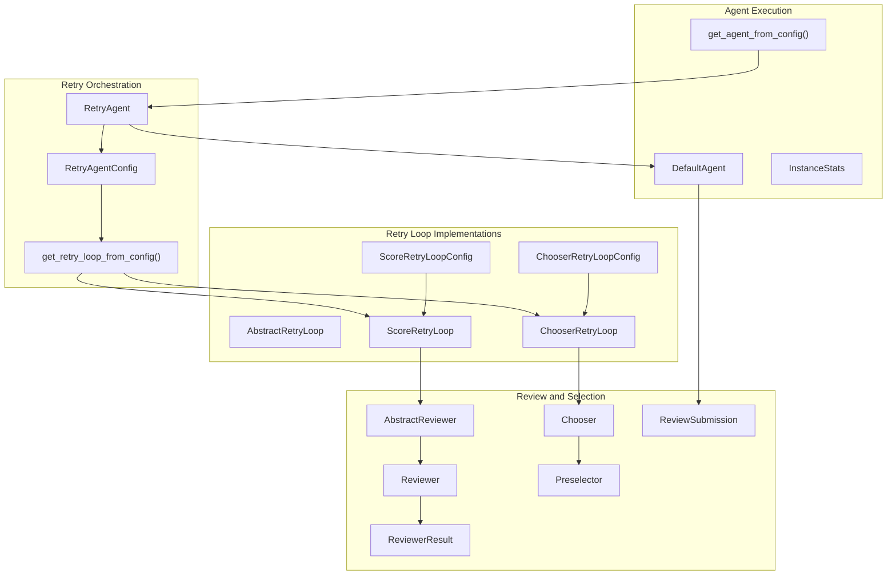
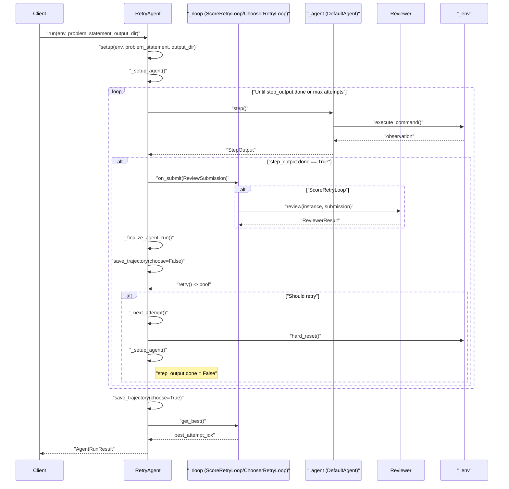
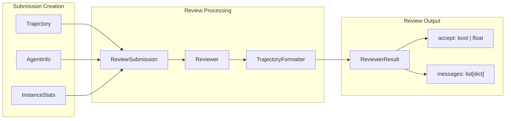
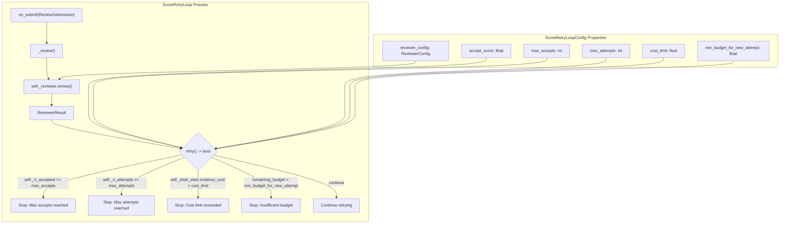
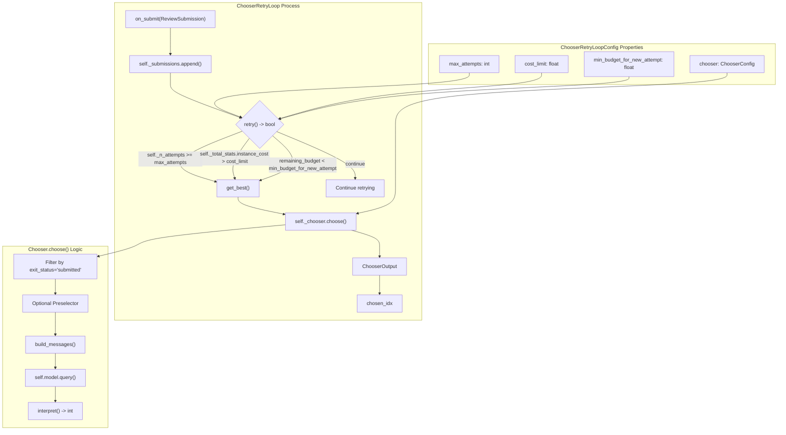
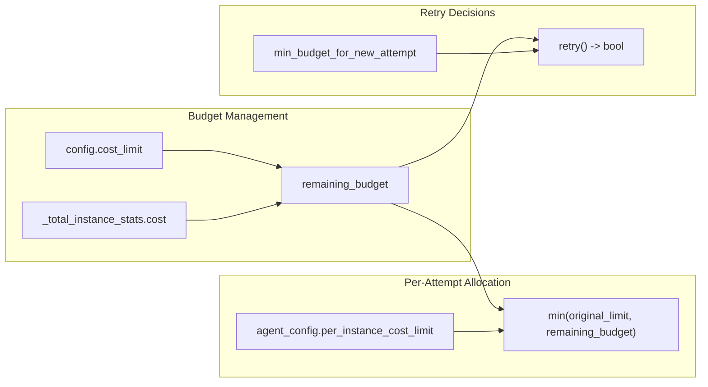
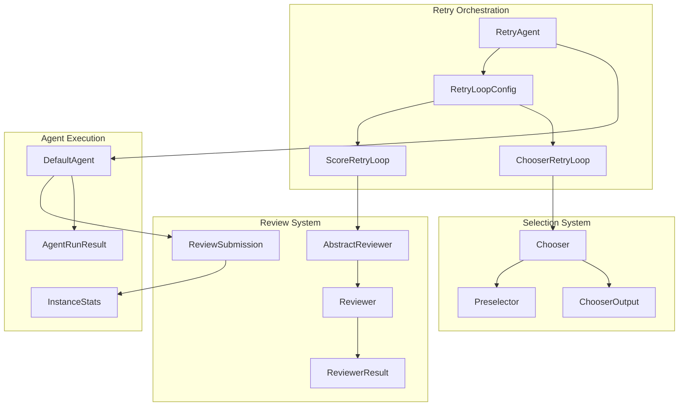
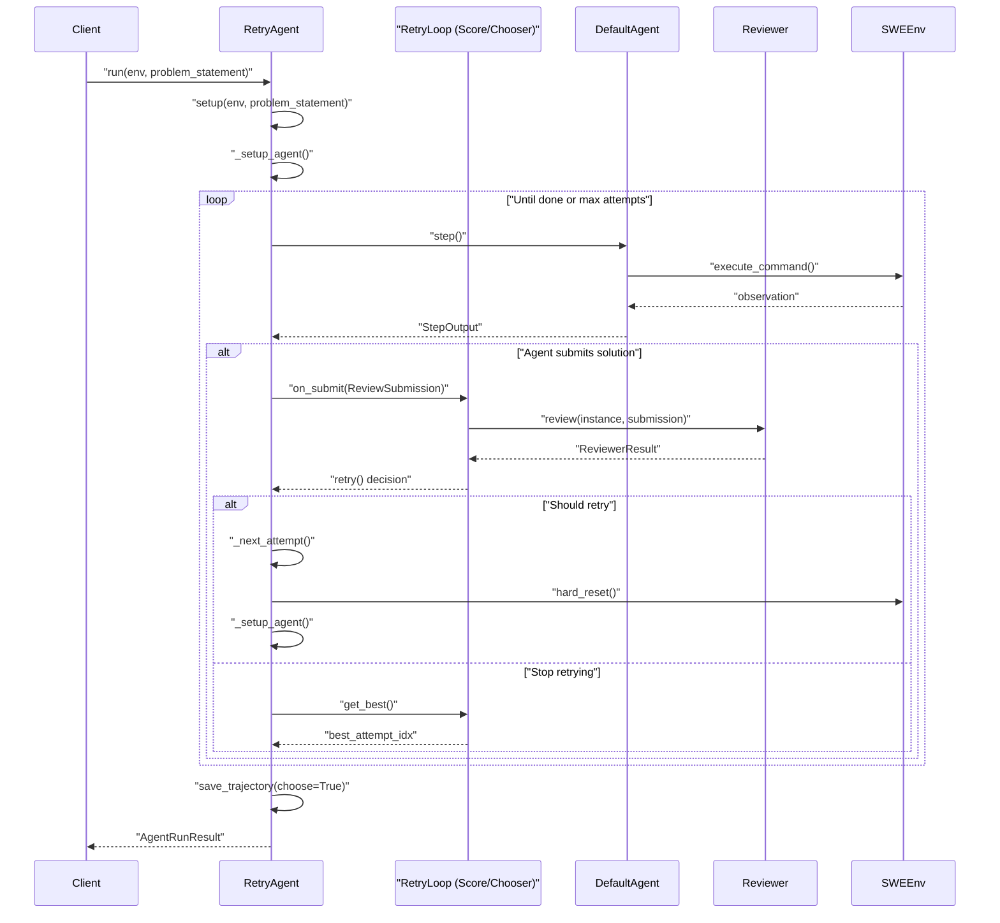
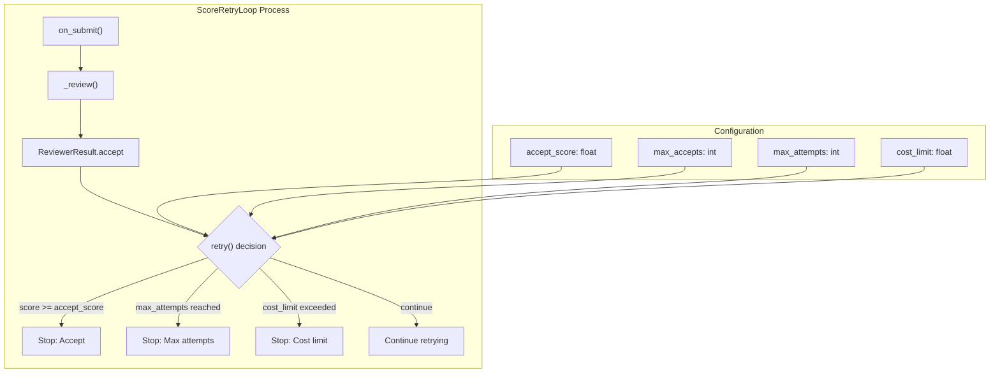
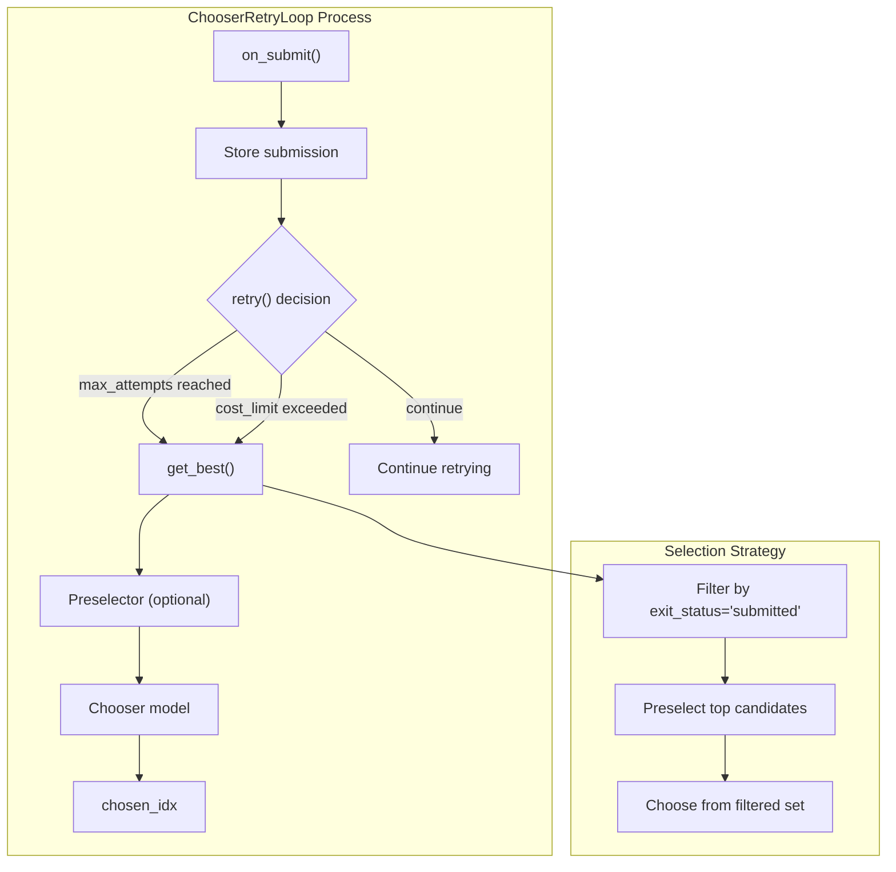

# Retry and Review System

<details>
<summary>Relevant source files</summary>

The following files were used as context for generating this wiki page:

- [sweagent/agent/agents.py](sweagent/agent/agents.py)
- [sweagent/agent/models.py](sweagent/agent/models.py)
- [sweagent/agent/reviewer.py](sweagent/agent/reviewer.py)
- [sweagent/types.py](sweagent/types.py)

</details>


## Purpose and Scope

The Retry and Review System provides SWE-agent with the ability to make multiple attempts at solving a problem and automatically evaluate and select the best solution. This system orchestrates retry loops, manages cost budgets across attempts, and implements sophisticated review mechanisms to assess solution quality.

For information about single-run execution without retries, see [Single Run Execution](#5.1). For details about the core agent implementations used within retry attempts, see [Core Agent System](#3.1).

## Core Components Overview

### System Architecture



**Sources:** [sweagent/agent/agents.py:188-194](), [sweagent/agent/reviewer.py:661-664](), [sweagent/agent/agents.py:242-254]()

### Key Classes and Interfaces

| Component | Class/Function | Purpose | Location |
|-----------|----------------|---------|----------|
| **Retry Orchestration** | `RetryAgent` | Primary orchestrator for multi-attempt execution | [sweagent/agent/agents.py:257-441]() |
| **Agent Factory** | `get_agent_from_config()` | Creates agents based on config type | [sweagent/agent/agents.py:242-254]() |
| **Retry Logic Interface** | `AbstractRetryLoop` | Abstract interface for retry decision making | [sweagent/agent/reviewer.py:91-123]() |
| **Score-based Retry** | `ScoreRetryLoop` | Numerical scoring-based retry decisions | [sweagent/agent/reviewer.py:559-658]() |
| **Selection-based Retry** | `ChooserRetryLoop` | Model-based selection of best attempt | [sweagent/agent/reviewer.py:499-556]() |
| **Review Interface** | `AbstractReviewer` | Abstract interface for solution evaluation | [sweagent/agent/reviewer.py:81-89]() |
| **Review Implementation** | `Reviewer` | Template-based solution reviewer | [sweagent/agent/reviewer.py:375-449]() |
| **Selection Logic** | `Chooser` | Model-based selection between multiple submissions | [sweagent/agent/reviewer.py:292-372]() |

**Sources:** [sweagent/agent/agents.py:257-441](), [sweagent/agent/reviewer.py:91-123](), [sweagent/agent/reviewer.py:375-449]()

## Retry Agent Architecture

The `RetryAgent` serves as the primary orchestrator for multi-attempt problem solving. It manages the lifecycle of individual attempts and coordinates with review systems to determine retry decisions.

### RetryAgent Execution Flow



**Sources:** [sweagent/agent/agents.py:390-441](), [sweagent/agent/agents.py:321-327](), [sweagent/agent/agents.py:413-432]()

### Attempt Management

The `RetryAgent` maintains state across multiple attempts through several key mechanisms:

| Mechanism | Implementation | Purpose |
|-----------|----------------|---------|
| **Attempt Data Storage** | `self._attempt_data: list[dict[str, Any]]` | Stores trajectory and metadata for each attempt |
| **Cost Tracking** | `self._total_instance_attempt_stats: InstanceStats` | Cumulative cost tracking across attempts |
| **Environment Reset** | `self._env.hard_reset()` | Resets environment state between attempts |
| **Agent Configuration** | `self.config.agent_configs[self._i_attempt % len(self.config.agent_configs)]` | Cycles through different agent configurations |
| **Attempt Counter** | `self._i_attempt: int` | Tracks current attempt number |

#### State Management Methods

| Method | Purpose | Key Operations |
|--------|---------|----------------|
| **`_setup_agent()`** | Initializes agent for current attempt with budget allocation | Creates `DefaultAgent`, sets cost limits, configures output directory |
| **`_next_attempt()`** | Prepares for next attempt | Increments `_i_attempt`, calls `hard_reset()`, calls `_setup_agent()` |
| **`_finalize_agent_run()`** | Saves attempt data and accumulates statistics | Calls `save_trajectory()`, appends to `_attempt_data`, updates `_total_instance_attempt_stats` |

#### Dynamic Budget Allocation

```python
# From _setup_agent() method
remaining_budget = self.config.retry_loop.cost_limit - self._total_instance_stats.instance_cost
if remaining_budget < agent_config.model.per_instance_cost_limit:
    agent_config.model.per_instance_cost_limit = remaining_budget
```

**Sources:** [sweagent/agent/agents.py:258-276](), [sweagent/agent/agents.py:303-327](), [sweagent/agent/agents.py:351-357](), [sweagent/agent/agents.py:307-311]()

## Review and Evaluation System

The review system evaluates solution quality and determines whether attempts should be accepted or rejected. It supports multiple evaluation strategies through configurable reviewers.

### Review Submission Process



**Sources:** [sweagent/agent/reviewer.py:30-38](), [sweagent/agent/reviewer.py:59-63](), [sweagent/agent/reviewer.py:375-449]()

### Reviewer Configuration and Templates

The `Reviewer` class uses configurable templates to format prompts for evaluation:

- **System Template**: Defines the reviewer's role and evaluation criteria
- **Instance Template**: Formats the problem statement and submission details
- **Trajectory Formatter**: Filters and formats execution traces for review
- **Score Interpretation**: Extracts numerical scores from reviewer responses

**Sources:** [sweagent/agent/reviewer.py:157-178](), [sweagent/agent/reviewer.py:400-414](), [sweagent/agent/reviewer.py:455-496]()

## Retry Loop Implementations

Two primary retry loop implementations provide different strategies for managing multiple attempts:

### ScoreRetryLoop

The `ScoreRetryLoop` uses numerical scoring to evaluate submissions and decide on retries:



#### Score Evaluation Logic

The `ScoreRetryLoop` maintains several key properties for decision making:

- **`self._n_accepted`**: Count of submissions scoring >= `accept_score`
- **`self._total_stats`**: Combined costs of all attempts plus review model costs
- **`self._reviews`**: List of `ReviewerResult` objects from all reviews

**Sources:** [sweagent/agent/reviewer.py:559-658](), [sweagent/agent/reviewer.py:200-235](), [sweagent/agent/reviewer.py:617-645]()

### ChooserRetryLoop

The `ChooserRetryLoop` defers selection to the end and uses a chooser model to pick the best attempt:



#### Chooser Selection Strategy

The `Chooser` implements a multi-stage selection process:

1. **Exit Status Filtering**: Prefers submissions with `exit_status='submitted'` when ≥2 exist
2. **Optional Preselection**: `Preselector` can reduce candidate set before final choice
3. **Model-based Selection**: Uses configured model to choose from filtered candidates
4. **Fallback Logic**: Handles edge cases with invalid responses or indices

**Sources:** [sweagent/agent/reviewer.py:499-556](), [sweagent/agent/reviewer.py:180-198](), [sweagent/agent/reviewer.py:292-372](), [sweagent/agent/reviewer.py:329-372]()

## Cost Management and Budgeting

The retry system implements sophisticated cost tracking and budget allocation across attempts:

### Cost Limit Enforcement

Cost limits are enforced at multiple levels through the following mechanisms:

| Level | Implementation | Location |
|-------|----------------|----------|
| **Total Cost Limit** | `config.retry_loop.cost_limit` | Maximum budget for all attempts combined |
| **Per-Attempt Limits** | Dynamic adjustment based on remaining budget | Individual attempt budgets are recalculated |
| **Minimum Budget Checks** | `min_budget_for_new_attempt` | Ensures sufficient budget remains for new attempts |
| **Review Cost Inclusion** | `review_model_stats` | Review costs tracked separately but included in totals |

#### Cost Enforcement Logic

#### Dynamic Budget Allocation in RetryAgent

```python
# From RetryAgent._setup_agent() method
remaining_budget = self.config.retry_loop.cost_limit - self._total_instance_stats.instance_cost
if remaining_budget < agent_config.model.per_instance_cost_limit:
    self.logger.debug("Setting agent per-attempt cost limit to remaining budget: %s", remaining_budget)
    agent_config.model.per_instance_cost_limit = remaining_budget
```

#### Retry Decision Cost Checks

Both retry loop implementations perform cost checks in their `retry()` methods:

```python
# ScoreRetryLoop and ChooserRetryLoop
remaining_budget = self._config.cost_limit - self._total_stats.instance_cost
if self._config.min_budget_for_new_attempt > 0 and remaining_budget < self._config.min_budget_for_new_attempt:
    return False  # Stop retrying
```

#### Cost Tracking Properties

- **`self._total_instance_stats`**: Property that combines attempt costs and review costs
- **`self._total_instance_attempt_stats`**: Direct attempt costs only
- **`self._rloop.review_model_stats`**: Review-specific model costs

**Sources:** [sweagent/agent/agents.py:307-311](), [sweagent/agent/reviewer.py:621-643](), [sweagent/agent/reviewer.py:536-544](), [sweagent/agent/agents.py:278-281]()

### Budget Allocation Strategy



**Sources:** [sweagent/agent/agents.py:301-304](), [sweagent/agent/reviewer.py:536-544]()

## Configuration and Setup

### RetryAgentConfig Structure

The retry system is configured through the `RetryAgentConfig` which specifies:

```python
class RetryAgentConfig(BaseModel):
    name: str = "retry_main"
    agent_configs: list[DefaultAgentConfig]
    retry_loop: RetryLoopConfig  # ScoreRetryLoopConfig | ChooserRetryLoopConfig
    type: Literal["retry"] = "retry"
```

Key configuration components:

- **`agent_configs`**: List of `DefaultAgentConfig` objects to cycle through attempts
- **`retry_loop`**: Either `ScoreRetryLoopConfig` or `ChooserRetryLoopConfig`
- **`type`**: Literal `"retry"` for proper factory instantiation

**Sources:** [sweagent/agent/agents.py:188-194](), [sweagent/agent/reviewer.py:237]()

### Retry Loop Configuration Types

#### ScoreRetryLoopConfig

```python
class ScoreRetryLoopConfig(BaseModel):
    type: Literal["score"] = "score"
    reviewer_config: ReviewerConfig
    accept_score: float
    max_accepts: int = 1
    max_attempts: int
    cost_limit: float
    min_budget_for_new_attempt: float = 0.0
    model: ModelConfig  # For the reviewer
```

#### ChooserRetryLoopConfig

```python
class ChooserRetryLoopConfig(BaseModel):
    type: Literal["chooser"] = "chooser"
    chooser: ChooserConfig
    max_attempts: int
    cost_limit: float
    min_budget_for_new_attempt: float = 0.0
```

**Sources:** [sweagent/agent/reviewer.py:200-235](), [sweagent/agent/reviewer.py:180-198]()

### Integration with Run System

#### Agent Factory Logic

```python
def get_agent_from_config(config: AgentConfig) -> AbstractAgent:
    if config.type == "default":
        return DefaultAgent.from_config(config)
    elif config.type == "retry":
        return RetryAgent.from_config(config)
    elif config.type == "shell":
        from sweagent.agent.extra.shell_agent import ShellAgent
        return ShellAgent.from_config(config)
```

#### Retry Loop Factory

```python
def get_retry_loop_from_config(
    config: RetryLoopConfig, problem_statement: ProblemStatement
) -> ScoreRetryLoop | ChooserRetryLoop:
    return config.get_retry_loop(problem_statement=problem_statement)
```

#### Integration Points

| Integration Point | Implementation | Purpose |
|------------------|----------------|---------|
| **Factory Pattern** | `get_agent_from_config()` | Creates agents based on `config.type` |
| **Hook System** | `self._chook: CombinedAgentHook` | Supports same hook system as `DefaultAgent` |
| **Trajectory Management** | `get_trajectory_data(choose=bool)` | Enhanced `.traj` files with attempt metadata |
| **Result Selection** | `save_trajectory(choose=True)` | Final results reflect chosen best attempt |

**Sources:** [sweagent/agent/agents.py:242-254](), [sweagent/agent/reviewer.py:661-664](), [sweagent/agent/agents.py:358-383](), [sweagent/agent/agents.py:385-389]()

# Retry and Review System

## Purpose and Scope

The Retry and Review System provides SWE-agent with the ability to make multiple attempts at solving a problem and automatically evaluate and select the best solution. This system orchestrates retry loops, manages cost budgets across attempts, and implements sophisticated review mechanisms to assess solution quality.

For information about single-run execution without retries, see [Single Run Execution](#5.1). For details about the core agent implementations used within retry attempts, see [Core Agent System](#3.1).

## Core Components Overview

The retry and review system consists of several interconnected components that work together to enable multi-attempt problem solving:



**Sources:** [sweagent/agent/agents.py:182-190](), [sweagent/agent/reviewer.py:30-77](), [sweagent/agent/reviewer.py:200-237]()

## Retry Agent Architecture

The `RetryAgent` serves as the primary orchestrator for multi-attempt problem solving. It manages the lifecycle of individual attempts and coordinates with review systems to determine retry decisions.

### RetryAgent Execution Flow



**Sources:** [sweagent/agent/agents.py:384-435](), [sweagent/agent/agents.py:315-343]()

### Attempt Management

The `RetryAgent` maintains state across multiple attempts through several key mechanisms:

- **Attempt Data Storage**: Each attempt's trajectory and metadata are stored in `_attempt_data`
- **Cost Tracking**: Cumulative costs are tracked via `_total_instance_attempt_stats`
- **Environment Reset**: The environment is reset between attempts using `hard_reset()`
- **Agent Configuration**: Different agent configurations can be cycled through attempts

**Sources:** [sweagent/agent/agents.py:252-270](), [sweagent/agent/agents.py:315-320]()

## Review and Evaluation System

The review system evaluates solution quality and determines whether attempts should be accepted or rejected. It supports multiple evaluation strategies through configurable reviewers.

### Review Submission Process


**Sources:** [sweagent/agent/reviewer.py:30-38](), [sweagent/agent/reviewer.py:59-63](), [sweagent/agent/reviewer.py:375-449]()

### Reviewer Configuration and Templates

The `Reviewer` class uses configurable templates to format prompts for evaluation:

- **System Template**: Defines the reviewer's role and evaluation criteria
- **Instance Template**: Formats the problem statement and submission details
- **Trajectory Formatter**: Filters and formats execution traces for review
- **Score Interpretation**: Extracts numerical scores from reviewer responses

**Sources:** [sweagent/agent/reviewer.py:157-178](), [sweagent/agent/reviewer.py:400-414](), [sweagent/agent/reviewer.py:455-496]()

## Retry Loop Implementations

Two primary retry loop implementations provide different strategies for managing multiple attempts:

### ScoreRetryLoop

The `ScoreRetryLoop` uses numerical scoring to evaluate submissions and decide on retries:



**Sources:** [sweagent/agent/reviewer.py:559-658](), [sweagent/agent/reviewer.py:200-235]()

### ChooserRetryLoop

The `ChooserRetryLoop` defers selection to the end and uses a chooser model to pick the best attempt:



**Sources:** [sweagent/agent/reviewer.py:499-556](), [sweagent/agent/reviewer.py:180-198](), [sweagent/agent/reviewer.py:292-372]()

## Cost Management and Budgeting

The retry system implements sophisticated cost tracking and budget allocation across attempts:

### Cost Limit Enforcement

Cost limits are enforced at multiple levels:

1. **Total Cost Limit**: Maximum budget for all attempts combined
2. **Per-Attempt Limits**: Individual attempt budgets are dynamically adjusted
3. **Minimum Budget Checks**: Ensures sufficient budget remains for new attempts
4. **Review Cost Inclusion**: Review costs are tracked separately but included in totals

**Sources:** [sweagent/agent/agents.py:300-304](), [sweagent/agent/reviewer.py:621-643](), [sweagent/agent/reviewer.py:524-544]()

### Budget Allocation Strategy


**Sources:** [sweagent/agent/agents.py:301-304](), [sweagent/agent/reviewer.py:536-544]()

## Configuration and Setup

### RetryAgentConfig Structure

The retry system is configured through the `RetryAgentConfig` which specifies:

- **Agent Configurations**: List of `DefaultAgentConfig` objects to cycle through
- **Retry Loop Configuration**: Either `ScoreRetryLoopConfig` or `ChooserRetryLoopConfig`
- **Type Specification**: Literal type identifier for proper instantiation

**Sources:** [sweagent/agent/agents.py:182-188](), [sweagent/agent/agents.py:236-248]()

### Integration with Run System

The retry agent integrates with the broader SWE-agent execution system:

1. **Factory Pattern**: `get_agent_from_config()` creates appropriate agent instances
2. **Hook System**: Retry agents support the same hook system as regular agents
3. **Trajectory Management**: Enhanced trajectory files include attempt metadata
4. **Result Selection**: Final results reflect the chosen best attempt

**Sources:** [sweagent/agent/agents.py:236-248](), [sweagent/agent/agents.py:352-377](), [sweagent/agent/agents.py:379-383]()