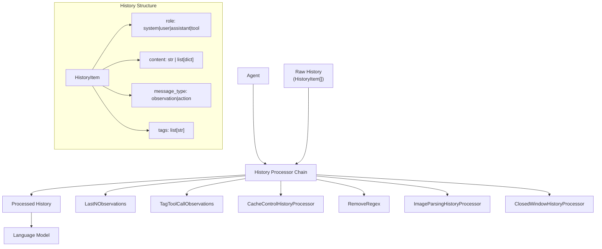
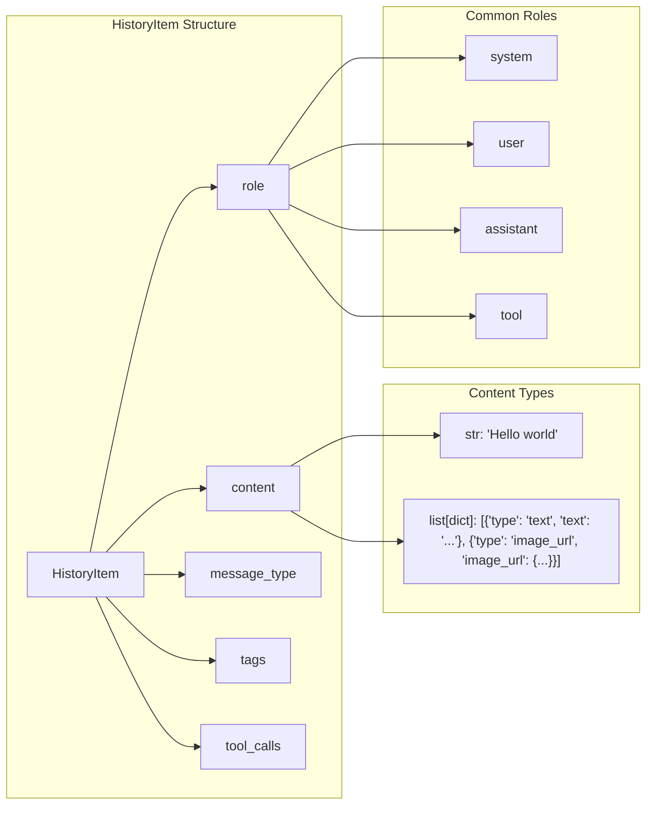
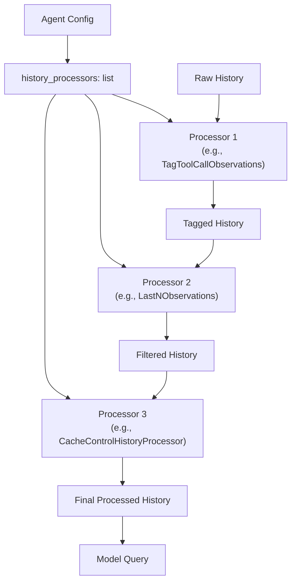
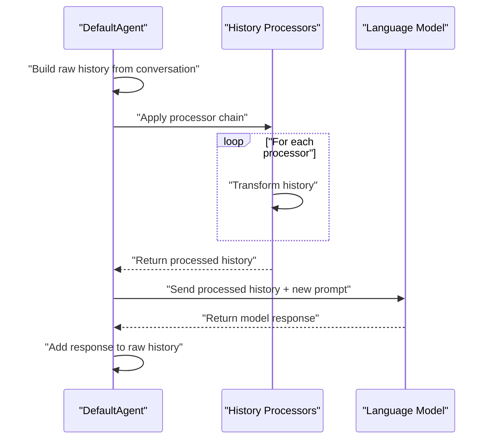

# History Management

<details>
<summary>Relevant source files</summary>

The following files were used as context for generating this wiki page:

- [sweagent/agent/agents.py](sweagent/agent/agents.py)
- [sweagent/agent/models.py](sweagent/agent/models.py)
- [sweagent/agent/reviewer.py](sweagent/agent/reviewer.py)
- [sweagent/types.py](sweagent/types.py)

</details>


The History Management system controls how conversation context is processed and maintained throughout agent execution. This system filters, transforms, and optimizes the conversation history before sending it to language models, enabling efficient context management for long-running agent sessions.

For information about agent execution lifecycle, see [Core Agent System](#3.1). For model configuration and API settings, see [Models and Language Models](#3.2).

## Purpose and Architecture

The history management system processes the conversation history between agents, tools, and the environment before each language model query. History processors can reduce context length, add metadata, optimize caching, and handle multimodal content to ensure efficient and effective agent-environment interactions.



**History Flow and Processing Chain**

Sources: [sweagent/agent/history_processors.py:1-400](), [sweagent/types.py]()

## Core Data Structures

The system operates on `History` objects, which are lists of `HistoryItem` dictionaries. Each history item represents one turn in the conversation with specific roles and metadata.

| Field | Type | Description |
|-------|------|-------------|
| `role` | `str` | Message role: `system`, `user`, `assistant`, or `tool` |
| `content` | `str \| list[dict]` | Message content, either plain text or multimodal content |
| `message_type` | `str` | Optional type: `observation`, `action`, `system_prompt` |
| `tags` | `list[str]` | Optional tags for filtering and processing |
| `tool_calls` | `list[dict]` | Function calls made by the agent |



**HistoryItem Data Structure and Content Types**

Sources: [sweagent/agent/history_processors.py:23-51](), [sweagent/types.py]()

## Available History Processors

### DefaultHistoryProcessor

The `DefaultHistoryProcessor` performs no modifications and returns the history unchanged. It serves as the base case when no history processing is needed.

```yaml
agent:
  history_processors:
    - type: default
```

Sources: [sweagent/agent/history_processors.py:74-82]()

### LastNObservations

The `LastNObservations` processor maintains only the last N observations to control context length. This was the classic approach used in the original SWE-agent paper to manage long conversations by eliding older observations.

```yaml
agent:
  history_processors:
    - type: last_n_observations
      n: 5
      polling: 1
      always_remove_output_for_tags: ["remove_output"]
      always_keep_output_for_tags: ["keep_output"]
```

| Parameter | Type | Default | Description |
|-----------|------|---------|-------------|
| `n` | `int` | Required | Number of observations to keep |
| `polling` | `int` | `1` | Steps between updates for caching optimization |
| `always_remove_output_for_tags` | `set[str]` | `{"remove_output"}` | Force removal for tagged observations |
| `always_keep_output_for_tags` | `set[str]` | `{"keep_output"}` | Force retention for tagged observations |

Elided observations are replaced with summary messages like `"Old environment output: (n lines omitted)"`.

Sources: [sweagent/agent/history_processors.py:85-176]()

### TagToolCallObservations

The `TagToolCallObservations` processor adds tags to history items based on tool call patterns. This enables selective processing of specific tool interactions.

```yaml
agent:
  history_processors:
    - type: tag_tool_call_observations
      tags: ["keep_output"]
      function_names: ["edit", "search_file"]
```

Sources: [sweagent/agent/history_processors.py:179-212]()

### CacheControlHistoryProcessor

The `CacheControlHistoryProcessor` adds Anthropic Claude cache control markers to optimize API costs and response times through prompt caching.

```yaml
agent:
  history_processors:
    - type: cache_control
      last_n_messages: 2
      last_n_messages_offset: 0
      tagged_roles: ["user", "tool"]
```

Sources: [sweagent/agent/history_processors.py:261-302]()

### RemoveRegex

The `RemoveRegex` processor removes content matching specified regex patterns, useful for cleaning up verbose outputs or removing sensitive information.

```yaml
agent:
  history_processors:
    - type: remove_regex
      remove: ["<diff>.*</diff>"]
      keep_last: 2
```

Sources: [sweagent/agent/history_processors.py:305-337]()

### ImageParsingHistoryProcessor

The `ImageParsingHistoryProcessor` converts embedded base64 images from markdown format to multimodal message format for vision-capable models.

```yaml
agent:
  history_processors:
    - type: image_parsing
      allowed_mime_types: ["image/png", "image/jpeg", "image/webp"]
```

Sources: [sweagent/agent/history_processors.py:340-387]()

## Processor Chain Configuration

History processors are configured as a list in the agent configuration and are applied sequentially in the order specified.



**Sequential History Processor Chain Execution**

The configuration uses Pydantic discriminated unions for type-safe processor selection:

```python
HistoryProcessor = Annotated[
    DefaultHistoryProcessor
    | LastNObservations  
    | ClosedWindowHistoryProcessor
    | TagToolCallObservations
    | CacheControlHistoryProcessor
    | RemoveRegex
    | ImageParsingHistoryProcessor,
    Field(discriminator="type"),
]
```

Sources: [sweagent/agent/history_processors.py:390-399](), [tests/test_data/trajectories/gpt4__swe-agent-test-repo__default_from_url__t-0.00__p-0.95__c-3.00__install-1/args.yaml:302-307]()

## Integration with Agent Execution

History processors are invoked by the agent before each language model query. The processed history maintains the conversation structure while optimizing for context length, caching, and content filtering.



**History Processing in Agent Query Cycle**

Example trajectory structure showing how history items flow through the system:

```json
{
  "history": [
    {
      "role": "system",
      "content": "SETTING: You are an autonomous programmer...",
      "message_type": "system_prompt"
    },
    {
      "role": "user", 
      "content": "We're currently solving the following issue...",
      "message_type": "observation"
    },
    {
      "role": "assistant",
      "content": "I'll start by examining the file...",
      "action": "find_file missing_colon.py",
      "message_type": "action"
    }
  ]
}
```

Sources: [sweagent/agent/history_processors.py:13-16](), [tests/test_data/trajectories/gpt4__swe-agent-test-repo__default_from_url__t-0.00__p-0.95__c-3.00__install-1/6e44b9__sweagenttestrepo-1c2844.traj:60-180]()

## Utility Functions

The history processors module provides several utility functions for manipulating history content:

| Function | Purpose |
|----------|---------|
| `_get_content_stats()` | Extract line count and image count from history entries |
| `_get_content_text()` | Extract text content from multimodal entries |
| `_set_content_text()` | Update text content in multimodal entries |
| `_clear_cache_control()` | Remove cache control metadata |
| `_set_cache_control()` | Add Anthropic cache control markers |

Sources: [sweagent/agent/history_processors.py:23-68]()