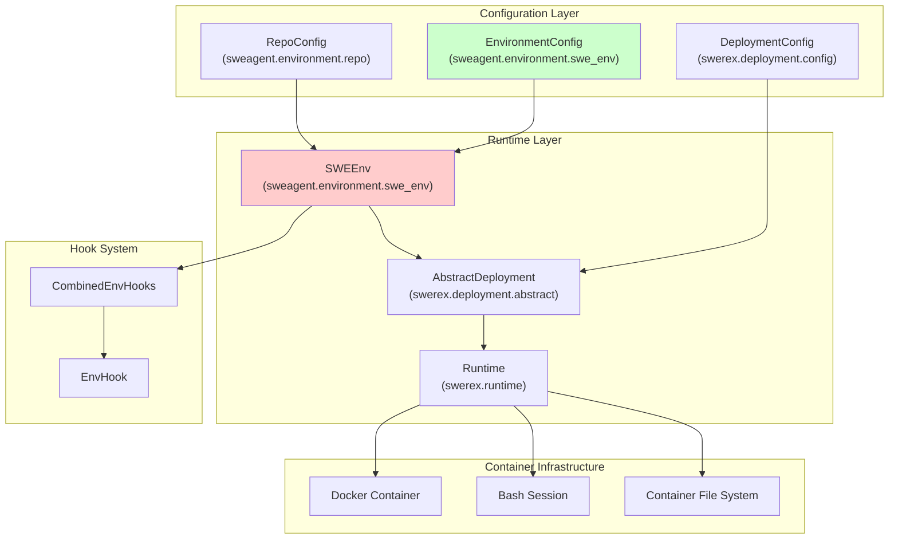
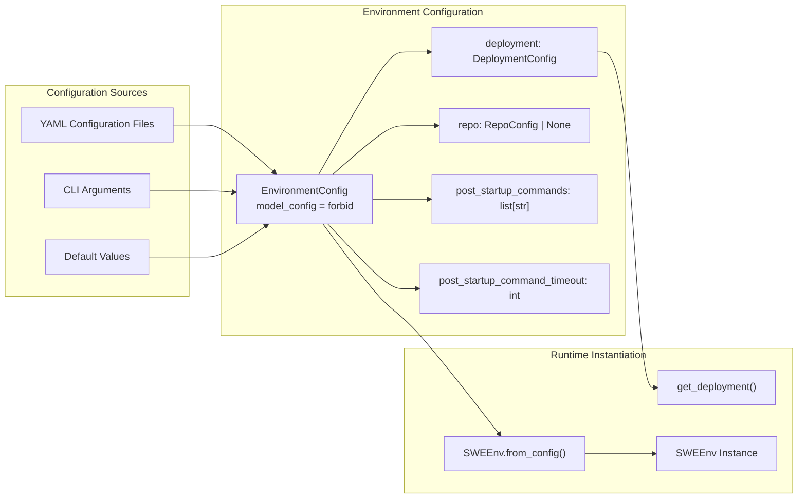
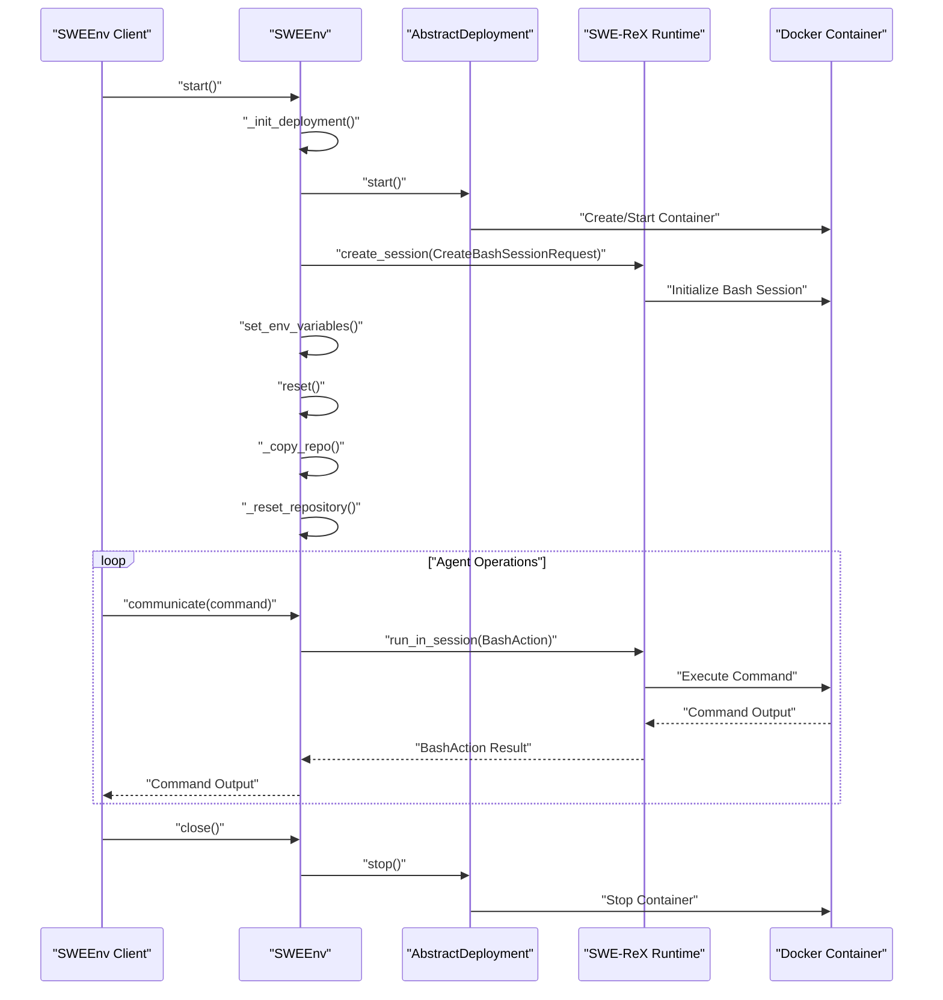
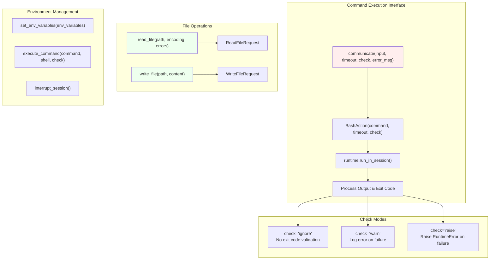
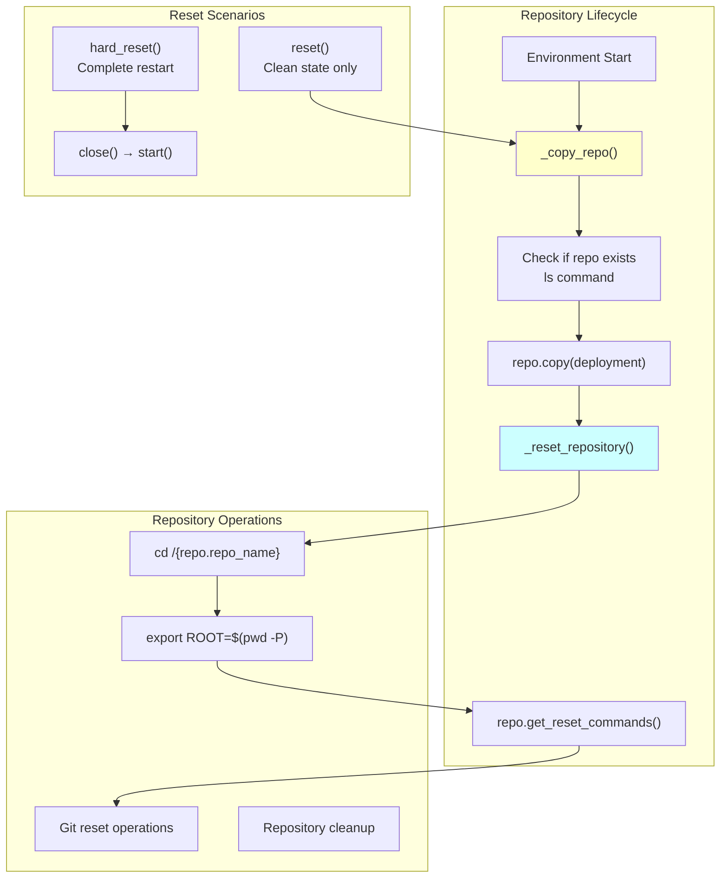
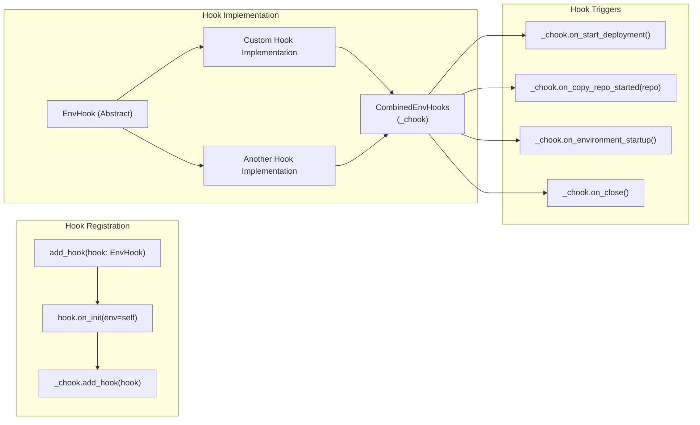
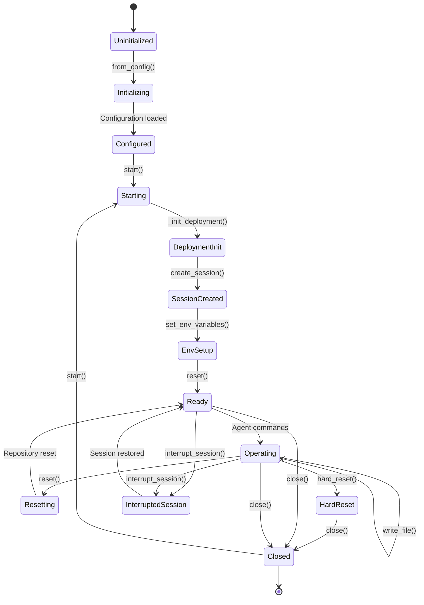

# Environment System

Relevant source files

The following files were used as context for generating this wiki page:

- [pyproject.toml](pyproject.toml)
- [sweagent/environment/swe_env.py](sweagent/environment/swe_env.py)
- [tests/conftest.py](tests/conftest.py)
- [tests/test_env.py](tests/test_env.py)
- [tests/test_run.py](tests/test_run.py)

The Environment System provides a containerized execution environment for SWE-agent where language model agents can safely interact with codebases and execute commands. This system abstracts Docker containers and runtime management through the SWE-ReX backend, providing file operations, command execution, and repository management capabilities.

For information about agent tool usage within environments, see [Tool System](#6). For details about running agents and orchestration, see [Execution and Run System](#5).

## Core Architecture

The Environment System is built around two primary classes: `EnvironmentConfig` for configuration management and `SWEEnv` for runtime operations. The system integrates with SWE-ReX to provide containerized execution environments.

**Core Environment Architecture**

Sources: [sweagent/environment/swe_env.py:1-277](), [pyproject.toml:60-60]()

## Environment Configuration

The `EnvironmentConfig` class defines the environment setup parameters including deployment options, repository configuration, and startup commands.

| Configuration Field | Type | Purpose |
|---------------------|------|---------|
| `deployment` | `DeploymentConfig` | Container deployment settings (Docker image, Python setup) |
| `repo` | `RepoConfig \| None` | Repository to clone/mount in the environment |
| `post_startup_commands` | `list[str]` | Commands executed after environment initialization |
| `post_startup_command_timeout` | `int` | Timeout for startup commands (default: 500s) |
| `name` | `str` | Environment identifier (default: "main") |

**Environment Configuration Flow**

Sources: [sweagent/environment/swe_env.py:24-49](), [sweagent/environment/swe_env.py:84-98]()

## SWE-ReX Runtime Integration

The `SWEEnv` class integrates with SWE-ReX to provide containerized execution through the `AbstractDeployment` interface. This abstraction supports different deployment types including Docker containers and dummy environments for testing.

**SWE-ReX Integration Sequence**

Sources: [sweagent/environment/swe_env.py:109-114](), [sweagent/environment/swe_env.py:176-190](), [sweagent/environment/swe_env.py:168-172]()

## Command Execution and Communication

The `communicate` method provides the primary interface for executing commands in the containerized environment. It supports timeout handling, exit code checking, and error management.

**Command Execution and File Operations**

Sources: [sweagent/environment/swe_env.py:196-232](), [sweagent/environment/swe_env.py:234-254](), [sweagent/environment/swe_env.py:256-276]()

## Repository Management

The environment system handles repository setup, including cloning, copying, and resetting to specific commits. Repository operations are coordinated through the `Repo` protocol and `RepoConfig` classes.

**Repository Management Flow**

Sources: [sweagent/environment/swe_env.py:116-127](), [sweagent/environment/swe_env.py:149-166](), [sweagent/environment/swe_env.py:128-133]()

## Hook System Integration

The environment supports an extensible hook system through `EnvHook` classes that can inject custom functionality at various lifecycle stages. Hooks are managed by the `CombinedEnvHooks` coordinator.

| Hook Method | Trigger Point | Purpose |
|------------|---------------|---------|
| `on_init` | Environment initialization | Setup hook state |
| `on_start_deployment` | Before deployment start | Pre-deployment setup |
| `on_copy_repo_started` | Before repository copy | Repository setup hooks |
| `on_environment_startup` | After environment reset | Post-initialization logic |
| `on_close` | Environment shutdown | Cleanup operations |

**Environment Hook System**

Sources: [sweagent/environment/swe_env.py:100-107](), [sweagent/environment/swe_env.py:19-19](), [sweagent/environment/swe_env.py:80-82]()

## Environment Lifecycle Management

The environment follows a structured lifecycle from initialization through operation to cleanup, with support for both soft resets and complete restarts.

**Environment State Lifecycle**

Sources: [sweagent/environment/swe_env.py:109-114](), [sweagent/environment/swe_env.py:135-147](), [sweagent/environment/swe_env.py:168-172]()