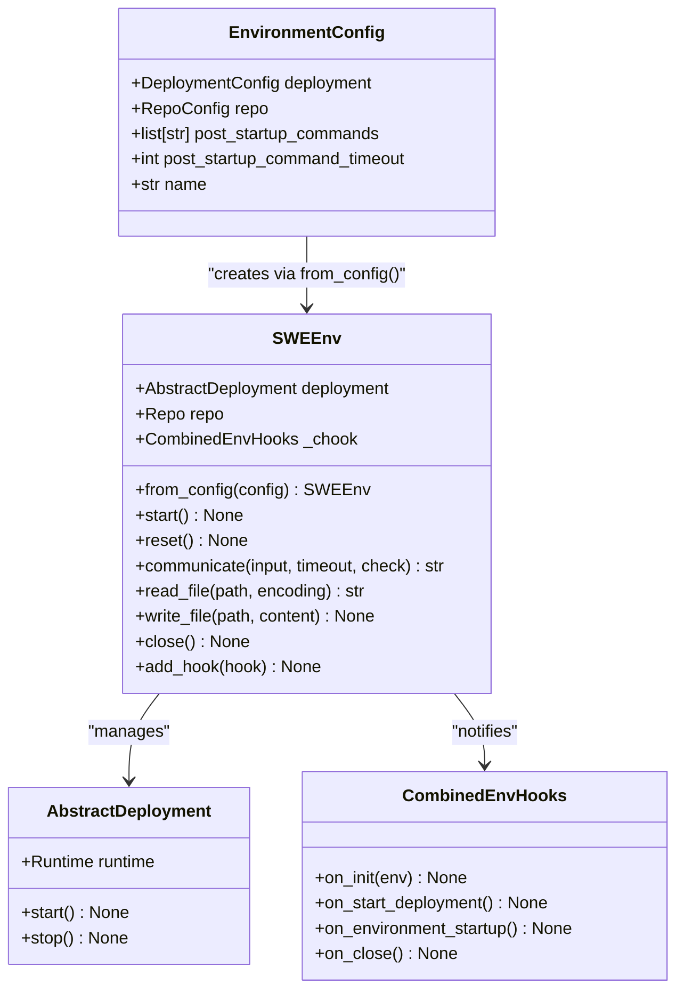
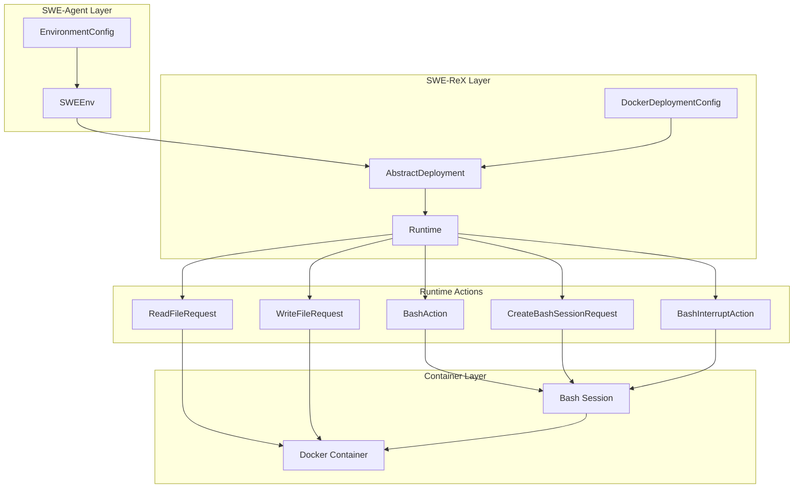
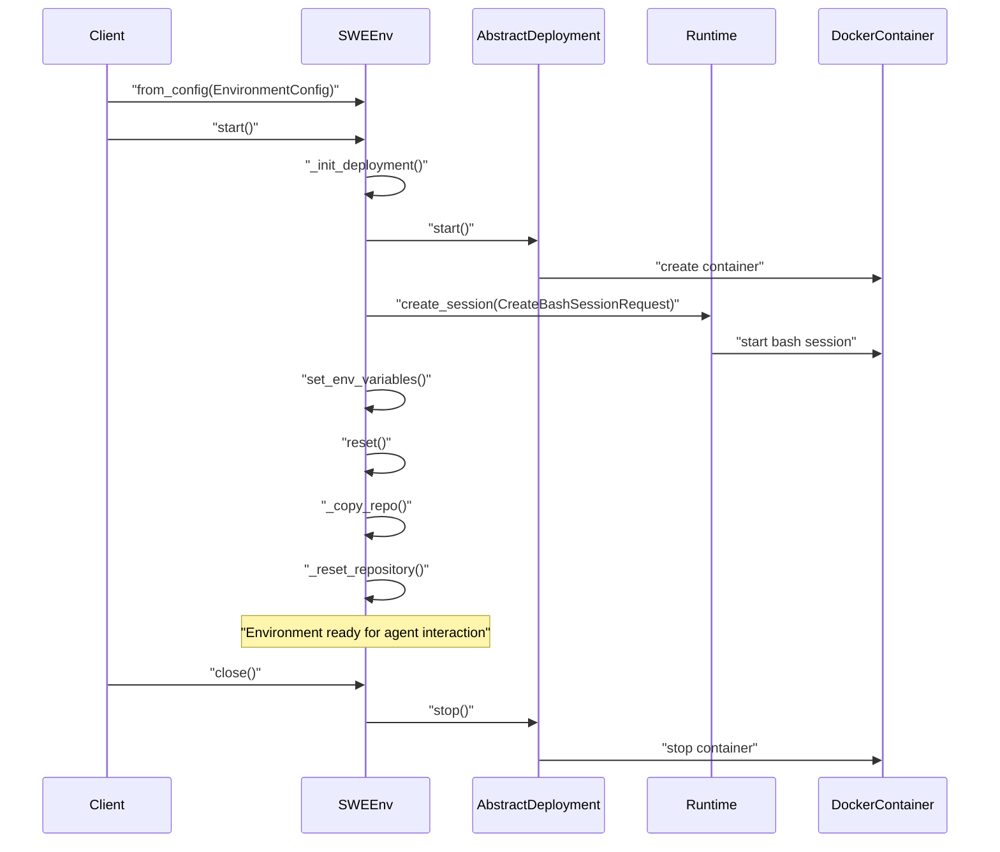
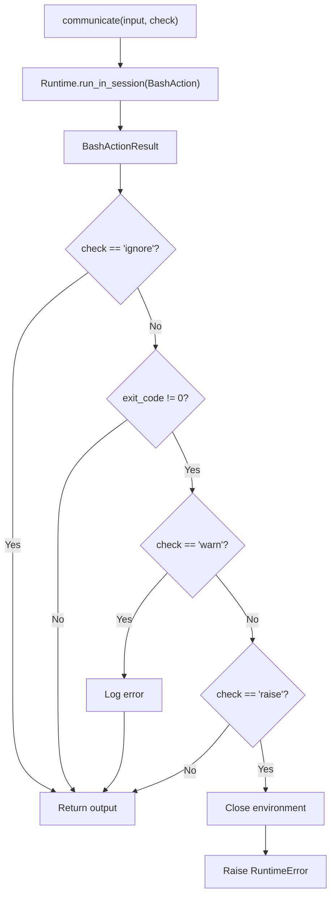
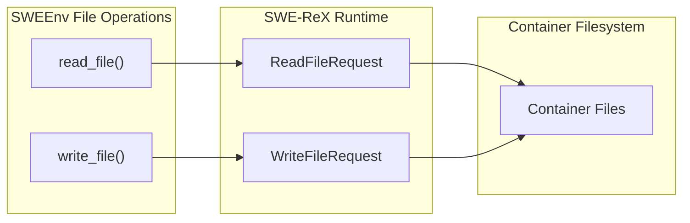
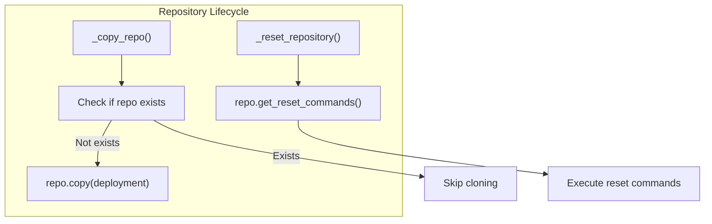
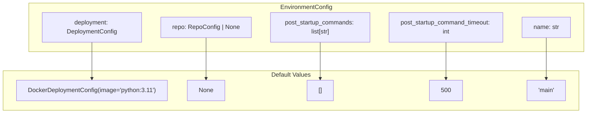

# SWEEnv and Runtime

<details>
<summary>Relevant source files</summary>

The following files were used as context for generating this wiki page:

- [pyproject.toml](pyproject.toml)
- [sweagent/environment/swe_env.py](sweagent/environment/swe_env.py)
- [tests/conftest.py](tests/conftest.py)
- [tests/test_env.py](tests/test_env.py)
- [tests/test_run.py](tests/test_run.py)

</details>


This document covers the `SWEEnv` class and its integration with the SWE-ReX runtime system for containerized code execution. The `SWEEnv` class provides the core execution environment where agents interact with repositories and execute commands in isolated Docker containers.

For information about repository configuration and cloning, see [Repository Management](#4.2). For deployment options and Docker configurations, see [Deployment Configuration](#4.3).

## Purpose and Architecture

The `SWEEnv` class serves as the primary interface between SWE-agent and the containerized execution environment. It manages the lifecycle of Docker containers, handles command execution, file operations, and repository setup through the SWE-ReX runtime backend.

### Core SWEEnv Class Structure



Sources: [sweagent/environment/swe_env.py:24-49](), [sweagent/environment/swe_env.py:51-83]()

### SWE-ReX Runtime Integration

The `SWEEnv` class integrates with SWE-ReX (SWE Runtime Execution) for containerized command execution. SWE-ReX provides the runtime backend that manages Docker containers and executes commands.



Sources: [sweagent/environment/swe_env.py:8-17](), [sweagent/environment/swe_env.py:176-188]()

## Environment Lifecycle Management

The `SWEEnv` class manages a complete lifecycle from initialization to cleanup, with specific phases for deployment setup, repository preparation, and environment reset.

### Initialization and Startup Flow

| Phase | Method | Description |
|-------|--------|-------------|
| Configuration | `from_config()` | Creates SWEEnv instance from EnvironmentConfig |
| Startup | `start()` | Initializes deployment and performs initial reset |
| Deployment Init | `_init_deployment()` | Starts Docker container and creates bash session |
| Repository Setup | `_copy_repo()` | Clones/copies repository into container |
| Reset | `reset()` | Resets repository to clean state |
| Shutdown | `close()` | Stops deployment and cleans up resources |



Sources: [sweagent/environment/swe_env.py:84-98](), [sweagent/environment/swe_env.py:109-115](), [sweagent/environment/swe_env.py:176-190]()

## Command Execution and Communication

The `communicate()` method is the primary interface for executing commands in the containerized environment. It provides error handling, timeout management, and logging capabilities.

### Command Execution Parameters

| Parameter | Type | Description |
|-----------|------|-------------|
| `input` | `str` | Command to execute in bash session |
| `timeout` | `int \| float` | Command timeout in seconds (default: 25) |
| `check` | `Literal["warn", "ignore", "raise"]` | Exit code handling strategy |
| `error_msg` | `str` | Custom error message for failures |

```python
# Command execution with error handling
output = env.communicate(
    input="python script.py", 
    timeout=30,
    check="raise",
    error_msg="Script execution failed"
)
```

### Error Handling Strategies



Sources: [sweagent/environment/swe_env.py:197-232]()

## File Operations

The `SWEEnv` class provides direct file access methods that bypass the bash session for more efficient file I/O operations.

### File Access Methods

| Method | Purpose | Runtime Action |
|--------|---------|----------------|
| `read_file(path, encoding, errors)` | Read file contents | `ReadFileRequest` |
| `write_file(path, content)` | Write file contents | `WriteFileRequest` |



Sources: [sweagent/environment/swe_env.py:234-254]()

## Repository Management Integration

The `SWEEnv` class integrates with repository management to handle code repository setup and reset operations within the containerized environment.

### Repository Operations



Sources: [sweagent/environment/swe_env.py:116-127](), [sweagent/environment/swe_env.py:149-166]()

## Configuration and Deployment

The `EnvironmentConfig` class defines the configuration structure for environment setup, including deployment options, repository settings, and startup commands.

### Configuration Structure



### Environment Hooks System

The `SWEEnv` class supports a hooks system for extensibility, allowing custom functionality to be injected at different lifecycle stages.

| Hook Method | Trigger Point |
|-------------|---------------|
| `on_init()` | Environment initialization |
| `on_start_deployment()` | Deployment startup |
| `on_copy_repo_started()` | Repository copying begins |
| `on_environment_startup()` | Environment ready |
| `on_close()` | Environment shutdown |

Sources: [sweagent/environment/swe_env.py:24-49](), [sweagent/environment/swe_env.py:100-107](), [sweagent/environment/hooks/abstract.py]()