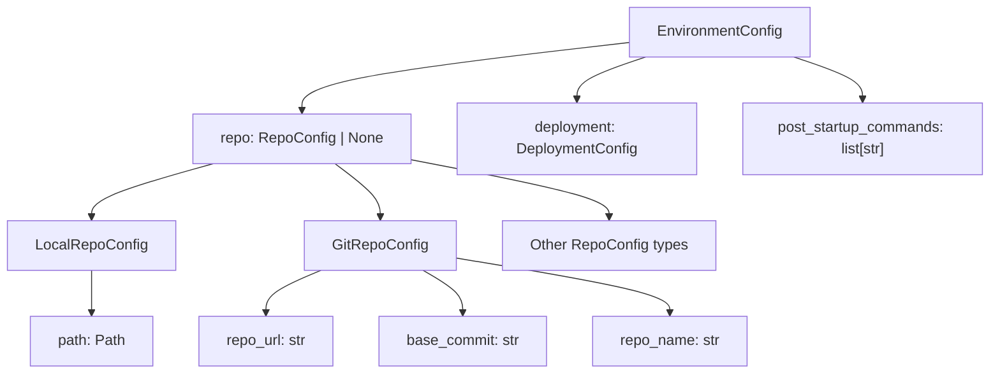
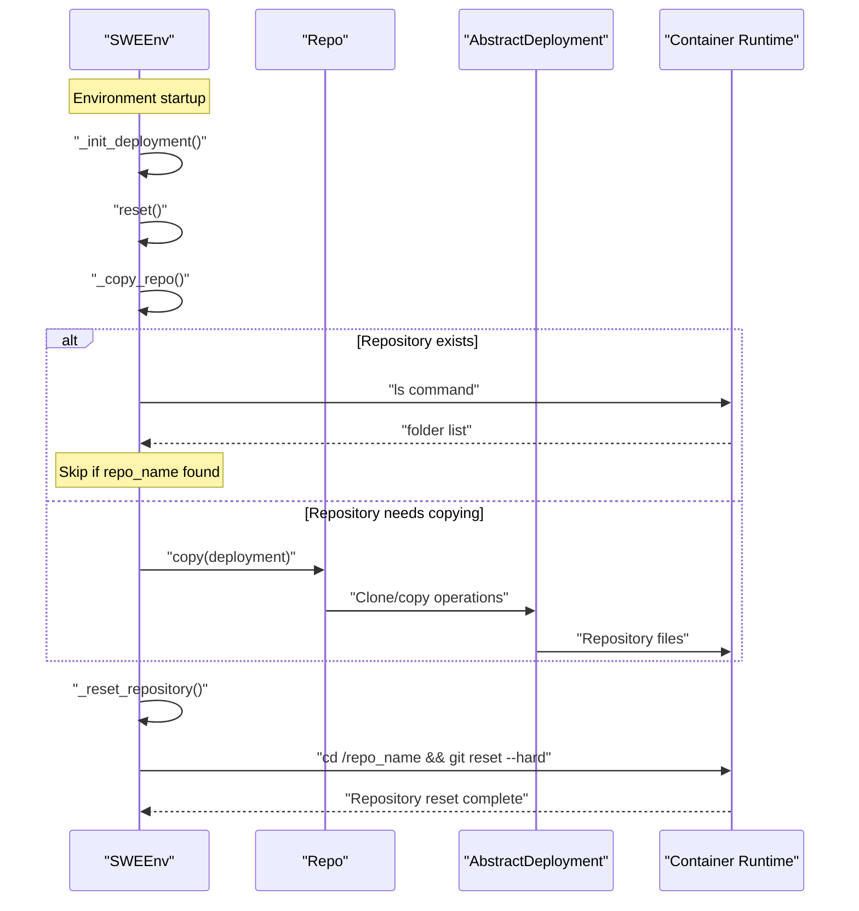
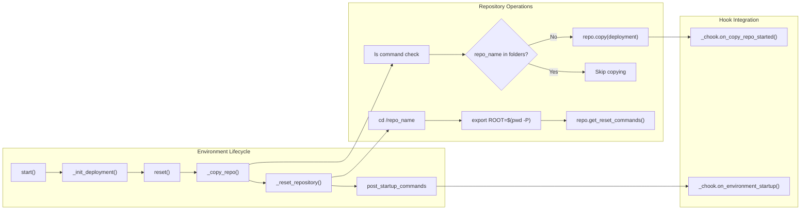

# Repository Management

<details>
<summary>Relevant source files</summary>

The following files were used as context for generating this wiki page:

- [pyproject.toml](pyproject.toml)
- [sweagent/environment/swe_env.py](sweagent/environment/swe_env.py)
- [sweagent/run/batch_instances.py](sweagent/run/batch_instances.py)
- [sweagent/run/common.py](sweagent/run/common.py)
- [sweagent/run/hooks/apply_patch.py](sweagent/run/hooks/apply_patch.py)
- [sweagent/run/run_batch.py](sweagent/run/run_batch.py)
- [sweagent/run/run_replay.py](sweagent/run/run_replay.py)
- [sweagent/run/run_single.py](sweagent/run/run_single.py)
- [sweagent/utils/log.py](sweagent/utils/log.py)
- [tests/conftest.py](tests/conftest.py)
- [tests/test_env.py](tests/test_env.py)
- [tests/test_run.py](tests/test_run.py)

</details>


This document covers the repository management system within SWE-agent's environment framework. Repository management handles the configuration, cloning, copying, and lifecycle management of code repositories that agents operate on within containerized environments.

For information about the broader SWE environment runtime system, see [SWEEnv and Runtime](#4.1). For deployment and containerization configuration, see [Deployment Configuration](#4.3). For agent tools that manipulate files within repositories, see [Edit and File Operations](#6.2).

## Repository Configuration System

The repository management system centers around the `RepoConfig` class hierarchy and its integration with `EnvironmentConfig`. The configuration system supports multiple repository sources and cloning strategies.

### Configuration Structure

The `EnvironmentConfig` class [sweagent/environment/swe_env.py:24-49]() contains an optional `repo` field that accepts either a `RepoConfig` instance or `None`. This field controls whether and how a repository is made available in the environment:



**Repository Configuration Types**

| Config Type | Purpose | Key Fields |
|-------------|---------|------------|
| `LocalRepoConfig` | Local filesystem repositories | `path: Path` |
| `GitRepoConfig` | Remote Git repositories | `repo_url`, `base_commit`, `repo_name` |

Sources: [sweagent/environment/swe_env.py:31-34](), [tests/conftest.py:84-87]()

## Repository Lifecycle Management

Repository management follows a structured lifecycle within the `SWEEnv` class, coordinating cloning, copying, and reset operations with the containerized execution environment.

### Repository Lifecycle Flow



Sources: [sweagent/environment/swe_env.py:109-147](), [sweagent/environment/swe_env.py:116-127]()

## Repository Operations

The `SWEEnv` class provides several key methods for managing repository state and ensuring clean, reproducible environments for agent execution.

### Core Repository Methods

**Repository Copying**
The `_copy_repo()` method [sweagent/environment/swe_env.py:116-127]() handles initial repository setup:

- Checks if repository already exists in container using `ls` command
- Calls environment hooks via `_chook.on_copy_repo_started()`
- Delegates actual copying to the `Repo.copy()` method
- Skips copying if repository directory already present

**Repository Reset**
The `_reset_repository()` method [sweagent/environment/swe_env.py:149-166]() ensures clean state:

- Changes to repository root directory
- Sets `ROOT` environment variable to repository path
- Executes repository-specific reset commands via `repo.get_reset_commands()`
- Uses 120-second timeout for reset operations (handles slow index rebuilds)

### Environment Integration



Sources: [sweagent/environment/swe_env.py:109-147](), [sweagent/environment/swe_env.py:149-166]()

## Repository State Management

Repository management includes mechanisms for handling different repository states and providing clean environments for each agent execution attempt.

### Reset and Recovery Operations

The system supports both soft resets and hard resets for different scenarios:

**Soft Reset via `reset()`**
- Preserves deployment and container state
- Resets repository to base commit
- Called between agent attempts on same problem
- Maintains container session and installed dependencies

**Hard Reset via `hard_reset()`**
The `hard_reset()` method [sweagent/environment/swe_env.py:128-133]() provides complete environment recreation:
- Calls `close()` to shutdown deployment
- Calls `start()` to recreate everything from scratch
- Used when environment corruption suspected
- More expensive but guarantees clean state

### Repository Configuration in Testing

Test configurations demonstrate typical repository setup patterns:

```python
# Local repository configuration
test_env_args = EnvironmentConfig(
    deployment=DockerDeploymentConfig(image="python:3.11"),
    repo=LocalRepoConfig(path=Path(local_repo_path)),
)

# Remote repository cloning in tests
clone_cmd = ["git", "clone", "https://github.com/swe-agent/test-repo", str(local_repo_path)]
```

Sources: [tests/conftest.py:84-87](), [tests/conftest.py:125-127](), [sweagent/environment/swe_env.py:128-133]()

## Error Handling and Timeouts

Repository operations include robust error handling and timeout mechanisms to handle various failure scenarios:

### Timeout Configuration

| Operation | Default Timeout | Purpose |
|-----------|----------------|---------|
| Repository reset | 120 seconds | Handles slow Git index rebuilds |
| Post-startup commands | 500 seconds | Configurable via `post_startup_command_timeout` |
| General communication | 25 seconds | Default for `communicate()` method |

### Error Recovery

Repository reset operations use the `communicate()` method with error handling:
- `check="raise"` parameter ensures failures are caught
- Custom error messages via `error_msg` parameter
- Automatic environment cleanup on critical failures

Sources: [sweagent/environment/swe_env.py:160-166](), [sweagent/environment/swe_env.py:40-43](), [sweagent/environment/swe_env.py:197-232]()