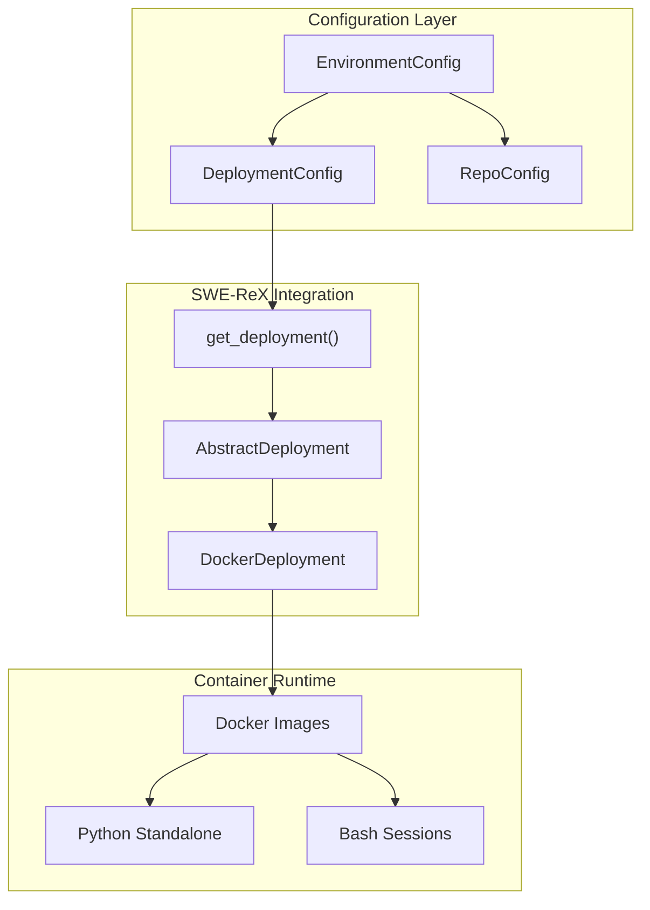
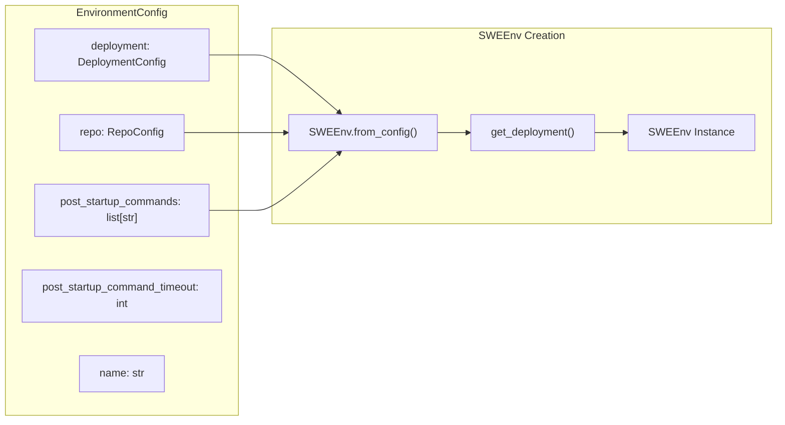
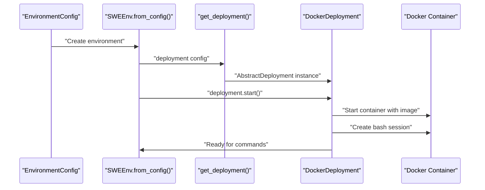
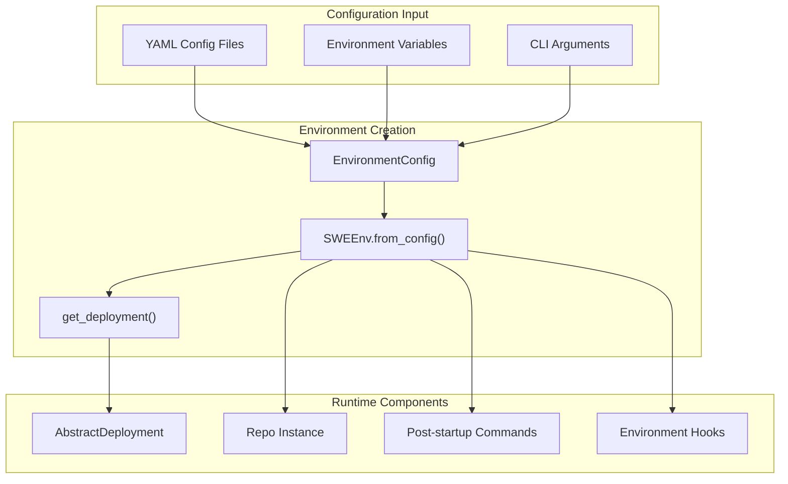
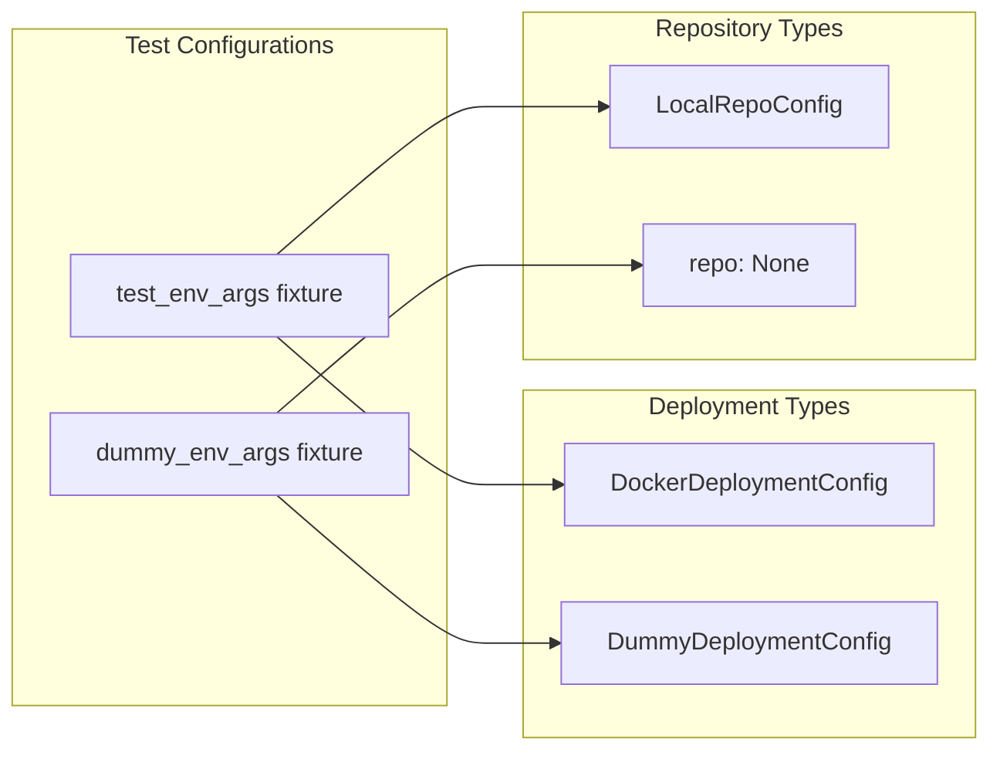

# Deployment Configuration

<details>
<summary>Relevant source files</summary>

The following files were used as context for generating this wiki page:

- [README.md](README.md)
- [docs/assets/mini_logo.svg](docs/assets/mini_logo.svg)
- [docs/assets/mini_logo_text_below.svg](docs/assets/mini_logo_text_below.svg)
- [docs/index.md](docs/index.md)
- [docs/overrides/main.html](docs/overrides/main.html)
- [docs/usage/cl_tutorial.md](docs/usage/cl_tutorial.md)
- [mkdocs.yml](mkdocs.yml)
- [pyproject.toml](pyproject.toml)
- [sweagent/environment/swe_env.py](sweagent/environment/swe_env.py)
- [tests/conftest.py](tests/conftest.py)
- [tests/test_env.py](tests/test_env.py)
- [tests/test_run.py](tests/test_run.py)

</details>


This document explains the deployment configuration system in SWE-agent, which controls how the agent execution environment is deployed and managed. This covers Docker container configuration, cloud deployment options, and integration with the SWE-ReX runtime system. For information about repository setup within the deployment, see [Repository Management](#4.2). For details about the SWEEnv runtime itself, see [SWEEnv and Runtime](#4.1).

## Overview

The deployment configuration system in SWE-agent provides a flexible framework for running agent environments in different deployment contexts, primarily through containerized Docker environments. The system is built around the `EnvironmentConfig` class which integrates deployment settings with repository and startup configurations.



**Deployment Configuration Architecture**

Sources: [sweagent/environment/swe_env.py:24-49](), [sweagent/environment/swe_env.py:8-9]()

## Environment Configuration

The `EnvironmentConfig` class serves as the primary configuration interface, combining deployment settings with repository and startup configurations:

| Field | Type | Default | Description |
|-------|------|---------|-------------|
| `deployment` | `DeploymentConfig` | `DockerDeploymentConfig` | Deployment backend configuration |
| `repo` | `RepoConfig \| None` | `None` | Repository configuration |
| `post_startup_commands` | `list[str]` | `[]` | Commands to execute after environment setup |
| `post_startup_command_timeout` | `int` | `500` | Timeout for startup commands |
| `name` | `str` | `"main"` | Environment instance name |



**Environment Configuration to SWEEnv Pipeline**

Sources: [sweagent/environment/swe_env.py:24-49](), [sweagent/environment/swe_env.py:84-98]()

## Docker Deployment Configuration

The default deployment backend uses Docker containers through `DockerDeploymentConfig`. This configuration specifies the container image and Python environment setup:

```python
# Default Docker deployment configuration
DockerDeploymentConfig(
    image="python:3.11", 
    python_standalone_dir="/root"
)
```

The Docker deployment system integrates with SWE-ReX to provide:

- **Container Lifecycle Management**: Starting, stopping, and resetting containers
- **Bash Session Management**: Creating isolated bash sessions for command execution
- **File System Operations**: Reading and writing files within the container
- **Environment Variable Management**: Setting up the container environment



**Docker Deployment Initialization Sequence**

Sources: [sweagent/environment/swe_env.py:27-30](), [sweagent/environment/swe_env.py:176-190]()

## Deployment Integration with SWEEnv

The `SWEEnv` class consumes deployment configuration through its `from_config` class method, which creates a deployment instance and integrates it with other environment components:



**Configuration to Runtime Integration**

The deployment lifecycle includes several key phases:

1. **Initialization**: `_init_deployment()` starts the container and creates bash sessions
2. **Environment Setup**: Sets default environment variables and prepares the workspace
3. **Repository Integration**: Copies and configures the target repository
4. **Startup Commands**: Executes post-startup commands with configured timeouts

Sources: [sweagent/environment/swe_env.py:84-98](), [sweagent/environment/swe_env.py:176-190]()

## Testing and Development Configurations

The testing framework demonstrates both Docker and dummy deployment configurations:

| Configuration Type | Use Case | Implementation |
|-------------------|----------|----------------|
| `DockerDeploymentConfig` | Integration testing | Uses `python:3.11` image for realistic testing |
| `DummyDeploymentConfig` | Unit testing | Lightweight mock deployment for fast tests |
| `LocalRepoConfig` | Development | Points to local repository clones |



**Testing Configuration Patterns**

Sources: [tests/conftest.py:76-89](), [tests/conftest.py:92-97](), [tests/test_env.py:14-24]()

## Cloud and Alternative Deployments

While Docker is the primary deployment backend, the system's architecture supports extension to other deployment types through the `AbstractDeployment` interface from SWE-ReX. The `get_deployment()` function serves as a factory for creating deployment instances based on configuration type.

The deployment system is designed to support:

- **Local Docker Deployments**: Standard containerized execution
- **Remote Docker Deployments**: Docker containers on remote hosts
- **Cloud Provider Integration**: Potential integration with cloud container services
- **Mock Deployments**: Testing and development environments

Sources: [sweagent/environment/swe_env.py:8-9](), [sweagent/environment/swe_env.py:93]()

## Configuration Management

Deployment configuration follows SWE-agent's hierarchical configuration system, where settings can be specified through:

1. **YAML Configuration Files**: Primary configuration method
2. **Environment Variables**: Runtime overrides and secrets
3. **CLI Arguments**: Command-line overrides for specific runs

The `model_config = ConfigDict(extra="forbid")` setting ensures strict validation of deployment configuration parameters, preventing configuration errors from propagating to runtime.

Sources: [sweagent/environment/swe_env.py:46](), [pyproject.toml:60]()