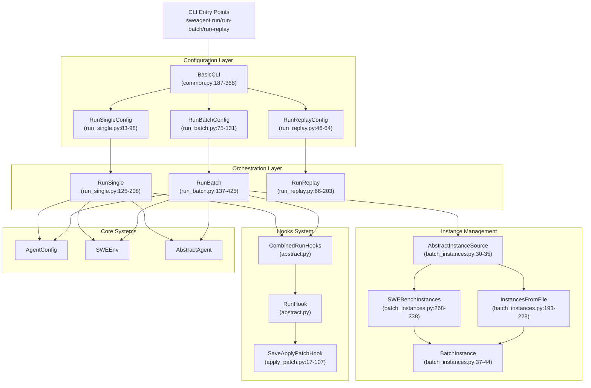
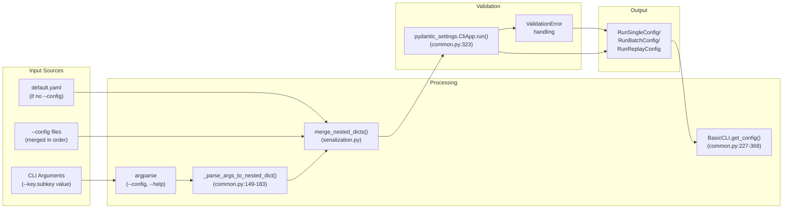
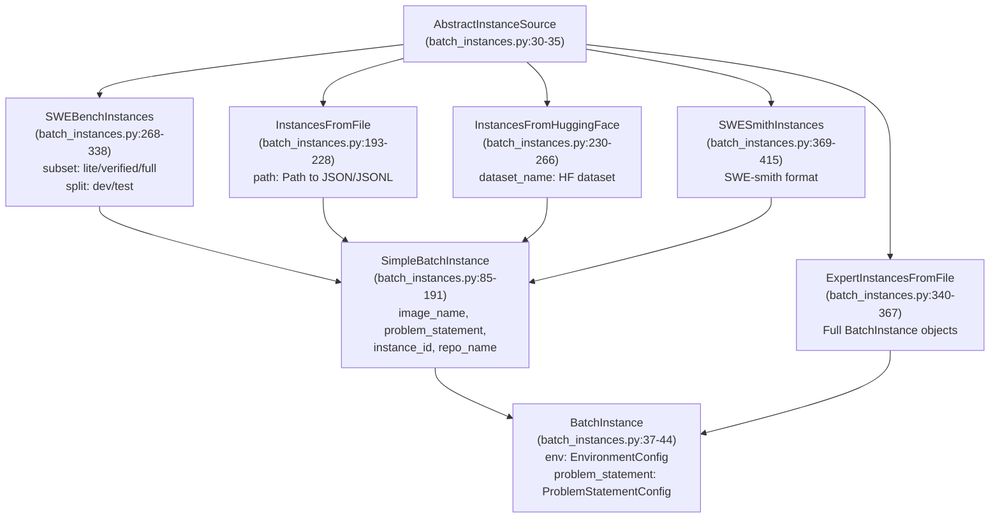
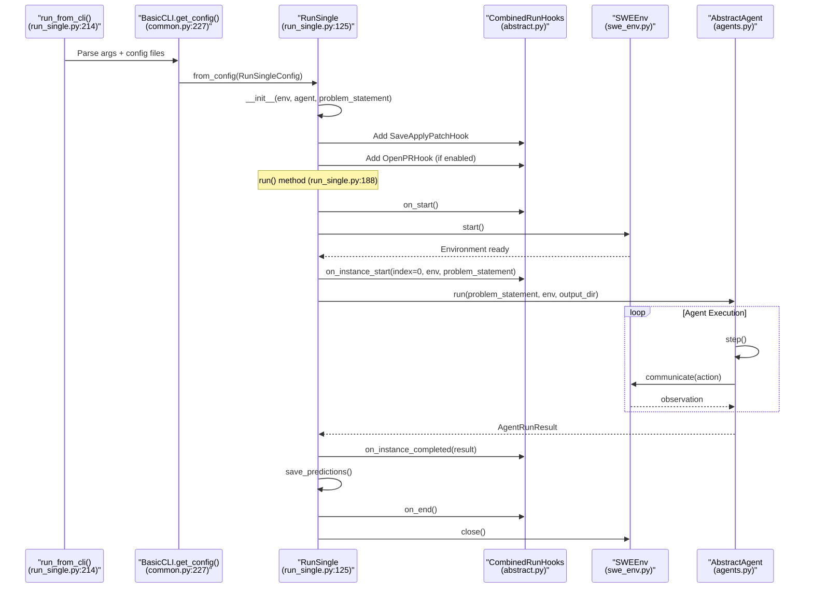
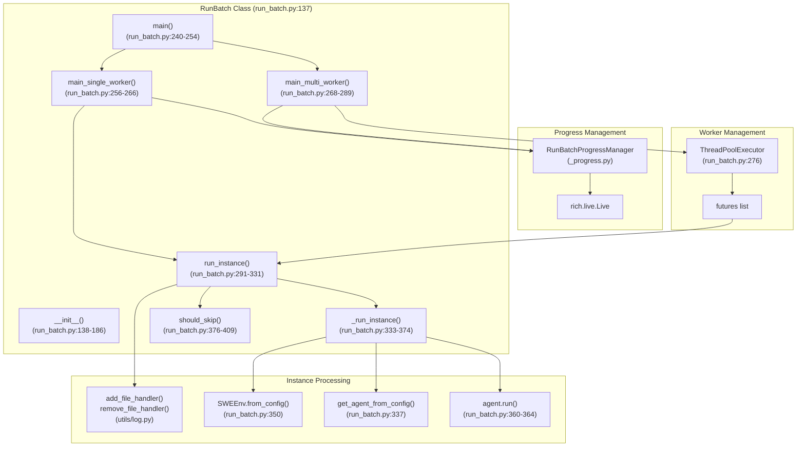
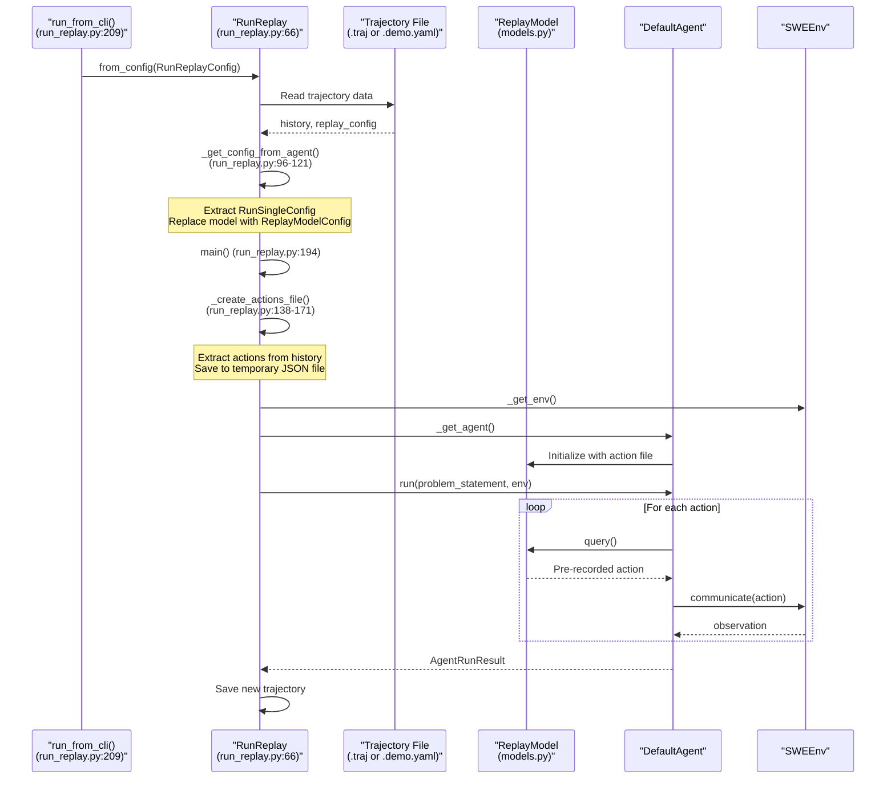
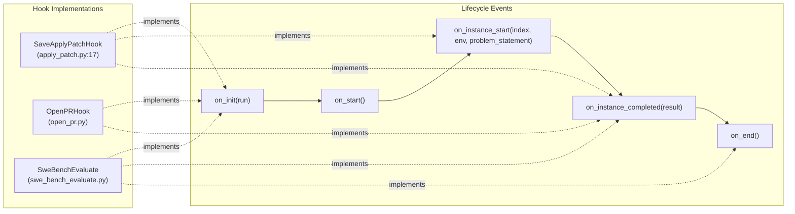

# Execution and Run System

<details>
<summary>Relevant source files</summary>

The following files were used as context for generating this wiki page:

- [sweagent/run/batch_instances.py](sweagent/run/batch_instances.py)
- [sweagent/run/common.py](sweagent/run/common.py)
- [sweagent/run/hooks/apply_patch.py](sweagent/run/hooks/apply_patch.py)
- [sweagent/run/run_batch.py](sweagent/run/run_batch.py)
- [sweagent/run/run_replay.py](sweagent/run/run_replay.py)
- [sweagent/run/run_single.py](sweagent/run/run_single.py)
- [sweagent/utils/log.py](sweagent/utils/log.py)

</details>


## Purpose and Scope

The Execution and Run System orchestrates the complete lifecycle of agent execution in SWE-agent. It handles configuration loading, instance preparation, environment initialization, agent invocation, result collection, and post-execution actions. This system supports three execution modes: single-instance runs, parallel batch processing, and trajectory replay.

For details on the agent decision-making logic, see [Core Agent System](#3.1). For environment management specifics, see [SWEEnv and Runtime](#4.1). For detailed information on single runs, batch processing, and hooks, see sections [5.1](#5.1), [5.2](#5.2), and [5.3](#5.3).

## Architecture Overview

The run system is organized into three primary orchestrators (`RunSingle`, `RunBatch`, `RunReplay`) that coordinate between configuration, agents, environments, and hooks. Each orchestrator implements a specific execution pattern while sharing common infrastructure.

### System Components and Relationships



**Sources:** [sweagent/run/run_single.py:1-226](), [sweagent/run/run_batch.py:1-443](), [sweagent/run/run_replay.py:1-220](), [sweagent/run/batch_instances.py:1-420]()

## Configuration System

The run system uses `pydantic-settings` for hierarchical configuration merging. The `BasicCLI` class [sweagent/run/common.py:187-368]() implements a three-stage configuration resolution process:

1. **Default config files**: Loaded from `config/default.yaml` unless `--no_config_file` is specified
2. **Additional config files**: Specified with `--config <path>` (can be used multiple times)
3. **CLI arguments**: Override any previous settings using dotted notation (e.g., `--agent.model.name gpt-4o`)

### Configuration Classes

| Configuration Class | Purpose | Location |
|---------------------|---------|----------|
| `RunSingleConfig` | Single instance execution parameters | [sweagent/run/run_single.py:83-123]() |
| `RunBatchConfig` | Batch processing parameters including worker count and instance sources | [sweagent/run/run_batch.py:75-131]() |
| `RunReplayConfig` | Trajectory replay parameters | [sweagent/run/run_replay.py:46-64]() |
| `RunSingleActionConfig` | Post-execution actions (PR creation, patch application) | [sweagent/run/run_single.py:55-66]() |

Each configuration class includes:
- **Agent configuration**: Model settings, tool configurations, templates
- **Environment configuration**: Deployment type, repository settings, post-startup commands
- **Problem statement**: Issue description from GitHub, text, or file
- **Output directory**: Where trajectories and patches are saved

### Configuration Merging Process



**Sources:** [sweagent/run/common.py:187-368](), [sweagent/run/run_single.py:83-123](), [sweagent/run/run_batch.py:75-131]()

## Instance Sources and Batch Configuration

Batch execution requires loading problem instances from various sources. All sources implement the `AbstractInstanceSource` interface [sweagent/run/batch_instances.py:30-35](), which defines a single method: `get_instance_configs()`.

### Instance Source Types



### Instance Filtering and Slicing

All instance sources support three common operations [sweagent/run/batch_instances.py:65-82]():

1. **Filter**: Regular expression matching on instance IDs (`--instances.filter='instance_id_1|instance_id_2'`)
2. **Slice**: Python-style slicing (`--instances.slice :50` for first 50 instances)
3. **Shuffle**: Random shuffling with fixed seed (`--instances.shuffle=True`)

The filtering process is implemented in `_filter_batch_items()` [sweagent/run/batch_instances.py:65-82]() and applied consistently across all source types.

**Sources:** [sweagent/run/batch_instances.py:1-420]()

## Single Instance Execution

The `RunSingle` class [sweagent/run/run_single.py:125-208]() orchestrates execution for a single problem instance. The execution flow follows a linear sequence:

### RunSingle Execution Flow



The `from_config()` class method [sweagent/run/run_single.py:165-182]() handles initialization:
- Loads environment variables from `.env` file if specified
- Sets default output directory based on user, model, and problem ID
- Initializes `SWEEnv` and agent from configurations
- Attaches hooks based on action configuration

**Sources:** [sweagent/run/run_single.py:1-226](), [sweagent/run/common.py:187-368]()

## Batch Processing

The `RunBatch` class [sweagent/run/run_batch.py:137-425]() extends single-instance execution to support parallel processing of multiple instances. It includes sophisticated progress tracking, error handling, and multi-worker coordination.

### Batch Processing Architecture



### Worker Configuration

The number of parallel workers is controlled by `num_workers` parameter [sweagent/run/run_batch.py:87-88]():
- **Single worker mode** (`num_workers=1`): Sequential execution with optional progress bar
- **Multi-worker mode** (`num_workers>1`): Parallel execution using `ThreadPoolExecutor` [sweagent/run/run_batch.py:276]()

Multi-worker execution includes special handling:
- Logger names include thread identifiers [sweagent/utils/log.py:38-42]()
- Stream handlers set to WARNING level [sweagent/run/run_batch.py:269-273]()
- Random startup delays to avoid race conditions [sweagent/run/run_batch.py:296-297]()

### Instance Skip Logic

Before executing an instance, `should_skip()` [sweagent/run/run_batch.py:376-409]() checks for existing trajectories:

1. Checks if trajectory file exists at `{output_dir}/{instance_id}/{instance_id}.traj`
2. Validates trajectory is not empty
3. Reads `exit_status` from trajectory's `info` section
4. Skips if `exit_status` is not `"early_exit"` or `None`

This allows batch runs to resume from where they left off when `redo_existing=False` [sweagent/run/run_batch.py:83-84]().

**Sources:** [sweagent/run/run_batch.py:1-443](), [sweagent/utils/log.py:1-176]()

## Trajectory Replay

The `RunReplay` class [sweagent/run/run_replay.py:66-203]() re-executes actions from a trajectory file to reproduce results or create demos. This is useful for debugging tool behavior and converting trajectories to demo format.

### Replay Process



The replay system extracts actions from the trajectory's history [sweagent/run/run_replay.py:138-171]() and writes them to a temporary file. The `ReplayModel` reads actions sequentially from this file instead of querying a language model.

**Key implementation details:**
- Validates compatibility between trajectory and config (function calling vs. thought-action parsing)
- Supports config updates via `--update_config` parameter [sweagent/run/run_replay.py:53-54]()
- Can override deployment configuration [sweagent/run/run_replay.py:48-49]()

**Sources:** [sweagent/run/run_replay.py:1-220]()

## Output and Results Management

All run orchestrators produce standardized outputs in structured directories. The output directory structure follows this pattern:

```
{output_dir}/
├── {instance_id}/
│   ├── {instance_id}.traj          # Complete trajectory JSON
│   ├── {instance_id}.patch         # Git-formatted patch
│   ├── {instance_id}.pred          # SWE-bench prediction format
│   ├── {instance_id}.config.yaml   # Replay configuration
│   ├── {instance_id}.trace.log     # TRACE level logs
│   ├── {instance_id}.debug.log     # DEBUG level logs
│   └── {instance_id}.info.log      # INFO level logs
├── preds.json                      # Merged predictions (batch only)
└── run_batch.log                   # Run-level logs (batch only)
```

### Prediction Saving

The `save_predictions()` function [sweagent/run/common.py:370-380]() writes prediction files in SWE-bench format:

```python
{
    "model_name_or_path": str,  # Trajectory directory name
    "instance_id": str,
    "model_patch": str,         # The submitted patch
}
```

For batch runs, `merge_predictions()` [sweagent/run/merge_predictions.py]() aggregates individual prediction files into a single `preds.json` [sweagent/run/run_batch.py:249-252]().

### Trajectory File Structure

Trajectory files contain the complete execution record:
- `history`: List of conversation messages
- `trajectory`: List of action-observation pairs
- `info`: Metadata including exit status, costs, submission
- `replay_config`: Configuration needed to replay the trajectory

**Sources:** [sweagent/run/common.py:370-388](), [sweagent/run/run_batch.py:249-252](), [sweagent/run/run_single.py:188-207]()

## Hooks System

The hooks system provides extension points throughout the execution lifecycle. Hooks implement the `RunHook` interface and are invoked by `CombinedRunHooks` [sweagent/run/hooks/abstract.py]().

### Hook Lifecycle



### Standard Hooks

| Hook Class | Purpose | Invocation Points |
|------------|---------|-------------------|
| `SaveApplyPatchHook` | Saves patches to disk and optionally applies to local repo | `on_instance_start`, `on_instance_completed` |
| `OpenPRHook` | Creates GitHub pull requests with patches | `on_instance_completed` |
| `SweBenchEvaluate` | Submits predictions to SWE-bench for evaluation | `on_instance_completed`, `on_end` |

Hooks are added to runs via `add_hook()` [sweagent/run/run_single.py:184-186]() and automatically invoked at appropriate lifecycle points. The `CombinedRunHooks` class manages multiple hooks and ensures all are called in order.

**Sources:** [sweagent/run/hooks/apply_patch.py:1-107](), [sweagent/run/run_single.py:184-186](), [sweagent/run/run_batch.py:236-238]()

## Logging System

The run system implements comprehensive logging with per-instance log files and configurable verbosity levels. The logging infrastructure is provided by [sweagent/utils/log.py:1-176]().

### Log File Management

Batch execution creates three log files per instance at different verbosity levels:
- **TRACE**: Most detailed, includes all internal operations
- **DEBUG**: Debug-level information
- **INFO**: High-level progress information

Log handlers are dynamically added and removed for each instance:
- `_add_instance_log_file_handlers()` [sweagent/run/run_batch.py:411-420]() creates handlers at the start
- `_remove_instance_log_file_handlers()` [sweagent/run/run_batch.py:422-424]() cleans up handlers at the end

### Multi-Worker Logging

In multi-worker mode [sweagent/run/run_batch.py:268-273]():
- Thread names are registered with instance IDs [sweagent/utils/log.py:38-42]()
- Logger names include thread identifiers automatically
- Stream handler levels are elevated to WARNING to reduce console noise
- File handlers filter by instance ID to separate logs

**Sources:** [sweagent/utils/log.py:1-176](), [sweagent/run/run_batch.py:268-273](), [sweagent/run/run_batch.py:411-424]()