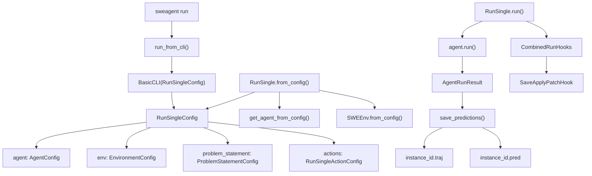
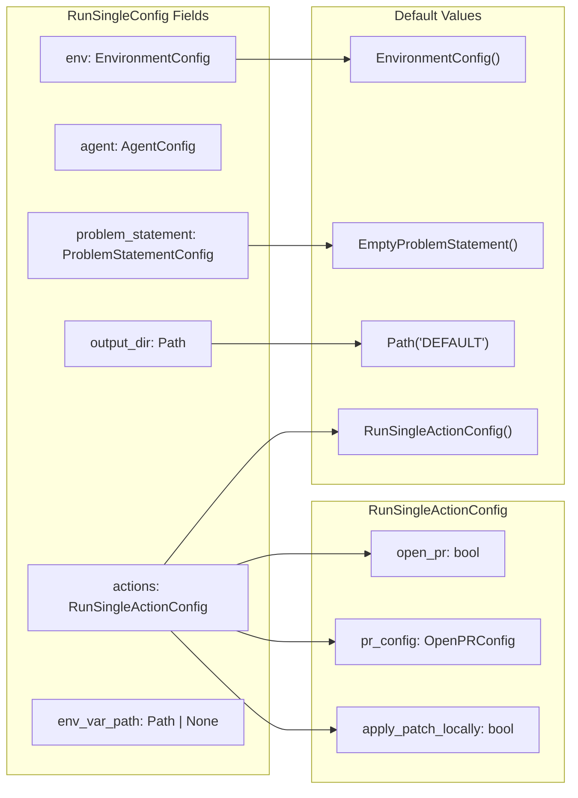
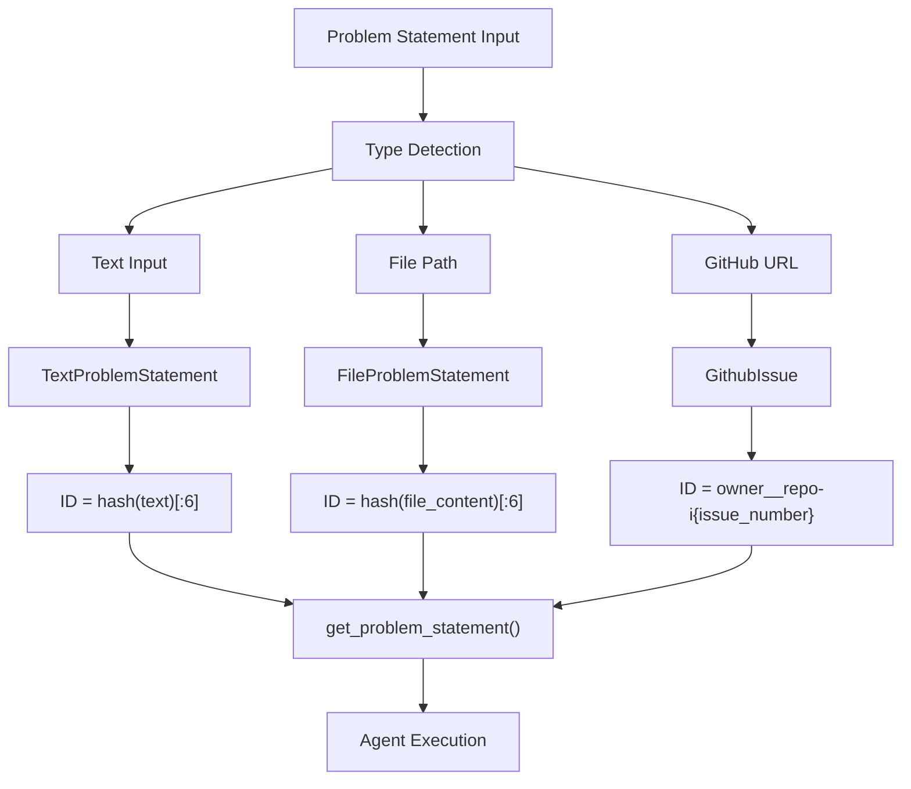
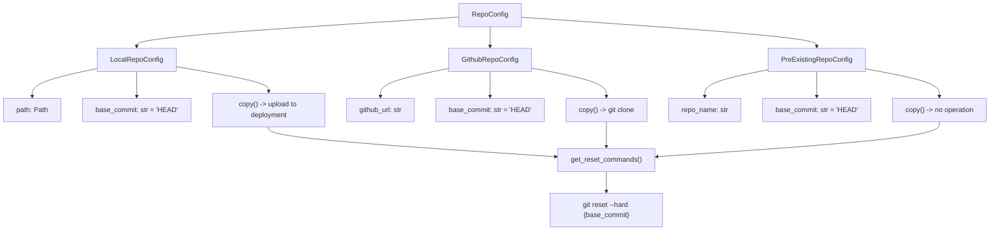
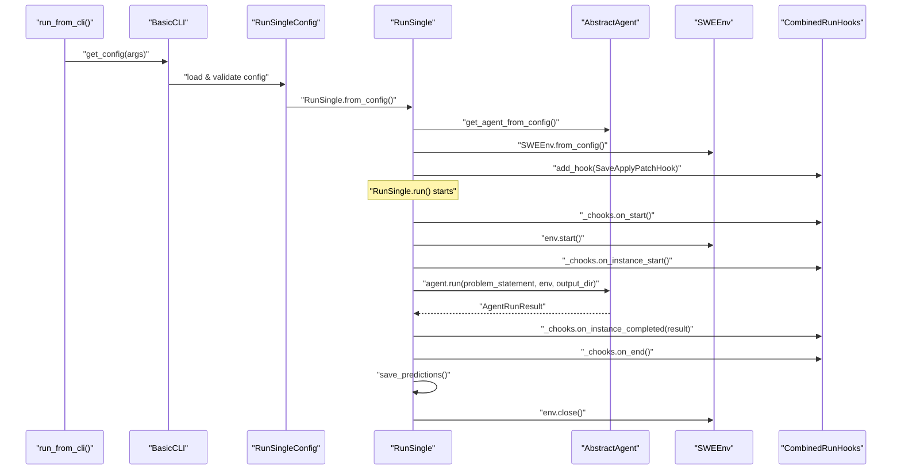
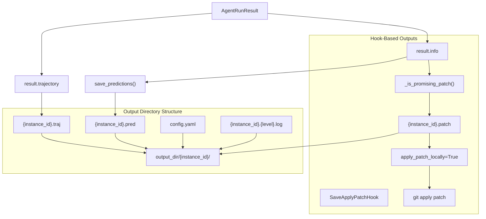
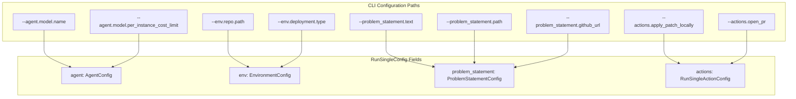

# Single Run Execution

<details>
<summary>Relevant source files</summary>

The following files were used as context for generating this wiki page:

- [README.md](README.md)
- [docs/assets/mini_logo.svg](docs/assets/mini_logo.svg)
- [docs/assets/mini_logo_text_below.svg](docs/assets/mini_logo_text_below.svg)
- [docs/index.md](docs/index.md)
- [docs/overrides/main.html](docs/overrides/main.html)
- [docs/usage/cl_tutorial.md](docs/usage/cl_tutorial.md)
- [mkdocs.yml](mkdocs.yml)
- [sweagent/run/batch_instances.py](sweagent/run/batch_instances.py)
- [sweagent/run/common.py](sweagent/run/common.py)
- [sweagent/run/hooks/apply_patch.py](sweagent/run/hooks/apply_patch.py)
- [sweagent/run/run_batch.py](sweagent/run/run_batch.py)
- [sweagent/run/run_replay.py](sweagent/run/run_replay.py)
- [sweagent/run/run_single.py](sweagent/run/run_single.py)
- [sweagent/utils/log.py](sweagent/utils/log.py)

</details>


This document covers the execution of SWE-agent on a single problem instance through the `RunSingle` class. Single run execution is the foundational execution mode for running agents on individual tasks such as GitHub issues or coding challenges. 

For batch processing of multiple instances, see [Batch Processing](5.2). For trajectory inspection and analysis tools, see [Trajectory Management and Inspection](8).

## Overview

Single run execution is orchestrated through the `RunSingle` class located in [sweagent/run/run_single.py:125-208](). The process involves configuring an agent with a problem statement, setting up the execution environment, running the agent, and handling the results through a hooks system.

**RunSingle Execution Architecture**



Sources: [sweagent/run/run_single.py:125-208](), [sweagent/run/run_single.py:214-221](), [sweagent/run/common.py:187-368]()

## Configuration System

Single run execution is configured through the `RunSingleConfig` class defined in [sweagent/run/run_single.py:83-123](). This configuration class inherits from `BaseSettings` and provides structured configuration for all aspects of single run execution.

**RunSingleConfig Structure**



**Configuration Loading Process**

| Configuration Source | Priority | Method | Example |
|---------------------|----------|---------|---------|
| CLI Arguments | Highest | `CliApp.run()` | `--agent.model.name gpt-4o` |
| Config Files | Medium | `--config config.yaml` | YAML configuration files |
| Environment Variables | Low | `SWE_AGENT_*` prefix | `SWE_AGENT_OUTPUT_DIR=/path` |
| Defaults | Lowest | Class field defaults | `Path("DEFAULT")` |

Sources: [sweagent/run/run_single.py:83-123](), [sweagent/run/run_single.py:55-66](), [sweagent/run/common.py:227-367]()

## Problem Statement Types

SWE-agent supports multiple problem statement types, each with specific use cases and configuration options.

| Type | Class | Use Case | Configuration |
|------|-------|----------|---------------|
| Text | `TextProblemStatement` | Direct text input | `--problem_statement.text="description"` |
| File | `FileProblemStatement` | Problem from file | `--problem_statement.path=problem.md` |
| GitHub Issue | `GithubIssue` | GitHub issue URL | `--problem_statement.github_url=URL` |
| Empty | `EmptyProblemStatement` | No specific problem | Default when none specified |

**Problem Statement Processing Flow**



Sources: [sweagent/agent/problem_statement.py:39-149](), [tests/test_run_single.py:94-98]()

## Repository Configuration

The execution environment requires a repository configuration that determines where and how the agent operates.

**Repository Types and Setup**



Sources: [sweagent/environment/repo.py:74-187](), [tests/test_run_single.py:101-105]()

## Execution Flow

The `RunSingle.run()` method coordinates the complete execution lifecycle, managing environment setup, agent execution, and result processing through a hooks-based architecture.

**RunSingle Execution Sequence**



**Key Execution Steps**

| Step | Method | Purpose | Output |
|------|--------|---------|---------|
| 1. Configuration | `BasicCLI.get_config()` | Parse CLI args and config files | `RunSingleConfig` |
| 2. Initialization | `RunSingle.from_config()` | Create agent and environment | `RunSingle` instance |
| 3. Environment Setup | `env.start()` | Start container/deployment | Active environment |
| 4. Agent Execution | `agent.run()` | Execute agent reasoning loop | `AgentRunResult` |
| 5. Result Processing | `save_predictions()` | Save trajectory and outputs | Files in `output_dir` |
| 6. Cleanup | `env.close()` | Teardown environment | Resources released |

Sources: [sweagent/run/run_single.py:188-208](), [sweagent/run/run_single.py:164-182](), [sweagent/run/common.py:370-379]()

## Output Handling

Single run execution produces structured outputs in the configured `output_dir`, with file names based on the problem statement ID. The `save_predictions()` function handles standard output generation, while hooks manage specialized outputs.

**Output Files and Structure**

| Output Type | File Pattern | Generator | Content |
|-------------|--------------|-----------|---------|
| Trajectory | `{instance_id}.traj` | Agent trajectory logging | Complete execution history as JSON |
| Prediction | `{instance_id}.pred` | `save_predictions()` | SWE-bench compatible prediction format |
| Configuration | `config.yaml` | `RunSingle.run()` | Replay configuration for the run |
| Patch | `{instance_id}.patch` | `SaveApplyPatchHook` | Git-applicable patch file |
| Logs | `{instance_id}.{level}.log` | Logging system | Debug/info/trace level logs |

**Output Generation Flow**



**Default Output Directory Generation**

The default output directory follows a structured naming convention when `output_dir=Path("DEFAULT")`:

```
trajectories/{user_id}/{config_file}__{model_id}___{problem_id}/
```

Where:
- `user_id`: Current system user from `getpass.getuser()`
- `config_file`: Stem of the config file used
- `model_id`: Model identifier from `agent.model.id`
- `problem_id`: Problem statement ID

Sources: [sweagent/run/common.py:370-379](), [sweagent/run/run_single.py:68-80](), [sweagent/run/hooks/apply_patch.py:32-91](), [sweagent/run/run_single.py:140-147]()

## CLI Usage

The `sweagent run` command provides a comprehensive CLI interface through the `run_from_cli()` function, which utilizes the `BasicCLI` class for argument parsing and configuration management.

**Basic CLI Pattern**
```bash
sweagent run --config CONFIG_FILE [CONFIGURATION_OPTIONS]
```

**CLI Configuration Hierarchy**

The CLI supports hierarchical configuration options that map directly to the `RunSingleConfig` structure:



**Common Usage Examples**

| Scenario | Command |
|----------|---------|
| GitHub issue + repo | `sweagent run --config config/default.yaml --problem_statement.github_url=URL --env.repo.github_url=REPO_URL` |
| Local repository | `sweagent run --config config/default.yaml --problem_statement.path=problem.md --env.repo.path=/path/to/repo` |
| Text problem | `sweagent run --config config/default.yaml --problem_statement.text="Fix the bug" --env.repo.path=/path/to/repo` |
| Apply patch locally | `sweagent run --config config/default.yaml --actions.apply_patch_locally=True` |
| Custom model | `sweagent run --config config/default.yaml --agent.model.name=gpt-4o` |

**Auto-Correction System**

The CLI includes an auto-correction system through `RunSingleConfig._get_auto_correct()` that provides helpful suggestions for common mistakes:

| Common Mistake | Suggestion |
|----------------|------------|
| `--model` | Use `--agent.model.name` |
| `--data_path` | Use `--problem_statement.*` options |
| `--repo_path` | Use `--env.repo.path` |
| `--repo.path` | Use `--env.repo.path` |

**Help and Configuration Options**

```bash
# Show general help
sweagent run --help

# Show help for specific configuration class
sweagent run --help_option sweagent.agent.agents.AgentConfig

# Print final merged configuration
sweagent run --print_config [other options]

# Load multiple config files
sweagent run --config config1.yaml --config config2.yaml
```

Sources: [sweagent/run/run_single.py:214-221](), [sweagent/run/run_single.py:104-122](), [sweagent/run/common.py:213-284]()

## Specialized Run Modes

### Shell Agent Mode

The `RunShell` class provides an alternative execution mode for semi-interactive agent operation, allowing human intervention during execution.

**Shell Mode Features**
- Human model integration via `HumanModel`
- Interactive command execution through `ShellAgent`
- Keyboard interrupt handling for human step-in
- Repository mounting via Docker volumes

Sources: [sweagent/run/run_shell.py:40-151](), [sweagent/agent/extra/shell_agent.py:14-107]()

### Configuration Validation

The system includes comprehensive validation for configuration parameters and execution prerequisites.

**Validation Checks**
- Repository accessibility and Git status validation
- Model configuration compatibility
- Tool bundle availability
- Output directory permissions

Sources: [sweagent/environment/repo.py:95-104](), [tests/test_run_single.py:32-44]()