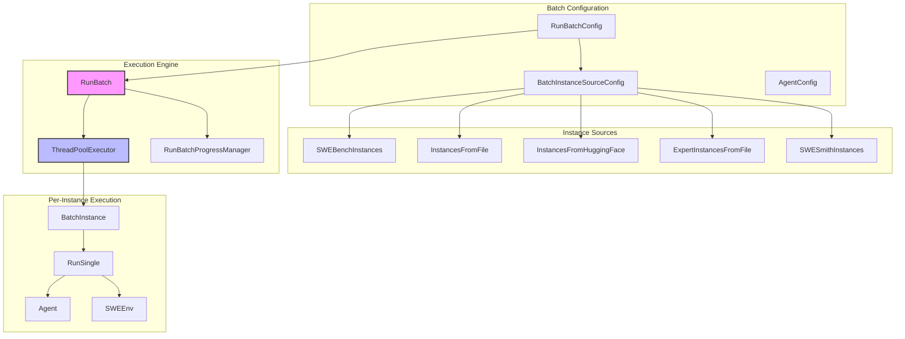
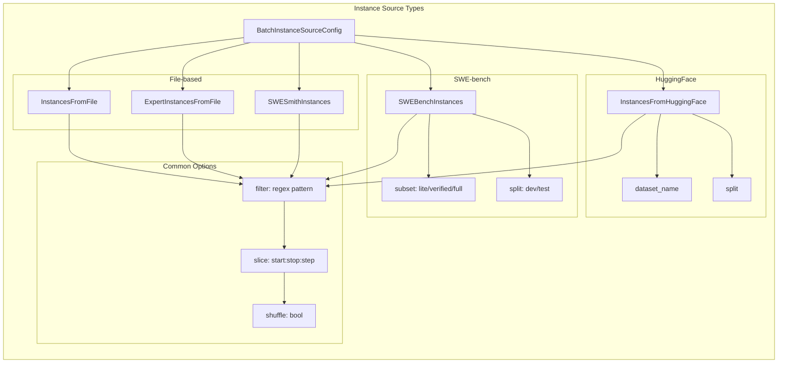
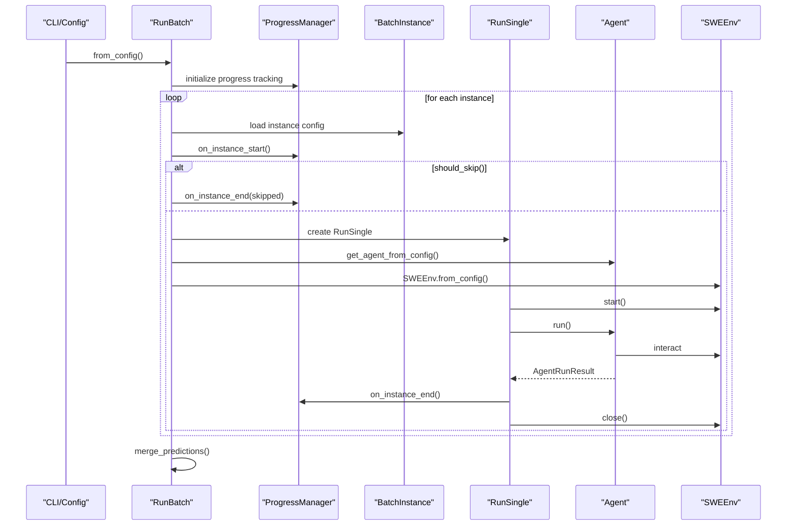
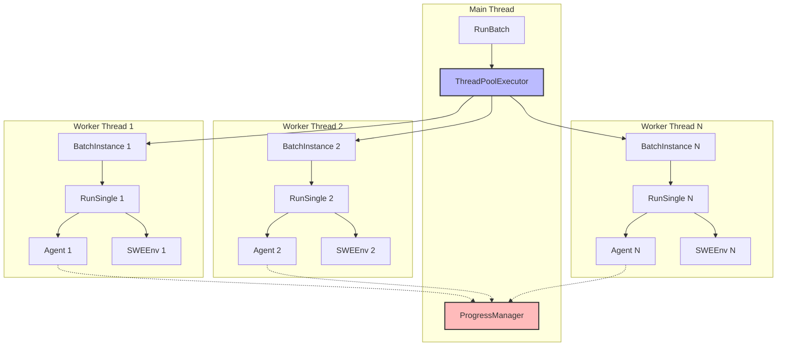
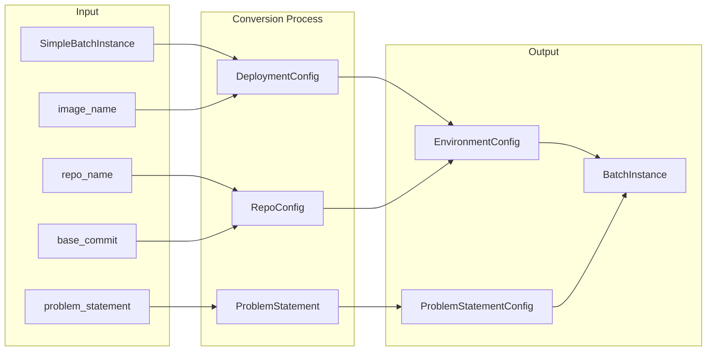
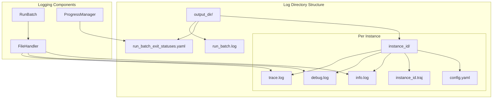
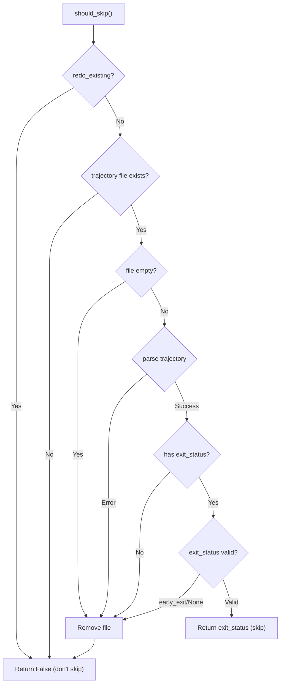
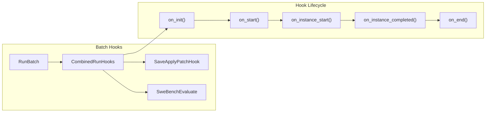
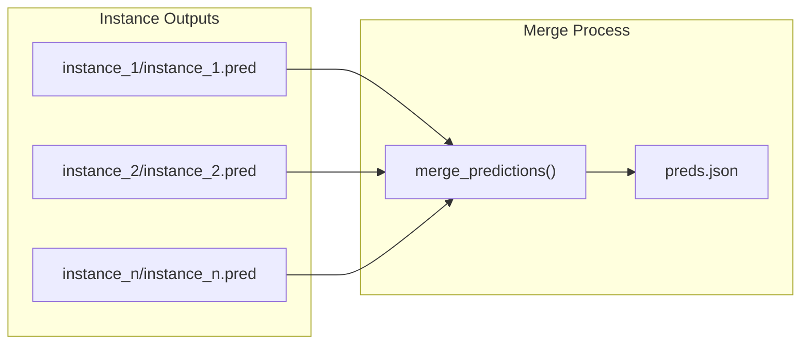

# Batch Processing

<details>
<summary>Relevant source files</summary>

The following files were used as context for generating this wiki page:

- [README.md](README.md)
- [docs/assets/mini_logo.svg](docs/assets/mini_logo.svg)
- [docs/assets/mini_logo_text_below.svg](docs/assets/mini_logo_text_below.svg)
- [docs/index.md](docs/index.md)
- [docs/overrides/main.html](docs/overrides/main.html)
- [docs/usage/cl_tutorial.md](docs/usage/cl_tutorial.md)
- [mkdocs.yml](mkdocs.yml)
- [sweagent/run/batch_instances.py](sweagent/run/batch_instances.py)
- [sweagent/run/common.py](sweagent/run/common.py)
- [sweagent/run/hooks/apply_patch.py](sweagent/run/hooks/apply_patch.py)
- [sweagent/run/run_batch.py](sweagent/run/run_batch.py)
- [sweagent/run/run_replay.py](sweagent/run/run_replay.py)
- [sweagent/run/run_single.py](sweagent/run/run_single.py)
- [sweagent/utils/log.py](sweagent/utils/log.py)

</details>


This document covers the batch processing system in SWE-agent, which enables running the agent on multiple problem instances simultaneously. Batch processing supports parallel execution, progress tracking, and various instance sources including SWE-bench, custom files, and HuggingFace datasets.

For information about running single instances, see [Single Run Execution](#5.1). For details about progress tracking and reporting features, see [Progress Tracking and Reporting](#5.3).

## Overview

The batch processing system orchestrates the execution of SWE-agent across multiple problem instances. It provides a scalable framework for benchmarking, evaluation, and bulk problem-solving tasks.

### Core Components



**Batch Processing Architecture**

Sources: [sweagent/run/run_batch.py:75-131](), [sweagent/run/batch_instances.py:417-419]()

## Configuration System

### RunBatchConfig

The `RunBatchConfig` class defines the configuration for batch processing operations:

| Field | Type | Description |
|-------|------|-------------|
| `instances` | `BatchInstanceSourceConfig` | Source configuration for instances to run |
| `agent` | `AgentConfig` | Agent configuration options |
| `output_dir` | `Path` | Output directory for results |
| `num_workers` | `int` | Number of parallel workers (default: 1) |
| `raise_exceptions` | `bool` | Whether to raise exceptions or skip failed instances |
| `redo_existing` | `bool` | Whether to rerun instances with existing trajectories |
| `progress_bar` | `bool` | Whether to show progress bar |
| `random_delay_multiplier` | `float` | Random delay factor for worker startup |

Sources: [sweagent/run/run_batch.py:75-101]()

### Instance Sources

The system supports multiple instance sources through the `BatchInstanceSourceConfig` union type:



**Instance Source Configuration Options**

Sources: [sweagent/run/batch_instances.py:417-419](), [sweagent/run/batch_instances.py:268-338]()

## Execution Flow

### Single Worker Execution



**Single Worker Execution Flow**

Sources: [sweagent/run/run_batch.py:256-267](), [sweagent/run/run_batch.py:291-374]()

### Multi-Worker Execution

For parallel execution, the system uses `ThreadPoolExecutor`:



**Multi-Worker Parallel Execution**

Sources: [sweagent/run/run_batch.py:268-290](), [sweagent/run/run_batch.py:39]()

## Instance Management

### BatchInstance Structure

Each `BatchInstance` combines environment configuration with problem statement:

```python
class BatchInstance(BaseModel):
    env: EnvironmentConfig
    problem_statement: ProblemStatementConfig
```

### SimpleBatchInstance Conversion

For simplified configuration, `SimpleBatchInstance` provides a convenient interface:



**SimpleBatchInstance to BatchInstance Conversion**

Sources: [sweagent/run/batch_instances.py:85-157](), [sweagent/run/batch_instances.py:112-157]()

## Progress Tracking and Logging

### File-based Logging

The batch system implements comprehensive logging with per-instance file handlers:



**Batch Processing Log Structure**

Sources: [sweagent/run/run_batch.py:167-173](), [sweagent/run/run_batch.py:411-424]()

### Progress Management

The `RunBatchProgressManager` tracks execution status:

- Instance start/completion tracking
- Exit status monitoring
- Error reporting and statistics
- Live progress display for multi-worker runs

Sources: [sweagent/run/_progress.py](), [sweagent/run/run_batch.py:182-184]()

## Error Handling and Recovery

### Instance Skipping Logic

The system implements sophisticated logic for skipping already-processed instances:



**Instance Skipping Decision Flow**

Sources: [sweagent/run/run_batch.py:376-409]()

### Exception Handling

The batch system provides multiple levels of exception handling:

1. **Instance-level**: Catch and log exceptions per instance
2. **Batch-level**: Handle system-level exceptions that should stop the batch
3. **Worker-level**: Manage thread-specific exceptions in parallel execution

Sources: [sweagent/run/run_batch.py:310-331](), [sweagent/run/run_batch.py:314-324]()

## Hooks and Evaluation

### Hook System Integration

Batch processing integrates with the hooks system for automated evaluation:



**Batch Processing Hook Integration**

Sources: [sweagent/run/run_batch.py:177-181](), [sweagent/run/run_batch.py:223-234]()

### SWE-bench Evaluation

For SWE-bench instances, automatic evaluation can be enabled:

```python
if isinstance(config.instances, SWEBenchInstances) and config.instances.evaluate:
    from sweagent.run.hooks.swe_bench_evaluate import SweBenchEvaluate
    rb.add_hook(SweBenchEvaluate(...))
```

Sources: [sweagent/run/run_batch.py:223-234]()

## Output Management

### Predictions Merging

The batch system automatically merges predictions from all instances:



**Predictions Merging Process**

Sources: [sweagent/run/run_batch.py:249-252](), [sweagent/run/merge_predictions.py]()

### Directory Structure

The batch system creates a structured output directory:

```
output_dir/
├── run_batch.log
├── run_batch_exit_statuses.yaml
├── run_batch.config.yaml
├── preds.json
├── instance_1/
│   ├── instance_1.traj
│   ├── instance_1.pred
│   ├── instance_1.patch
│   ├── config.yaml
│   └── *.log files
└── instance_n/
    └── ...
```

Sources: [sweagent/run/run_batch.py:199-200](), [sweagent/run/run_batch.py:334-344]()