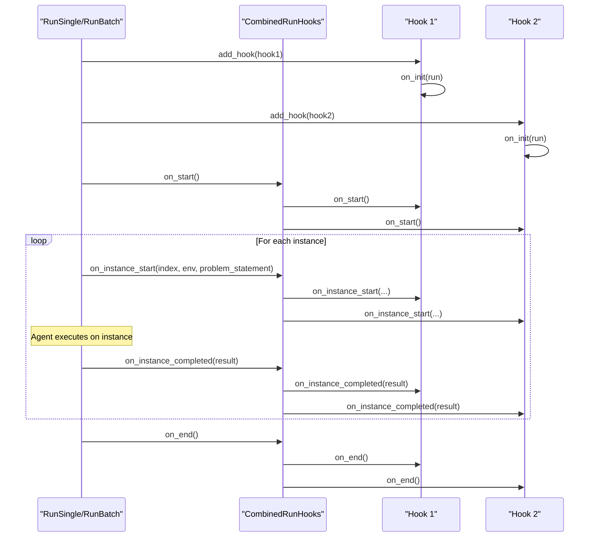
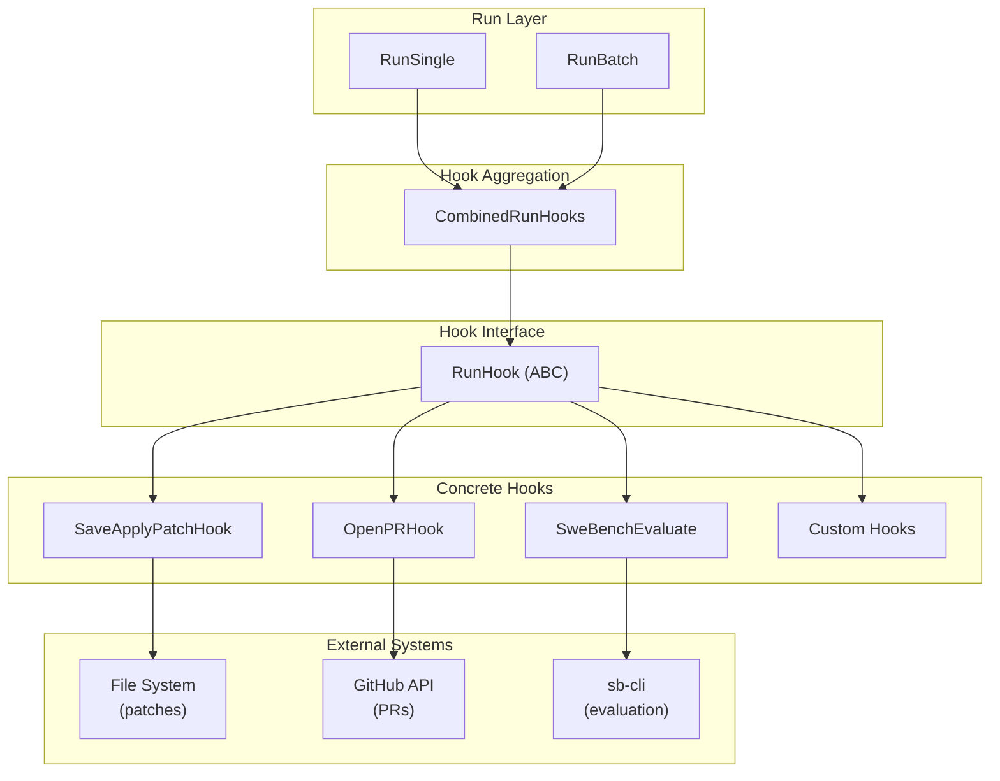
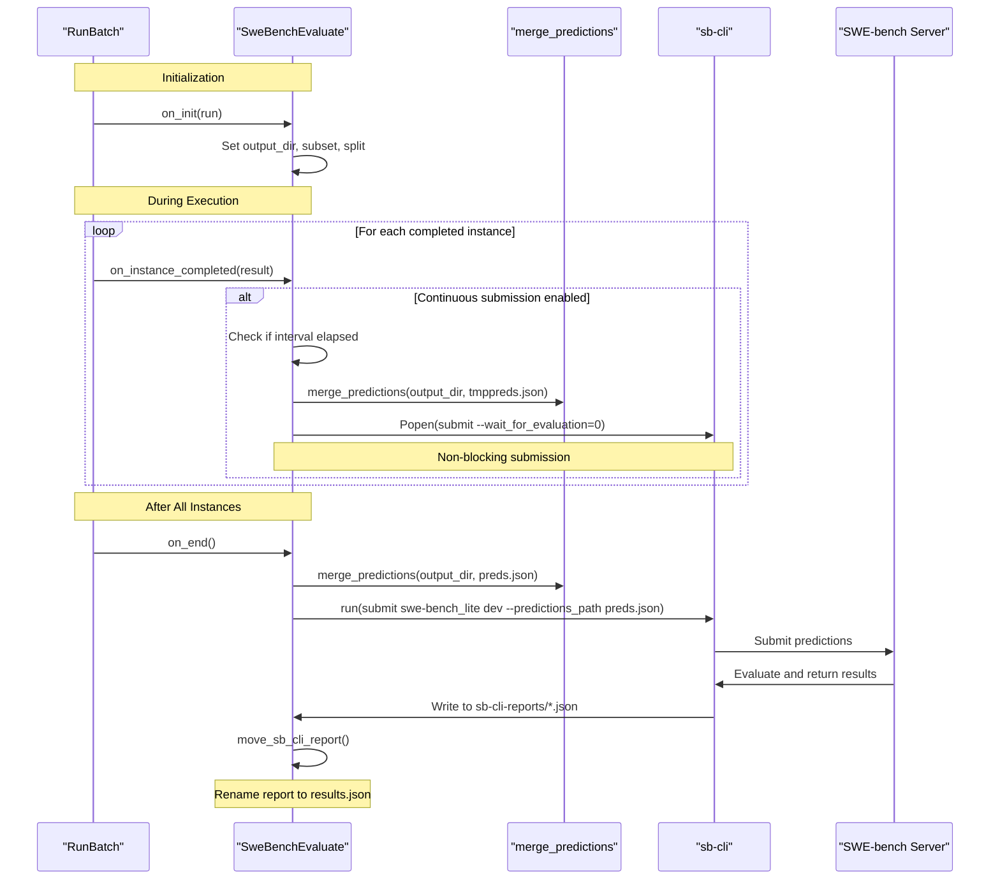

# Run Hooks and Evaluation

<details>
<summary>Relevant source files</summary>

The following files were used as context for generating this wiki page:

- [sweagent/run/batch_instances.py](sweagent/run/batch_instances.py)
- [sweagent/run/common.py](sweagent/run/common.py)
- [sweagent/run/hooks/apply_patch.py](sweagent/run/hooks/apply_patch.py)
- [sweagent/run/hooks/swe_bench_evaluate.py](sweagent/run/hooks/swe_bench_evaluate.py)
- [sweagent/run/run_batch.py](sweagent/run/run_batch.py)
- [sweagent/run/run_replay.py](sweagent/run/run_replay.py)
- [sweagent/run/run_single.py](sweagent/run/run_single.py)
- [sweagent/utils/log.py](sweagent/utils/log.py)
- [tests/test_agent.py](tests/test_agent.py)
- [tests/test_batch_instance.py](tests/test_batch_instance.py)
- [tests/test_run_batch.py](tests/test_run_batch.py)
- [tests/test_run_single.py](tests/test_run_single.py)

</details>


This page documents the run hook system that allows extending SWE-agent execution with custom behaviors, and specifically covers the automated evaluation system for SWE-bench. Run hooks enable actions like saving patches, opening pull requests, and submitting results for evaluation without modifying core execution logic.

For information about the core execution orchestration, see [Single Run Execution](#5.1) and [Batch Processing](#5.2).

## Overview

The run hook system provides a plugin architecture for injecting custom behavior at specific points during agent execution. Hooks implement the `RunHook` interface and receive callbacks at key lifecycle events. This design allows separation of concerns between core agent logic and auxiliary actions like file I/O, API calls, or evaluation submissions.

The `CombinedRunHooks` class aggregates multiple hooks and ensures they are all invoked at each lifecycle point. Both `RunSingle` and `RunBatch` use this system to coordinate hooks across single-instance and batch execution contexts.

**Sources:** [sweagent/run/run_batch.py:59](), [sweagent/run/run_single.py:48]()

## Hook Lifecycle

All hooks follow a standard lifecycle with five callback methods that correspond to different phases of execution:

| Method | Called When | Receives | Purpose |
|--------|------------|----------|---------|
| `on_init` | Hook is added to run | `run` (RunSingle or RunBatch) | Initialize hook with access to run configuration |
| `on_start` | Before any instances execute | None | Perform setup before execution begins |
| `on_instance_start` | Before each instance starts | `index`, `env`, `problem_statement` | Prepare for individual instance execution |
| `on_instance_completed` | After each instance finishes | `result` (AgentRunResult) | Process results from completed instance |
| `on_end` | After all instances complete | None | Perform cleanup and final actions |

**Sources:** [sweagent/run/run_batch.py:236-254](), [sweagent/run/run_single.py:184-205]()

### Hook Lifecycle Sequence



**Sources:** [sweagent/run/run_batch.py:242-254](), [sweagent/run/run_single.py:189-205]()

## Built-in Hooks

SWE-agent provides three built-in hooks for common post-execution actions:

### SaveApplyPatchHook

The `SaveApplyPatchHook` saves generated patches to the filesystem and optionally applies them to local repositories. This is the default hook added to all runs.

**Key behaviors:**
- Saves patches as `{instance_id}.patch` files in the output directory
- Only applies patches when `apply_patch_locally=True` and the repository is local
- Uses `_is_promising_patch` to check if the patch likely solves the issue (exit status is "submitted")
- Displays success message with instructions for inspecting/applying the patch

**Configuration:**
```python
SaveApplyPatchHook(
    apply_patch_locally: bool = False,  # Apply to local repo
    show_success_message: bool = True    # Show congratulations panel
)
```

**Sources:** [sweagent/run/hooks/apply_patch.py:17-106]()

### OpenPRHook

The `OpenPRHook` creates GitHub pull requests with generated patches when issues are resolved. This hook is added when `actions.open_pr=True` in the run configuration.

**Key behaviors:**
- Only opens PRs for promising patches (submitted exit status)
- Uses GitHub API to create PR with patch content
- Configurable via `OpenPRConfig` for PR title, body template, and other options

**Sources:** [sweagent/run/run_single.py:179-181]()

### SweBenchEvaluate

The `SweBenchEvaluate` hook automates submission of predictions to SWE-bench for evaluation. It is automatically added to batch runs when `SWEBenchInstances.evaluate=True`.

**Key behaviors:**
- Merges predictions into `preds.json` after all instances complete
- Submits to `sb-cli` (SWE-bench command-line interface) with appropriate subset and split
- Supports continuous submission during long-running batch jobs
- Moves final evaluation report from `sb-cli-reports/` to `results.json`

**Configuration:**
```python
SweBenchEvaluate(
    output_dir: Path,
    subset: str,                          # "lite", "verified", "full", "multimodal", "multilingual"
    split: str,                           # "dev", "test"
    continuous_submission_every: int = 0  # Submit every N seconds (0 = disabled)
)
```

**Sources:** [sweagent/run/hooks/swe_bench_evaluate.py:19-113](), [sweagent/run/run_batch.py:223-233]()

## Hook Integration Architecture



**Sources:** [sweagent/run/run_batch.py:59](), [sweagent/run/run_single.py:48](), [sweagent/run/hooks/apply_patch.py:17](), [sweagent/run/hooks/swe_bench_evaluate.py:19]()

## Using Hooks

### Adding Hooks to Single Runs

Hooks can be added programmatically or configured via CLI/YAML:

**Programmatic:**
```python
from sweagent.run.run_single import RunSingle, RunSingleConfig
from sweagent.run.hooks.apply_patch import SaveApplyPatchHook

config = RunSingleConfig(...)
run = RunSingle.from_config(config)
run.add_hook(SaveApplyPatchHook(apply_patch_locally=True))
run.run()
```

**CLI configuration:**
```bash
sweagent run \
    --actions.apply_patch_locally=True \
    --actions.open_pr=True \
    --actions.pr_config.draft=True
```

The `RunSingle.from_config` method automatically adds hooks based on `actions` configuration:
- `SaveApplyPatchHook` is always added
- `OpenPRHook` is added when `actions.open_pr=True`

**Sources:** [sweagent/run/run_single.py:164-182]()

### Adding Hooks to Batch Runs

For batch execution, hooks are added similarly but with special handling for SWE-bench evaluation:

**Programmatic:**
```python
from sweagent.run.run_batch import RunBatch, RunBatchConfig
from sweagent.run.hooks.swe_bench_evaluate import SweBenchEvaluate

config = RunBatchConfig(...)
run = RunBatch.from_config(config)
run.add_hook(SweBenchEvaluate(
    output_dir=config.output_dir,
    subset="lite",
    split="dev",
    continuous_submission_every=300  # Submit every 5 minutes
))
run.main()
```

**CLI configuration:**
```bash
sweagent run-batch \
    --instances.type=swe_bench \
    --instances.subset=lite \
    --instances.evaluate=True  # Automatically adds SweBenchEvaluate hook
```

The default hook for batch runs is `SaveApplyPatchHook(show_success_message=False)` to avoid excessive console output during parallel execution.

**Sources:** [sweagent/run/run_batch.py:195-234]()

## SWE-bench Evaluation System

The SWE-bench evaluation system uses the `SweBenchEvaluate` hook to automatically submit predictions and retrieve evaluation results.

### Evaluation Workflow



**Sources:** [sweagent/run/hooks/swe_bench_evaluate.py:65-113]()

### SWE-bench Subset Mapping

The hook maps friendly subset names to SWE-bench dataset identifiers:

| Subset | SWE-bench Dataset |
|--------|-------------------|
| `lite` | `swe-bench_lite` |
| `verified` | `swe-bench_verified` |
| `multimodal` | `swe-bench_multimodal` |

**Sources:** [sweagent/run/hooks/swe_bench_evaluate.py:20]()

### Continuous Evaluation

The `continuous_submission_every` parameter enables periodic submissions during long batch runs:

**Behavior:**
1. After each instance completes, check if the interval has elapsed
2. If yes, merge current predictions to `tmppreds.json`
3. Submit to `sb-cli` with `--wait_for_evaluation=0` for non-blocking execution
4. Track running submissions and log errors if they fail

This allows monitoring progress and catching issues early in multi-hour runs without waiting for all instances to complete.

**Sources:** [sweagent/run/hooks/swe_bench_evaluate.py:65-83]()

### sb-cli Command Construction

The hook constructs `sb-cli submit` commands with the following structure:

```bash
sb-cli submit {subset_mapped} {split} \
    --predictions_path {preds_path} \
    --run_id {output_dir_name}_{timestamp} \
    --output_dir {output_dir}/sb-cli-reports
```

For continuous submissions, additional flags suppress blocking behavior:
```bash
--wait_for_evaluation 0 --gen_report 0 --verify_submission 0
```

The `run_id` includes a timestamp suffix to avoid collisions when reusing output directories.

**Sources:** [sweagent/run/hooks/swe_bench_evaluate.py:40-55]()

## Prediction Format and Merging

Predictions are saved in SWE-bench format throughout execution and merged at the end:

### Individual Prediction Files

Each instance produces a `.pred` file:

```json
{
  "model_name_or_path": "trajectory_dir_name",
  "instance_id": "django__django-12345",
  "model_patch": "diff --git a/file.py ...\n..."
}
```

**Sources:** [sweagent/run/common.py:370-379]()

### Merged Predictions File

The `merge_predictions` function aggregates all `.pred` files into a single `preds.json`:

```json
[
  {
    "model_name_or_path": "...",
    "instance_id": "instance_1",
    "model_patch": "..."
  },
  {
    "model_name_or_path": "...",
    "instance_id": "instance_2",
    "model_patch": "..."
  }
]
```

This format is required by `sb-cli` for evaluation submission.

**Sources:** [sweagent/run/run_batch.py:249-252](), [sweagent/run/hooks/swe_bench_evaluate.py:74]()

## Evaluation Results

After successful evaluation, the hook moves the results from `sb-cli-reports/{run_id}.json` to `results.json` in the output directory. The results file contains:

- Per-instance evaluation outcomes (resolved/unresolved)
- Overall metrics (resolution rate, etc.)
- Execution details and error messages

**Sources:** [sweagent/run/hooks/swe_bench_evaluate.py:85-96]()

## Custom Hooks

To implement custom hooks, subclass `RunHook` and implement the desired lifecycle methods:

```python
from sweagent.run.hooks.abstract import RunHook
from sweagent.types import AgentRunResult

class CustomHook(RunHook):
    def on_init(self, *, run):
        self.run = run
        # Access run.output_dir, run.agent_config, etc.
    
    def on_instance_start(self, *, index: int, env, problem_statement):
        # Called before each instance
        print(f"Starting instance {problem_statement.id}")
    
    def on_instance_completed(self, *, result: AgentRunResult):
        # Called after each instance
        print(f"Completed with status: {result.info['exit_status']}")
    
    def on_end(self):
        # Called at the end of all execution
        print("All instances completed")
```

Then add the hook to your run:
```python
run.add_hook(CustomHook())
```

**Sources:** [sweagent/run/run_batch.py:236-238](), [tests/test_run_single.py:17-29]()