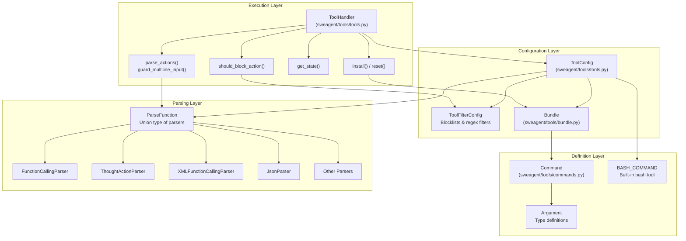
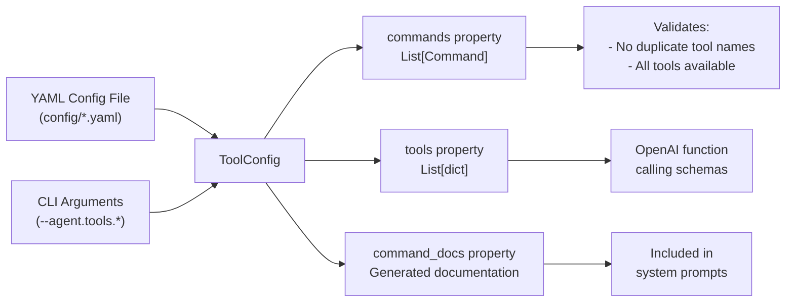
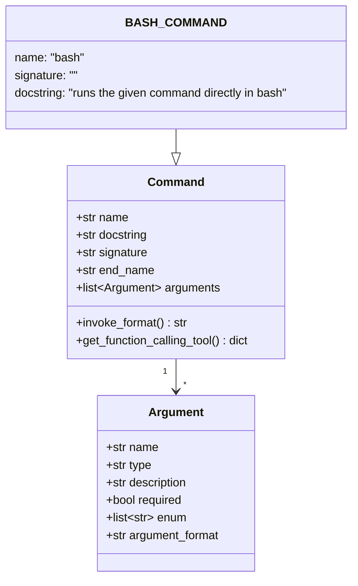
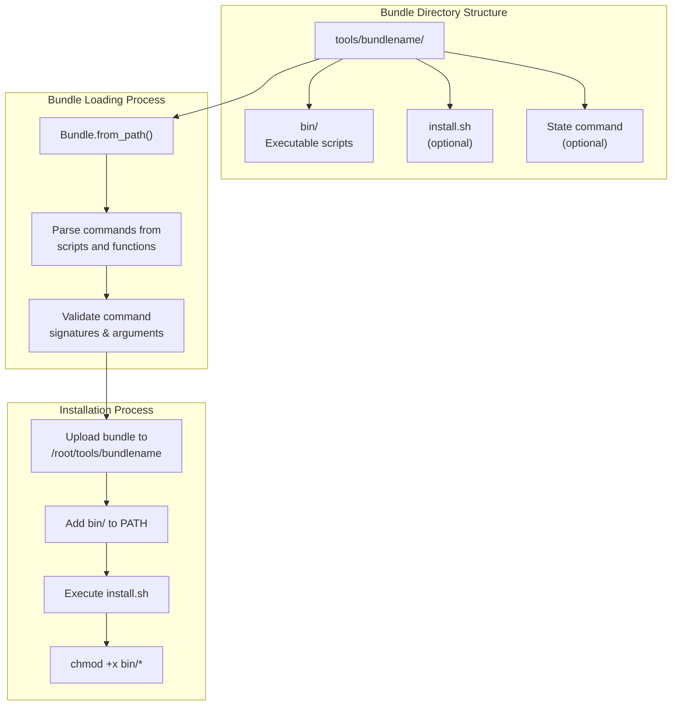
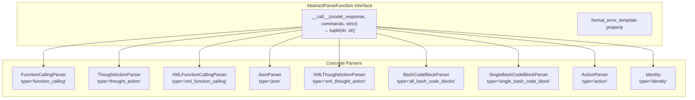
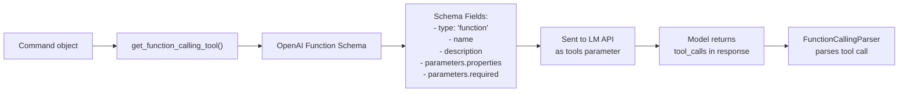
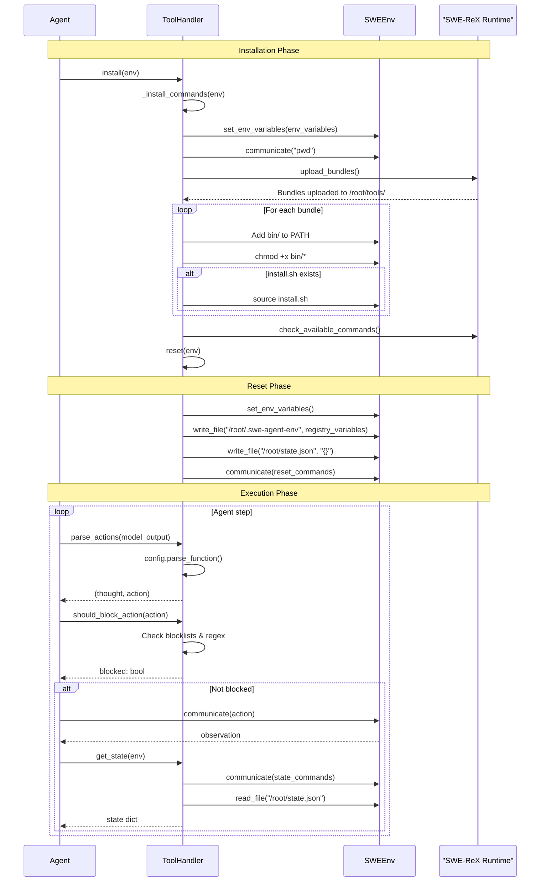
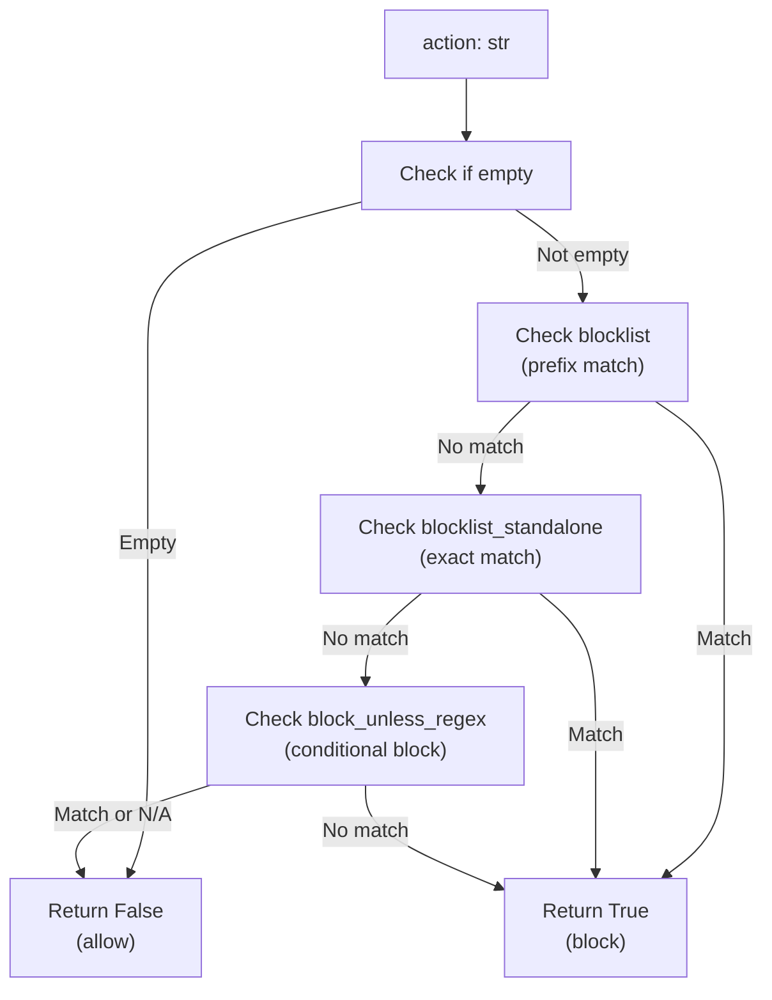
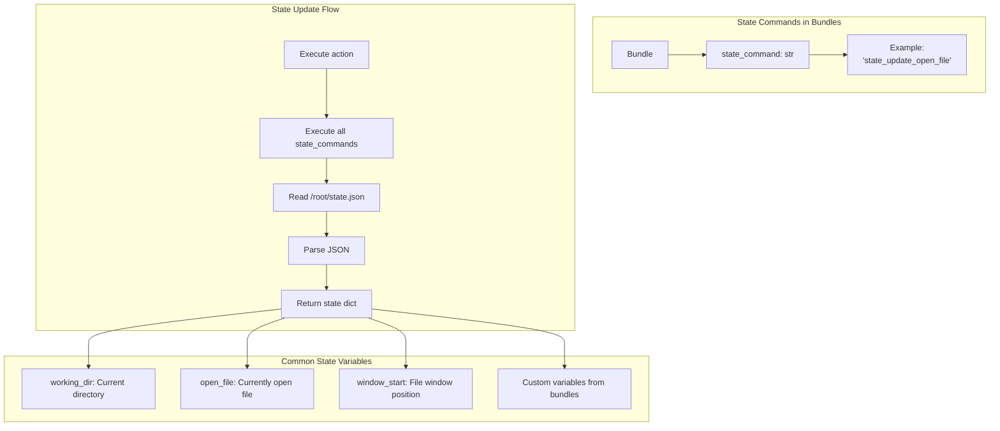
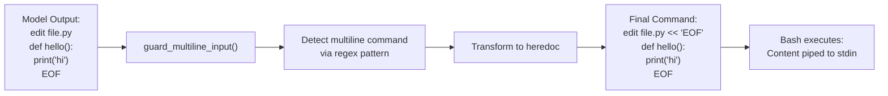

# Tool System

<details>
<summary>Relevant source files</summary>

The following files were used as context for generating this wiki page:

- [config/bash_only.yaml](config/bash_only.yaml)
- [docs/reference/exceptions.md](docs/reference/exceptions.md)
- [sweagent/exceptions.py](sweagent/exceptions.py)
- [sweagent/tools/commands.py](sweagent/tools/commands.py)
- [sweagent/tools/parsing.py](sweagent/tools/parsing.py)
- [sweagent/tools/tools.py](sweagent/tools/tools.py)
- [sweagent/tools/utils.py](sweagent/tools/utils.py)
- [tests/test_parsing.py](tests/test_parsing.py)
- [tests/test_tools_command_parsing.py](tests/test_tools_command_parsing.py)

</details>


The Tool System defines what actions agents can take in their environments. It manages the complete lifecycle from tool installation to command execution, including configuration, action parsing, validation, and state tracking. The system provides a pluggable architecture that supports multiple tool bundles, parsing strategies, and security filtering mechanisms.

For information about how agents use tools during execution, see [Core Agent System](#3.1). For details on the execution environment where tools run, see [SWEEnv and Runtime](#4.1).

## Architecture Overview

The Tool System consists of four primary components that work together to enable agent actions:



**Sources:** [sweagent/tools/tools.py:1-431](), [sweagent/tools/commands.py:1-221](), [sweagent/tools/parsing.py:1-620]()

## Core Components

### ToolConfig Class

The `ToolConfig` class is the central configuration object that defines all aspects of the tool system. It is typically loaded from YAML configuration files and can be modified via command-line arguments.

| Field | Type | Purpose |
|-------|------|---------|
| `bundles` | `list[Bundle]` | Tool bundles to load (e.g., edit, registry, submit) |
| `parse_function` | `ParseFunction` | Strategy for parsing model outputs into actions |
| `filter` | `ToolFilterConfig` | Command blocking and filtering rules |
| `enable_bash_tool` | `bool` | Whether to enable the built-in bash tool |
| `submit_command` | `str` | Name of the submission command (default: "submit") |
| `env_variables` | `dict[str, Any]` | Environment variables to set in the tool environment |
| `registry_variables` | `dict[str, Any]` | Variables to populate in the registry file |
| `reset_commands` | `list[str \| list[str]]` | Commands executed on environment reset |
| `execution_timeout` | `int` | Timeout for individual command execution (seconds) |
| `install_timeout` | `int` | Timeout for tool installation (seconds) |



The `ToolConfig` performs validation at initialization time, checking for duplicate tool names across bundles and ensuring that argument formats are valid.

**Sources:** [sweagent/tools/tools.py:75-225](), [config/bash_only.yaml:208-213]()

### Command and Argument Classes

The `Command` class defines an executable action with typed arguments and documentation. Commands can be simple one-line bash commands or multi-line commands terminated by an end marker.



**Command Signature Formats:**

Commands support multiple signature formats that are normalized to an `invoke_format` for execution:

| Signature Format | Example | Normalized To |
|-----------------|---------|---------------|
| Angle brackets | `goto <line_number>` | `goto {line_number}` |
| Optional brackets | `open "<path>" [<line_number>]` | `open "{path}" {line_number}` |
| Flag-style | `grep --pattern <pattern>` | `grep --pattern {pattern}` |
| No arguments | `scroll_up` | `scroll_up` |
| Default (no signature) | N/A | `{name} {arg1} {arg2} ...` |

The `invoke_format` property uses Python format string syntax where argument names become format placeholders. Individual arguments can customize their rendering via the `argument_format` field (default: `"{{value}}"`).

**Sources:** [sweagent/tools/commands.py:79-221](), [tests/test_tools_command_parsing.py:6-56]()

### Tool Bundles

A `Bundle` represents a collection of related tools packaged together. Bundles are directories containing executable scripts and configuration files.



Common bundles in SWE-agent include:
- `tools/submit` - Contains the submit command for solution submission
- `tools/edit_anthropic` - File editing tools optimized for Claude models
- `tools/registry` - Variable registry for storing/retrieving values

**Sources:** [sweagent/tools/tools.py:266-312](), [sweagent/tools/bundle.py]()

## Action Parsing

Action parsing is the process of converting a language model's output into executable commands. The `ParseFunction` interface defines multiple parsing strategies to support different model output formats.

### ParseFunction Interface



All parsers return a tuple of `(thought, action)` where:
- `thought`: The reasoning/explanation portion of the model's response
- `action`: The executable command string

When parsing fails, parsers raise a `FormatError` or `FunctionCallingFormatError` exception with a detailed error message that is presented back to the model.

**Sources:** [sweagent/tools/parsing.py:52-67](), [sweagent/exceptions.py:6-25]()

### Parser Comparison

| Parser | Input Format | Use Case | Example |
|--------|-------------|----------|---------|
| `FunctionCallingParser` | LiteLLM tool calls | Models with native function calling | `tool_calls: [{"function": {"name": "bash", "arguments": {...}}}]` |
| `ThoughtActionParser` | Markdown code blocks | General instruction-following models | `Let's check...\n```\nls -l\n```` |
| `XMLFunctionCallingParser` | XML tags | Models trained on XML formats | `<function=bash>\n<parameter=command>ls</parameter>\n</function>` |
| `JsonParser` | JSON object | Structured output models | `{"thought": "...", "command": {"name": "bash", "arguments": {...}}}` |
| `BashCodeBlockParser` | Bash code blocks | Execute all bash blocks | ` ```bash\nls\n```\n```bash\npwd\n``` ` |
| `SingleBashCodeBlockParser` | Single bash block | Enforce one command per turn | ` ```bash\nls -la\n``` ` |

**Example: FunctionCallingParser**

```python
# Input (model_response)
{
    "message": "Let's list the files",
    "tool_calls": [
        {
            "function": {
                "name": "bash",
                "arguments": {"command": "ls -la"}
            }
        }
    ]
}

# Output
thought = "Let's list the files"
action = "bash ls -la"
```

**Example: ThoughtActionParser**

```python
# Input (model_response)
{
    "message": "Let's look at the files in the current directory.\n```\nls -l\n```"
}

# Output
thought = "Let's look at the files in the current directory.\n"
action = "ls -l\n"
```

**Sources:** [sweagent/tools/parsing.py:109-605](), [tests/test_parsing.py:19-126]()

### Function Calling Schema Generation

When using `FunctionCallingParser`, the `ToolConfig` automatically generates OpenAI-compatible function calling schemas for all commands. These schemas are passed to the language model via the `tools` parameter.



**Sources:** [sweagent/tools/commands.py:133-162](), [sweagent/tools/tools.py:194-195]()

## ToolHandler Lifecycle

The `ToolHandler` class manages the complete lifecycle of tools within an environment, from installation to execution.



**Sources:** [sweagent/tools/tools.py:227-431]()

### Installation and Reset

The installation process prepares tools for use:

1. **Upload bundles**: Copy tool directories to `/root/tools/` in the container
2. **Configure PATH**: Add each bundle's `bin/` directory to `$PATH`
3. **Make executable**: Run `chmod +x` on all scripts in `bin/`
4. **Run install.sh**: Execute bundle-specific installation scripts if present
5. **Verify availability**: Check that all command names are available via `which`

The reset process initializes the tool environment:

1. **Set environment variables**: Apply configured variables (e.g., `PAGER=cat`)
2. **Propagate variables**: Copy specified variables from host environment
3. **Initialize registry**: Write `registry_variables` to `/root/.swe-agent-env`
4. **Clear state**: Create empty `/root/state.json`
5. **Execute reset commands**: Run any configured setup commands

**Sources:** [sweagent/tools/tools.py:252-312]()

## Command Filtering and Blocking

The Tool System includes security features to prevent dangerous or problematic commands from executing. This is managed by the `ToolFilterConfig` class and implemented by `ToolHandler.should_block_action()`.

### Blocking Mechanisms



**Blocklist (Prefix Match):**
Commands that start with these strings are blocked:

```python
blocklist = [
    "vim", "vi", "emacs", "nano",  # Interactive editors
    "nohup",                        # Background processes
    "gdb",                          # Debugger
    "less", "tail -f",             # Interactive viewers
    "python -m venv",              # Virtual environments
    "make",                        # Build system
]
```

**Blocklist Standalone (Exact Match):**
Commands that match exactly are blocked:

```python
blocklist_standalone = [
    "python", "python3", "ipython",  # Interactive REPLs
    "bash", "sh", "/bin/bash", "/bin/sh",  # Shell spawning
    "vi", "vim", "emacs", "nano",    # Interactive editors
    "su",                            # User switching
]
```

**Conditional Blocking:**
Some commands are allowed only if they match a specific regex pattern:

```python
block_unless_regex = {
    "radare2": r"\b(?:radare2)\b.*\s+-c\s+.*",  # Only allow non-interactive mode
    "r2": r"\b(?:radare2)\b.*\s+-c\s+.*",
}
```

When a command is blocked, the agent receives an error message:

```
Operation '{action}' is not supported by this environment.
```

This error is added to the agent's history, allowing it to try a different approach.

**Sources:** [sweagent/tools/tools.py:29-74](), [sweagent/tools/tools.py:353-367]()

## State Management

The Tool System maintains environment state that can be queried between command executions. State is stored in `/root/state.json` and updated by state commands defined in tool bundles.



**State Access Pattern:**

```python
# After action execution
state = tool_handler.get_state(env)
# state = {
#     "working_dir": "/testbed",
#     "open_file": "src/main.py",
#     "window_start": 100
# }
```

State commands are shell scripts that update `/root/state.json`. They are executed after each agent action but before the observation is returned to the agent. This allows the environment to provide contextual information about the current working state.

**Sources:** [sweagent/tools/tools.py:159-164](), [sweagent/tools/tools.py:314-348]()

## Multiline Commands and Heredocs

Commands with an `end_name` field are multiline commands that accept large text blocks as input. These use bash heredoc syntax for safe transmission of multiline content.

### Heredoc Transformation



**Example Transformation:**

```python
# Input action
action = """edit file.py
def hello():
    print("hi")
EOF"""

# After guard_multiline_input()
guarded = """edit file.py << 'EOF'
def hello():
    print("hi")
EOF"""
```

The heredoc marker ensures that special characters, whitespace, and newlines in the content are preserved exactly as written. The `ToolHandler._get_command_patterns()` method creates regex patterns for each multiline command to detect and transform them.

**Pattern Structure:**
```python
# For a command with end_name
pattern = re.compile(
    rf"^\s*({command.name})\s*(.*?)^({command.end_name})\s*$",
    re.DOTALL | re.MULTILINE,
)
# Groups: (1) command name, (2) arguments, (3) end marker
```

**Sources:** [sweagent/tools/tools.py:382-430](), [sweagent/tools/utils.py:8-36]()

## Configuration Example

Here is a complete example showing how tools are configured in a YAML file:

```yaml
agent:
  tools:
    execution_timeout: 60
    bundles:
      - path: tools/submit
      - path: tools/edit_anthropic
      - path: tools/registry
    parse_function:
      type: function_calling
    filter:
      blocklist:
        - vim
        - vi
        - emacs
      blocklist_standalone:
        - python
        - bash
    env_variables:
      PAGER: cat
      GIT_PAGER: cat
    registry_variables:
      CURRENT_FILE: null
      CURRENT_LINE: 0
    enable_bash_tool: true
    submit_command: submit
```

This configuration:
- Sets a 60-second timeout for command execution
- Loads three tool bundles (submit, edit_anthropic, registry)
- Uses function calling parser for models with native tool support
- Blocks interactive editors and shells
- Configures environment variables to prevent pager usage
- Initializes registry with tracking variables
- Enables the built-in bash tool
- Sets "submit" as the submission command

**Sources:** [config/bash_only.yaml:208-213](), [sweagent/tools/tools.py:75-225]()