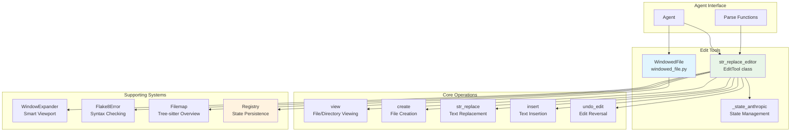
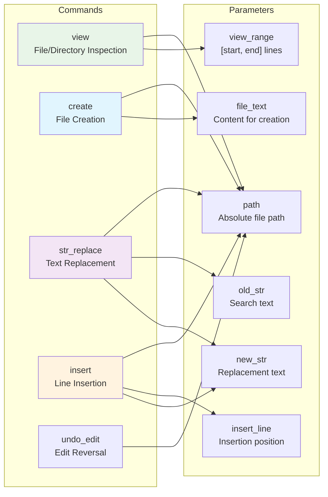
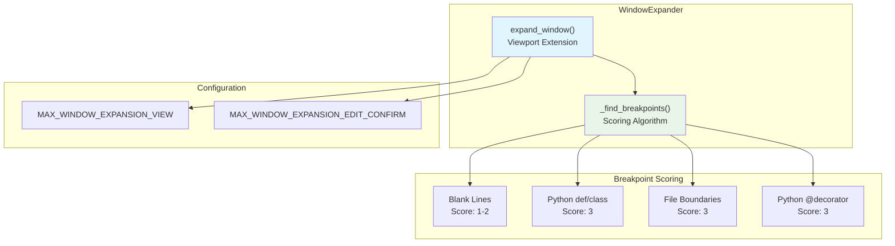
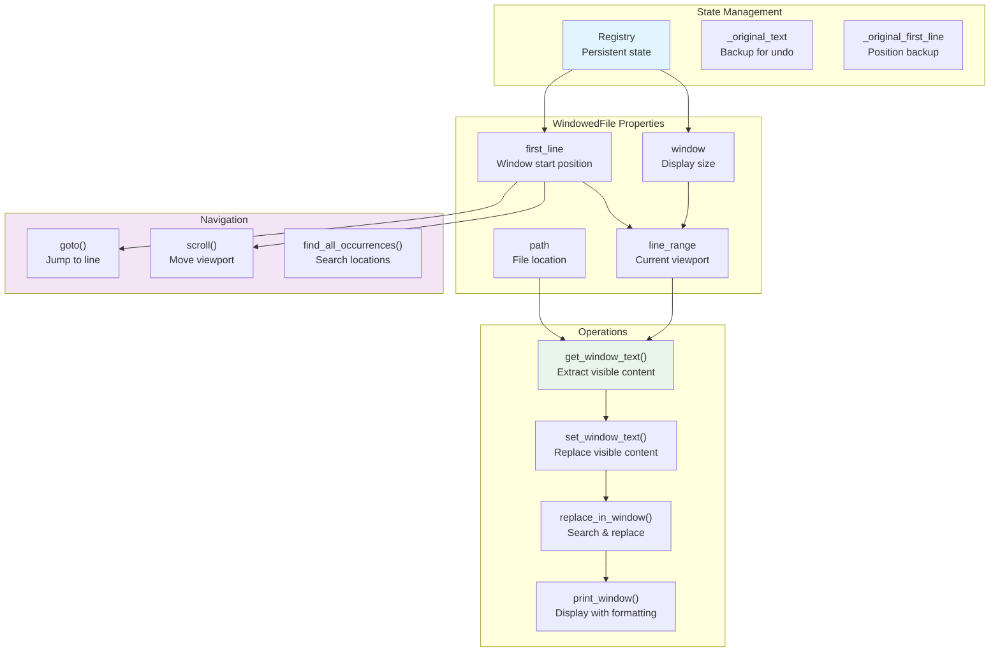
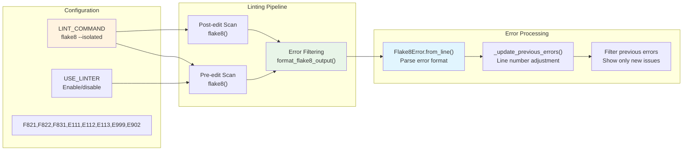
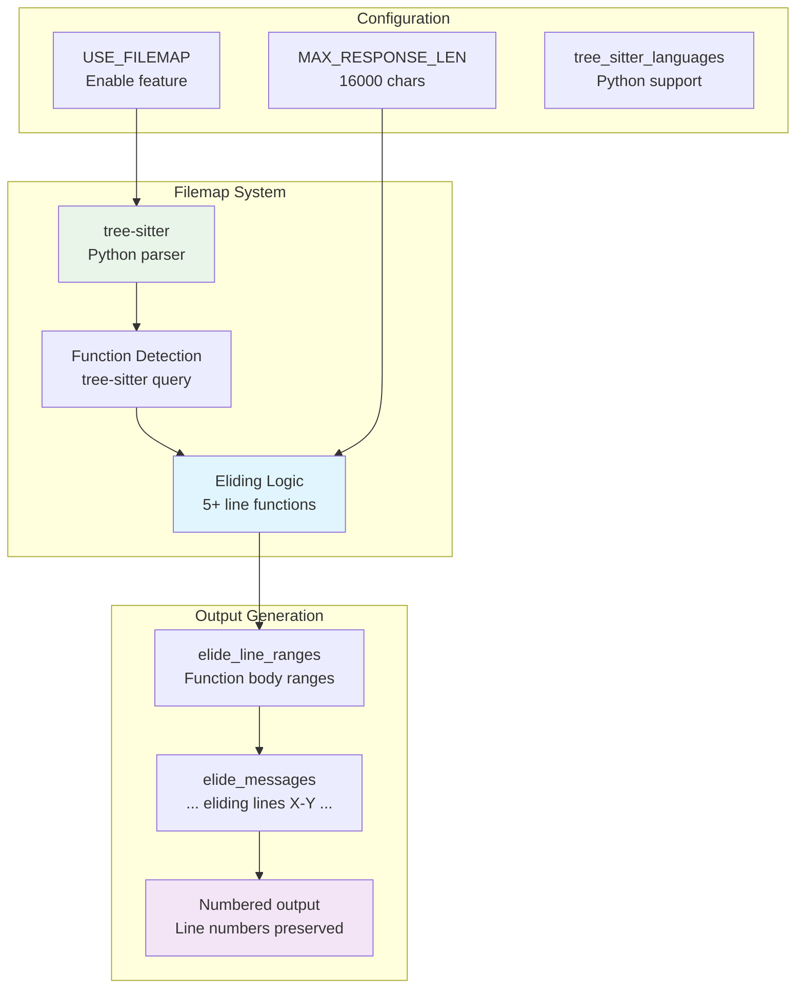

# Edit and File Operations

Relevant source files

The following files were used as context for generating this wiki page:

- [config/bash_only.yaml](config/bash_only.yaml)
- [config/default.yaml](config/default.yaml)
- [docs/reference/exceptions.md](docs/reference/exceptions.md)
- [sweagent/exceptions.py](sweagent/exceptions.py)
- [sweagent/tools/commands.py](sweagent/tools/commands.py)
- [sweagent/tools/parsing.py](sweagent/tools/parsing.py)
- [sweagent/tools/tools.py](sweagent/tools/tools.py)
- [sweagent/tools/utils.py](sweagent/tools/utils.py)
- [tests/test_parsing.py](tests/test_parsing.py)
- [tests/test_tools_command_parsing.py](tests/test_tools_command_parsing.py)

This document covers the file manipulation and editing tools available in the SWE-agent system. These tools enable agents to view, create, modify, and manage files within their execution environments. The system provides two main approaches: the `str_replace_editor` tool for direct file operations and the `WindowedFile` system for managing large files with windowed views.

For information about the broader tool system architecture, see [Tool System](#6). For details on parsing functions that process tool outputs, see [Parsing Functions](#6.1).

## System Architecture

The edit and file operations system consists of several interconnected components that work together to provide comprehensive file manipulation capabilities:

Sources: [tools/edit_anthropic/bin/str_replace_editor:1-711](), [tools/windowed/lib/windowed_file.py:1-316](), [tools/edit_anthropic/config.yaml:1-57]()

## str_replace_editor Tool

The `str_replace_editor` is the primary file manipulation tool, implemented in the `EditTool` class. It provides a comprehensive interface for file operations with built-in safety features and intelligent error handling.

### Command Interface

The tool supports five core commands, each with specific parameters and validation:

Sources: [tools/edit_anthropic/bin/str_replace_editor:362-402](), [tools/edit_anthropic/config.yaml:20-55]()

### File Operations Implementation

The `EditTool` class handles core file operations with comprehensive validation and error handling:

| Operation | Method | Key Features |
|-----------|---------|-------------|
| **View** | `view()` | Directory listing, file content display, range viewing, filemap for large files |
| **Create** | `create_file()` | Path validation, parent directory checks, file history tracking |
| **Replace** | `str_replace()` | Exact string matching, uniqueness validation, linting integration |
| **Insert** | `insert()` | Line-based insertion, boundary checking, snippet generation |
| **Undo** | `undo_edit()` | History-based reversal, state restoration |

Sources: [tools/edit_anthropic/bin/str_replace_editor:436-641]()

### Window Expansion System

The `WindowExpander` class provides intelligent viewport management for better code context:

Sources: [tools/edit_anthropic/bin/str_replace_editor:228-340](), [tools/edit_anthropic/bin/str_replace_editor:29-30]()

## WindowedFile System

The `WindowedFile` class provides a windowed view interface for managing large files efficiently, with state persistence and intelligent navigation:

### Core Architecture

Sources: [tools/windowed/lib/windowed_file.py:53-316](), [tools/windowed/lib/windowed_file.py:116-126]()

### Text Manipulation Features

The `WindowedFile` class provides several text manipulation methods with intelligent positioning:

| Method | Purpose | Key Features |
|--------|---------|-------------|
| `replace_in_window()` | Replace text in current window | Returns `ReplacementInfo`, auto-repositioning |
| `replace()` | Replace text in entire file | Multiple occurrence handling, line tracking |
| `insert()` | Insert text at specified position | Flexible positioning, returns `InsertInfo` |
| `find_all_occurrences()` | Search for text patterns | Zero/one-based indexing options |
| `undo_edit()` | Revert to original state | Restores text and position |

Sources: [tools/windowed/lib/windowed_file.py:190-279]()

## Linting and Validation

The system includes comprehensive linting support through the `Flake8Error` class and error filtering:

Sources: [tools/edit_anthropic/bin/str_replace_editor:65-188](), [tools/edit_anthropic/bin/str_replace_editor:538-572]()

## Filemap Integration

For large Python files, the system uses tree-sitter-based filemap generation to provide abbreviated views:

Sources: [tools/edit_anthropic/bin/str_replace_editor:190-226](), [tools/edit_anthropic/bin/str_replace_editor:26-32]()

## Registry and State Management

Both edit systems use a registry-based approach for state persistence:

| Registry Key | Purpose | Used By |
|-------------|---------|----------|
| `CURRENT_FILE` | Current file path | `WindowedFile`, `str_replace_editor` |
| `FIRST_LINE` | Window start position | `WindowedFile` |
| `WINDOW` | Window size | `WindowedFile` |
| `file_history` | Edit history for undo | `str_replace_editor` |
| `OVERLAP` | Scroll overlap amount | `WindowedFile` |

The `_state_anthropic` command provides additional state management by tracking the current working directory in `/root/state.json`.

Sources: [tools/windowed/lib/windowed_file.py:15-16](), [tools/edit_anthropic/bin/str_replace_editor:18](), [tools/edit_anthropic/bin/_state_anthropic:1-22]()

## Error Handling and Validation

The system implements comprehensive error handling with specific exit codes and validation:

| Error Type | Exit Code | Validation |
|------------|-----------|------------|
| Missing required parameter | 1-4 | Parameter presence check |
| Invalid command | 5 | Command enumeration |
| Path validation errors | 6-9 | Absolute path, existence, directory checks |
| View range errors | 10-14 | Range bounds, integer validation |
| String replacement errors | 15-16 | Uniqueness, occurrence validation |
| File operation errors | 17-21 | Insert bounds, undo history, I/O errors |

Sources: [tools/edit_anthropic/bin/str_replace_editor:404-427](), [tools/edit_anthropic/bin/str_replace_editor:459-479](), [tools/edit_anthropic/bin/str_replace_editor:522-536]()