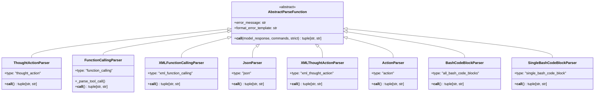
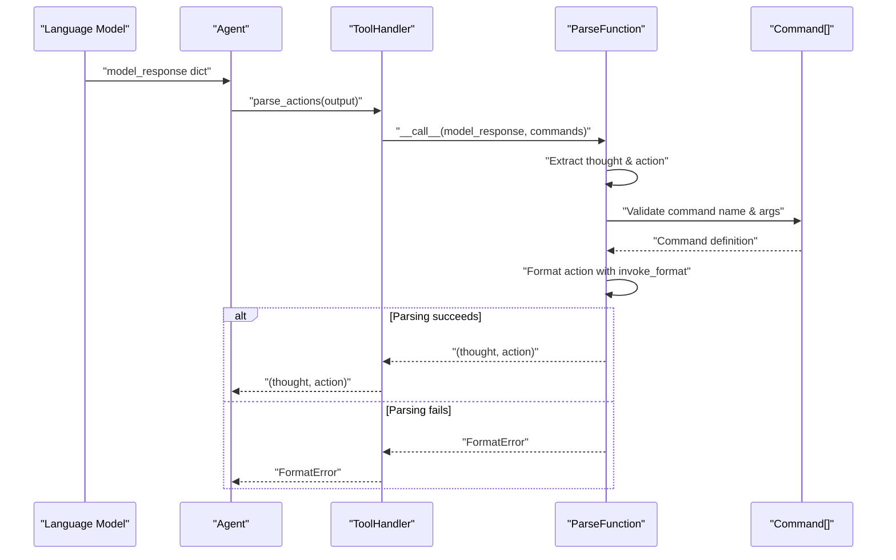
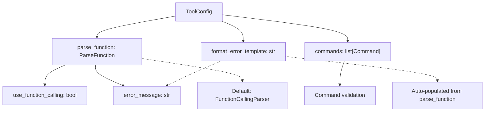
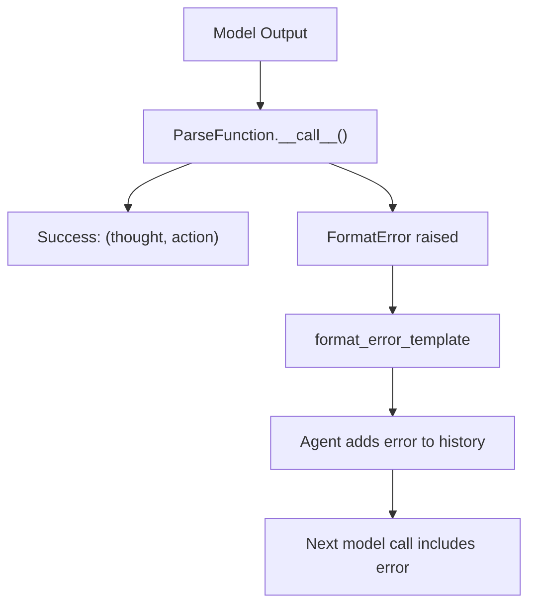
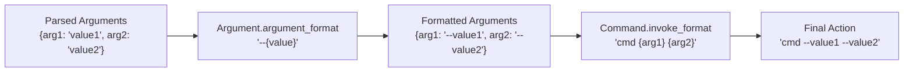
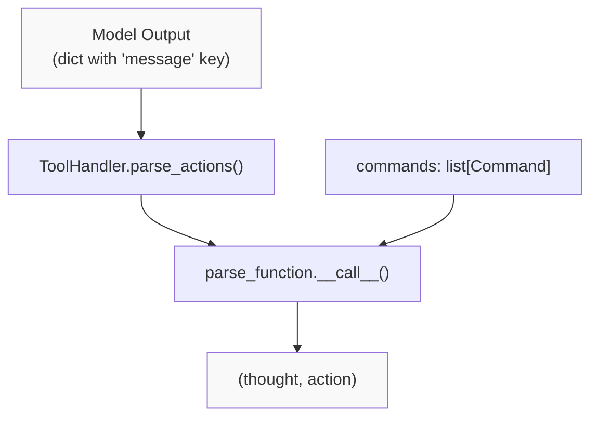
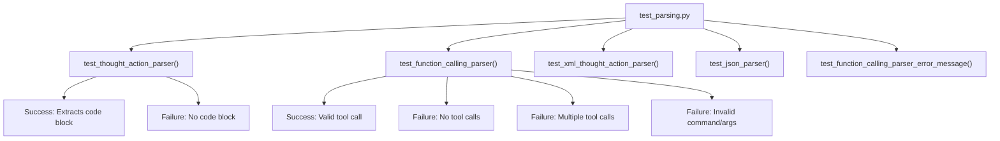

# Action Parsing

<details>
<summary>Relevant source files</summary>

The following files were used as context for generating this wiki page:

- [config/bash_only.yaml](config/bash_only.yaml)
- [docs/reference/exceptions.md](docs/reference/exceptions.md)
- [sweagent/exceptions.py](sweagent/exceptions.py)
- [sweagent/tools/commands.py](sweagent/tools/commands.py)
- [sweagent/tools/parsing.py](sweagent/tools/parsing.py)
- [sweagent/tools/tools.py](sweagent/tools/tools.py)
- [sweagent/tools/utils.py](sweagent/tools/utils.py)
- [tests/test_parsing.py](tests/test_parsing.py)
- [tests/test_tools_command_parsing.py](tests/test_tools_command_parsing.py)

</details>


Action parsing is the process of extracting executable commands (actions) from language model outputs. When a model generates text in response to a problem, that text must be transformed into concrete shell commands that can be executed in the environment. This document describes the parsing system that performs this transformation.

For information about tool configuration and available commands, see [Tool Configuration and Bundles](#6.1). For information about how parsed actions are executed and filtered, see [Command Execution and Filtering](#6.3).

## Overview

The action parsing system serves as the bridge between unstructured language model outputs and structured commands that can be executed. Different language models produce outputs in different formats (natural language with code blocks, XML tags, JSON objects, or native function calls), so SWE-agent provides multiple parser implementations to handle these variations.

**Sources:** [sweagent/tools/parsing.py:1-34]()

## Parser Architecture

### AbstractParseFunction Interface

All parsers implement the `AbstractParseFunction` interface, which defines two key components:

1. A `__call__` method that takes model output and returns a tuple of `(thought, action)`
2. An `error_message` template for formatting error messages when parsing fails



**Sources:** [sweagent/tools/parsing.py:52-67]()

### Parsing Flow

The parsing process follows this sequence:



**Sources:** [sweagent/tools/tools.py:378-380](), [sweagent/tools/parsing.py:60-62]()

## Parser Implementations

### Parser Types and Formats

The following table summarizes the available parser types and their expected input formats:

| Parser Type | Input Format | Use Case |
|------------|--------------|----------|
| `thought_action` | Discussion + code block with backticks | General purpose, works with most models |
| `function_calling` | LiteLLM tool call format | Models with native function calling (GPT-4, Claude) |
| `xml_function_calling` | XML tags with parameters | XML-based function calling |
| `json` | JSON object with thought/command | Structured JSON output |
| `xml_thought_action` | Discussion + XML command tags | XML-based command wrapping |
| `action` | Single command only | Simple command-only mode |
| `action_only` | Command without thought | No discussion, direct command |
| `edit_format` | Discussion + code block | File editing workflow |
| `identity` | Passthrough | No parsing, returns as-is |
| `all_bash_code_blocks` | Multiple bash code blocks | Execute all bash blocks |
| `single_bash_code_block` | Single bash code block | Execute one bash block |

**Sources:** [sweagent/tools/parsing.py:72-619]()

### ThoughtActionParser

The `ThoughtActionParser` expects model output in the format of a discussion followed by a command wrapped in triple backticks:

**Input Example:**
```
Let's look at the files in the current directory.

```
ls -l
```
```

**Output:** `("Let's look at the files in the current directory.\n", "ls -l\n")`

The parser uses a regex pattern to find code blocks and extracts the last valid (non-nested) code block as the action. Everything outside the code block becomes the thought.

**Sources:** [sweagent/tools/parsing.py:109-166](), [tests/test_parsing.py:29-37]()

### FunctionCallingParser

The `FunctionCallingParser` handles native function calling formats from LiteLLM, which wraps function calls from providers like OpenAI and Anthropic:

**Input Example:**
```python
{
    "message": "Let's list the files",
    "tool_calls": [
        {
            "function": {
                "name": "ls",
                "arguments": {"path": "."}
            }
        }
    ]
}
```

**Output:** `("Let's list the files", "ls .")`

The parser performs several validations:
- Exactly one tool call must be present
- The command name must exist in the available commands
- All required arguments must be provided
- No extra arguments beyond those defined in the command
- Arguments are properly formatted using the command's `argument_format` templates

**Sources:** [sweagent/tools/parsing.py:371-453](), [tests/test_parsing.py:83-126]()

### XMLFunctionCallingParser

The `XMLFunctionCallingParser` parses XML-formatted function calls:

**Input Example:**
```
Let's look at the files in the current directory.
<function=bash>
<parameter=command>find /testbed -type f -name "_discovery.py"</parameter>
</function>
```

**Output:** `("Let's look at the files in the current directory.", "find /testbed -type f -name \"_discovery.py\"")`

The parser uses regex patterns to extract the function name and parameters, validates them against command definitions, and formats the final action.

**Sources:** [sweagent/tools/parsing.py:225-322]()

### JsonParser

The `JsonParser` expects a JSON object with structured thought and command fields:

**Input Example:**
```json
{
    "thought": "List files",
    "command": {
        "name": "ls",
        "arguments": {
            "path": "."
        }
    }
}
```

**Output:** `("List files", "ls .")`

The parser validates the JSON structure, checks for required keys, and formats arguments according to the command's `invoke_format`.

**Sources:** [sweagent/tools/parsing.py:455-539](), [tests/test_parsing.py:67-81]()

### BashCodeBlockParser

The `BashCodeBlockParser` extracts and executes all bash code blocks from the model output:

**Input Example:**
```
First, let's check the directory:
```bash
ls -la
```

Then look at a specific file:
```bash
cat file.txt
```
```

**Output:** `("<extracted_code_block>\n\nThen look at a specific file:\n<extracted_code_block>", "ls -la\ncat file.txt")`

This parser is useful when you want to execute multiple commands from a single response.

**Sources:** [sweagent/tools/parsing.py:541-570]()

### SingleBashCodeBlockParser

Similar to `BashCodeBlockParser`, but enforces exactly one bash code block:

**Input Example:**
```
Let me check the directory:
```bash
ls -la
```
```

**Output:** `("Let me check the directory:\n<extracted_code_block>", "ls -la")`

This parser raises a `FormatError` if zero or multiple bash blocks are detected.

**Sources:** [sweagent/tools/parsing.py:572-605]()

## Configuration

### Setting the Parser

Parsers are configured through the `ToolConfig.parse_function` field. You can specify the parser in several ways:

**YAML Configuration:**
```yaml
agent:
  tools:
    parse_function:
      type: "thought_action"
```

**Command Line:**
```bash
sweagent run --agent.tools.parse_function.type=function_calling
```

**Python:**
```python
from sweagent.tools.parsing import FunctionCallingParser
from sweagent.tools.tools import ToolConfig

config = ToolConfig(
    parse_function=FunctionCallingParser()
)
```

**Sources:** [sweagent/tools/tools.py:112-114](), [config/bash_only.yaml:212-213]()

### Parser Integration with ToolConfig

The `ToolConfig` class integrates the parser with other tool configuration:



The `ToolConfig` automatically determines if function calling is enabled based on the parser type:

**Sources:** [sweagent/tools/tools.py:75-225]()

## Error Handling

### FormatError Exception

When parsing fails, parsers raise a `FormatError` exception. This exception carries a message that is shown to the model in the next step, allowing it to correct its output format.



**Sources:** [sweagent/exceptions.py:6-8]()

### FunctionCallingFormatError

The `FunctionCallingFormatError` is a specialized format error for function calling parsers that includes an error code and extra information:

**Error Codes:**
- `"missing"` - No tool calls in output
- `"multiple"` - Multiple tool calls (expected one)
- `"invalid_json"` - Arguments not valid JSON
- `"invalid_command"` - Command name not found
- `"missing_arg"` - Required argument missing
- `"unexpected_arg"` - Extra argument provided

**Error Message Template:**

The error templates use Jinja2 syntax to customize the message based on the error code:

```jinja2

Your last output did not use any tool calls!
Please make sure your output includes exactly _ONE_ function call!

Your last output included multiple tool calls!

Your action could not be parsed properly: {{exception_message}}.

Your action could not be parsed properly: {{exception_message}}.

```

**Sources:** [sweagent/exceptions.py:10-25](), [sweagent/tools/parsing.py:374-392](), [tests/test_parsing.py:128-131]()

## Argument Formatting

### Command-Specific Formatting

Parsers use the `Command.invoke_format` and `Argument.argument_format` fields to construct the final action string:



**Example:**
```python
command = Command(
    name="grep",
    signature="grep --pattern <pattern> --file <file>",
    arguments=[
        Argument(
            name="pattern",
            type="string",
            description="search pattern",
            required=True,
            argument_format="--pattern {value}"
        ),
        Argument(
            name="file",
            type="string",
            description="file to search",
            required=True,
            argument_format="--file {value}"
        )
    ]
)
```

**Sources:** [sweagent/tools/commands.py:102-132](), [sweagent/tools/parsing.py:310-321](), [sweagent/tools/parsing.py:431-437]()

### Quoting Logic

The parsers use the `_should_quote()` utility function to determine when to quote string arguments:

- Bash commands: Never quoted (command itself handles quoting)
- Multi-line commands: Never quoted (use heredoc syntax)
- Single-line string arguments: Quoted using `shlex.quote()`

**Sources:** [sweagent/tools/utils.py:39-43](), [sweagent/tools/parsing.py:313-315](), [sweagent/tools/parsing.py:423-429]()

## Parser Selection Guidelines

Choosing the right parser depends on your model and use case:

| Scenario | Recommended Parser | Rationale |
|----------|-------------------|-----------|
| Models with native function calling (GPT-4, Claude Sonnet 4) | `function_calling` | Most reliable, leverages native API features |
| Models without function calling | `thought_action` or `single_bash_code_block` | Works with any instruction-following model |
| XML-preferring models | `xml_function_calling` or `xml_thought_action` | Better for models trained on XML formats |
| Structured output required | `json` | Ensures consistent output structure |
| Multiple commands per step | `all_bash_code_blocks` | Extracts all bash blocks |
| Testing/debugging | `identity` | No parsing, see raw model output |

**Note:** If you don't use `FunctionCallingParser`, you must include tool documentation in your system prompt using the `{{command_docs}}` template variable. Function calling parsers automatically provide this information through the API.

**Sources:** [sweagent/tools/parsing.py:29-33](), [config/bash_only.yaml:212-213]()

## Integration with ToolHandler

The `ToolHandler` class uses the configured parser to extract actions from model outputs:



The `parse_actions()` method in `ToolHandler` delegates to the configured parser:

```python
def parse_actions(self, output: dict) -> tuple[str, str]:
    """Parse the model output into a thought and action."""
    return self.config.parse_function(output, self.config.commands)
```

After parsing, the `ToolHandler` performs additional processing:
1. Checks if action should be blocked (see [Command Execution and Filtering](#6.3))
2. Guards multi-line commands with heredoc syntax
3. Communicates the action to the environment

**Sources:** [sweagent/tools/tools.py:378-380](), [sweagent/tools/tools.py:382-388]()

## Validation and Testing

### Parser Testing

The test suite provides comprehensive coverage of parser behavior:



Each parser test verifies:
- Successful parsing with valid input
- Error handling with invalid input
- Proper thought/action separation
- Argument validation

**Sources:** [tests/test_parsing.py:1-132]()

### Command Validation

Parsers validate parsed actions against `Command` definitions:

1. **Command Name:** Must match an available command
2. **Required Arguments:** All required arguments must be present
3. **Valid Arguments:** No extra arguments beyond those defined
4. **Argument Types:** Arguments must match expected types

This validation ensures that parsed actions can be successfully executed by the environment.

**Sources:** [sweagent/tools/parsing.py:293-308](), [sweagent/tools/parsing.py:409-421]()