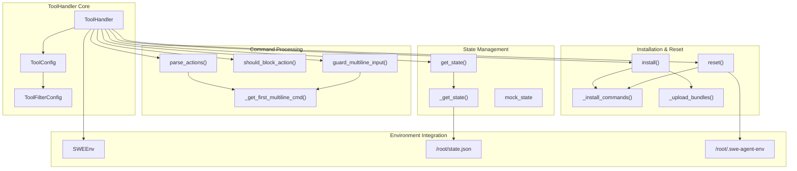
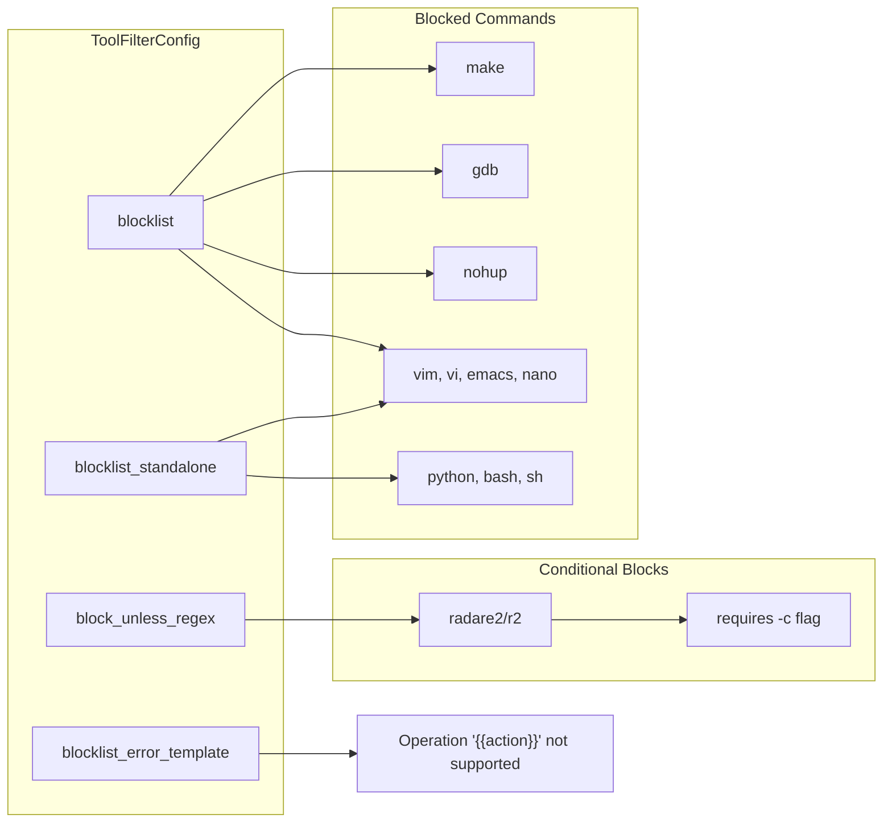
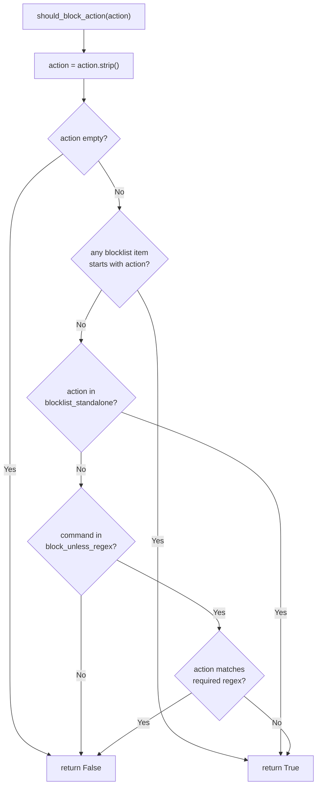
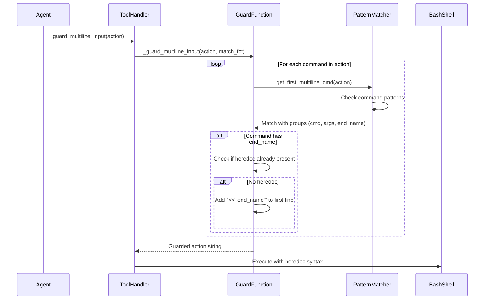
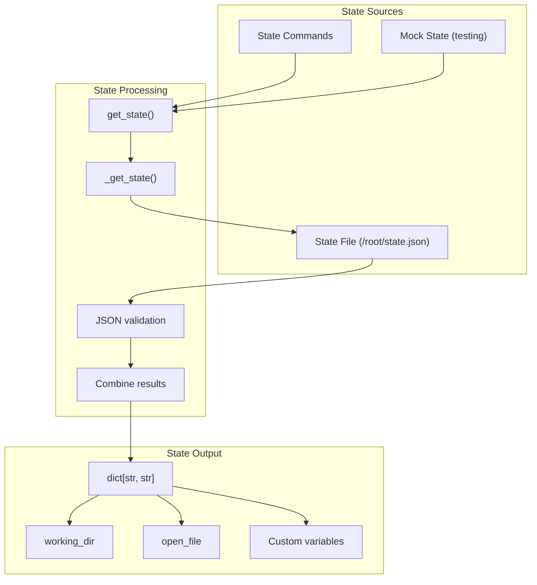
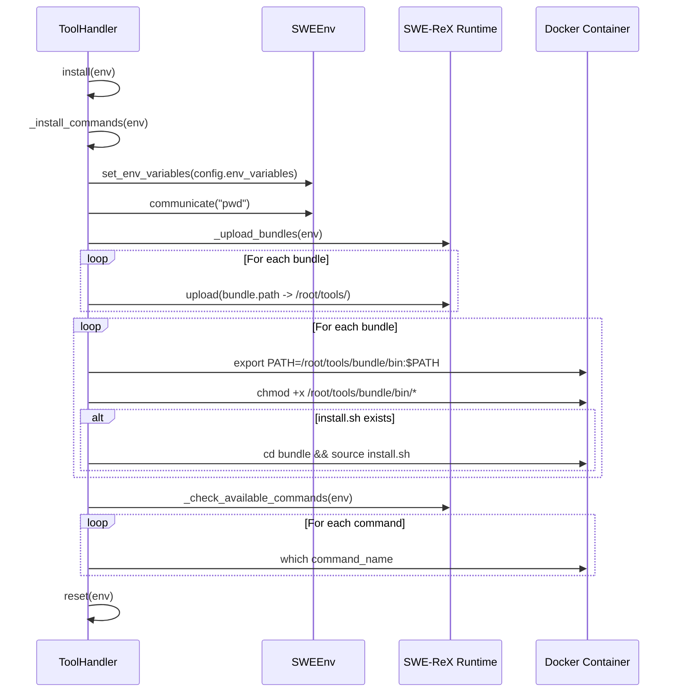
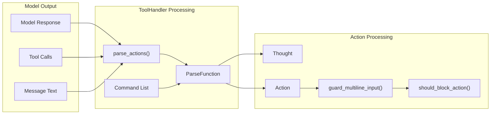

# Command Execution and Filtering

Relevant source files

The following files were used as context for generating this wiki page:

- [config/bash_only.yaml](config/bash_only.yaml)
- [docs/reference/exceptions.md](docs/reference/exceptions.md)
- [sweagent/exceptions.py](sweagent/exceptions.py)
- [sweagent/tools/commands.py](sweagent/tools/commands.py)
- [sweagent/tools/parsing.py](sweagent/tools/parsing.py)
- [sweagent/tools/tools.py](sweagent/tools/tools.py)
- [sweagent/tools/utils.py](sweagent/tools/utils.py)
- [tests/test_parsing.py](tests/test_parsing.py)
- [tests/test_tools_command_parsing.py](tests/test_tools_command_parsing.py)

This document covers how SWE-agent executes commands and filters potentially dangerous actions through the `ToolHandler` system. It explains the command execution flow, action blocking mechanisms, multiline command handling, and state management.

For information about command parsing from model outputs, see [Action Parsing](#6.2). For tool configuration and bundle management, see [Tool Configuration and Bundles](#6.1).

## Overview

The `ToolHandler` class serves as the central orchestrator for command execution in SWE-agent. It manages the complete lifecycle from action validation to execution, implementing safety mechanisms to prevent harmful commands while supporting complex multiline operations.

## ToolHandler Architecture

**ToolHandler Command Execution Architecture**

The `ToolHandler` integrates multiple subsystems to provide safe command execution with comprehensive filtering and state management capabilities.

Sources: [sweagent/tools/tools.py:227-431]()

## Command Filtering System

The filtering system prevents execution of potentially dangerous or interactive commands through multiple blocking mechanisms:

### Blocklist Configuration

**Command Filtering Mechanisms**

The system uses three types of blocklists to prevent execution of dangerous or interactive commands.

Sources: [sweagent/tools/tools.py:29-73]()

### Action Blocking Logic

The `should_block_action` method implements the filtering logic:

**Action Blocking Decision Flow**

The filtering system applies multiple checks in sequence to determine if a command should be blocked.

Sources: [sweagent/tools/tools.py:353-367]()

## Multiline Command Handling

SWE-agent supports multiline commands that span multiple lines and are terminated by specific end markers. These use bash heredoc syntax for safe transmission.

### Multiline Command Processing

**Multiline Command Processing Flow**

The system automatically adds heredoc syntax to multiline commands to ensure safe execution in bash.

Sources: [sweagent/tools/tools.py:382-409](), [sweagent/tools/utils.py:8-36]()

### Command Pattern Matching

The `_get_command_patterns` method creates regex patterns for each command:

| Command Type | Pattern | Example |
|--------------|---------|---------|
| Single-line | `^\s*(command)\s*(.*?)$` | `bash ls -la` |
| Multi-line | `^\s*(command)\s*(.*?)^(end_name)\s*$` | `edit file.py\ncontent\nEOF` |
| Submit | `^\s*(submit)\s*(.*?)^(submit_end_name)\s*$` | `submit\nsolution\nEOF` |

Sources: [sweagent/tools/tools.py:411-430]()

## State Management

The `ToolHandler` maintains environment state through JSON files and state commands from tool bundles.

### State Retrieval Process

**State Management System**

The system maintains environment state through file-based storage and command execution.

Sources: [sweagent/tools/tools.py:317-348]()

## Installation and Reset Process

The `ToolHandler` manages tool installation and environment reset through a structured process:

### Installation Flow

**Tool Installation and Setup Process**

The installation process uploads bundles, sets permissions, runs installation scripts, and verifies command availability.

Sources: [sweagent/tools/tools.py:252-312]()

### Reset Operations

The reset process initializes the environment state:

1. **Environment Variables**: Sets configured variables and propagates specified ones
2. **Registry File**: Writes `/root/.swe-agent-env` with registry variables as JSON
3. **State File**: Initializes `/root/state.json` as empty object
4. **Reset Commands**: Executes all configured reset commands

Sources: [sweagent/tools/tools.py:256-264]()

## Integration with Parsing System

The `ToolHandler` integrates with the parsing system to convert model outputs into executable actions:

**Integration with Parsing System**

The `ToolHandler` delegates parsing to configured `ParseFunction` implementations while handling multiline guarding and blocking.

Sources: [sweagent/tools/tools.py:378-380]()

## Error Handling and Timeouts

The system implements comprehensive error handling and timeout management:

### Timeout Configuration

| Timeout Type | Default | Purpose |
|--------------|---------|---------|
| `execution_timeout` | 30s | Individual command execution |
| `install_timeout` | 300s | Tool installation commands |
| `total_execution_timeout` | 1800s | Total execution time limit |
| `max_consecutive_execution_timeouts` | 3 | Consecutive timeout limit |

### Error Templates

The system uses Jinja2 templates for error messages, allowing dynamic content based on the specific error condition and blocked action.

Sources: [sweagent/tools/tools.py:139-152]()