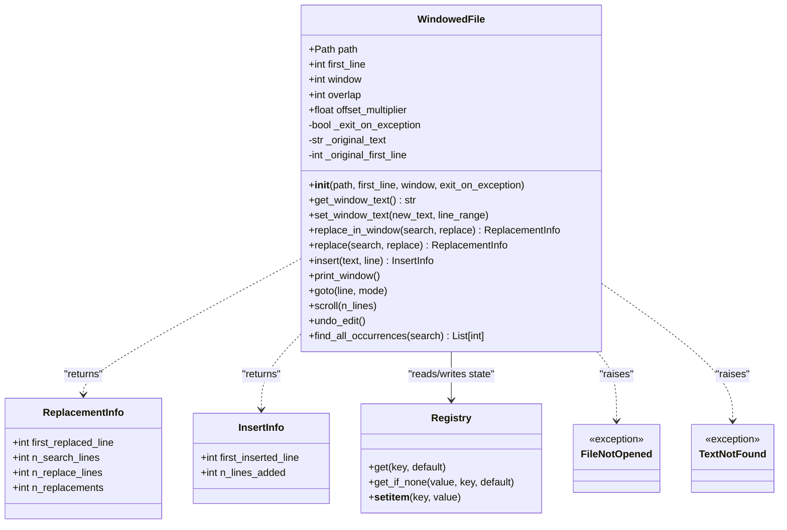
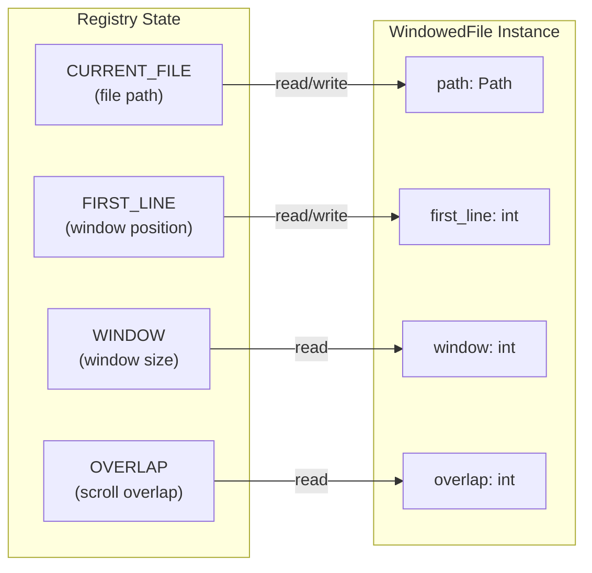
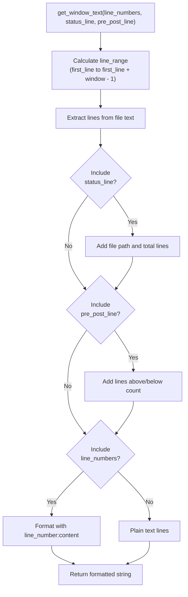
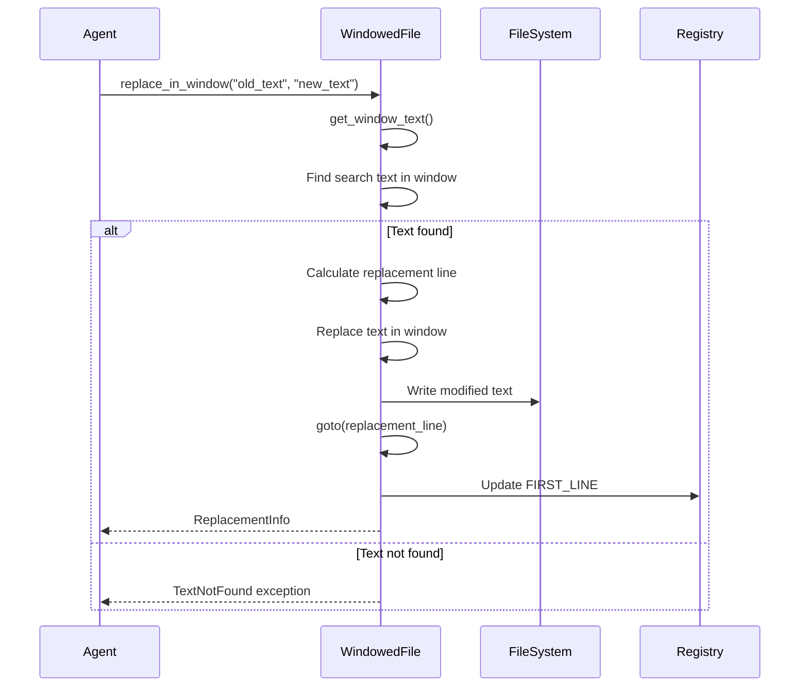
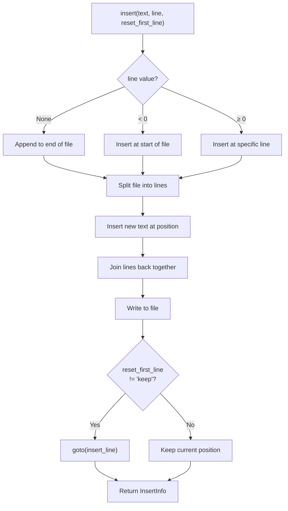
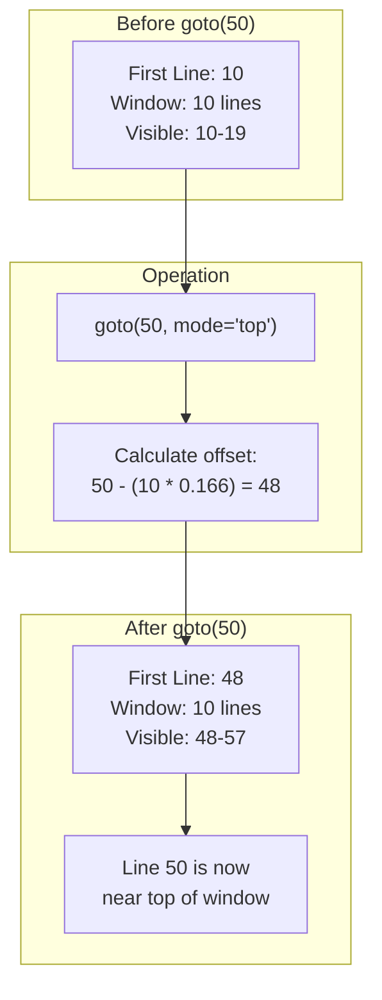
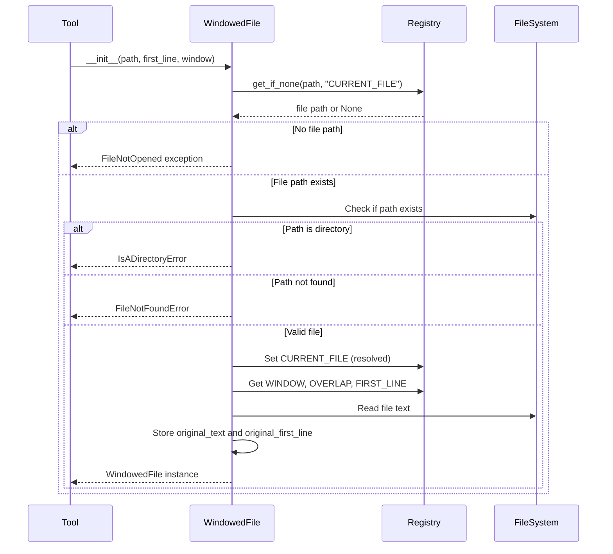

# WindowedFile System

<details>
<summary>Relevant source files</summary>

The following files were used as context for generating this wiki page:

- [tests/tools/conftest.py](tests/tools/conftest.py)
- [tests/tools/test_default_utils.py](tests/tools/test_default_utils.py)
- [tests/tools/test_edit_replace.py](tests/tools/test_edit_replace.py)
- [tools/windowed/lib/windowed_file.py](tools/windowed/lib/windowed_file.py)

</details>


The WindowedFile system provides a windowed interface for viewing and editing files, allowing agents to work with large files by displaying only a portion at a time. This system is essential for efficient file manipulation within SWE-agent's tool framework, enabling agents to navigate, search, and edit files without loading entire file contents into context.

For information about how tools are configured and loaded, see [Tool Configuration and Bundles](#6.1). For details on how tool commands are executed, see [Command Execution and Filtering](#6.3).

## Overview

The WindowedFile system implements a text editor-like interface where only a "window" of lines is visible at any given time. This approach is critical for working with large files while maintaining manageable context sizes for language models. The system tracks the current viewing position, handles text modifications, and provides navigation commands.

The core implementation is in [tools/windowed/lib/windowed_file.py]() and is used by various editing tools in the windowed tool bundle.

**Key Concepts:**

| Concept | Description |
|---------|-------------|
| Window | The visible portion of the file (e.g., 10 or 100 lines) |
| First Line | The starting line number of the current window (0-indexed) |
| Overlap | Number of lines to keep visible when scrolling |
| Offset Multiplier | Controls positioning when jumping to a line |

Sources: [tools/windowed/lib/windowed_file.py:53-115]()

## Architecture

### WindowedFile Class Structure



**WindowedFile Class Design**

The `WindowedFile` class [tools/windowed/lib/windowed_file.py:53-316]() is the central component. It manages:

- **File Access**: Reads and writes to the underlying file via `Path` operations
- **Window State**: Tracks which portion of the file is currently visible
- **State Persistence**: Synchronizes window position with the registry system
- **Edit History**: Maintains original text for undo operations

Sources: [tools/windowed/lib/windowed_file.py:53-115](), [tools/windowed/lib/windowed_file.py:36-51](), [tools/windowed/lib/windowed_file.py:18-24]()

## State Management and Registry Integration

The WindowedFile system integrates with the registry system (see [State Management](#6.3)) to persist viewing state across command invocations.

### Registry Keys



**State Synchronization Flow**

| Operation | Registry Read | Registry Write |
|-----------|--------------|----------------|
| Initialization | `CURRENT_FILE`, `FIRST_LINE`, `WINDOW`, `OVERLAP` | `CURRENT_FILE` (resolved path) |
| Window Movement | None | `FIRST_LINE` |
| File Creation | `CURRENT_FILE` | `CURRENT_FILE` (new file path) |

The registry enables stateful editing across multiple tool invocations. When an agent executes a command like `goto 50`, the `FIRST_LINE` value is updated in the registry [tools/windowed/lib/windowed_file.py:125](), and subsequent commands operate on the new window position.

Sources: [tools/windowed/lib/windowed_file.py:80-111](), [tools/windowed/lib/windowed_file.py:120-125]()

## File Viewing Operations

### Window Display

The `get_window_text()` method [tools/windowed/lib/windowed_file.py:150-175]() provides flexible text retrieval with optional formatting:



**Example Output Format**

With all options enabled, the output looks like:
```
[File: /path/to/file.py (100 lines total)]
(10 more lines above)
11:def example():
12:    pass
13:
14:if __name__ == "__main__":
15:    example()
(85 more lines below)
```

Sources: [tools/windowed/lib/windowed_file.py:150-175](), [tests/tools/test_default_utils.py:114-137]()

### Line Range Calculation

The `line_range` property [tools/windowed/lib/windowed_file.py:141-148]() calculates visible lines:

```python
# Returns (first_line, last_line) tuple
# Ensures exactly 'window' lines are shown (when possible)
line_range = (self.first_line, min(self.first_line + self.window - 1, self.n_lines - 1))
```

The `first_line` setter [tools/windowed/lib/windowed_file.py:120-125]() ensures the window stays within file bounds:

```python
# Clamps first_line to valid range
self._first_line = max(0, min(value, self.n_lines - self.window))
```

Sources: [tools/windowed/lib/windowed_file.py:116-148]()

## File Editing Operations

### Window-Based Replacement



**replace_in_window() Method**

The `replace_in_window()` method [tools/windowed/lib/windowed_file.py:190-226]() performs search-and-replace within the current visible window:

1. Retrieves current window text
2. Searches for the target string
3. Calculates the line number where replacement occurs
4. Replaces text and updates file
5. Repositions window to show the replacement
6. Returns `ReplacementInfo` with metadata

**Return Value Structure:**
```python
ReplacementInfo(
    first_replaced_line=47,      # Line where replacement started
    n_search_lines=3,            # Lines in search string
    n_replace_lines=5,           # Lines in replacement string
    n_replacements=1             # Always 1 for window operations
)
```

Sources: [tools/windowed/lib/windowed_file.py:190-226](), [tools/windowed/lib/windowed_file.py:36-44]()

### Full-File Replacement

The `replace()` method [tools/windowed/lib/windowed_file.py:240-259]() searches and replaces across the entire file:

```python
# Replaces ALL occurrences in the file
info = wf.replace("old_text", "new_text")
# Returns number of replacements made
print(info.n_replacements)  # Could be > 1
```

**Difference from replace_in_window():**

| Method | Scope | Replacements | Use Case |
|--------|-------|--------------|----------|
| `replace_in_window()` | Current window only | First occurrence | Targeted edit in visible area |
| `replace()` | Entire file | All occurrences | Global find-and-replace |

Sources: [tools/windowed/lib/windowed_file.py:240-259](), [tools/windowed/lib/windowed_file.py:228-238]()

### Text Insertion



The `insert()` method [tools/windowed/lib/windowed_file.py:280-315]() handles three insertion modes:

1. **Append mode** (`line=None`): Adds text to end of file
2. **Prepend mode** (`line < 0`): Adds text to start of file  
3. **Insert mode** (`line ≥ 0`): Inserts at specified line number

Sources: [tools/windowed/lib/windowed_file.py:280-315](), [tools/windowed/lib/windowed_file.py:47-50]()

## Navigation and Window Movement

### goto() Operation



The `goto()` method [tools/windowed/lib/windowed_file.py:264-268]() positions the window so the target line appears near the top:

```python
# Default offset_multiplier is 1/6
# So target line appears at position: window_size / 6 from top
def goto(self, line: int, mode: str = "top"):
    if mode == "top":
        self.first_line = line - self.window * self.offset_multiplier
```

**Offset Multiplier Usage:**

The `offset_multiplier` [tools/windowed/lib/windowed_file.py:112]() controls how close to the top the target line appears:
- Default: `1/6` (target line at 1/6th position in window)
- Tests use: `1/4` for easier verification [tests/tools/test_default_utils.py:32]()

Sources: [tools/windowed/lib/windowed_file.py:264-268](), [tests/tools/test_default_utils.py:66-77]()

### scroll() Operation

The `scroll()` method [tools/windowed/lib/windowed_file.py:270-274]() moves the window by a specified number of lines:

```python
def scroll(self, n_lines: int):
    if n_lines > 0:
        # Scroll down: move forward minus overlap
        self.first_line += n_lines - self.overlap
    elif n_lines < 0:
        # Scroll up: move backward plus overlap
        self.first_line += n_lines + self.overlap
```

**Overlap Behavior:**

| Overlap Value | Scroll Down by 10 | Scroll Up by 10 |
|---------------|-------------------|-----------------|
| 0 (default) | `first_line += 10` | `first_line -= 10` |
| 2 | `first_line += 8` | `first_line -= 8` |

The overlap ensures some context is preserved when scrolling, similar to the `scroll` option in vim or less.

Sources: [tools/windowed/lib/windowed_file.py:270-274](), [tests/tools/test_default_utils.py:79-92]()

## Initialization and File Handling

### Initialization Flow



**Parameter Resolution:**

The constructor [tools/windowed/lib/windowed_file.py:54-115]() uses `registry.get_if_none()` to resolve parameters:

```python
# If parameter is None, get from registry; if registry missing, use default
self.window = int(registry.get_if_none(window, "WINDOW"))
self.first_line = int(registry.get_if_none(first_line, "FIRST_LINE", 0))
```

This allows tools to omit parameters and rely on persistent registry state.

Sources: [tools/windowed/lib/windowed_file.py:54-115]()

### Exception Handling

The `exit_on_exception` parameter [tools/windowed/lib/windowed_file.py:60]() controls error behavior:

| Value | Behavior on Error |
|-------|-------------------|
| `True` (default) | Print error message and call `exit(1)` |
| `False` | Raise Python exception |

**Test Mode Usage:**

Tests set `exit_on_exception=False` [tests/tools/test_default_utils.py:31]() to catch exceptions:

```python
wf = WindowedFile(exit_on_exception=False)
with pytest.raises(TextNotFound):
    wf.replace_in_window("nonexistent", "replacement")
```

Sources: [tools/windowed/lib/windowed_file.py:60-98](), [tests/tools/test_default_utils.py:62-64]()

## Undo Functionality

The `undo_edit()` method [tools/windowed/lib/windowed_file.py:276-278]() reverts to the original file state:

```python
def undo_edit(self):
    self.text = self._original_text
    self.first_line = self._original_first_line
```

The original state is captured during initialization:
- `_original_text`: File contents when `WindowedFile` was created [tools/windowed/lib/windowed_file.py:113]()
- `_original_first_line`: Window position when created [tools/windowed/lib/windowed_file.py:114]()

This provides a single-level undo capability for the agent to revert mistaken edits.

Sources: [tools/windowed/lib/windowed_file.py:276-278](), [tools/windowed/lib/windowed_file.py:113-114]()

## Usage in Tool Commands

The WindowedFile class is used by various command-line tools in the windowed bundle. Common pattern:

```python
#!/usr/bin/env python3
from windowed_file import WindowedFile

# Tool script creates WindowedFile instance
wf = WindowedFile()  # Uses registry state

# Perform operations
wf.goto(50)
wf.print_window()

# Changes automatically persist to registry
```

The tools that use this system include:
- `goto`: Navigate to a line
- `scroll_down`/`scroll_up`: Move window
- `edit`: Make replacements
- `str_replace`: Search and replace
- `insert`: Add new lines

These are defined in the windowed tool bundle configuration (see [Tool Configuration and Bundles](#6.1)).

Sources: [tools/windowed/lib/windowed_file.py:1-16]()